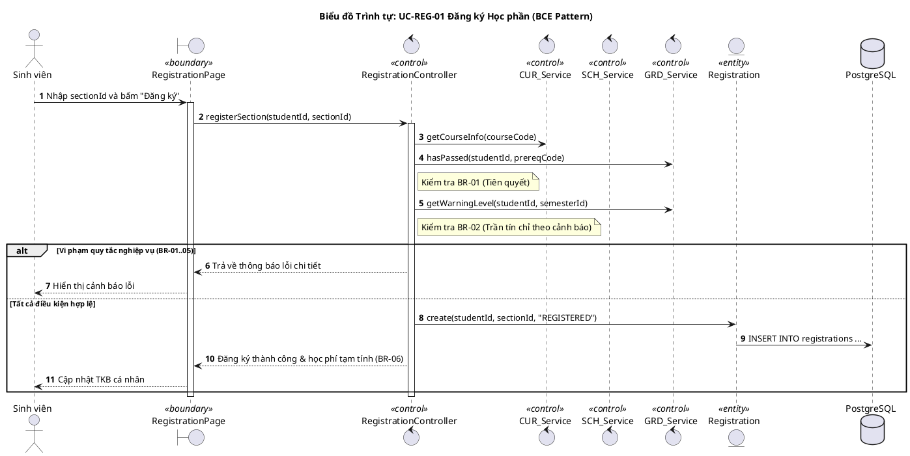
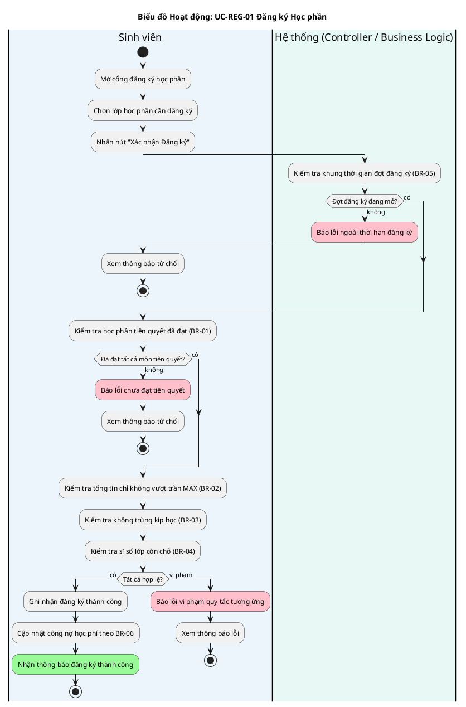
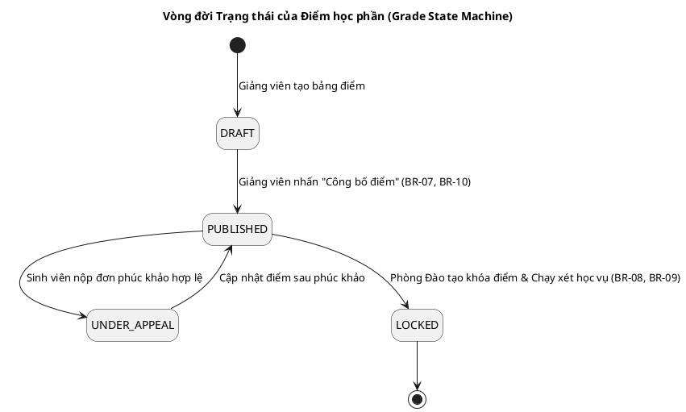

# PlantUML Expert Skill for IT3120 (System Analysis & Design)

Skill này cung cấp các tiêu chuẩn, khuôn mẫu và chỉ dẫn kỹ thuật để tạo các biểu đồ PlantUML chất lượng học thuật cao cho đồ án **IT3120 - Hệ thống Quản lý Đào tạo Đại học**.

---

## 1. Nguyên tắc Tạo Biểu đồ Chuẩn Học thuật

1. **Giao diện & Màu sắc (Styling):**
   * Luôn sử dụng skinparam hiện đại, rõ ràng, tương phản tốt khi in ấn hoặc chèn vào tài liệu DOCX/PDF:
     ```plantuml
     skinparam handwritten false
     skinparam shadowing false
     skinparam defaultFontName "Arial"
     skinparam defaultFontSize 12
     skinparam roundcorner 8
     ```
2. **Ngôn ngữ:**
   * Tiêu đề biểu đồ (`title`), chú thích (`note`) và thông báo nghiệp vụ: **Tiếng Việt có dấu**.
   * Tên class, method, attribute: **Tiếng Anh** theo chuẩn `PascalCase` và `camelCase`.
3. **Phân rã Thư mục Lưu trữ:**
   * `diagrams/00-overall/`: Domain Model, Use Case tổng quan, Package diagram.
   * `diagrams/01-cur/`: Sơ đồ thuộc phân hệ CUR (`UC-CUR-01`).
   * `diagrams/02-sch/`: Sơ đồ thuộc phân hệ SCH (`UC-SCH-01`).
   * `diagrams/03-reg/`: Sơ đồ thuộc phân hệ REG (`UC-REG-01`).
   * `diagrams/04-grd/`: Sơ đồ thuộc phân hệ GRD (`UC-GRD-01`).

---

## 2. Khuôn mẫu Các Loại Biểu đồ Cốt lõi

### Mẫu 1: Biểu đồ Trình tự Phân tích theo Mẫu BCE (BCE Sequence Diagram)
* **Quy chuẩn:** Phải có Actor, Boundary (`boundary`), Control (`control`), Entity (`entity`) và Database (`database`).
* **Gọi chéo liên module:** Bắt buộc dùng đúng 6 chữ ký hàm trong `docs/interfaces-matrix.md`.



### Mẫu 2: Biểu đồ Hoạt động Phân làn (Activity Diagram with Swimlanes)
* Thể hiện rõ các làn hoạt động (Actor, Controller/Service, External/Database).
* Làm nổi bật các điểm rẽ nhánh quyết định (Diamond) kiểm tra BR.



### Mẫu 3: Biểu đồ Máy Trạng thái (State Machine Diagram)
* Dùng cho vòng đời thực thể: `ClassSection`, `Registration`, `Invoice`, `Grade`.



---

## 3. Quy trình Kiểm thử & Kết xuất Ảnh Biểu đồ

Sau khi tạo hoặc chỉnh sửa file `.puml`, Agent hoặc người dùng có thể kết xuất ngay sang PNG bằng PowerShell:

```powershell
# Chạy script render cục bộ nếu có plantuml.jar
./scripts/render.ps1

# Hoặc kiểm tra cú pháp nhanh qua công cụ dòng lệnh nếu máy có Java:
java -jar ./scripts/plantuml.jar -syntax diagrams/00-overall/domain-model.puml
```

Toàn bộ ảnh sẽ được đưa vào thư mục `renders/` với cấu trúc thư mục con tương ứng, sẵn sàng để chèn vào báo cáo.
