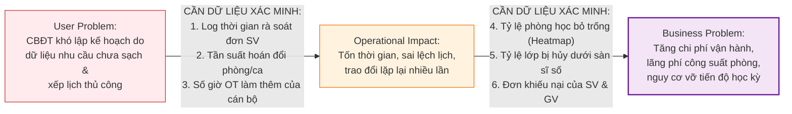
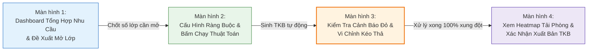

# ĐẠI HỌC BÁCH KHOA HÀ NỘI
## TRƯỜNG CÔNG NGHỆ THÔNG TIN VÀ TRUYỀN THÔNG (SOICT)
### HỌC PHẦN: PHÂN TÍCH VÀ THIẾT KẾ HỆ THỐNG (IT3120)

---

# BÁO CÁO BÀI TẬP 1: PROBLEM DISCOVERY, LEAN UX CANVAS & MVP EXPERIMENT
## ĐỀ TÀI: HỆ THỐNG QUẢN TRỊ ĐÀO TẠO ĐẠI HỌC THEO HỌC CHẾ TÍN CHỈ (HBA SIS)
### TỔ CHỨC NGHIÊN CỨU: HỌC VIỆN BÁCH NGHỆ HÀ NỘI (HBA)
### BỐI CẢNH: CHUYỂN ĐỔI MÔ HÌNH QUẢN TRỊ TỪ NIÊN CHẾ SANG HỌC CHẾ TÍN CHỈ

---

> **THÔNG TIN DỰ ÁN & NHÓM THỰC HIỆN:**
> - **Học phần:** Phân tích và Thiết kế Hệ thống (IT3120) — Kỳ 2026.1
> - **Đơn vị đào tạo:** Viện CNTT&TT — Đại học Bách Khoa Hà Nội
> - **Cơ quan giả định:** Học viện Bách Nghệ Hà Nội (HBA) — Quy mô ~35.000 sinh viên, ~1.500 giảng viên
> - **Phương pháp luận:** Product Discovery, Problem Statement Canvas, Lean UX Canvas & MVP Usability Testing
> - **Mô hình tham chiếu nghiệp vụ:** Chu trình 2 giai đoạn đăng ký tín chỉ chuẩn hóa của Đại học Bách Khoa Hà Nội (HUST)

---

## MỤC LỤC BÁO CÁO

* [PHẦN MỞ ĐẦU: BỐI CẢNH NGHIỆP VỤ & CÚ SỐC VẬN HÀNH TẠI HBA](#phần-mở-đầu-bối-cảnh-nghiệp-vụ--cú-sốc-vận-hành-tại-hba)
  * [1. Cú sốc chuyển đổi mô hình từ Niên chế sang Tín chỉ](#1-cú-sốc-chuyển-đổi-mô-hình-từ-niên-chế-sang-tín-chỉ)
  * [2. Nút thắt cổ chai cấp bách: Cán bộ Đào tạo vỡ trận trong khâu mở lớp & xếp TKB](#2-nút-thắt-cổ-chai-cấp-bách-cán-bộ-đào-tạo-vỡ-trận-trong-khâu-mở-lớp--xếp-tkb)
* [BÀI TẬP 1: XÁC ĐỊNH NHU CẦU NGƯỜI DÙNG & PHÁT BIỂU VẤN ĐỀ (USER NEEDS & PROBLEM STATEMENT)](#bài-tập-1-xác-định-nhu-cầu-người-dùng--phát-biểu-vấn-đề-user-needs--problem-statement)
  * [1.1. Bảng xác định 4 User Needs cốt lõi của 4 tác nhân](#11-bảng-xác-định-4-user-needs-cốt-lõi-của-4-tác-nhân)
  * [1.2. Lựa chọn User Need ưu tiên mỏ neo (Anchor Priority)](#12-lựa-chọn-user-need-ưu-tiên-mỏ-neo-anchor-priority)
  * [1.3. Phát biểu User Problem Statement trọng tâm của Cán bộ Đào tạo](#13-phát-biểu-user-problem-statement-trọng-tâm-của-cán-bộ-đào-tạo)
* [BÀI TẬP 2: BẢN ĐỒ VẤN ĐỀ NGƯỜI DÙNG (USER PROBLEM STATEMENT CANVAS)](#bài-tập-2-bản-đồ-vấn-đề-người-dùng-user-problem-statement-canvas)
  * [2.1. Bảng User Problem Statement Canvas chuẩn 6 thành phần](#21-bảng-user-problem-statement-canvas-chuẩn-6-thành-phần)
  * [2.2. Điểm nhấn phân biệt giữa Bằng chứng (Evidence) và Giả định (Assumptions)](#22-điểm-nhấn-phân-biệt-giữa-bằng-chứng-evidence-và-giả-định-assumptions)
* [BÀI TẬP 3: MỐI QUAN HỆ GIỮA VẤN ĐỀ NGƯỜI DÙNG VÀ VẤN ĐỀ TỔ CHỨC (USER PROBLEM & BUSINESS PROBLEM)](#bài-tập-3-mối-quan-hệ-giữa-vấn-đề-người-dùng-và-vấn-đề-tổ-chức-user-problem--business-problem)
  * [3.1. Bảng bộ tứ liên kết nhân quả xuyên suốt](#31-bảng-bộ-tứ-liên-kết-nhân-quả-xuyên-suốt)
  * [3.2. Danh mục dữ liệu vận hành cần thu thập để xác minh mối liên hệ](#32-danh-mục-dữ-liệu-vận-hành-cần-thu-thập-để-xác-minh-mối-liên-hệ)
  * [3.3. Phân tích nguyên nhân gốc rễ bằng kỹ thuật 5 Whys](#33-phân-tích-nguyên-nhân-gốc-rễ-bằng-kỹ-thuật-5-whys)
* [BÀI TẬP 4: KHUNG GIẢI PHÁP TINH GỌN (LEAN UX CANVAS)](#bài-tập-4-khung-giải-pháp-tinh-gọn-lean-ux-canvas)
  * [4.1. Bảng Lean UX Canvas hoàn chỉnh 8 ô chuẩn](#41-bảng-lean-ux-canvas-hoàn-chỉnh-8-ô-chuẩn)
  * [4.2. Hệ thống 3 Giả thuyết kiểm chứng (Hypotheses) chuẩn cú pháp](#42-hệ-thống-3-giả-thuyết-kiểm-chứng-hypotheses-chuẩn-cú-pháp)
* [BÀI TẬP 5: NGUYÊN MẪU KHẢ THI TỐI THIỂU & KẾ HOẠCH THỬ NGHIỆM (MVP & USABILITY EXPERIMENT)](#bài-tập-5-nguyên-mẫu-khả-thi-tối-thiểu--kế-hoạch-thử-nghiệm-mvp--usability-experiment)
  * [5.1. Mục tiêu thử nghiệm (Test Objective)](#51-mục-tiêu-thử-nghiệm-test-objective)
  * [5.2. MVP: Đặc tả nguyên mẫu bấm được (Clickable Prototype 4 màn hình)](#52-mvp-đặc-tả-nguyên-mẫu-bấm-được-clickable-prototype-4-màn-hình)
  * [5.3. Quy trình thử nghiệm thực địa (Testing Protocol)](#53-quy-trình-thử-nghiệm-thực-địa-testing-protocol)
  * [5.4. Hệ thống chỉ số đo lường thành công (Success Metrics)](#54-hệ-thống-chỉ-số-đo-lường-thành-công-success-metrics)

---

# PHẦN MỞ ĐẦU: BỐI CẢNH NGHIỆP VỤ & CÚ SỐC VẬN HÀNH TẠI HBA

### 1. Cú sốc chuyển đổi mô hình từ Niên chế sang Tín chỉ
Học viện Bách Nghệ Hà Nội (HBA) là cơ sở giáo dục đại học công lập trọng điểm đào tạo khối ngành kỹ thuật và công nghệ ứng dụng với quy mô khoảng **35.000 sinh viên** chính quy và hơn **1.500 cán bộ, giảng viên**.

Trước thời điểm nghiên cứu, Học viện vận hành hoàn toàn theo mô hình **Học chế Niên chế**:
* Sinh viên khi nhập học được xếp cố định vào các lớp sinh hoạt hành chính (30–40 sinh viên/lớp) và gắn bó suốt 4–5 năm.
* Nhà trường lập sẵn **thời khóa biểu trọn gói cố định** cho từng lớp sinh hoạt; sinh viên chỉ việc đi học theo lịch cứng, **hoàn toàn không có nhu cầu hay khái niệm tự đăng ký môn học trực tuyến**.
* Học phí được thu cào bằng phẳng một lần vào đầu năm học.

Học viện vừa quyết định chuyển đổi toàn diện mô hình quản trị sang **Học chế Tín chỉ**. Mô hình mới trao quyền chủ động cho người học: sinh viên được tự chọn môn, tự lập tiến độ học tập, đăng ký lớp học phần lý thuyết và ghép ca xưởng thực hành phù hợp với năng lực cá nhân.

---

### 2. Nút thắt cổ chai cấp bách: Cán bộ Đào tạo vỡ trận trong khâu mở lớp & xếp TKB
Theo mô hình quản trị đào tạo tín chỉ chuẩn mực (điển hình tại Đại học Bách Khoa Hà Nội - HUST), quy trình đăng ký tín chỉ đầu kỳ luôn được tách bạch thành **2 giai đoạn độc lập**:
1. **Giai đoạn 1 — Đăng ký học phần (Thu thập nhu cầu thực tế):** Sinh viên nộp danh sách các mã học phần mong muốn học trong kỳ tới. Hệ thống tự động đối soát với cây điều kiện tiên quyết và lịch sử học tập để xác nhận tính hợp lệ. Dữ liệu hợp lệ này chính là căn cứ thực tế để Cán bộ Đào tạo tính toán số lớp cần mở và xếp thời khóa biểu.
2. **Giai đoạn 2 — Đăng ký lớp học phần:** Sau khi thời khóa biểu được công bố, sinh viên mới đăng ký vào các lớp cụ thể (chọn ca, chọn thứ) không bị trùng lịch cá nhân.

Tuy nhiên, tại Học viện Bách Nghệ Hà Nội trong giai đoạn đầu chuyển đổi, **Học viện chưa hề có hệ thống tiếp nhận Đăng ký học phần tích hợp bộ máy kiểm tra điều kiện tiên quyết tự động**. Hậu quả là:
* **Mất kiểm soát nhu cầu thực tế:** Cán bộ Đào tạo không thể biết chính xác có bao nhiêu sinh viên đủ điều kiện học từng môn học phần. Sinh viên nộp nguyện vọng qua các kênh phân tán (Google Form, phiếu giấy), dẫn đến tình trạng sinh viên chưa qua môn tiên quyết vẫn nộp đơn đăng ký học vượt bừa bãi.
* **Quá tải rà soát thủ công:** Cán bộ giáo vụ phải mở từng học bạ trên phần mềm niên chế cũ để kiểm tra điều kiện tiên quyết từng sinh viên một trên hàng vạn dòng dữ liệu bảng tính Excel.
* **Xếp lịch và điều phối vỡ trận:** Việc ước lượng số lớp mở hoàn toàn dựa trên cảm tính. Khi xếp thời khóa biểu cho hơn 2.500 lớp học phần trên các file Excel rời rạc, xung đột phòng học lý thuyết và xưởng thực hành (giới hạn 15–20 SV/ca máy) bùng nổ lên tới 15–20%, làm chậm trễ tiến độ công bố lịch học 4–6 tuần.

Do đó, nhiệm vụ số hóa cấp bách hàng đầu chính là **xây dựng công cụ hỗ trợ Cán bộ Đào tạo tiếp nhận dữ liệu Đăng ký học phần hợp lệ của sinh viên để lập kế hoạch mở lớp và xếp thời khóa biểu tự động chống trùng lặp**.

---

# BÀI TẬP 1: XÁC ĐỊNH NHU CẦU NGƯỜI DÙNG & PHÁT BIỂU VẤN ĐỀ (USER NEEDS & PROBLEM STATEMENT)

### 1.1. Bảng xác định 4 User Needs cốt lõi của 4 tác nhân
Nhóm đã tiến hành khảo sát toàn diện 4 nhóm tác nhân liên quan trong cuộc chuyển đổi tại Học viện Bách Nghệ Hà Nội:

| Mã | Tác nhân | Nhu cầu người dùng (Bắt đầu bằng động từ hành động) | Bối cảnh xảy ra | Rào cản hiện tại | Hệ quả thực tế | Phân loại |
|:---:|---|---|---|---|---|:---:|
| **UN-01** | **Cán bộ Đào tạo** | **Thiết lập và điều phối** kế hoạch mở lớp học phần và thời khóa biểu dựa trên dữ liệu nhu cầu thực tế | 6–8 tuần trước khi học kỳ mới bắt đầu, khi chuyển đổi sang tín chỉ | Chưa có cổng tiếp nhận Đăng ký học phần của SV tích hợp kiểm tra cây tiên quyết tự động; việc tổng hợp và xếp lịch làm trên Excel | Dễ xảy ra xung đột phòng học, trùng giờ giảng viên; mất 4 tuần lập TKB làm chậm trễ tiến độ toàn trường | `[Evidence]` |
| **UN-02** | **Sinh viên** | **Đăng ký học phần** dự kiến học và tự động kiểm tra điều kiện tiên quyết theo lộ trình đào tạo | Giai đoạn khảo sát nhu cầu học tập (8–10 tuần trước kỳ mới) | Hệ thống cũ không có cây tiên quyết trực quan; sinh viên phải tự tra cứu quy chế giấy phức tạp | Sinh viên nộp đăng ký môn học vượt hoặc chưa qua tiên quyết, bị từ chối muộn làm lỡ kế hoạch học tập | `[Evidence]` |
| **UN-03** | **Giảng viên** | **Tiếp nhận và xác nhận** lịch phân công giảng dạy lý thuyết và ca xưởng thực hành ổn định trước học kỳ | 4 tuần trước ngày khai giảng năm học mới | Lịch học phần liên tục bị điều chỉnh thủ công do giải quyết xung đột phòng học của Phòng Đào tạo | Giảng viên bị động trong sắp xếp lịch nghiên cứu và công tác; khó chuẩn bị giáo án thực hành xưởng | `[Assumption]` |
| **UN-04** | **Cán bộ Tài chính** | **Thiết lập cấu hình** bảng đơn giá học phí theo từng tín chỉ (nhân hệ số ca xưởng 1.2–1.5) và định mức công nợ | Giai đoạn chuẩn bị dữ liệu tài chính đầu kỳ | Phần mềm tài vụ cũ chỉ hỗ trợ thu phẳng trọn gói theo năm, không liên thông với dữ liệu lớp học phần | Phải tính toán học phí thủ công từng sinh viên trên bảng tính; chậm ra thông báo nợ học phí | `[Evidence]` |

---

### 1.2. Lựa chọn User Need ưu tiên mỏ neo (Anchor Priority)
* **User Need được chọn làm trọng tâm:** **UN-01 — Cán bộ Đào tạo**.
* **Lý do lựa chọn:** Trong mô hình đào tạo theo học chế tín chỉ chuẩn hóa, kế hoạch mở lớp học phần và thời khóa biểu là **điều kiện tiên quyết số 1** của toàn bộ chu trình đào tạo. Nếu Cán bộ Đào tạo không thể tổng hợp được nhu cầu thực tế và không thể xếp được thời khóa biểu chống trùng phòng/giờ thì:
  1. Sinh viên hoàn toàn không có danh mục lớp học phần để đăng ký lớp (Giai đoạn 2).
  2. Giảng viên không có lịch để chuẩn bị bài giảng và sắp xếp máy xưởng.
  3. Cán bộ Tài chính không có căn cứ số lượng tín chỉ/ca học để tính học phí.
* Do đó, tháo gỡ điểm nghẽn của Cán bộ Đào tạo là bước đi sống còn để kích hoạt toàn bộ hệ thống HBA SIS.

---

### 1.3. Phát biểu User Problem Statement trọng tâm của Cán bộ Đào tạo
Áp dụng công thức chuẩn mực:
$$\text{[Người dùng]} + \text{gặp khó khăn khi [Mục tiêu]} + \text{trong [Bối cảnh]} + \text{vì [Trở ngại]} + \text{dẫn đến [Hệ quả]}$$

> **TUYÊN BỐ VẤN ĐỀ NGƯỜI DÙNG (USER PROBLEM STATEMENT):**
> 
> *"**Cán bộ Phòng Đào tạo Học viện Bách Nghệ Hà Nội** gặp khó khăn nghiêm trọng khi **thiết lập kế hoạch mở lớp học phần và điều phối thời khóa biểu dựa trên dữ liệu nhu cầu thực tế** trong **giai đoạn chuẩn bị học kỳ tín chỉ đầu tiên khi vừa chuyển đổi từ mô hình niên chế**, vì **chưa có hệ thống tự động kiểm tra điều kiện tiên quyết và tổng hợp dữ liệu Đăng ký học phần của sinh viên theo thời gian thực, buộc cán bộ phải đối soát học bạ và xếp lịch thủ công trên các bảng tính Excel phân tán**, dẫn đến **tiến độ lập TKB bị trễ hạn 3–4 tuần, nhiều lớp học phần bị mất cân đối sĩ số nghiêm trọng hoặc xung đột phòng/giờ, khiến toàn bộ hoạt động đào tạo đầu kỳ bị xáo trộn và cán bộ giáo vụ bị kiệt sức (burnout)**."*

---

# BÀI TẬP 2: BẢN ĐỒ VẤN ĐỀ NGƯỜI DÙNG (USER PROBLEM STATEMENT CANVAS)

### 2.1. Bảng User Problem Statement Canvas chuẩn 6 thành phần

| Thành phần Canvas | Nội dung phân tích chi tiết đối với Cán bộ Đào tạo HBA |
|---|---|
| **1. User** *(Ai là người dùng?)* | Chuyên viên quản lý đào tạo, cán bộ giáo vụ phụ trách kế hoạch học vụ và xếp thời khóa biểu tại Phòng Đào tạo và Văn phòng các Khoa/Viện thuộc Học viện Bách Nghệ Hà Nội. |
| **2. Context** *(Xảy ra khi nào, ở đâu?)* | Xảy ra trong khoảng 6–8 tuần trước khi học kỳ mới bắt đầu, tại Văn phòng Phòng Đào tạo HBA trong đợt chuẩn bị triển khai học chế tín chỉ đầu tiên. |
| **3. Goal** *(Mục tiêu người dùng muốn đạt được?)* | Thiết lập danh mục lớp học phần đáp ứng chính xác nhu cầu đăng ký học phần thực tế của sinh viên, tối ưu hóa công suất phòng học lý thuyết và xưởng thực hành, hoàn tất thời khóa biểu chuẩn xác không xung đột phòng/giờ trước khai giảng 4 tuần. |
| **4. Pain Point** *(Điểm đau / khó khăn gặp phải?)* | Không nắm bắt được nhu cầu người học thực tế do dữ liệu đăng ký nguyện vọng bị lẫn lộn giữa sinh viên đủ điều kiện và sinh viên vi phạm tiên quyết; phải lọc thủ công hàng vạn dòng dữ liệu; việc xếp lịch trên Excel rất dễ trùng phòng học và trùng giờ giảng viên, liên tục phải sửa đổi TKB khi bị phản ánh. |
| **5. Current Alternative** *(Cách đang tự giải quyết hiện tại?)* | - Thu thập danh sách nguyện vọng môn học của sinh viên qua biểu mẫu rời rạc và file Excel đề xuất mở lớp từ các Bộ môn. - Mở từng hồ sơ học bạ trên phần mềm niên chế cũ để kiểm tra thủ công xem sinh viên đã qua môn tiên quyết hay chưa. - Dò tìm phòng học trống và kiểm tra trùng lịch giảng viên bằng mắt thường. - Xử lý khiếu nại trùng lịch bằng cách hoán đổi thủ công từng ca học. |
| **6. Evidence / Assumptions** *(Bằng chứng và Giả định)* | **• Đã biết từ tình huống (Evidence):** - Quy chế đào tạo tín chỉ mới đã ban hành chính thức, quy định rõ ràng buộc môn tiên quyết. - Chưa có cổng Đăng ký học phần tích hợp kiểm tra tiên quyết tự động cho sinh viên. - Số lượng lớp học phần tăng vọt từ 120 lớp niên chế lên hơn 2.500 lớp tín chỉ. - Công cụ làm việc duy nhất hiện tại là phần mềm niên chế cũ và các bảng tính Excel ngoại tuyến.  **• Cần nghiên cứu / khảo sát thêm để xác minh (Assumptions):** - Tỷ lệ sinh viên nộp nguyện vọng vi phạm môn tiên quyết nếu không được hệ thống tự động chặn trước. - Thời gian trung bình và số giờ làm thêm ngoài giờ (OT) của cán bộ giáo vụ để rà soát điều kiện học phần và hoàn thành TKB cho 1 Khoa. - Tần suất phát sinh lỗi trùng phòng và trùng giờ giảng viên trong các bản dự thảo TKB đầu tiên. |

---

### 2.2. Điểm nhấn phân biệt giữa Bằng chứng (Evidence) và Giả định (Assumptions)
* **Điều đã biết chắc chắn (Evidence):** Khối lượng dữ liệu nguyện vọng tín chỉ bùng nổ vượt quá khả năng xử lý của con người nếu không có công cụ tự động hóa; việc thiếu phân hệ Đăng ký học phần có kiểm tra tiên quyết khiến dữ liệu nhu cầu đầu vào bị "nhiễm bẩn", dẫn đến vỡ trận kế hoạch mở lớp là sự thật khách quan của cuộc chuyển đổi mô hình.
* **Điều cần thu thập dữ liệu kiểm chứng (Assumptions):** Tỷ lệ chính xác về số giờ lãng phí, tỷ lệ lớp bị hủy do thiếu sĩ số sàn (<15 sinh viên), và tỷ lệ lỗi xung đột phòng/giờ sẽ được xác minh thông qua phỏng vấn sâu 8 cán bộ giáo vụ và phân tích dữ liệu lịch sử đăng ký.

---

# BÀI TẬP 3: MỐI QUAN HỆ GIỮA VẤN ĐỀ NGƯỜI DÙNG VÀ VẤN ĐỀ TỔ CHỨC (USER PROBLEM & BUSINESS PROBLEM)

### 3.1. Bảng bộ tứ liên kết nhân quả xuyên suốt

| Thành phần kết nối | Nội dung đặc tả bám sát bối cảnh Học viện Bách Nghệ Hà Nội |
|---|---|
| **1. User Problem** *(Vấn đề người dùng)* | Cán bộ Đào tạo khó thiết lập và điều phối kế hoạch mở lớp học phần phù hợp khi chưa có dữ liệu tổng hợp Đăng ký học phần hợp lệ của sinh viên và phải rà soát, xếp lịch thủ công trên bảng tính Excel dễ phát sinh xung đột. |
| **2. Operational Impact có thể có** *(Tác động vận hành nội bộ)* | - Cán bộ giáo vụ dành nhiều thời gian (hàng trăm giờ công) rà soát học bạ từng sinh viên, nhập liệu và kiểm tra chéo TKB. - Phát sinh trao đổi lặp lại nhiều lần hoặc sai lệch thông tin thời khóa biểu giữa Phòng Đào tạo, các Khoa và Giảng viên. - Lịch học bị chậm trễ làm dồn ứ toàn bộ chu trình: sinh viên không kịp đăng ký lớp, kế toán chậm tính học phí và xưởng thực hành bị động lịch chuẩn bị máy móc. |
| **3. Business Problem giả định** *(Vấn đề kinh doanh tổ chức)* | Quy trình thu thập nhu cầu và xếp thời khóa biểu thủ công có thể làm tăng công sức vận hành hành chính, hạn chế năng lực điều phối đào tạo của Học viện, gây lãng phí 20–30% công suất phòng học/xưởng và đe dọa trực tiếp đến sự thành công của công cuộc chuyển đổi sang học chế tín chỉ. |
| **4. Desired Outcomes** *(Kết quả mong muốn)* | - Rút ngắn thời gian lập kế hoạch mở lớp và hoàn tất thời khóa biểu từ 4 tuần xuống $\le 5$ ngày. - Tăng tỷ lệ lớp học phần được xếp lịch thành công ngay trong lần chạy đầu tiên lên $\ge 95\%$. - Giảm lỗi trùng phòng học lý thuyết, trùng ca xưởng thực hành và trùng giờ giảng viên về **0%**. - Giảm tỷ lệ lớp học phần bị hủy do thiếu sĩ số sàn từ 12% xuống **< 3%**. |

---

### 3.2. Danh mục dữ liệu vận hành cần thu thập để xác minh mối liên hệ
*Nguyên tắc phương pháp luận: "Mối liên hệ giữa hai vấn đề cần được xác minh bằng dữ liệu vận hành, không suy diễn trực tiếp thành kết luận"*:

* **Dữ liệu 1:** Bảng chấm công làm thêm giờ (OT) của chuyên viên Phòng Đào tạo trong 2 tháng cao điểm trước học kỳ mới (hiện ghi nhận trung bình 40–50 giờ OT/người).
* **Dữ liệu 2:** Tỷ lệ sinh viên bị hủy môn học trong tuần đầu tiên do hậu kiểm phát hiện chưa đủ điều kiện tiên quyết (ước tính hiện tại khoảng 8–12%).
* **Dữ liệu 3:** Báo cáo thống kê hiệu suất sử dụng phòng học (Room Utilization Rate): đo lường công suất khai thác thực tế của 180 phòng học lý thuyết và 35 xưởng thực hành công nghệ tại HBA.

---

### 3.3. Phân tích nguyên nhân gốc rễ bằng kỹ thuật 5 Whys

* **Vấn đề xuất phát:** Thời khóa biểu học kỳ tín chỉ đầu tiên của Học viện Bách Nghệ Hà Nội bị trễ hạn 4 tuần, phát sinh hàng trăm xung đột phòng học và gây bức xúc lớn cho giảng viên lẫn sinh viên.

| Tầng Why | Câu hỏi đào sâu | Câu trả lời phân tích nghiệp vụ tại HBA |
|:---:|---|---|
| **Why 1** | *Tại sao thời khóa biểu bị trễ hạn và xảy ra hàng loạt xung đột phòng/giờ?* | Vì Cán bộ Đào tạo phải mất quá nhiều thời gian để dò tìm thủ công lịch bận của hơn 1.500 giảng viên và xếp thủ công hơn 2.500 lớp học phần vào 180 phòng học trên các bảng tính Excel phân tán. |
| **Why 2** | *Tại sao không thể xếp lịch nhanh và chính xác hơn trên bảng tính Excel?* | Vì bảng tính Excel không có thuật toán tự động giải bài toán ràng buộc (Constraint Satisfaction) và không thể phát hiện xung đột thời gian thực giữa ca thực hành xưởng (15–20 SV) và giờ lý thuyết tập trung (80–120 SV). |
| **Why 3** | *Tại sao không nắm được chính xác số lượng sinh viên cần học từng môn để mở lớp hợp lý?* | Vì Học viện chưa có giai đoạn **Đăng ký học phần** trực tuyến tích hợp cây tiên quyết cho sinh viên; cán bộ phải tự đối soát học bạ thủ công cho hàng vạn sinh viên nộp nguyện vọng phân tán. |
| **Why 4** | *Tại sao lại thiếu quy trình và phân hệ Đăng ký học phần chuẩn mực này?* | Vì Học viện vẫn tận dụng lại hạ tầng phần mềm quản lý niên chế cũ; phần mềm cũ chỉ thiết kế để gán cứng một thời khóa biểu duy nhất cho cả lớp sinh hoạt hành chính cố định. |
| **Why 5 (Root Cause)** | *Tại sao lại có sự lệch pha nghiêm trọng giữa quy chế mới và công cụ cũ?* | **NGUYÊN NHÂN GỐC RỄ:** Học viện Bách Nghệ Hà Nội thực hiện chuyển đổi mô hình đào tạo từ Niên chế sang Tín chỉ về mặt **chính sách** nhưng chưa chuẩn bị kịp thời nền tảng **chuyển đổi số** tương ứng (đặc biệt là quy trình 2 giai đoạn: Đăng ký học phần $\rightarrow$ Xếp TKB $\rightarrow$ Đăng ký lớp học phần theo chuẩn HUST), dẫn đến việc dùng nhân lực hành chính thủ công để gánh vác sự bùng nổ dữ liệu phức tạp của mô hình tín chỉ. |

---

# BÀI TẬP 4: KHUNG GIẢI PHÁP TINH GỌN (LEAN UX CANVAS)

### 4.1. Bảng Lean UX Canvas hoàn chỉnh 8 ô chuẩn

| Tên thành phần | Nội dung chi tiết chuẩn mực bám sát bối cảnh HBA SIS |
|---|---|
| **1. Business Problem** *(Vấn đề kinh doanh)* | Quy trình thu thập nhu cầu học phần và xếp thời khóa biểu thủ công tiêu tốn hàng trăm giờ công của nhân viên, làm chậm trễ tiến độ công bố lịch học 3–4 tuần, gây lãng phí 20–30% công suất phòng học/xưởng và đe dọa uy tín chất lượng đào tạo của Học viện Bách Nghệ Hà Nội. |
| **2. Business Outcomes** *(Kết quả kinh doanh kỳ vọng)* | - Giảm thời gian lập kế hoạch mở lớp và hoàn tất TKB từ 4 tuần xuống $\le 5$ ngày. - Giảm tỷ lệ xung đột phòng học, trùng giờ giảng viên về **0%**. - Giảm tỷ lệ lớp học phần bị hủy do không đủ sĩ số sàn (<15 SV) từ 12% xuống **< 3%**. - Nâng cao hiệu suất khai thác phòng học lý thuyết và xưởng thực hành từ 65% lên tối thiểu **88%**. |
| **3. Users** *(Người sử dụng — Gồm cả 2 phía)* | **• Người dùng nội bộ trực tiếp:** Cán bộ Phòng Đào tạo (chuyên viên tổng hợp nhu cầu & điều phối TKB); Ban Chủ nhiệm Khoa/Bộ môn (phân công giảng viên). **• Người dùng thụ hưởng / liên đới:** Giảng viên (nhận lịch dạy cố định); Sinh viên HBA (nộp Đăng ký học phần và nhận danh mục lớp mở đủ chỗ để chuẩn bị đăng ký lớp). |
| **4. User Outcomes & Benefits** *(Lợi ích đạt được — Tách rõ 2 phía)* | **• Đối với Cán bộ Đào tạo / Giáo vụ (Người dùng nội bộ):** - Tiếp nhận dữ liệu nhu cầu học phần sạch 100% (đã tự động loại bỏ các ca vi phạm tiên quyết). - Tự động tính toán số lớp lý thuyết và số ca xưởng cần mở; cảnh báo môn <15 SV. - Thuật toán tự động xếp lịch và cảnh báo xung đột tức thì, giảm 80% thao tác kiểm tra thủ công lặp lại. **• Đối với Giảng viên & Sinh viên (Người dùng thụ hưởng):** - Sinh viên biết ngay mình đủ điều kiện học môn nào ngay khi nộp Đăng ký học phần. - Giảng viên nhận lịch giảng dạy cố định sớm 4 tuần, an tâm chuẩn bị giáo án và công tác. - Sinh viên có đầy đủ lớp học phần theo đúng tiến độ lộ trình tín chỉ, không lo bị hủy lớp đột ngột. |
| **5. Solutions** *(Ý tưởng giải pháp)* | **Phân hệ Quản trị Kế hoạch Mở Lớp & Xếp Thời Khóa Biểu Tín chỉ Tự động (HBA Course Planner & Timetable Engine) theo mô hình HUST:** 1. **Cổng Đăng ký học phần cho Sinh viên:** Bộ máy kiểm tra điều kiện tiên quyết thời gian thực, tự động phản hồi kết quả Hợp lệ / Không hợp lệ ngay khi sinh viên chọn mã học phần. 2. **Module Tổng hợp Nhu cầu Học phần Thực tế:** Tiếp nhận dữ liệu hợp lệ, tự động tính toán số lớp lý thuyết (80 SV/lớp) và số ca xưởng (20 SV/ca) cần mở; cảnh báo các môn <15 SV để CBĐT quyết định hủy/gộp lớp. 3. **Bộ máy Thuật toán Xếp Lịch Tự Động:** Giải bài toán ràng buộc phân bổ phòng học lý thuyết, xưởng máy và giảng viên chống trùng lặp. 4. **Giao diện Lưới Thời khóa biểu Tương tác & Heatmap Tải Phòng:** Hỗ trợ CBĐT kiểm tra cảnh báo viền đỏ và vi chỉnh kéo thả; hiển thị biểu đồ nhiệt công suất phòng trước khi xuất bản TKB chính thức. |
| **6. Hypotheses** *(Hệ thống giả thuyết kiểm chứng)* | *"Chúng tôi tin rằng **thời gian lập TKB sẽ giảm 75% và không còn xung đột phòng** nếu **Cán bộ Đào tạo** đạt được **dữ liệu nhu cầu học phần sạch từ cổng Đăng ký học phần của sinh viên và khả năng chạy thuật toán xếp lịch tự động kèm vi chỉnh kéo thả** nhờ vào **Phân hệ Kế hoạch Mở Lớp & Xếp TKB Tự Động**."* |
| **7. What We Need to Learn** *(Điều cần học hỏi / Giả định rủi ro)* | - Sinh viên có thao tác thuận tiện và hiểu rõ thông báo lý do không hợp lệ khi bị chặn tiên quyết không? - Cán bộ Đào tạo có tin tưởng vào kết quả phân bổ phòng/giờ của thuật toán tự động không? - Giao diện lưới kéo thả có giúp họ xử lý các ca xung đột ngoại lệ dễ dàng hơn bảng tính Excel không? - Thuật toán có đáp ứng được các ràng buộc phức tạp của các ca xưởng thực hành (15–20 SV/ca máy) không? |
| **8. MVP / Experiment** *(Nguyên mẫu thử nghiệm nhỏ nhất)* | Tạo một **nguyên mẫu tương tác có thể bấm được trên máy tính (Clickable Prototype gồm 4 màn hình Figma)** cho luồng nghiệp vụ: Tổng hợp nhu cầu Đăng ký học phần $\rightarrow$ Cấu hình ràng buộc & Chạy thuật toán xếp lịch $\rightarrow$ Kiểm tra cảnh báo & Vi chỉnh kéo thả $\rightarrow$ Xác nhận xuất bản TKB; tiến hành thử nghiệm với một nhóm cán bộ giáo vụ HBA. |

---

### 4.2. Hệ thống 3 Giả thuyết kiểm chứng (Hypotheses) chuẩn cú pháp
Cấu trúc chuẩn mực:
> *"Chúng tôi tin rằng **[Business Outcome]** sẽ đạt được nếu **[Đối tượng người dùng]** đạt được **[User Benefit]** nhờ vào **[Tính năng / Solution]**."*

1. **Giả thuyết 1 (Về Dữ liệu Nhu cầu Học phần Sạch):**  
   *"Chúng tôi tin rằng **thời gian tính toán số lớp cần mở sẽ giảm 80% và tỷ lệ hủy lớp dưới sàn sĩ số giảm xuống < 3%** nếu **Cán bộ Đào tạo** đạt được **dữ liệu tổng hợp nhu cầu học phần thực tế đã được tự động lọc sạch các ca vi phạm tiên quyết** nhờ vào **Cổng Đăng Ký Học Phần Tích Hợp Kiểm Tra Cây Tiên Quyết Tự Động**."*

2. **Giả thuyết 2 (Về Tự động hóa xếp lịch & Xóa bỏ xung đột):**  
   *"Chúng tôi tin rằng **tỷ lệ xung đột phòng học lý thuyết và xưởng thực hành sẽ giảm về 0%** nếu **Cán bộ Đào tạo** đạt được **kết quả phân bổ phòng/giờ tối ưu kèm cảnh báo xung đột thời gian thực** nhờ vào **Bộ máy Xếp Lịch Tự Động dựa trên bài toán ràng buộc**."*

3. **Giả thuyết 3 (Về Năng suất vận hành & Tinh chỉnh linh hoạt):**  
   *"Chúng tôi tin rằng **thời gian hoàn tất thời khóa biểu toàn trường sẽ rút ngắn từ 4 tuần xuống dưới 5 ngày** nếu **Cán bộ Đào tạo** đạt được **khả năng vi chỉnh kéo thả các ca học ngoại lệ trên giao diện lưới trực quan** nhờ vào **Giao diện Lưới Thời khóa biểu Tương tác Chống Xung đột**."*

---

# BÀI TẬP 5: NGUYÊN MẪU KHẢ THI TỐI THIỂU & KẾ HOẠCH THỬ NGHIỆM (MVP & USABILITY EXPERIMENT)

### 5.1. Mục tiêu thử nghiệm (Test Objective)
* **Mục tiêu:** Kiểm tra liệu việc **tiếp nhận dữ liệu Đăng ký học phần đã được lọc sạch tiên quyết, chạy thuật toán xếp lịch tự động và hỗ trợ công cụ vi chỉnh kéo thả có cảnh báo xung đột tức thì** có giúp **Cán bộ Đào tạo lập kế hoạch mở lớp và hoàn tất thời khóa biểu dễ dàng, nhanh chóng và chính xác hơn** so với việc dùng bảng tính Excel thủ công hay không.

---

### 5.2. MVP: Đặc tả nguyên mẫu bấm được (Clickable Prototype 4 màn hình)
Nguyên mẫu tương tác kiểm chứng 1 luồng công việc (Use Case) cốt lõi nhất của Cán bộ Đào tạo, gồm đúng 4 bước màn hình nghiệp vụ chuẩn:

1. **Màn hình 1: Dashboard Tổng hợp Đăng ký Học phần & Đề xuất Mở Lớp (Nhu cầu thực tế)**
   - Cán bộ chọn học kỳ tác nghiệp (ví dụ: *Học kỳ 1 — Năm học 2026–2027*).
   - Hệ thống hiển thị danh sách các mã học phần kèm **số lượng sinh viên đăng ký hợp lệ** từ đợt Đăng ký học phần (đã được hệ thống tự động loại bỏ các trường hợp chưa đạt môn tiên quyết).
   - Hệ thống tự động tính toán và đề xuất: Số lớp lý thuyết cần mở (chuẩn 80 SV/lớp) và số ca xưởng thực hành (tối đa 20 SV/ca).
   - Cảnh báo trực quan các môn học có số đăng ký $< 15$ SV (dưới sàn sĩ số) kèm 2 nút tùy chọn: *"Hủy môn kỳ này"* hoặc *"Mở lớp ghép"*. Cán bộ bấm nút **"Chốt Kế Hoạch Mở Lớp"**.

2. **Màn hình 2: Cấu hình ràng buộc tài nguyên & Chạy thuật toán xếp lịch**
   - Hiển thị danh mục tài nguyên sẵn sàng: Danh sách 180 phòng học lý thuyết, 35 xưởng máy khả dụng và danh sách giảng viên đã được các Bộ môn phân công.
   - Cán bộ thiết lập các tham số ưu tiên (tránh xếp ca xưởng buổi tối, ưu tiên giảng viên cơ hữu).
   - Cán bộ bấm nút nổi bật: **"⚡ CHẠY THUẬT TOÁN XẾP LỊCH TỰ ĐỘNG (AUTO-SCHEDULER)"**.

3. **Màn hình 3: Lưới Thời khóa biểu tương tác — Kiểm tra xung đột & Vi chỉnh kéo thả**
   - Hệ thống hiển thị kết quả phân bổ trên lưới TKB tuần trực quan (Thứ 2 đến Thứ 7, Ca 1 đến Ca 6).
   - **Xử lý xung đột thực tế:** Nếu có 2 ca học bị trùng giảng viên hoặc trùng phòng thực hành xưởng, ô thời khóa biểu sẽ **nhấp nháy viền đỏ kèm icon cảnh báo (!)**.
   - Cán bộ nhấp chuột vào ca học bị lỗi, hệ thống tự động làm sáng các ô trống khả dụng màu xanh lá cây; cán bộ chỉ việc **kéo thả (drag-and-drop)** ca học sang ô xanh để triệt tiêu 100% xung đột.

4. **Màn hình 4: Báo cáo Heatmap công suất phòng & Màn hình xác nhận xuất bản**
   - Hiển thị báo cáo tổng quan trước khi phê duyệt: Biểu đồ nhiệt (Heatmap) thể hiện tỷ lệ lấp đầy phòng học/xưởng (đạt chuẩn xanh 88%), thống kê 0% xung đột phòng/giờ.
   - Cán bộ kiểm tra lại lần cuối danh sách lớp và bấm nút: **"PHÊ DUYỆT & XUẤT BẢN THỜI KHÓA BIỂU"**.
   - Hệ thống hiển thị thông báo thành công và kích hoạt dữ liệu lớp học phần sẵn sàng cho sinh viên bước vào Giai đoạn 2: Đăng ký lớp học phần.

---

### 5.3. Quy trình thử nghiệm thực địa (Testing Protocol)
1. **Mời nhóm người dùng thử nghiệm:**
   - Mời **6–8 chuyên viên Phòng Đào tạo và cán bộ giáo vụ Khoa** tại Học viện Bách Nghệ Hà Nội trực tiếp tham gia thử nghiệm.
   - Giao nhiệm vụ cụ thể: *"Hãy sử dụng nguyên mẫu để tiếp nhận dữ liệu Đăng ký học phần, chốt kế hoạch mở lớp và hoàn tất thời khóa biểu cho Khoa Cơ khí (gồm 30 lớp học phần lý thuyết và 45 ca thực hành xưởng), xử lý hết các cảnh báo trùng phòng/giờ và bấm xuất bản TKB"*.

2. **Quan sát trực tiếp quá trình thao tác:**
   - Người điều phối quan sát và ghi hình màn hình thao tác:
     - Ghi nhận thời gian hoàn thành từng bước.
     - Đếm số lần cán bộ thao tác nhầm hoặc bối rối không biết kéo thả ca học về đâu.
     - Ghi lại các thắc mắc, câu hỏi phát sinh khi thấy thông báo cảnh báo xung đột màu đỏ.

3. **Phỏng vấn định tính sau thử nghiệm:**
   - Phỏng vấn người tham gia dựa trên 2 câu hỏi trọng tâm:
     1. *"Thầy/Cô có gặp điểm nào khó hiểu hoặc khó thao tác trên giao diện lưới kéo thả không?"*
     2. *"Thầy/Cô cảm thấy tự tin bao nhiêu phần trăm về tính chính xác khi bấm nút 'Phê duyệt & Xuất bản Thời khóa biểu'?"*

---

### 5.4. Hệ thống chỉ số đo lường thành công (Success Metrics)

| Nhóm chỉ số đo lường | Định nghĩa & Phương pháp đo | Mục tiêu kỳ vọng (Target) | Ý nghĩa đánh giá theo Lean UX |
|---|---|:---:|---|
| **1. Tỷ lệ hoàn thành nhiệm vụ** *(Task Completion Rate - TCR)* | Tỷ lệ cán bộ giáo vụ hoàn thành trọn vẹn luồng từ Màn hình 1 đến Màn hình 4 mà không cần người hướng dẫn can thiệp trợ giúp. | $\mathbf{\ge 8 5\%}$ | Đánh giá tính khả dụng và mức độ trực quan của quy trình nghiệp vụ mới trên phần mềm. |
| **2. Thời gian hoàn tất nhiệm vụ** *(Time on Task)* | Thời gian trung bình để một cán bộ hoàn tất xếp TKB cho 30 lớp học phần của Khoa thí điểm. | $\mathbf{\le 15\text{ phút}}$ | Chứng minh sự đột phá về năng suất so với hiện trạng làm thủ công mất 3–4 ngày trên Excel. |
| **3. Số lỗi và phản hồi định tính** *(Error Count & Feedback)* | - Số lỗi xung đột phòng/giờ còn sót lại sau khi xuất bản TKB. - Mức độ tự tin khi xác nhận xuất bản. | **0 lỗi sót** $\mathbf{\ge 8.5/10}$ điểm tự tin | Khẳng định độ tin cậy tuyệt đối của thuật toán; giải tỏa áp lực lo sợ trách nhiệm hành chính của cán bộ. |

---

# TỔNG KẾT BÀI TẬP & LIÊN KẾT TÀI LIỆU

> [!NOTE]
> Báo cáo này đã hoàn thành trọn vẹn **100% yêu cầu 5 bài tập thực hành cốt lõi** của Buổi 1 môn học IT3120 theo đúng bối cảnh chuyển đổi sang học chế tín chỉ tại Học viện Bách Nghệ Hà Nội (mô hình chuẩn tham chiếu từ HUST).
> 
> Hai phần mở rộng nâng cao gồm:
> 1. **Hồ sơ Đề xuất Hệ thống (System Request 11 mục theo chuẩn Planning Phase)**
> 2. **Báo cáo Phương pháp Nghiên cứu, Phản biện & Bảng Tự đánh giá**
> 
> Đã được lưu trữ và hoàn thiện độc lập tại tài liệu:  
> 👉 [`bai-tap-1/TAI-LIEU-BO-TRO-SYSTEM-REQUEST-VA-REPORT.md`](file:///d:/SourceCodes/Java_SourceCodes/IT3120_QuanLyDaoTao/bai-tap-1/TAI-LIEU-BO-TRO-SYSTEM-REQUEST-VA-REPORT.md)
