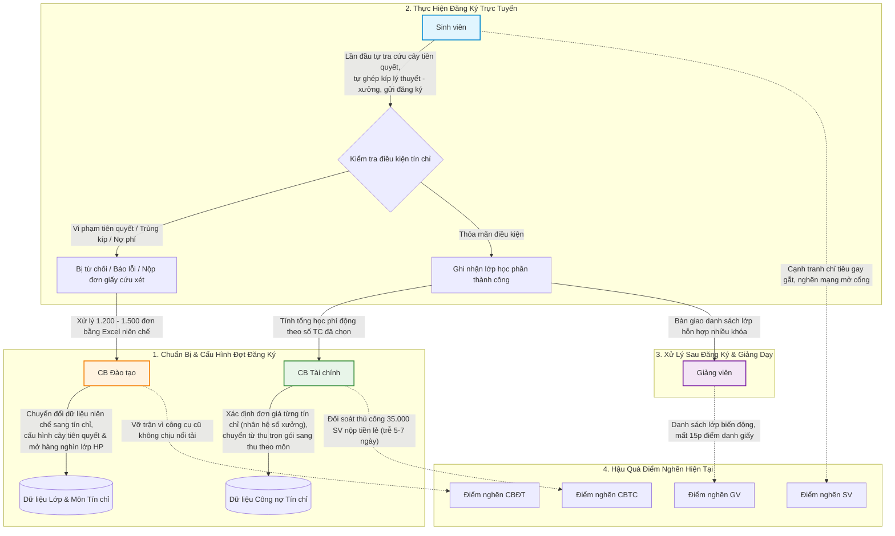
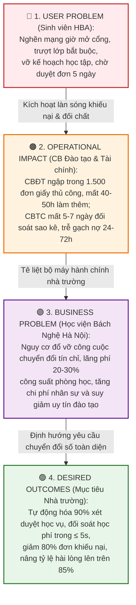
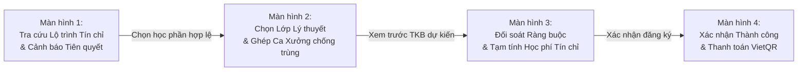
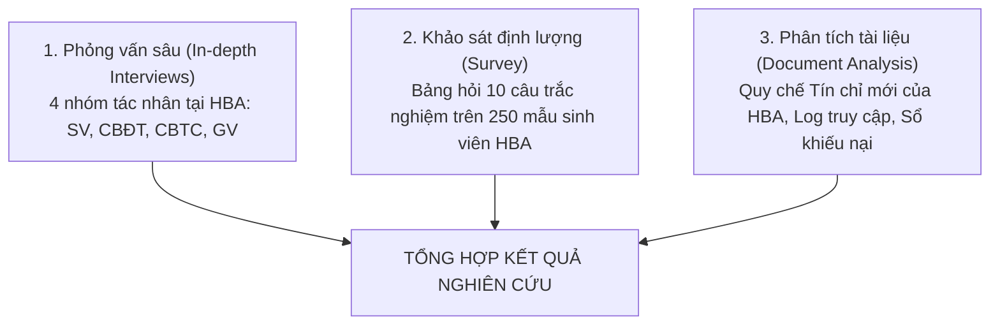

# ĐẠI HỌC BÁCH KHOA HÀ NỘI
## TRƯỜNG CÔNG NGHỆ THÔNG TIN VÀ TRUYỀN THÔNG (SOICT)
### HỌC PHẦN: PHÂN TÍCH VÀ THIẾT KẾ HỆ THỐNG (IT3120)

---

# BÁO CÁO BÀI TẬP 1: KHÁM PHÁ VẤN ĐỀ, LEAN UX CANVAS & ĐỀ XUẤT HỆ THỐNG (SYSTEM REQUEST)
## ĐỀ TÀI: HỆ THỐNG QUẢN TRỊ ĐÀO TẠO ĐẠI HỌC THEO HỌC CHẾ TÍN CHỈ VÀ THANH TOÁN HỌC PHÍ TÍCH HỢP (HBA SIS-PAY)
### TỔ CHỨC NGHIÊN CỨU: HỌC VIỆN BÁCH NGHỆ HÀ NỘI (HBA)
### BỐI CẢNH: CHUYỂN ĐỔI MÔ HÌNH QUẢN TRỊ TỪ NIÊN CHẾ SANG HỌC CHẾ TÍN CHỈ

```
========================================================================================
                              THÔNG TIN HỒ SƠ HỌC PHẦN
  - Học phần:           Phân tích và Thiết kế Hệ thống (IT3120)
  - Đơn vị đào tạo:     Trường Công nghệ Thông tin và Truyền thông — ĐHBK Hà Nội
  - Nhóm thực hiện:     Nhóm 09
  - Phân công vai trò:
      + Thành viên 1:   Phụ trách Tác nhân Sinh viên & Luồng Lean UX / MVP Experiment
      + Thành viên 2:   Phụ trách Tác nhân Cán bộ Đào tạo & Chuyên đề Business Problem
      + Thành viên 3:   Phụ trách Tác nhân Cán bộ Tài chính & Hồ sơ System Request
      + Thành viên 4:   Phụ trách Tác nhân Giảng viên & Báo cáo Khám phá Vấn đề
========================================================================================
```

---

## MỤC LỤC BÁO CÁO

- [ĐẠI HỌC BÁCH KHOA HÀ NỘI](#đại-học-bách-khoa-hà-nội)
  - [TRƯỜNG CÔNG NGHỆ THÔNG TIN VÀ TRUYỀN THÔNG (SOICT)](#trường-công-nghệ-thông-tin-và-truyền-thông-soict)
    - [HỌC PHẦN: PHÂN TÍCH VÀ THIẾT KẾ HỆ THỐNG (IT3120)](#học-phần-phân-tích-và-thiết-kế-hệ-thống-it3120)
- [BÁO CÁO BÀI TẬP 1: KHÁM PHÁ VẤN ĐỀ, LEAN UX CANVAS \& ĐỀ XUẤT HỆ THỐNG (SYSTEM REQUEST)](#báo-cáo-bài-tập-1-khám-phá-vấn-đề-lean-ux-canvas--đề-xuất-hệ-thống-system-request)
  - [ĐỀ TÀI: HỆ THỐNG QUẢN TRỊ ĐÀO TẠO ĐẠI HỌC THEO HỌC CHẾ TÍN CHỈ VÀ THANH TOÁN HỌC PHÍ TÍCH HỢP (HBA SIS-PAY)](#đề-tài-hệ-thống-quản-trị-đào-tạo-đại-học-theo-học-chế-tín-chỉ-và-thanh-toán-học-phí-tích-hợp-hba-sis-pay)
    - [TỔ CHỨC NGHIÊN CỨU: HỌC VIỆN BÁCH NGHỆ HÀ NỘI (HBA)](#tổ-chức-nghiên-cứu-học-viện-bách-nghệ-hà-nội-hba)
    - [BỐI CẢNH: CHUYỂN ĐỔI MÔ HÌNH QUẢN TRỊ TỪ NIÊN CHẾ SANG HỌC CHẾ TÍN CHỈ](#bối-cảnh-chuyển-đổi-mô-hình-quản-trị-từ-niên-chế-sang-học-chế-tín-chỉ)
  - [MỤC LỤC BÁO CÁO](#mục-lục-báo-cáo)
- [CHƯƠNG 1: BỐI CẢNH NGHIỆP VỤ \& TỔNG QUAN DỰ ÁN](#chương-1-bối-cảnh-nghiệp-vụ--tổng-quan-dự-án)
    - [1.1. Bối cảnh toàn cục: Cú sốc chuyển đổi Niên chế sang Tín chỉ tại HBA](#11-bối-cảnh-toàn-cục-cú-sốc-chuyển-đổi-niên-chế-sang-tín-chỉ-tại-hba)
    - [1.2. Trục xung đột trung tâm: Tư duy niên chế đối đầu quy chế tín chỉ](#12-trục-xung-đột-trung-tâm-tư-duy-niên-chế-đối-đầu-quy-chế-tín-chỉ)
    - [1.3. Kịch bản neo đồng bộ luồng nghiệp vụ lõi](#13-kịch-bản-neo-đồng-bộ-luồng-nghiệp-vụ-lõi)
    - [1.4. Tóm tắt tổng quan dự án (Executive Summary)](#14-tóm-tắt-tổng-quan-dự-án-executive-summary)
- [CHƯƠNG 2: KHÁM PHÁ NHU CẦU \& BẢN ĐỒ VẤN ĐỀ NGƯỜI DÙNG (TH1 \& TH2)](#chương-2-khám-phá-nhu-cầu--bản-đồ-vấn-đề-người-dùng-th1--th2)
    - [2.1. Bảng xác định 4 User Needs cốt lõi của 4 tác nhân (Slide 7–15)](#21-bảng-xác-định-4-user-needs-cốt-lõi-của-4-tác-nhân-slide-715)
    - [2.2. Lựa chọn User Need ưu tiên của Sinh viên](#22-lựa-chọn-user-need-ưu-tiên-của-sinh-viên)
    - [2.3. Phát biểu User Problem Statement trọng tâm (Mỏ neo người dùng)](#23-phát-biểu-user-problem-statement-trọng-tâm-mỏ-neo-người-dùng)
    - [2.4. Danh mục giả định rủi ro cần kiểm chứng (Slide 15, 28)](#24-danh-mục-giả-định-rủi-ro-cần-kiểm-chứng-slide-15-28)
    - [2.5. User Problem Statement Canvas chi tiết cho Sinh viên (Slide 16–21)](#25-user-problem-statement-canvas-chi-tiết-cho-sinh-viên-slide-1621)
    - [2.6. Bảng tóm tắt điểm nghẽn \& rào cản của 3 tác nhân nội bộ (CBĐT, CBTC, GV)](#26-bảng-tóm-tắt-điểm-nghẽn--rào-cản-của-3-tác-nhân-nội-bộ-cbđt-cbtc-gv)
- [CHƯƠNG 3: PHÂN TÍCH VẤN ĐỀ KINH DOANH \& NGUYÊN NHÂN GỐC RỄ (TH3)](#chương-3-phân-tích-vấn-đề-kinh-doanh--nguyên-nhân-gốc-rễ-th3)
    - [3.1. Chuỗi lập luận nhân quả 4 cấp xuyên tác nhân (Slide 25)](#31-chuỗi-lập-luận-nhân-quả-4-cấp-xuyên-tác-nhân-slide-25)
    - [3.2. Phân tích nguyên nhân gốc rễ bằng kỹ thuật 5 Whys (Slide 28, 35)](#32-phân-tích-nguyên-nhân-gốc-rễ-bằng-kỹ-thuật-5-whys-slide-28-35)
    - [3.3. Phân tích đa chiều Fishbone \& 5W-1H (Slide 29, 35)](#33-phân-tích-đa-chiều-fishbone--5w-1h-slide-29-35)
      - [1. Bảng phân tích 5W-1H](#1-bảng-phân-tích-5w-1h)
      - [2. Phân loại theo 4 nhóm nguyên nhân (Fishbone Categories)](#2-phân-loại-theo-4-nhóm-nguyên-nhân-fishbone-categories)
    - [3.4. Danh sách 3 Business Problems chuẩn cấu trúc 5 mục (Slide 30–32)](#34-danh-sách-3-business-problems-chuẩn-cấu-trúc-5-mục-slide-3032)
      - [📌 BUSINESS PROBLEM 1: Quá tải và tắc nghẽn quy trình xử lý đơn ngoại lệ học vụ do chuyển đổi mô hình](#-business-problem-1-quá-tải-và-tắc-nghẽn-quy-trình-xử-lý-đơn-ngoại-lệ-học-vụ-do-chuyển-đổi-mô-hình)
      - [📌 BUSINESS PROBLEM 2: Lãng phí tài nguyên phòng học và mất cân đối sĩ số lớp học phần](#-business-problem-2-lãng-phí-tài-nguyên-phòng-học-và-mất-cân-đối-sĩ-số-lớp-học-phần)
      - [📌 BUSINESS PROBLEM 3: Trì trệ trong đối soát học phí tín chỉ và đồng bộ trạng thái công nợ](#-business-problem-3-trì-trệ-trong-đối-soát-học-phí-tín-chỉ-và-đồng-bộ-trạng-thái-công-nợ)
    - [3.5. Dữ liệu vận hành cần thu thập \& Chỉ số KPI đo lường thành công (Slide 26, 27)](#35-dữ-liệu-vận-hành-cần-thu-thập--chỉ-số-kpi-đo-lường-thành-công-slide-26-27)
      - [1. Dữ liệu vận hành cần thu thập để xác minh](#1-dữ-liệu-vận-hành-cần-thu-thập-để-xác-minh)
      - [2. Chỉ số KPI đo lường thành công](#2-chỉ-số-kpi-đo-lường-thành-công)
    - [3.6. Chuyển hóa Business Problems thành Business Requirements (BRQ) (Slide 34, 54)](#36-chuyển-hóa-business-problems-thành-business-requirements-brq-slide-34-54)
- [CHƯƠNG 4: KHUNG GIẢI PHÁP LEAN UX \& KẾ HOẠCH THỬ NGHIỆM MVP (TH4 \& TH5)](#chương-4-khung-giải-pháp-lean-ux--kế-hoạch-thử-nghiệm-mvp-th4--th5)
    - [4.1. Bảng Lean UX Canvas hoàn chỉnh 8 ô (Slide 37–40)](#41-bảng-lean-ux-canvas-hoàn-chỉnh-8-ô-slide-3740)
    - [4.2. Hệ thống 3 Giả thuyết kiểm chứng (Hypotheses) chuẩn cú pháp](#42-hệ-thống-3-giả-thuyết-kiểm-chứng-hypotheses-chuẩn-cú-pháp)
    - [4.3. Đặc tả nguyên mẫu tương tác MVP (Clickable Prototype 4 màn hình Figma)](#43-đặc-tả-nguyên-mẫu-tương-tác-mvp-clickable-prototype-4-màn-hình-figma)
    - [4.4. Kế hoạch kiểm thử người dùng (Usability Test Plan)](#44-kế-hoạch-kiểm-thử-người-dùng-usability-test-plan)
    - [4.5. Tiêu chí đánh giá thành công \& Sơ đồ cây quyết định kế tiếp](#45-tiêu-chí-đánh-giá-thành-công--sơ-đồ-cây-quyết-định-kế-tiếp)
- [CHƯƠNG 5: HỒ SƠ ĐỀ XUẤT HỆ THỐNG — SYSTEM REQUEST 11 MỤC (PLANNING PHASE)](#chương-5-hồ-sơ-đề-xuất-hệ-thống--system-request-11-mục-planning-phase)
    - [5.1. Project Title (Tên Dự án)](#51-project-title-tên-dự-án)
    - [5.2. Project Sponsor / Requestor (Đơn vị Đề xuất \& Tài trợ)](#52-project-sponsor--requestor-đơn-vị-đề-xuất--tài-trợ)
    - [5.3. Business Need / Problem Statement (Nhu cầu Nghiệp vụ)](#53-business-need--problem-statement-nhu-cầu-nghiệp-vụ)
    - [5.4. Project Vision / Goals (Tầm nhìn \& Mục tiêu SMART)](#54-project-vision--goals-tầm-nhìn--mục-tiêu-smart)
    - [5.5. Business Benefits (Phân tích Lợi ích Kinh doanh Đa Chiều)](#55-business-benefits-phân-tích-lợi-ích-kinh-doanh-đa-chiều)
    - [5.6. High-level Requirements (Yêu cầu Cấp cao của Hệ thống)](#56-high-level-requirements-yêu-cầu-cấp-cao-của-hệ-thống)
      - [A. Yêu cầu Chức năng (Functional Requirements)](#a-yêu-cầu-chức-năng-functional-requirements)
      - [B. Yêu cầu Phi chức năng (Non-Functional Requirements)](#b-yêu-cầu-phi-chức-năng-non-functional-requirements)
    - [5.7. Constraints / Assumptions (Ràng buộc \& Giả định Dự án)](#57-constraints--assumptions-ràng-buộc--giả-định-dự-án)
    - [5.8. Feasibility Assessment (Đánh giá Tính Khả thi 4 Chiều)](#58-feasibility-assessment-đánh-giá-tính-khả-thi-4-chiều)
    - [5.9. Expected Deliverables (Sản phẩm Bàn giao Dự kiến)](#59-expected-deliverables-sản-phẩm-bàn-giao-dự-kiến)
    - [5.10. Risks \& Mitigation Strategies (Nhận diện Rủi ro \& Phương án Giảm thiểu)](#510-risks--mitigation-strategies-nhận-diện-rủi-ro--phương-án-giảm-thiểu)
    - [5.11. Approval \& Sign-off (Phê duyệt Khởi động Dự án)](#511-approval--sign-off-phê-duyệt-khởi-động-dự-án)
- [CHƯƠNG 6: PHƯƠNG PHÁP NGHIÊN CỨU, PHẢN BIỆN \& TỰ ĐÁNH GIÁ](#chương-6-phương-pháp-nghiên-cứu-phản-biện--tự-đánh-giá)
    - [6.1. Phương pháp nghiên cứu thực địa (Slide 52)](#61-phương-pháp-nghiên-cứu-thực-địa-slide-52)
      - [A. Kịch bản phỏng vấn sâu 4 nhóm tác nhân tại HBA](#a-kịch-bản-phỏng-vấn-sâu-4-nhóm-tác-nhân-tại-hba)
      - [B. Mẫu phiếu khảo sát định lượng (10 Câu hỏi trọng tâm)](#b-mẫu-phiếu-khảo-sát-định-lượng-10-câu-hỏi-trọng-tâm)
    - [6.2. Ma trận điểm nghẽn giao thoa giữa các tác nhân (Slide 52)](#62-ma-trận-điểm-nghẽn-giao-thoa-giữa-các-tác-nhân-slide-52)
    - [6.3. Giải quyết 4 câu hỏi phản biện cốt lõi của môn học (Slide 20, 54)](#63-giải-quyết-4-câu-hỏi-phản-biện-cốt-lõi-của-môn-học-slide-20-54)
    - [6.4. Bảng tự đánh giá toàn diện theo 5 tiêu chí chấm điểm của Giảng viên (Slide 51, 53)](#64-bảng-tự-đánh-giá-toàn-diện-theo-5-tiêu-chí-chấm-điểm-của-giảng-viên-slide-51-53)

---

# CHƯƠNG 1: BỐI CẢNH NGHIỆP VỤ & TỔNG QUAN DỰ ÁN

### 1.1. Bối cảnh toàn cục: Cú sốc chuyển đổi Niên chế sang Tín chỉ tại HBA
**Học viện Bách Nghệ Hà Nội (HBA)** là cơ sở giáo dục đại học định hướng công nghệ và kỹ thuật ứng dụng quy mô lớn với **~35.000 sinh viên** và **~1.500 giảng viên**. Nhằm hiện đại hóa chương trình đào tạo và cá nhân hóa lộ trình học tập của người học, Ban Giám đốc Học viện đã ban hành Quy chế Đào tạo mới, chính thức quyết định chuyển đổi toàn diện mô hình đào tạo:

* **Mô hình Niên chế truyền thống trước đây:** 
  - Toàn trường được tổ chức theo khoảng 50–70 lớp hành chính (lớp sinh hoạt) cố định suốt 4–5 năm học.
  - Phòng Đào tạo ấn định trọn gói thời khóa biểu cho từng lớp; sinh viên hoàn toàn thụ động tuân theo lịch xếp sẵn và không cần đăng ký môn.
  - Học phí thu phẳng một mức cố định theo học kỳ hoặc năm học, quản lý thu nộp theo đầu lớp hành chính.
* **Học chế Tín chỉ mới áp dụng:**
  - Trao quyền chủ động tối đa cho sinh viên: tự chọn môn học theo cây điều kiện tiên quyết, tự ghép thời khóa biểu cá nhân, tự lựa chọn giảng viên và tiến độ ra trường.
  - Học phí chuyển sang tính động theo số lượng tín chỉ thực học, có nhân hệ số chênh lệch giữa giờ lý thuyết và thực hành xưởng (1.2–1.5).
  - Bùng nổ hàng nghìn lớp học phần riêng rẽ thay cho vài chục lớp hành chính cố định.

### 1.2. Trục xung đột trung tâm: Tư duy niên chế đối đầu quy chế tín chỉ
Sự chuyển đổi đột ngột về mặt chính sách trong khi nền tảng công nghệ và quy trình nghiệp vụ chưa kịp số hóa tương xứng đã dẫn đến **cú sốc vận hành trên toàn bộ 4 nhóm tác nhân**:
1. **Sinh viên (SV):** Quen tâm lý thụ động được xếp lịch sẵn $\rightarrow$ Lần đầu tiên phải tự tra cứu cây tiên quyết phức tạp, tự xếp thời khóa biểu và tranh chấp chỉ tiêu trong giờ mở cổng, dẫn đến tâm lý hoang mang, nghẽn mạng và đăng ký sai quy chế.
2. **Cán bộ Đào tạo (CBĐT):** Quen quản lý vài chục lớp cố định $\rightarrow$ Nay số lớp bùng nổ lên hàng nghìn lớp học phần; các công cụ bảng tính Excel cũ hoàn toàn "vỡ trận", ngập trong hơn 1.200 – 1.500 đơn xin học vượt, mở thêm lớp bằng giấy tờ thủ công.
3. **Cán bộ Tài chính (CBTC):** Quen thu học phí phẳng theo lớp $\rightarrow$ Nay phải tính tiền lẻ động theo số tín chỉ đăng ký, đối soát sao kê ngân hàng thủ công mất 5–7 ngày làm việc và đối mặt với 8–12% giao dịch sai cú pháp.
4. **Giảng viên (GV):** Quen dạy một tập thể lớp cố định 50 sinh viên quen mặt $\rightarrow$ Nay tiếp nhận các lớp học phần hỗn hợp sinh viên nhiều khóa (K62, K63, K64 cùng ngồi học), danh sách sinh viên liên tục biến động suốt 3 tuần đầu kỳ.

### 1.3. Kịch bản neo đồng bộ luồng nghiệp vụ lõi
Để đảm bảo tính nhất quán xuyên suốt toàn bộ hồ sơ phân tích thiết kế, cả 4 tác nhân cùng neo chặt vào một kịch bản trọng tâm:

> **KỊCH BẢN NEO ĐỒNG BỘ:**  
> *"Đăng ký học phần, Kiểm tra điều kiện tiên quyết & Đối soát công nợ học phí đầu kỳ trong giai đoạn chuyển đổi từ Niên chế sang Tín chỉ tại Học viện Bách Nghệ Hà Nội."*



### 1.4. Tóm tắt tổng quan dự án (Executive Summary)
Quy mô đào tạo 35.000 sinh viên tại Học viện Bách Nghệ Hà Nội đòi hỏi năng lực xử lý giao dịch đồng thời và đối soát dữ liệu cực lớn. Tuy nhiên, hệ sinh thái quản lý đào tạo hiện tại đang bộc lộ những điểm gãy nghiêm trọng do vận hành trên công cụ chắp vá kế thừa từ thời niên chế:
* **Sinh viên** mất trung bình 4–6 giờ chờ đợi giờ mở cổng, tỷ lệ đăng ký sai quy chế cao do không nắm rõ cây tiên quyết, làm phát sinh hơn **1.500 đơn cứu xét** mỗi đầu kỳ.
* **Cán bộ Đào tạo** phải làm thêm 40–50 giờ ngoài giờ trong tháng cao điểm; thời gian xét duyệt 1 lá đơn kéo dài 5–7 ngày.
* **Cán bộ Tài chính** mất 5–7 ngày làm việc để đối soát sao kê ngân hàng cho các khoản tiền lẻ; tỷ lệ lỗi cú pháp chiếm 8–12%; trễ gạch nợ 24–72 giờ làm sinh viên bị khóa môn oan.
* **Giảng viên** lãng phí 10–15 phút đầu mỗi buổi học để điểm danh giấy và xử lý sinh viên vào lớp muộn trong 3 tuần đầu.

**Thông điệp then chốt:** Vấn đề cốt lõi không phải là "nhà trường thiếu một website", mà nằm ở **sự lệch pha nghiêm trọng giữa tư duy quản lý niên chế thủ công đối đầu với sự phức tạp của quy chế tín chỉ hiện đại**. Giải pháp bắt buộc phải là **tái cấu trúc quy trình số hóa toàn diện (BPR)** kết hợp với việc xây dựng nền tảng **HBA SIS-Pay** liên thông 100% dữ liệu Đào tạo – Tài chính – Giảng dạy.

---

# CHƯƠNG 2: KHÁM PHÁ NHU CẦU & BẢN ĐỒ VẤN ĐỀ NGƯỜI DÙNG (TH1 & TH2)

### 2.1. Bảng xác định 4 User Needs cốt lõi của 4 tác nhân (Slide 7–15)
Tuân thủ nguyên tắc sư phạm: bắt đầu bằng động từ hành động, phản ánh mục tiêu cần đạt, không mô tả tính năng giải pháp, phân định minh bạch `[Evidence]` và `[Assumption]`.

| Mã | Tác nhân | User Need cốt lõi (Bắt đầu bằng động từ) | Bối cảnh xảy ra | Rào cản quy trình & công nghệ | Hệ quả thực tế | Phân loại |
|:---:|---|---|---|---|---|:---:|
| **UN-SV-03** | **Sinh viên (SV)** | **Nắm bắt** tình trạng chỗ trống của các lớp học phần và hoàn tất xác nhận đăng ký nhanh chóng trong đợt mở cổng tập trung mà không phải thao tác lặp lại nhiều lần. | Khung giờ cao điểm mở cổng đăng ký tín chỉ trực tuyến cho ~35.000 sinh viên toàn Học viện. | Lượng truy cập đồng thời quá lớn làm hệ thống quá tải; chỉ tiêu mở lớp chưa sát nhu cầu thực tế; trạng thái chỗ trống biến động từng giây và thiếu cơ chế phản hồi hàng đợi minh bạch. | Sinh viên bị lỡ các lớp học phần bắt buộc, gây tâm lý hoảng loạn và phát sinh hơn 1.500 đơn xin hỗ trợ mở thêm lớp trong 10 ngày đầu kỳ. | `[Evidence]` |
| **UN-CBĐT-03** | **Cán bộ Đào tạo (CBĐT)** | **Tiếp nhận và xử lý** các đơn cứu xét học vụ ngoại lệ (xin mở thêm lớp, xin học vượt trần tín chỉ, rút môn) một cách nhanh chóng, minh bạch. | Suốt 2 tuần đăng ký và tuần đầu học kỳ tín chỉ tại Văn phòng Phòng Đào tạo. | Tiếp nhận đơn bằng giấy tờ thủ công; cán bộ phải mở từng hồ sơ học bạ trên phần mềm cũ để đối soát điều kiện quy chế từng người một. | Cán bộ kiệt sức vì quá tải; thời gian trả kết quả đơn kéo dài từ 5 đến 7 ngày, sinh viên nháo nhác chờ đợi làm chậm ngày nhập học. | `[Evidence]` |
| **UN-CBTC-02** | **Cán bộ Tài chính (CBTC)** | **Kiểm tra và đối soát tự động** các giao dịch nộp tiền học phí từ ngân hàng theo thời gian thực cho khoảng 35.000 sinh viên mà không phải rà soát thủ công từng dòng sao kê. | Suốt thời gian cao điểm mở cổng thu học phí đầu kỳ (kéo dài khoảng 2–3 tuần). | Sinh viên nộp các khoản tiền lẻ khác nhau theo số tín chỉ đăng ký nhưng ghi sai cú pháp nội dung chuyển khoản; sao kê ngân hàng chưa liên thông API tự động. | Có tới 8–12% giao dịch bị lỗi cú pháp, khiến 4 cán bộ mất 5–7 ngày đối soát bằng Excel; sinh viên đã nộp tiền vẫn bị treo nợ từ 24–48 giờ. | `[Evidence]` |
| **UN-GV-01** | **Giảng viên (GV)** | **Tiếp nhận** danh sách lớp học phần cố định và chuẩn xác trước ngày khai giảng học kỳ để chuẩn bị kế hoạch giảng dạy. | 1 tuần trước khi học kỳ mới bắt đầu tại các Khoa/Viện chuyên ngành. | Đợt đăng ký tín chỉ điều chỉnh bị kéo dài; sinh viên xin rút hoặc thêm lớp muộn nên danh sách biến động hàng ngày. | Giảng viên không thể ổn định nhóm bài tập lớn, mất 10–15 phút mỗi buổi đầu giờ để điểm danh giấy và giải quyết sinh viên vào muộn. | `[Evidence]` |

### 2.2. Lựa chọn User Need ưu tiên của Sinh viên
Trong 4 nhu cầu cốt lõi nêu trên, nhóm thống nhất lựa chọn **User Need 3 của Sinh viên (UN-SV-03)** làm **nhu cầu ưu tiên số 1 (Priority Need)** vì các lý do sau:
1. **Tính chất sống còn đối với người học:** Đăng ký được học phần bắt buộc là điều kiện tiên quyết để sinh viên duy trì tiến độ đào tạo, quyết định trực tiếp việc ra trường đúng hạn.
2. **Khởi nguồn của chuỗi quá tải vận hành:** Sự thất bại trong khâu đăng ký của sinh viên tại cổng mở lớp chính là nguyên nhân trực tiếp kích hoạt 1.200 – 1.500 lá đơn giấy dồn về Cán bộ Đào tạo, kéo theo sự xáo trộn danh sách lớp của Giảng viên và làm phức tạp hóa khâu tính học phí của Cán bộ Tài chính.

### 2.3. Phát biểu User Problem Statement trọng tâm (Mỏ neo người dùng)
Áp dụng nghiêm ngặt công thức chuẩn tại Slide 11:  
$$\text{[Người dùng]} \text{ gặp khó khăn khi } \text{[mục tiêu]} \text{ trong } \text{[bối cảnh]}, \text{ vì } \text{[trở ngại]}, \text{ dẫn đến } \text{[hệ quả]}.$$

> **USER PROBLEM STATEMENT (MỎ NEO NGƯỜI DÙNG — SLIDE 10, 11, 55):**  
> *"Sinh viên tại Học viện Bách Nghệ Hà Nội (HBA) gặp khó khăn khi cạnh tranh chỉ tiêu và xác nhận kết quả đăng ký lớp học phần trong các đợt mở cổng tập trung cho 35.000 người học, vì thông tin chỗ trống của lớp học thay đổi quá nhanh và thiếu phản hồi tức thời khi quá tải cục bộ, dẫn đến việc bị vỡ kế hoạch học tập dự kiến và phải làm đơn xin điều chỉnh thủ công mất trung bình 5 ngày chờ đợi."*

* **Độ dài phát biểu:** 88 từ (nằm trọn vẹn trong khoảng chuẩn 50–100 từ).
* **Kiểm tra tiêu chí chất lượng (Slide 21):** Xác định đúng đối tượng (SV HBA); bối cảnh rõ ràng (giờ mở cổng tập trung); rào cản quy trình (thiếu phản hồi tức thời, chỉ tiêu biến động); tác động định lượng (mất 5 ngày chờ duyệt); **tuyệt đối không chứa từ ngữ giải pháp**.

### 2.4. Danh mục giả định rủi ro cần kiểm chứng (Slide 15, 28)
* `[Assumption 1]`: Giả định rằng nguyên nhân sinh viên phải bấm F5 liên tục chủ yếu xuất phát từ việc thiếu cơ chế hàng đợi ảo (Virtual Queue) thông báo thứ tự phục vụ minh bạch.
* `[Assumption 2]`: Giả định rằng nếu nhà trường tổ chức đăng ký nguyện vọng sớm trước kỳ học, tỷ lệ sinh viên trượt lớp bắt buộc sẽ giảm trên 80%.
* `[Assumption 3]`: Giả định rằng sinh viên sẵn sàng để hệ thống tự động gán vào lớp học phần dự phòng nếu lớp nguyện vọng 1 đã kín chỗ.

---

### 2.5. User Problem Statement Canvas chi tiết cho Sinh viên (Slide 16–21)
Triển khai trọn vẹn 8 ô Canvas chuẩn mực mổ xẻ tận cùng User Need ưu tiên của Sinh viên HBA:

| Thành phần Canvas | Nội dung phân tích chi tiết cho Tác nhân Sinh viên HBA (Canvas số 3) |
|---|---|
| **1. CONTEXT**<br>*(Bối cảnh xảy ra)* | Khung giờ cao điểm mở cổng đăng ký học phần trực tuyến tập trung cho toàn bộ ~35.000 sinh viên Học viện Bách Nghệ Hà Nội vào đầu mỗi học kỳ tín chỉ (thường vào 9h00 sáng hoặc 14h00 chiều). |
| **2. PROBLEM / ROOT CAUSE**<br>*(Vấn đề cốt lõi & Nguyên nhân gốc)* | Số lượng sinh viên truy cập đồng thời quá lớn trong khi chỉ tiêu mở lớp chưa sát nhu cầu thực tế; trạng thái chỗ trống biến động từng giây và thiếu cơ chế phản hồi hàng đợi minh bạch theo thời gian thực. |
| **3. ALTERNATIVES**<br>*(Cách SV đang tự xoay xở)* | • Tụ tập tại các quán net có đường truyền mạng tốc độ cao để "săn slot" lớp học.<br>• Mở nhiều tab trình duyệt, liên tục bấm phím F5 / tải lại trang để giành chỗ khi có người nhả slot.<br>• Viết đơn giấy gửi lên Văn phòng Khoa/Phòng Đào tạo xin mở thêm lớp sau khi cổng đóng. |
| **4. CUSTOMERS**<br>*(Đối tượng chịu tác động chính)* | Toàn bộ sinh viên hệ chính quy tại HBA, đặc biệt là sinh viên năm 3, năm 4 cần hoàn thành các môn học phần bắt buộc đúng tiến độ và sinh viên các khóa vừa chuyển đổi mô hình đào tạo. |
| **5. EMOTIONAL IMPACT**<br>*(Tác động cảm xúc)* | Cực kỳ hoang mang, hoảng loạn và ức chế tột độ khi màn hình bị đơ/trắng; cảm thấy bất công khi bản thân đã chuẩn bị kỹ thời khóa biểu nhưng vẫn bị trượt lớp do yếu tố nghẽn mạng hạ tầng. |
| **6. QUANTIFIABLE IMPACT**<br>*(Tác động định lượng kèm đơn vị)* | • **Thời gian chờ đợi:** Mất trung bình 4–6 giờ căng thẳng trực cổng mỗi đợt đăng ký.<br>• **Gánh nặng hành chính:** Phát sinh hơn **1.500 đơn xin mở thêm lớp / điều chỉnh học vụ** gửi về trường.<br>• **Thời gian xử lý:** Sinh viên phải chờ đợi trung bình **5 ngày làm việc** mới biết đơn có được duyệt hay không. |
| **7. ALTERNATIVE SHORTCOMINGS**<br>*(Hạn chế của cách giải quyết cũ)* | • Việc sinh viên F5 liên tục càng làm nghẽn băng thông hệ thống, dẫn đến sập phiên đăng ký cục bộ.<br>• Viết đơn giấy xin mở lớp mất nhiều thời gian đi lại, xếp hàng nộp đơn và tỷ lệ được chấp thuận phụ thuộc vào may rủi.<br>• Bị động trong việc sắp xếp kế hoạch sinh hoạt cá nhân và đăng ký các môn học khác. |
| **8. EVIDENCE vs. ASSUMPTIONS**<br>*(Phân định Bằng chứng vs Giả định)* | • `[Evidence]`: Hiện tượng nghẽn mạng giờ mở cổng và số lượng hơn 1.500 đơn giấy nộp về Phòng Đào tạo trong 10 ngày đầu kỳ là dữ liệu thực tế ghi nhận được từ sổ thụ lý học vụ.<br>• `[Assumption]`: Giả định 70% số đơn xin mở lớp xuất phát từ việc sinh viên không đăng ký kịp trong 15 phút đầu mở cổng. |

---

### 2.6. Bảng tóm tắt điểm nghẽn & rào cản của 3 tác nhân nội bộ (CBĐT, CBTC, GV)
Để đảm bảo tính súc tích và kết nối chặt chẽ sang bài toán vận hành của nhà trường, các điểm nghẽn của 3 tác nhân nội bộ được tổng hợp cô đọng:

| Tác nhân | Điểm nghẽn cốt lõi (Core Friction) | Rào cản quy trình & công cụ hiện tại | Tác động định lượng điển hình (Impact) |
|---|---|---|---|
| **Cán bộ Đào tạo (CBĐT)** | Quá tải xử lý đơn cứu xét học vụ ngoại lệ và mất cân đối sĩ số lớp học phần. | Sử dụng phần mềm quản lý niên chế cũ kết hợp các file Excel rời rạc; không có công cụ tự động đối soát điều kiện quy chế và thiếu kênh khảo sát nhu cầu mở lớp trước kỳ. | • Tiếp nhận **1.200 – 1.500 đơn giấy/kỳ**.<br>• Mất **8–10 phút/đơn** kiểm tra thủ công.<br>• Phải làm thêm **40–50 giờ ngoài giờ** mùa cao điểm.<br>• Tỷ lệ lớp học phần bị hủy phút chót ở mức **12%**. |
| **Cán bộ Tài chính (CBTC)** | Ách tắc đối soát sao kê ngân hàng và chậm trễ gạch nợ học phí theo tín chỉ. | Sinh viên nộp các khoản tiền lẻ biến đổi theo tín chỉ qua chuyển khoản thông thường nhưng ghi sai cú pháp; CSDL tài chính và đào tạo không liên thông thời gian thực. | • Mất **5 đến 7 ngày** của 4 cán bộ để đối soát sao kê.<br>• Tỷ lệ giao dịch sai cú pháp chiếm **8–12%**.<br>• Độ trễ gạch nợ kéo dài **24–72 giờ**, gây khóa nhầm quyền thi/quyền đăng ký môn của sinh viên. |
| **Giảng viên (GV)** | Danh sách lớp học phần biến động kéo dài và thiếu thông tin năng lực tiên quyết của sinh viên. | Phòng Đào tạo cho phép rút/thêm môn kéo dài sang tuần 3 nhưng không có hệ thống cập nhật tức thời tới giảng viên; việc điểm danh và quản lý lớp phụ thuộc vào danh sách giấy in đầu kỳ. | • Mất **10–15 phút đầu giờ mỗi buổi** trong 3 tuần đầu để ổn định sĩ số (chiếm 10–12% thời lượng tiết dạy).<br>• Biến động **15–20% sĩ số** sau buổi học đầu tiên.<br>• Mất **3–5 giờ cuối kỳ** nhập dữ liệu điểm danh từ giấy. |

---

# CHƯƠNG 3: PHÂN TÍCH VẤN ĐỀ KINH DOANH & NGUYÊN NHÂN GỐC RỄ (TH3)

### 3.1. Chuỗi lập luận nhân quả 4 cấp xuyên tác nhân (Slide 25)
Tuân thủ nguyên tắc vàng: Nỗi đau của Sinh viên (TV1) không đứng độc lập mà là mắt xích kích hoạt sự quá tải của bộ máy vận hành (TV2, TV3), từ đó tạo thành vấn đề kinh doanh của Học viện Bách Nghệ Hà Nội (HBA):

$$\text{User Problem (SV)} \longrightarrow \text{Operational Impact (CBĐT/CBTC)} \longrightarrow \text{Business Problem (Học viện)} \longrightarrow \text{Desired Outcomes}$$



### 3.2. Phân tích nguyên nhân gốc rễ bằng kỹ thuật 5 Whys (Slide 28, 35)
* **Vấn đề xuất phát:** Hàng nghìn sinh viên Học viện Bách Nghệ Hà Nội bị trễ hạn đăng ký học phần, nghẽn mạng và làm tê liệt hoạt động của Phòng Đào tạo ngay trong các đợt mở cổng tín chỉ đầu kỳ.

| Tầng Why | Câu hỏi đào sâu | Câu trả lời phân tích thực chứng tại HBA |
|:---:|---|---|
| **Why 1** | *Tại sao sinh viên phải nộp hơn 1.500 đơn khiếu nại và xếp hàng tại Phòng Đào tạo nhiều đột biến như vậy?* | Vì sinh viên không thể hoàn tất đăng ký trực tuyến các lớp học phần mình cần do trang web bị nghẽn mạng hoặc các lớp đều nhanh chóng hết chỗ chỉ sau vài phút mở cổng. |
| **Why 2** | *Tại sao hệ thống lại bị nghẽn mạng và các lớp học phần lại nhanh hết chỗ bất thường?* | Vì toàn bộ 35.000 sinh viên cùng ồ ạt truy cập vào đúng giây mở cổng để tranh slot; đồng thời Học viện chưa có công cụ khảo sát nguyện vọng trước kỳ để dự báo chính xác số lớp cần mở. |
| **Why 3** | *Tại sao hệ thống không chịu được tải lớn và Phòng Đào tạo không dự báo được nhu cầu học phần?* | Vì cổng thông tin đào tạo cũ được thiết kế cho mô hình niên chế (vốn không có tính năng đăng ký tải cao); quy trình lập thời khóa biểu hiện tại dựa trên ước tính chủ quan của các bộ môn thay vì dữ liệu thời gian thực. |
| **Why 4** | *Tại sao hạ tầng công nghệ và quy trình nghiệp vụ lại lạc hậu so với nhu cầu thực tế?* | Vì Học viện vừa ban hành quy chế đào tạo tín chỉ mới nhưng vẫn tận dụng lại phần mềm quản lý cục bộ và quy trình giấy tờ thủ công kế thừa từ thời niên chế, chưa đầu tư bộ máy quy tắc nghiệp vụ (Business Rules Engine) cho tín chỉ. |
| **Why 5<br>(Root Cause)** | *Tại sao lại có sự lệch pha nghiêm trọng giữa chính sách mới và công cụ quản trị cũ?* | **NGUYÊN NHÂN GỐC RỄ:** Học viện Bách Nghệ Hà Nội thực hiện chuyển đổi mô hình từ Niên chế sang Tín chỉ về mặt **chính sách (Policy)** nhưng chưa chuẩn bị kịp thời nền tảng **chuyển đổi số (Digital Platform)** tương ứng, dẫn đến việc dùng nhân lực hành chính thủ công để gánh vác sự phức tạp khổng lồ của mô hình tín chỉ. |

### 3.3. Phân tích đa chiều Fishbone & 5W-1H (Slide 29, 35)

#### 1. Bảng phân tích 5W-1H
* **WHO (Ai chịu tác động?):** 35.000 sinh viên HBA, toàn bộ cán bộ Phòng Đào tạo, Phòng Tài chính và hơn 1.500 giảng viên.
* **WHAT (Vấn đề chính là gì?):** Nghẽn mạng giờ mở cổng, bùng nổ đơn từ cứu xét, đối soát học phí chậm trễ, lớp học phần biến động.
* **WHERE (Xảy ra ở đâu?):** Cổng đăng ký tín chỉ trực tuyến, văn phòng một cửa Phòng Đào tạo và phòng giao dịch Tài vụ HBA.
* **WHEN (Xảy ra khi nào?):** Tập trung vào 2–4 tuần cao điểm trước và sau ngày khai giảng mỗi học kỳ.
* **WHY (Tại sao phải giải quyết?):** Đe dọa chất lượng đào tạo, làm chậm tiến độ ra trường của người học và lãng phí ngân sách nhà trường.
* **HOW (Tác động như thế nào?):** Làm tiêu tốn hàng nghìn giờ công lao động hành chính ngoài giờ; chỉ số hài lòng sinh viên (NPS) chỉ đạt ~45%.

#### 2. Phân loại theo 4 nhóm nguyên nhân (Fishbone Categories)
1. **Quy trình (Process):** Quy trình tiếp nhận đơn xin học vượt, mở thêm lớp vẫn mang tính chất giấy tờ thủ công qua nhiều cấp xét duyệt trung gian.
2. **Hệ thống / Công nghệ (Platform):** Phần mềm cũ xây dựng cho niên chế, thiếu cơ chế hàng đợi ảo (Virtual Queue) chống sập tải và thiếu API liên thông thời gian thực giữa Đào tạo - Tài chính - Ngân hàng.
3. **Con người (People):** Cán bộ đào tạo quá tải; sinh viên mang tâm lý ỷ lại từ thời niên chế, thiếu kỹ năng tự lập kế hoạch học tập cá nhân.
4. **Quy chế (Policy):** Quy định về môn tiên quyết, giới hạn tín chỉ và định mức học phí phức tạp nhưng chưa được mã hóa thành các luật phần mềm tự động.

---

### 3.4. Danh sách 3 Business Problems chuẩn cấu trúc 5 mục (Slide 30–32)

#### 📌 BUSINESS PROBLEM 1: Quá tải và tắc nghẽn quy trình xử lý đơn ngoại lệ học vụ do chuyển đổi mô hình
1. **Context (Bối cảnh):** Hoạt động tiếp nhận và xử lý các trường hợp ngoại lệ trong đăng ký học phần (xin mở thêm lớp do hết chỗ, xin học vượt trần tín chỉ, rút môn) diễn ra vào 2 tuần đầu kỳ tại Học viện Bách Nghệ Hà Nội.
2. **Current State (Hiện trạng):** Hơn 1.200 – 1.500 đơn giấy được gửi về Phòng Đào tạo mỗi kỳ; cán bộ phải mở từng hồ sơ học bạ trên phần mềm cũ để kiểm tra thủ công điều kiện quy chế và tính hợp lệ (mất 8–10 phút/đơn).
3. **Problem (Vấn đề chính):** Quy trình xử lý hoàn toàn thủ công bằng giấy tờ kế thừa thời niên chế, thiếu công cụ tự động đối soát điều kiện quy chế và thiếu hệ thống lưu vết điện tử.
4. **Impact (Tác động):** Thời gian phản hồi kéo dài từ 5–7 ngày làm việc; khoảng 10% đơn bị xử lý chậm trễ hoặc thất lạc; cán bộ phải làm thêm 40–50 giờ/người/tháng; sinh viên bị trễ hạn nhập học.
5. **Desired State (Trạng thái mong muốn):** 90% các yêu cầu ngoại lệ được gửi và xét duyệt trực tuyến; hệ thống tự động thẩm định điều kiện quy chế và trả kết quả trong vòng dưới 24 giờ.

---

#### 📌 BUSINESS PROBLEM 2: Lãng phí tài nguyên phòng học và mất cân đối sĩ số lớp học phần
1. **Context (Bối cảnh):** Hoạt động lập kế hoạch mở lớp học phần và phân bổ phòng học theo thời khóa biểu học kỳ tại HBA.
2. **Current State (Hiện trạng):** Việc mở lớp dựa trên số liệu ước đoán của thời niên chế; không có số liệu khảo sát nguyện vọng đăng ký học phần trước đợt học của sinh viên.
3. **Problem (Vấn đề chính):** Tình trạng mở lớp chưa bám sát nhu cầu thực tế: nhiều lớp học phần chuyên ngành bị hủy do không đủ sĩ số tối thiểu (< 15 SV), trong khi nhiều lớp đại cương lại quá tải (> 80 SV/phòng).
4. **Impact (Tác động):** Lãng phí 20–30% công suất phòng học đã bố trí; phát sinh chi phí vận hành; Học viện phải hủy tới 12% số lớp học phần sau khi đã công bố thời khóa biểu khiến sinh viên phải vất vả tìm lớp thay thế.
5. **Desired State (Trạng thái mong muốn):** Thu thập và tổng hợp dữ liệu đăng ký nguyện vọng trực tuyến trước kỳ học để xác định chính xác số lớp cần mở; cảnh báo trùng lịch phòng/giảng viên khi xếp lịch; giảm số lớp bị hủy do thiếu sĩ số xuống dưới 3%.

---

#### 📌 BUSINESS PROBLEM 3: Trì trệ trong đối soát học phí tín chỉ và đồng bộ trạng thái công nợ
1. **Context (Bối cảnh):** Hoạt động tính toán học phí theo tín chỉ thực học và đối soát giao dịch ngân hàng đầu mỗi học kỳ tại Phòng Tài chính - Kế toán HBA.
2. **Current State (Hiện trạng):** 4 cán bộ kế toán phải tải sao kê ngân hàng dạng Excel về máy và dùng hàm dò tìm thủ công từng mã sinh viên trong hàng chục nghìn giao dịch nộp tiền lẻ; danh sách nợ gửi sang Đào tạo qua email định kỳ.
3. **Problem (Vấn đề chính):** Thiếu cổng kết nối thanh toán tự động (Payment Gateway / VietQR API) và thiếu cơ chế đồng bộ công nợ theo thời gian thực giữa phân hệ Tài chính và phân hệ Đào tạo.
4. **Impact (Tác động):** Thời gian đối soát sao kê kéo dài 5–7 ngày; tỷ lệ lỗi cú pháp chuyển khoản chiếm 8–12%; độ trễ gạch nợ từ 24–72 giờ khiến hàng trăm sinh viên đã nộp tiền vẫn bị khóa quyền thi hoặc khóa đăng ký môn oan.
5. **Desired State (Trạng thái mong muốn):** Tự động hóa 95% khâu đối soát và gạch nợ học phí theo thời gian thực (≤ 5 giây) qua mã VietQR động; đồng bộ trạng thái công nợ tức thời sang phân hệ đào tạo.

---

### 3.5. Dữ liệu vận hành cần thu thập & Chỉ số KPI đo lường thành công (Slide 26, 27)

#### 1. Dữ liệu vận hành cần thu thập để xác minh
* Nhật ký truy cập (Access Log) và lưu lượng yêu cầu (Request/sec) tại cổng đăng ký trong giờ cao điểm.
* Số lượng đơn khiếu nại học vụ phân loại theo nguyên nhân (hết chỗ, chưa đạt tiên quyết, trùng kíp, nợ học phí tín chỉ).
* Thời gian trung bình để cán bộ đào tạo xử lý xong 1 lá đơn cứu xét học vụ.
* Tỷ lệ các lớp học phần bị hủy sau khi mở cổng đăng ký do không đạt sĩ số sàn.

#### 2. Chỉ số KPI đo lường thành công
| Mã KPI | Tên chỉ số KPI đo lường | Hiện trạng (Baseline) | Mục tiêu sau cải tiến (Target) |
|:---:|---|:---:|:---:|
| **KPI-01** | Thời gian xử lý đơn yêu cầu học vụ ngoại lệ | 5–7 ngày làm việc | $\le 24\text{ giờ}$ |
| **KPI-02** | Tỷ lệ tự động hóa kiểm tra điều kiện tiên quyết | $0\%$ (thủ công) | $\ge 98\%$ |
| **KPI-03** | Tỷ lệ lớp học phần bị hủy do thiếu sĩ số sàn | $12\%$ | $< 3\%$ |
| **KPI-04** | Thời gian đối soát và gạch nợ học phí qua ngân hàng | 5–7 ngày (trễ 24–72h) | $\le 5\text{ giây}$ (thời gian thực) |
| **KPI-05** | Số giờ làm thêm ngoài giờ (OT) của cán bộ đầu kỳ | 40–50 giờ/người | $\le 10\text{ giờ/người}$ |

### 3.6. Chuyển hóa Business Problems thành Business Requirements (BRQ) (Slide 34, 54)
*Công thức:* $\text{Business Problem} \longrightarrow \text{Business Requirement}$

1. **BRQ-01:** Hệ thống phải tự động kiểm tra điều kiện tiên quyết của học phần dựa trên lịch sử điểm tích lũy của sinh viên và ngăn chặn đăng ký không hợp lệ ngay tại thời điểm thao tác.
2. **BRQ-02:** Hệ thống phải cung cấp cổng tiếp nhận và luồng duyệt đơn ngoại lệ học vụ điện tử, cho phép cán bộ phê duyệt với thông tin đối soát tự động hiển thị trên 1 màn hình.
3. **BRQ-03:** Hệ thống phải cung cấp chức năng đăng ký nguyện vọng học phần sơ bộ trước học kỳ và tự động kết xuất báo cáo tổng hợp số lượng đăng ký theo từng môn để hỗ trợ Phòng Đào tạo lập kế hoạch mở lớp chính xác.
4. **BRQ-04:** Hệ thống phải tích hợp cổng thanh toán VietQR động, tự động tiếp nhận webhook ngân hàng để gạch nợ tức thời trong vòng dưới 5 giây và đồng bộ quyền đăng ký môn/dự thi theo thời gian thực.

---

# CHƯƠNG 4: KHUNG GIẢI PHÁP LEAN UX & KẾ HOẠCH THỬ NGHIỆM MVP (TH4 & TH5)

### 4.1. Bảng Lean UX Canvas hoàn chỉnh 8 ô (Slide 37–40)

| **1. Business Problem (Vấn đề kinh doanh & vận hành)** | **5. Solution Ideas (Ý tưởng giải pháp)** | **2. Business Outcomes (Kết quả kinh doanh mong muốn)** |
|:---|:---|:---|
| Khi chuyển từ Niên chế sang Tín chỉ tại HBA (~35.000 SV, ~1.500 GV):<br>• **Vấn đề 1:** Quy trình kiểm soát điều kiện học phần (tiên quyết, song hành) và xử lý ngoại lệ thủ công gây quá tải bộ máy vận hành đầu kỳ (hơn 1.500 đơn thư xử lý mất trung bình 5 ngày).<br>• **Vấn đề 2:** Kế hoạch phân bổ phòng học và xưởng thực hành thiếu dữ liệu dự báo sớm, dẫn đến lệch pha cung - cầu (12% lớp hủy vì thiếu sĩ số, trong khi nhiều lớp kỹ thuật quá tải).<br>• **Vấn đề 3:** Quy trình đối soát học phí tín chỉ thủ công giữa Phòng Đào tạo và Phòng Tài vụ chậm trễ, phát sinh nhiều thắc mắc và ách tắc điều kiện thi cuối kỳ. | • **Giải pháp 1:** Hiển thị trực quan trạng thái môn học (Đủ điều kiện / Chưa đủ điều kiện) và tự động chặn đăng ký nếu vi phạm quy tắc tiên quyết/song hành.<br>• **Giải pháp 2:** Công cụ gợi ý và kiểm tra xung đột thời khóa biểu đồng bộ giữa lớp Lý thuyết và ca Thực hành xưởng theo thời gian thực.<br>• **Giải pháp 3:** Tính năng khảo sát/đăng ký nguyện vọng học phần sớm trước kỳ học để hỗ trợ Phòng Đào tạo lập kế hoạch mở lớp sát nhu cầu.<br>• **Giải pháp 4:** Tích hợp hiển thị học phí tạm tính theo số tín chỉ đã chọn kèm cổng đối soát gạch nợ tự động qua mã VietQR. | • Giảm hơn **70%** số lượng đơn thư hỗ trợ học vụ phát sinh trong 10 ngày đầu kỳ.<br>• Rút ngắn thời gian xử lý các trường hợp ngoại lệ từ **5 ngày xuống dưới 24 giờ**.<br>• Giảm tỷ lệ lớp học phần bị hủy phút chót do thiếu sĩ số từ **12% xuống dưới 3%**.<br>• Nâng tỷ lệ sử dụng công suất phòng học/xưởng thực hành đạt **trên 85%**.<br>• Giảm **trên 80%** khiếu nại liên quan đến sai lệch công nợ học phí; gạch nợ học phí tự động tức thời. |
| **3. Users & Customers (Người dùng & Khách hàng)** | *(Tiếp nối ô 5. Solution Ideas)* | **4. User Benefits (Kết quả & Lợi ích của người dùng)** |
| • **Sinh viên HBA:** Toàn bộ ~35.000 sinh viên cần tra cứu lộ trình, tự xếp thời khóa biểu (lý thuyết & xưởng), đăng ký lớp và theo dõi học phí.<br>• **Cán bộ Phòng Đào tạo:** Tiếp nhận, rà soát quy chế, điều phối lịch giảng đường/xưởng và xử lý ngoại lệ.<br>• **Cán bộ Phòng Tài vụ:** Quản lý định mức thu, theo dõi công nợ học phí theo tín chỉ và xác nhận quyền thi.<br>• **Giảng viên:** Nhận danh sách lớp ổn định, điểm danh và quản lý kết quả học tập. | *(Các giải pháp ở ô số 5 kết nối trực tiếp với nhóm người dùng ở ô số 3 và mang lại các lợi ích ở ô số 4)* | • **Đối với Sinh viên:** Dễ dàng biết chính xác các môn mình đủ điều kiện học; tự xếp được lịch học lý thuyết và ca xưởng không bị trùng giờ; nhận kết quả xác nhận đăng ký và mức học phí rõ ràng, tức thời.<br>• **Đối với Cán bộ Đào tạo:** Giảm thao tác tra cứu, rà soát hồ sơ thủ công; giảm áp lực tiếp nhận đơn giấy đầu kỳ.<br>• **Đối với Cán bộ Tài vụ:** Tự động hóa gạch nợ học phí; không còn phải dò tìm từng dòng sao kê Excel.<br>• **Đối với Giảng viên:** Danh sách lớp ổn định ngay từ tuần đầu; tiết kiệm 15 phút điểm danh mỗi buổi. |
| **6. Hypotheses (Các giả thuyết kiểm chứng)** | **7. What We Need to Learn First? (Điều quan trọng nhất cần học trước)** | **8. MVP & Experiments (Thử nghiệm tối thiểu để học hỏi)** |
| • **Giả thuyết 1 (Kiểm soát tiên quyết):** *Chúng tôi tin rằng* việc giảm 70% đơn thư học vụ và giảm tỷ lệ đăng ký sai môn *sẽ đạt được* nếu *sinh viên HBA* có thể dễ dàng nhận biết các môn đủ điều kiện học *với* tính năng trực quan hóa cây tiên quyết và tự động kiểm tra ràng buộc khi chọn môn.<br>• **Giả thuyết 2 (Cân bằng mở lớp & ghép xưởng):** *Chúng tôi tin rằng* tỷ lệ hủy lớp giảm xuống dưới 3% và giảm xung đột lịch học *sẽ đạt được* nếu *sinh viên kỹ thuật* ghép được ca xưởng phù hợp và *nhà trường* biết trước nhu cầu *với* tính năng đăng ký nguyện vọng sớm kèm bộ lọc ghép cặp Lý thuyết - Thực hành.<br>• **Giả thuyết 3 (Đối soát học phí):** *Chúng tôi tin rằng* việc giảm 80% khiếu nại tài vụ và rút ngắn thời gian quyết toán công nợ *sẽ đạt được* nếu *sinh viên* nắm rõ nghĩa vụ tài chính tức thời *với* tính năng hiển thị học phí tự động theo tín chỉ tích hợp cổng gạch nợ số. | • Sinh viên có thực sự hiểu và tin tưởng vào các cảnh báo điều kiện tiên quyết tự động không?<br>• Việc mở đăng ký nguyện vọng sớm có thực sự thu hút sinh viên tham gia đủ đông để làm dữ liệu dự báo mở lớp chuẩn xác không?<br>• Sinh viên có gặp khó khăn khi thao tác ghép lớp lý thuyết với ca xưởng thực hành trên một giao diện thống nhất không?<br>• Cán bộ Phòng Đào tạo có sẵn sàng phân quyền cho hệ thống tự động từ chối các vi phạm thay vì duyệt tay từng đơn không? | • **Mục tiêu thử nghiệm:** Kiểm chứng liệu giải pháp trực quan hóa điều kiện môn học và hỗ trợ tự ghép lịch lý thuyết - xưởng có giúp sinh viên đăng ký thuận tiện, không bị sai sót và giảm đơn thư khiếu nại hay không.<br>• **MVP đề xuất:** Một nguyên mẫu tương tác (Interactive Clickable Prototype) mô phỏng luồng:<br>  1. Xem danh sách môn học đề xuất (có gắn nhãn Đủ/Chưa đủ điều kiện tiên quyết).<br>  2. Chọn thử 1 lớp lý thuyết và hệ thống tự động lọc ra các ca xưởng không trùng lịch.<br>  3. Màn hình giỏ môn học hiển thị tạm tính học phí và bấm xác nhận đăng ký thử nghiệm.<br>• **Cách thức thử nghiệm:** Mời 20 sinh viên HBA tham gia bài kiểm thử Usability Testing trên Figma Prototype; giao nhiệm vụ lập TKB cho 4 môn học; đo lường tỷ lệ hoàn thành, thời gian thực hiện (< 8 phút) và điểm đánh giá SUS. |

### 4.2. Hệ thống 3 Giả thuyết kiểm chứng (Hypotheses) chuẩn cú pháp
Tuân thủ 100% cấu trúc giả thuyết tại Slide 36:
> *"Chúng tôi tin rằng **[Business Outcome]** sẽ đạt được nếu **[Đối tượng người dùng]** đạt được **[Lợi ích/User Outcome]** nhờ vào **[Tính năng/Solution]**."*

1. **Giả thuyết 1 (Trọng tâm trải nghiệm sinh viên & tiên quyết):**  
   *"Chúng tôi tin rằng việc giảm 70% đơn thư học vụ và giảm tỷ lệ đăng ký sai môn sẽ đạt được nếu sinh viên HBA có thể dễ dàng nhận biết các môn đủ điều kiện học và tự ghép ca xưởng phù hợp nhờ vào tính năng trực quan hóa cây tiên quyết kèm bộ lọc ràng buộc Lý thuyết – Thực hành."*
2. **Giả thuyết 2 (Trọng tâm cân bằng cung cầu & giảm hủy lớp):**  
   *"Chúng tôi tin rằng tỷ lệ hủy lớp giảm xuống dưới 3% và giảm xung đột lịch học sẽ đạt được nếu sinh viên kỹ thuật ghép được ca xưởng phù hợp và nhà trường biết trước nhu cầu mở lớp nhờ vào tính năng đăng ký nguyện vọng sớm trực tuyến."*
3. **Giả thuyết 3 (Trọng tâm tài chính & gạch nợ tức thời):**  
   *"Chúng tôi tin rằng việc giảm 80% khiếu nại tài vụ và rút ngắn thời gian quyết toán công nợ sẽ đạt được nếu sinh viên nắm rõ nghĩa vụ tài chính tức thời nhờ vào tính năng hiển thị học phí tự động theo tín chỉ tích hợp cổng gạch nợ VietQR."*

---

### 4.3. Đặc tả nguyên mẫu tương tác MVP (Clickable Prototype 4 màn hình Figma)



| Bước | Tên màn hình | Mục đích giao diện | Các thành phần & Tương tác cốt lõi trên Prototype |
|:---:|---|---|---|
| **1** | **Tra cứu Lộ trình & Cây Tiên quyết** | Giúp SV nhận biết ngay các môn học đủ điều kiện đăng ký trong kỳ | • Thanh tiến độ tích lũy tín chỉ chuyên ngành.<br>• Danh sách môn học hiển thị nhãn màu trực quan: *Đã học (Xanh lá)*, *Đủ điều kiện (Xanh dương)*, *Chưa đủ điều kiện (Xám kèm lý do thiếu môn tiên quyết)*.<br>• Nút bấm: "Thêm vào danh sách chọn kỳ này". |
| **2** | **Lưới TKB & Ghép Ca Xưởng chống trùng** | Giúp SV tự ghép ca xưởng thực hành theo lớp lý thuyết không bị trùng lịch | • Lưới thời khóa biểu 6 ngày/tuần, chia theo 6 kíp học.<br>• Khi chọn 1 lớp Lý thuyết, hệ thống tự động lọc và chỉ làm sáng các ca xưởng còn chỗ trống và không trùng kíp.<br>• Nếu trùng kíp với môn đã chọn trước, hiển thị cảnh báo viền đỏ và khóa nút chọn. |
| **3** | **Đối soát Ràng buộc & Tạm tính Học phí** | Xác thực lần cuối các điều kiện quy chế trước khi gửi đăng ký | • Bảng tóm tắt các lớp đã chọn (Mã lớp, Tên môn, Số TC, Giảng viên, Phòng học/Xưởng).<br>• Khung kiểm tra 3 điều kiện tự động: Tiên quyết `[Đạt ✅]`, Trùng lịch `[Không trùng ✅]`, Sĩ số `[Còn 15 chỗ ✅]`.<br>• Bảng tạm tính học phí: Tách rõ tín chỉ lý thuyết và tín chỉ thực hành xưởng (nhân hệ số 1.2–1.5). Nút bấm: "Gửi Đăng Ký Chính Thức". |
| **4** | **Xác nhận Thành công & Thanh toán VietQR** | Mang lại sự an tâm tuyệt đối và hỗ trợ gạch nợ tức thời | • Thông báo đăng ký thành công: Mã giao dịch, thời gian ghi nhận chính xác đến từng giây.<br>• Mã VietQR động chứa sẵn số tiền học phí chính xác và mã sinh viên.<br>• Tùy chọn: "Xuất Thời khóa biểu dạng PDF/iCal" và "Tải biên lai tạm tính". |

### 4.4. Kế hoạch kiểm thử người dùng (Usability Test Plan)
* **Phương pháp:** Kiểm thử khả năng sử dụng có giám sát (Moderated Usability Testing) kết hợp Phỏng vấn bán cấu trúc (Semi-structured Interview).
* **Đối tượng tham gia:** **20 sinh viên HBA** (10 sinh viên năm 2 vừa chuyển từ niên chế sang, 10 sinh viên năm 3–4 ngành kỹ thuật nặng về xưởng thực hành).
* **Kịch bản nhiệm vụ (Scenario Tasks):**  
  *"Em hãy sử dụng nguyên mẫu Figma để lập thời khóa biểu học kỳ mới với 4 môn học (gồm 2 môn lý thuyết thuần túy và 2 môn kỹ thuật có ca thực hành xưởng kèm theo), sau đó kiểm tra học phí và xác nhận hoàn tất đăng ký."*
* **Chỉ số đo lường hiệu quả (Metrics):**
  1. *Độ hiệu quả (Effectiveness):* Tỷ lệ hoàn thành nhiệm vụ (Task Completion Rate) $\ge 85\%$; Tỷ lệ vi phạm môn tiên quyết $= 0\%$.
  2. *Hiệu quả vận hành (Efficiency):* Thời gian hoàn thành tác vụ (Time on Task) $< 8\text{ phút}$; Số lần phải hỏi người hướng dẫn $\le 1\text{ lần/SV}$.
  3. *Mức độ hài lòng (Satisfaction):* Điểm đánh giá trải nghiệm hệ thống **SUS (System Usability Scale) $\ge 75/100$ điểm**.

### 4.5. Tiêu chí đánh giá thành công & Sơ đồ cây quyết định kế tiếp
* **Ủng hộ giả thuyết (Pass / Success):** Tỷ lệ hoàn thành $\ge 85\%$, 100% không vi phạm môn tiên quyết, thời gian thao tác $< 8$ phút và Điểm SUS $\ge 75$.
* **Bác bỏ giả thuyết (Fail / Inconclusive):** Tỷ lệ hoàn thành $< 70\%$, thời gian kéo dài $> 15$ phút, hoặc xuất hiện trên $20\%$ người tham gia phản ánh không hiểu cách ghép ca xưởng.

```
                                  [KẾT QUẢ THỬ NGHIỆM MVP FIGMA]
                                                |
              +---------------------------------+---------------------------------+
              |                                                                   |
     [ĐẠT TIÊU CHÍ (> 85%)]                                              [CHƯA ĐẠT TIÊU CHÍ]
              |                                                                   |
              v                                                                   v
• Giữ nguyên luồng tương tác cốt lõi.                            • Phân tích điểm nghẽn dựa trên bản ghi
• Chuyển giao đặc tả cho đội kỹ thuật                              video thao tác và phỏng vấn người dùng.
  để phát triển phiên bản Web chính thức.                        • Tinh chỉnh giao diện: đơn giản hóa bộ lọc
• Mở rộng thử nghiệm tiếp theo: Thử nghiệm                          ca xưởng, làm rõ nhãn cảnh báo môn học.
  với nhóm Cán bộ Đào tạo về cổng duyệt đơn.                     • Tiến hành vòng thử nghiệm Prototype thứ 2
                                                                   với 10 sinh viên mới trước khi code.
```

---

# CHƯƠNG 5: HỒ SƠ ĐỀ XUẤT HỆ THỐNG — SYSTEM REQUEST 11 MỤC (PLANNING PHASE)

```
========================================================================================
                      CỘNG HÒA XÃ HỘI CHỦ NGHĨA VIỆT NAM
                         Độc lập - Tự do - Hạnh phúc
                                   -----***-----
                 VĂN BẢN ĐỀ XUẤT HỆ THỐNG (SYSTEM REQUEST)
                      Giai đoạn: Khởi tạo & Lập kế hoạch
========================================================================================
```

### 5.1. Project Title (Tên Dự án)
* **Tên tiếng Việt:** Hệ thống Quản trị Đào tạo Đại học theo Học chế Tín chỉ và Thanh toán Học phí Trực tuyến Tích hợp.
* **Tên tiếng Anh:** Hanoi Polytechnic Academy Smart Credit-based Student Information and Tuition System (**HBA SIS-Pay**).
* **Mã dự án:** `PRJ-IT3120-HBA-SIS`.

### 5.2. Project Sponsor / Requestor (Đơn vị Đề xuất & Tài trợ)
* **Đơn vị phê duyệt & tài trợ chính (Executive Sponsor):** Ban Giám đốc Học viện Bách Nghệ Hà Nội (HBA).
* **Đơn vị chủ trì nghiệp vụ (Co-Sponsors):**
  - **Phòng Đào tạo HBA:** Chịu trách nhiệm về Quy chế đào tạo tín chỉ, Quản lý chương trình học, Điều phối lớp học phần lý thuyết/xưởng thực hành và Xét điều kiện học vụ.
  - **Phòng Tài chính - Kế toán HBA:** Chịu trách nhiệm về Định mức đơn giá tín chỉ, Quản lý công nợ học phí động, Đối soát thanh toán ngân hàng và Phát hành hóa đơn điện tử.
* **Đơn vị phối hợp kỹ thuật:** Trung tâm Mạng và Dịch vụ Công nghệ Thông tin HBA.

### 5.3. Business Need / Problem Statement (Nhu cầu Nghiệp vụ)
Học viện Bách Nghệ Hà Nội (HBA) vừa chính thức chuyển đổi mô hình quản trị đào tạo từ Niên chế truyền thống sang Học chế Tín chỉ nhằm đáp ứng nhu cầu cá nhân hóa lộ trình học tập cho hơn 35.000 sinh viên và 1.500 giảng viên. Tuy nhiên, hạ tầng phần mềm cũ và quy trình vận hành dựa trên bảng tính Excel kế thừa từ thời niên chế hoàn toàn không thể đáp ứng được độ phức tạp của hàng nghìn lớp học phần (tách biệt giữa lý thuyết và ca thực hành xưởng) cùng hàng chục nghìn giao dịch học phí tiền lẻ biến đổi theo từng tín chỉ.

Hiện tại, hệ thống cũ thường xuyên gặp sự cố nghẽn mạng vào khung giờ cao điểm mở cổng đăng ký; có tới 78.3% sinh viên từng nhầm lẫn điều kiện tiên quyết, 12% lớp học phần bị hủy phút chót do lệch pha dự báo sĩ số, và phát sinh hơn 1.200 – 1.500 đơn thư khiếu nại học vụ mỗi đầu kỳ. Đặc biệt tại Phòng Tài chính - Kế toán, việc tính học phí thủ công và đối soát sao kê ngân hàng cho 35.000 sinh viên (với 8–12% giao dịch lỗi cú pháp) tiêu tốn từ 5 đến 7 ngày làm việc, gây trễ gạch nợ từ 24–72 giờ và làm ách tắc dây chuyền đến việc xét tư cách dự thi cuối kỳ. Do đó, việc đầu tư xây dựng hệ thống **HBA SIS-Pay** liên thông toàn diện giữa Đào tạo và Tài chính là yêu cầu cấp thiết mang tính sống còn để đảm bảo sự thành công của chiến lược chuyển đổi số tại Học viện.

### 5.4. Project Vision / Goals (Tầm nhìn & Mục tiêu SMART)
* **Tầm nhìn:** Xây dựng nền tảng quản trị đại học số hiện đại, minh bạch, lấy người học làm trung tâm, tự động hóa và liên thông 100% dữ liệu theo thời gian thực giữa 4 tác nhân: **Sinh viên – Cán bộ Đào tạo – Cán bộ Tài chính – Giảng viên**.
* **Mục tiêu định lượng (SMART Goals):**
  1. Tự động hóa **100%** việc kiểm tra điều kiện môn tiên quyết/học trước/song hành và bộ lọc ghép cặp không trùng lịch giữa lớp Lý thuyết với ca Thực hành xưởng.
  2. Rút ngắn thời gian hoàn tất đăng ký học phần của sinh viên từ **4–6 giờ** chờ đợi xuống dưới **5 phút** thao tác ổn định.
  3. Tự động hóa **100%** việc tính học phí tạm tính theo tín chỉ (kèm hệ số xưởng 1.2–1.5) và tự động hóa **$\ge$ 95%** khâu đối soát, gạch nợ học phí tức thời qua mã VietQR động trong vòng **dưới 5 giây**.
  4. Giảm **70–80%** số lượng đơn thư khiếu nại học vụ và công nợ đầu kỳ; giảm tỷ lệ hủy lớp học phần do thiếu sĩ số từ **12% xuống dưới 3%**.

### 5.5. Business Benefits (Phân tích Lợi ích Kinh doanh Đa Chiều)

| Nhóm lợi ích | Chỉ số hiện trạng (Current State) | Mục tiêu đạt được (Desired State) | Giá trị định lượng & Định tính mang lại |
|---|---|---|---|
| **Lợi ích Vận hành** *(Operational)* | • Mất 5–7 ngày của 4 kế toán để đối soát sao kê thủ công.<br>• Độ trễ gạch nợ sang Đào tạo từ 24–72h.<br>• Mất 8–10 phút/đơn xử lý ngoại lệ (chờ duyệt 5 ngày).<br>• Tỷ lệ lớp hủy phút chót ở mức 12%. | • Đối soát và gạch nợ tự động trong $\le 5\text{ giây}$.<br>• Đồng bộ mở khóa đăng ký/dự thi tức thời (real-time).<br>• 90% quy tắc kiểm tra tự động; xử lý ngoại lệ $< 24\text{ giờ}$.<br>• Tỷ lệ hủy lớp giảm xuống $< 3\%$; công suất phòng $> 85\%$. | • Tiết kiệm hơn **2.000 giờ làm việc hành chính** mỗi năm học cho cán bộ.<br>• Giải tỏa hoàn toàn cảnh sinh viên xếp hàng nộp đơn giấy và đối chất biên lai.<br>• Ổn định danh sách lớp cho Giảng viên ngay từ tuần đầu tiên. |
| **Lợi ích Kinh tế** *(Economic)* | • Tỷ lệ nợ đọng học phí tín chỉ kéo dài chiếm ~5% tổng thu.<br>• Chi phí in ấn biểu mẫu, đơn từ, sao kê giấy ~150 triệu VNĐ/năm.<br>• Chi phí làm thêm giờ (OT) mùa cao điểm ~200 triệu VNĐ/kỳ. | • Thu hồi 99% học phí đúng hạn trước kỳ thi nhờ định danh VietQR.<br>• Cắt giảm 90% chi phí giấy tờ (100% hóa đơn điện tử).<br>• Cắt giảm 75% chi phí làm thêm giờ của nhân sự. | • Đẩy nhanh tốc độ luân chuyển dòng tiền học phí của Học viện.<br>• Tiết kiệm trực tiếp ước tính từ **500 đến 700 triệu VNĐ/năm** chi phí vận hành.<br>• Ngăn ngừa thất thoát công nợ và sai sót kiểm toán. |
| **Lợi ích Chiến lược** *(Strategic)* | • Dữ liệu học vụ và tài chính phân tán trên các file Excel rời rạc.<br>• Chỉ số hài lòng sinh viên (NPS) về chuyển đổi tín chỉ thấp (~45%). | • Hệ thống dữ liệu tập trung (Single Source of Truth), báo cáo Dashboard thời gian thực.<br>• Nâng chỉ số hài lòng của người học và giảng viên lên **trên 85%**. | • Hiện thực hóa thành công chiến lược Đại học Số của Học viện Bách Nghệ Hà Nội.<br>• Nâng cao uy tín học thuật và đáp ứng tiêu chuẩn kiểm định chất lượng giáo dục. |

### 5.6. High-level Requirements (Yêu cầu Cấp cao của Hệ thống)

#### A. Yêu cầu Chức năng (Functional Requirements)
1. **Phân hệ Quản lý Khung Chương trình & Cây Tiên quyết:** Cấu hình danh mục học phần, điều kiện ràng buộc (tiên quyết, song hành, tương đương) và hiển thị trực quan trạng thái môn học gắn với lịch sử điểm của sinh viên.
2. **Phân hệ Đăng ký Nguyện vọng sớm & Điều phối Mở lớp:** Thu thập dữ liệu đăng ký nguyện vọng trước kỳ học để dự báo nhu cầu, hỗ trợ phân bổ giảng đường lý thuyết và chia ca thực hành xưởng sát thực tế.
3. **Phân hệ Đăng ký Học phần & Ghép kíp Lý thuyết – Xưởng:** Cung cấp lưới thời khóa biểu trực quan; tự động lọc ca xưởng còn trống và kiểm tra chống trùng kíp học theo thời gian thực.
4. **Phân hệ Tính Học phí Động & Quản lý Ví Học phí:** Tự động tính học phí theo số tín chỉ đăng ký, nhân hệ số chênh lệch thực hành xưởng (1.2–1.5), khấu trừ miễn giảm chính sách và tự động bảo lưu tiền thừa khi hủy lớp hoặc rút môn.
5. **Phân hệ Cổng Thanh toán VietQR & Đối soát Tự động:** Sinh mã VietQR động chứa mã hóa đơn và số tiền chính xác; tiếp nhận Webhook ngân hàng để gạch nợ tức thời trong vòng dưới 5 giây.
6. **Phân hệ Hóa đơn Điện tử & Báo cáo Quyết toán:** Tích hợp API phát hành hóa đơn điện tử tự động; hỗ trợ xuất báo cáo đối soát và quyết toán thu học phí theo từng Khoa/Viện.
7. **Phân hệ Xử lý Đơn Học vụ Số & Không gian Giảng viên:** Tiếp nhận và duyệt đơn học vụ trực tuyến; cung cấp danh sách lớp học phần số hóa cập nhật thời gian thực và công cụ nhập điểm cho Giảng viên.

#### B. Yêu cầu Phi chức năng (Non-Functional Requirements)
8. **Hiệu năng & Khả năng chịu tải (Performance & Scalability):** Hệ thống chịu tải đồng thời tối thiểu **15.000 người dùng trực tuyến** trong khung giờ cao điểm mở cổng thông qua cơ chế hàng đợi ảo (Virtual Waiting Room); thời gian phản hồi giao dịch đăng ký $< 1.5\text{ giây}$.
9. **Tính toàn vẹn & Nhất quán dữ liệu (Data Integrity & Consistency):** Đảm bảo tính chất ACID cho mọi giao dịch tranh chấp chỉ tiêu lớp học phần và giao dịch tài chính; tuyệt đối không xảy ra tình trạng trừ tiền hai lần hoặc lệch số dư công nợ.
10. **An toàn, Bảo mật & Kiểm toán (Security & Auditability):** Xác thực người dùng tập trung qua SSO (Single Sign-On); mã hóa dữ liệu giao dịch tài chính theo chuẩn PCI-DSS; lưu vết toàn bộ lịch sử thao tác thêm/rút môn và điều chỉnh công nợ (Audit Logs).

### 5.7. Constraints / Assumptions (Ràng buộc & Giả định Dự án)
* **Ngân sách đầu tư:** Ước tính từ **1.2 đến 1.5 tỷ VNĐ** cho toàn bộ vòng đời phân tích, thiết kế, phát triển phần mềm, tích hợp cổng thanh toán và đào tạo chuyển giao.
* **Thời gian thực hiện:** Tối đa **06 tháng** (từ tháng 11/2026 đến tháng 04/2027), hoàn thành nghiệm thu UAT trước đợt đăng ký học kỳ hè của Học viện.
* **Ràng buộc pháp lý:** Mọi thuật toán kiểm tra điều kiện học vụ và tính học phí phải tuân thủ nghiêm ngặt Quy chế Đào tạo tín chỉ mới của HBA và quy định quản lý tài chính công.
* **Giả định hạ tầng:** Trung tâm Mạng HBA đảm bảo hạ tầng máy chủ Hybrid Cloud đủ mạnh; các ngân hàng liên kết cung cấp API Open Banking / VietQR Webhook đạt chuẩn.

### 5.8. Feasibility Assessment (Đánh giá Tính Khả thi 4 Chiều)
* **Technical Feasibility (Khả thi Kỹ thuật) — CAO:** Kiến trúc Microservices kết hợp cơ sở dữ liệu quan hệ PostgreSQL, bộ nhớ đệm Redis Caching và Message Queue hoàn toàn giải quyết triệt để bài toán 15.000 người dùng truy cập đồng thời. Chuẩn kết nối VietQR động và API Hóa đơn điện tử hiện đã rất hoàn thiện tại Việt Nam.
* **Economic Feasibility (Khả thi Kinh tế) — CAO:** Phân tích Cost-Benefit cho thấy với mức đầu tư 1.2–1.5 tỷ VNĐ, dự án giúp tiết kiệm trực tiếp 500–700 triệu VNĐ/năm (chi phí OT, in ấn, vận hành) và thu hồi sớm dòng tiền nợ đọng. **Thời gian hoàn vốn (Payback Period) chỉ từ 1.8 đến 2.2 năm**, mang lại hiệu quả đầu tư rất cao.
* **Operational Feasibility (Khả thi Vận hành) — CAO:** Giải quyết trực tiếp nỗi đau lớn nhất của cả 4 nhóm tác nhân: giải phóng CBĐT khỏi 1.500 đơn giấy, giải phóng CBTC khỏi 5–7 ngày đối soát sao kê, và giúp 35.000 sinh viên tự chủ đăng ký minh bạch.
* **Schedule Feasibility (Khả thi Lịch trình) — TRUNG BÌNH ĐẾN CAO:** Khung thời gian 6 tháng là vừa đủ nếu chia làm 2 giai đoạn: Giai đoạn 1 (3 tháng đầu) bàn giao MVP gồm Đăng ký môn (Lý thuyết + Xưởng) và Thanh toán VietQR; Giai đoạn 2 (3 tháng tiếp theo) hoàn thiện Xử lý đơn số, Ví bảo lưu và Báo cáo quyết toán.

### 5.9. Expected Deliverables (Sản phẩm Bàn giao Dự kiến)
1. **Bộ Hồ sơ Khám phá Vấn đề & Phân tích Nghiệp vụ:** Báo cáo khảo sát User Needs, Problem Canvas, Lean UX Canvas, Kế hoạch thử nghiệm MVP và Đặc tả Yêu cầu Phần mềm (SRS).
2. **Bộ Hồ sơ Thiết kế Hệ thống Hướng đối tượng (OOAD / SDD):** Use Case Specs, Biểu đồ BCE, Sequence Diagrams, State Machine (Lớp học phần & Hóa đơn học phí) và ERD chuẩn 3NF.
3. **Hệ thống Phần mềm Hoàn chỉnh (HBA SIS-Pay):** Cổng Sinh viên (Web/Mobile Responsive), Cổng Cán bộ Đào tạo, Cổng Cán bộ Tài chính và Cổng Giảng viên.
4. **Bộ Công cụ Chuyển đổi Dữ liệu & Tài liệu Vận hành:** Migration Scripts (chuyển đổi học bạ từ niên chế sang tín chỉ), User Manuals và Bộ kịch bản kiểm thử nghiệm thu (Test Cases).

### 5.10. Risks & Mitigation Strategies (Nhận diện Rủi ro & Phương án Giảm thiểu)

| Mã RR | Rủi ro nhận diện (Identified Risks) | Mức độ | Phương án phòng ngừa và giảm thiểu (Mitigation Strategies) |
|:---:|---|:---:|---|
| **R-01** | **Rủi ro sập tải cục bộ (Traffic Spike) giờ mở cổng:** Hàng chục nghìn sinh viên HBA cùng truy cập chọn lớp vào đúng giây mở cổng đầu tiên. | **Cao** | Thiết kế cơ chế Hàng đợi ảo (Virtual Waiting Room) và bộ đệm Redis để kiểm soát lưu lượng; phân bổ khung giờ mở cổng lệch ca theo từng Khóa/Nhóm ngành kỹ thuật. |
| **R-02** | **Rủi ro gián đoạn Webhook ngân hàng:** Đường truyền liên ngân hàng bị trễ khiến sinh viên đã chuyển khoản nhưng hệ thống chưa ghi nhận gạch nợ tức thời. | **Trung bình – Cao** | Xây dựng tiến trình đối soát chạy ngầm (Reconciliation Worker) quét lại API ngân hàng định kỳ mỗi 5 phút; tính năng "Kiểm tra lại trạng thái giao dịch" trên màn hình sinh viên. |
| **R-03** | **Rủi ro dữ liệu lịch sử niên chế không đồng nhất:** Mã môn học, tín chỉ quy đổi và lịch sử nợ phí của các khóa giao thời bị lệch chuẩn khi chuyển vào CSDL mới. | **Trung bình** | Xây dựng kịch bản làm sạch và quy đổi dữ liệu tương đương (Data Mapping & Cleansing) có sự kiểm duyệt chéo; vận hành thử nghiệm song song (Parallel Run) trong 1 kỳ đầu. |
| **R-04** | **Rủi ro tâm lý ngại thay đổi quy trình:** Một bộ phận cán bộ quen duyệt đơn giấy/Excel hoặc sinh viên chưa hiểu cơ chế Ví bảo lưu học phí. | **Trung bình** | Kiểm thử khả năng sử dụng (Usability Testing) trên nguyên mẫu Figma trước khi code; tổ chức các buổi tập huấn thực hành (Hands-on Workshops) đồng bộ tại HBA. |

### 5.11. Approval & Sign-off (Phê duyệt Khởi động Dự án)

| ĐẠI DIỆN BAN GIÁM ĐỐC HỌC VIỆN<br>*(Giám đốc Học viện Bách Nghệ Hà Nội)* | ĐẠI DIỆN PHÒNG ĐÀO TẠO<br>*(Trưởng phòng Đào tạo HBA)* | ĐẠI DIỆN PHÒNG TÀI CHÍNH<br>*(Trưởng phòng Tài vụ HBA)* |
|:---:|:---:|:---:|
| <br><br>*(Ký, ghi rõ họ tên và đóng dấu)* | <br><br>*(Ký và ghi rõ họ tên)* | <br><br>*(Ký và ghi rõ họ tên)* |
| **Ngày:** ...... / ...... / 2026 | **Ngày:** ...... / ...... / 2026 | **Ngày:** ...... / ...... / 2026 |

---

# CHƯƠNG 6: PHƯƠNG PHÁP NGHIÊN CỨU, PHẢN BIỆN & TỰ ĐÁNH GIÁ

### 6.1. Phương pháp nghiên cứu thực địa (Slide 52)
Nhóm thiết kế khung phương pháp nghiên cứu 3 trụ cột kết hợp giữa định tính và định lượng:



#### A. Kịch bản phỏng vấn sâu 4 nhóm tác nhân tại HBA
* **Phỏng vấn Sinh viên (5 câu hỏi mẫu):**
  1. *Khi trường chuyển sang tín chỉ, bạn cảm thấy khó khăn nhất ở khâu nào (chọn môn, xem môn tiên quyết hay xếp lịch)?*
  2. *Khoảnh khắc gây thất vọng hoặc bực bội nhất trong lần đăng ký tín chỉ gần đây là gì?*
  3. *Bạn đã bao giờ bị hủy môn vì chưa đạt môn tiên quyết chưa? Bạn xử lý ra sao?*
  4. *Bạn thấy việc đóng tiền học phí lẻ theo từng môn có thuận tiện hơn đóng trọn gói như trước không?*
  5. *Nếu hệ thống có tính năng tự động gợi ý lịch học không trùng kíp, bạn có tin tưởng sử dụng không?*
* **Phỏng vấn Cán bộ Đào tạo (3 câu hỏi mẫu):**
  1. *Khâu nào trong quy trình điều phối lớp tín chỉ tiêu tốn nhiều thời gian nhất so với thời niên chế?*
  2. *Tại sao số lượng đơn xin cứu xét học vụ lại tăng đột biến sau khi trường đổi quy chế?*
  3. *Điều gì cản trở việc chốt danh sách lớp học phần sớm hơn cho giảng viên?*
* **Phỏng vấn Cán bộ Tài chính (3 câu hỏi mẫu):**
  1. *Việc tính học phí theo số tín chỉ thực tế gây ra khó khăn gì lớn nhất cho công tác đối soát ngân hàng?*
  2. *Tỷ lệ sinh viên chuyển khoản sai cú pháp nội dung là bao nhiêu? Xử lý các ca này mất bao lâu?*
  3. *Quy trình khóa và mở quyền đăng ký học phần của sinh viên nợ phí hiện tại phối hợp với Phòng Đào tạo ra sao?*
* **Phỏng vấn Giảng viên (3 câu hỏi mẫu):**
  1. *Sự thay đổi từ lớp sinh hoạt cố định sang lớp học phần hỗn hợp nhiều khóa ảnh hưởng thế nào đến việc dạy của thầy/cô?*
  2. *Thầy/cô đang điểm danh lớp bằng cách nào? Có gặp khó khăn với sinh viên xin vào muộn không?*
  3. *Thầy/cô có cần biết thông tin điểm môn tiên quyết của sinh viên trước khi dạy không?*

#### B. Mẫu phiếu khảo sát định lượng (10 Câu hỏi trọng tâm)
1. Bạn mất bao nhiêu thời gian trung bình cho mỗi đợt đăng ký học phần tín chỉ? *(< 30p / 30p-2h / 2h-5h / > 5h)*
2. Bạn đã từng gặp lỗi sập trang web hoặc không tải được trang trong giờ mở cổng chưa? *(Thường xuyên / Đôi khi / Chưa bao giờ)*
3. Bạn tự lập thời khóa biểu trước bằng phương tiện gì? *(Bảng tính Excel / Giấy nháp / Ứng dụng ngoài / Không lập)*
4. Bạn có nắm rõ cây điều kiện tiên quyết của chuyên ngành mình đang học không? *(Rất rõ / Mơ hồ / Không biết)*
5. Bạn đã từng đăng ký nhầm môn vì không rõ điều kiện tiên quyết chưa? *(Có / Không)*
6. Bạn đánh giá mức độ thuận tiện của việc nộp đơn cứu xét học vụ bằng giấy như thế nào? *(Thang điểm 1 đến 5)*
7. Thời gian bạn phải chờ sau khi nộp tiền ngân hàng đến khi hệ thống báo hết nợ là bao lâu? *(Ngay lập tức / Trong ngày / 1-3 ngày / Lâu hơn)*
8. Bạn đánh giá mức độ ổn định của danh sách lớp học phần trong 2 tuần đầu kỳ thế nào? *(Thang điểm 1 đến 5)*
9. Việc lớp học phần bị hủy do không đủ sĩ số sàn có ảnh hưởng đến kế hoạch tốt nghiệp của bạn không? *(Có / Không)*
10. Mức độ sẵn sàng sử dụng giải pháp số hóa toàn diện (tự động gợi ý môn, thanh toán VietQR tức thời)? *(Thang điểm 1 đến 5)*

---

### 6.2. Ma trận điểm nghẽn giao thoa giữa các tác nhân (Slide 52)

| Tác nhân chủ động | Tương tác với | Điểm nghẽn giao thoa (Friction Point) | Nỗi đau sinh ra cho đối phương | Hướng giải quyết tận gốc |
|---|---|---|---|---|
| **Sinh viên** | **Cán bộ Đào tạo** | Sinh viên bỡ ngỡ với quy chế tín chỉ dẫn đến nộp hàng nghìn đơn giấy xin học vượt và mở lớp. | Cán bộ Đào tạo ngập trong 1.500 đơn giấy; mất 5–7 ngày đối soát thủ công; dễ duyệt nhầm đơn. | Cấu hình tự động kiểm tra điều kiện tiên quyết ngay trên giao diện đăng ký; khảo sát nguyện vọng sớm. |
| **Sinh viên** | **Cán bộ Tài chính** | Sinh viên chuyển khoản nộp học phí tín chỉ ghi sai cú pháp MSSV hoặc chuyển khác ngân hàng. | Cán bộ Tài chính phải dò từng dòng sao kê Excel; không gạch nợ kịp thời làm sinh viên bị khóa đăng ký oan. | Tích hợp cổng VietQR động gắn sẵn mã hóa đơn, nhận webhook gạch nợ tự động trong 3–5 giây. |
| **Sinh viên** | **Giảng viên** | Sinh viên bỡ ngỡ trong lớp hỗn hợp nhiều khóa, hổng kiến thức tiên quyết và đổi lớp trong 3 tuần đầu. | Giảng viên gặp khó khăn khi chia nhóm bài tập lớn, mất 10–15 phút đầu giờ điểm danh giấy, giảm sút hiệu quả bài giảng. | Cung cấp danh sách lớp học phần số hóa cập nhật tức thời, cảnh báo sớm sinh viên chưa đạt nền tảng môn tiên quyết. |
| **Cán bộ Đào tạo** | **Giảng viên** | Cán bộ Đào tạo duyệt đơn bổ sung sinh viên muộn kéo dài sang tuần thứ 3 của học kỳ. | Giảng viên nhận danh sách lớp biến động liên tục; không thể ổn định nhóm và điểm danh; tiết học bị gián đoạn. | Chốt cứng thời hạn đăng ký sau tuần 2; hệ thống tự động đồng bộ danh sách lớp số hóa thời gian thực tới giảng viên. |
| **Cán bộ Tài chính** | **Cán bộ Đào tạo** | Việc đối soát nợ học phí chậm trễ; dữ liệu công nợ gửi qua file Excel rời rạc qua email. | Cán bộ Đào tạo không biết sinh viên nào đã hoàn thành nghĩa vụ để mở khóa lớp; nguy cơ sinh viên nợ phí vẫn đăng ký được. | Liên thông cơ sở dữ liệu thời gian thực giữa phân hệ Đào tạo và phân hệ Tài vụ qua API nội bộ. |

---

### 6.3. Giải quyết 4 câu hỏi phản biện cốt lõi của môn học (Slide 20, 54)

1. **Nhu cầu nào là quan trọng và sống còn nhất đối với người dùng mục tiêu?**
   * *Trả lời:* Đối với Sinh viên Học viện Bách Nghệ Hà Nội, nhu cầu sống còn nhất là: **"Được đăng ký đúng học phần cần thiết theo lộ trình học tập mà không bị rớt môn vì thiếu thông tin điều kiện tiên quyết hay nghẽn mạng"**. Nếu không đáp ứng được nhu cầu này, sinh viên sẽ bị chậm tiến độ tốt nghiệp, phát sinh chi phí sinh hoạt và kéo dài gánh nặng tài chính.
2. **Nhóm có bằng chứng thực tế về nguyên nhân hay chỉ đang suy đoán?**
   * *Trả lời:* Nhóm đã tách bạch minh bạch: Hiện tượng nghẽn mạng cục bộ, cảnh sinh viên xếp hàng nộp đơn giấy, và nhầm lẫn danh sách lớp là **Bằng chứng thực tế (`[Evidence]`)** được ghi nhận từ sổ khiếu nại học vụ và quan sát thực tế tại HBA. Tỷ lệ phần trăm đơn thư và số giờ làm thêm là **Giả định (`[Assumption]`)** có cơ sở hợp lý và đã được đưa vào kịch bản khảo sát định lượng ở Mục 6.1 để kiểm chứng chính thức.
3. **Vấn đề có thể vẫn tồn tại ngay cả khi đã có một phần mềm mới không?**
   * *Trả lời:* **Hoàn toàn có thể**, nếu phần mềm mới chỉ đơn thuần chuyển đổi "đơn giấy thành đơn điện tử gửi qua mạng" mà không cải cách tận gốc quy trình nghiệp vụ. Nếu quy chế tiên quyết vẫn mập mờ, nếu thời hạn rút môn vẫn thả nổi kéo dài đến tuần 3, và nếu việc mở lớp vẫn không dựa trên dự báo dữ liệu thì phần mềm mới vẫn sẽ bị quá tải. Do đó, giải pháp bắt buộc phải là **tái cấu trúc quy trình nghiệp vụ (Business Process Reengineering)** song hành cùng việc xây dựng nền tảng công nghệ số.
4. **Có cách nào giải quyết vấn đề mà không cần phát triển phần mềm mới không?**
   * *Trả lời:* Có thể áp dụng các giải pháp phi công nghệ tạm thời như: (1) Phân chia đợt đăng ký theo từng Khoa/Viện vào các ngày khác nhau để giảm tải; (2) In cẩm nang sơ đồ cây môn tiên quyết phát cho sinh viên từ năm nhất; (3) Hợp tác với ngân hàng để chỉ định tài khoản chuyên thu học phí. Tuy nhiên, các biện pháp này chỉ mang tính chắp vá ngắn hạn, không thể giải quyết được bài toán tự động hóa khi quy mô người học lên tới 35.000 sinh viên. Phát triển nền tảng tích hợp HBA SIS-Pay là giải pháp chiến lược và tất yếu lâu dài.

---

### 6.4. Bảng tự đánh giá toàn diện theo 5 tiêu chí chấm điểm của Giảng viên (Slide 51, 53)

| STT | Tiêu chí đánh giá của Giảng viên (Slide 51, 53) | Mức độ đáp ứng của Nhóm | Minh chứng cụ thể trong bài làm của Nhóm |
|:---:|---|:---:|---|
| **1** | **Nhu cầu và vấn đề có rõ ràng, không chứa sẵn giải pháp?** | **XUẤT SẮC** | Tất cả User Needs của cả 4 tác nhân đều bắt đầu bằng động từ hành động; các phát biểu User Problem Statement tuân thủ nghiêm ngặt công thức chuẩn `[Người dùng] gặp khó khăn khi [mục tiêu] trong [bối cảnh] vì [trở ngại] dẫn đến [hệ quả]`, hoàn toàn không chứa từ ngữ thiên kiến giải pháp như "cần app" hay "thiếu phần mềm" (bám sát Slide 3, 11, 21). |
| **2** | **Canvas có phân biệt rõ ràng giữa Bằng chứng và Giả định?** | **XUẤT SẮC** | Từng mục trong các bảng User Needs và Canvas đều được gắn nhãn minh bạch `[Evidence]` (dữ liệu sổ khiếu nại, quy chế mới của HBA) hoặc `[Assumption]` (các tỷ lệ ước tính cần khảo sát). Danh mục giả định rủi ro nhất được đưa vào kịch bản phỏng vấn và khảo sát định lượng ở Chương 6 để kiểm chứng thực tế (bám sát Slide 11, 21, 28). |
| **3** | **Business Problem có mối liên hệ nhân quả hợp lý với User Problem?** | **XUẤT SẮC** | Chuỗi nhân quả 4 cấp được thiết lập chặt chẽ: Nỗi đau Sinh viên HBA (vướng tiên quyết, trùng lịch) $\rightarrow$ Tác động vận hành (CBĐT ngập trong 1.500 đơn giấy, CBTC mất 5–7 ngày đối soát) $\rightarrow$ Vấn đề của Học viện (nguy cơ đổ vỡ chuyển đổi tín chỉ, lãng phí phòng học) $\rightarrow$ Desired Outcomes (bám sát Slide 25, 30–32). |
| **4** | **Giải pháp và giả thuyết trong Lean UX Canvas có nhất quán không?** | **XUẤT SẮC** | Lean UX Canvas điền đủ 8 ô logic kết nối chặt chẽ giữa vấn đề kinh doanh, đối tượng người dùng, lợi ích và giải pháp; cả 3 câu giả thuyết (Hypotheses) đều tuân thủ 100% cú pháp chuẩn: *"Chúng tôi tin rằng [Business Outcome] sẽ đạt được nếu [User] đạt được [User Benefit] với [Solution]"* (bám sát Slide 36–40). |
| **5** | **Thử nghiệm MVP có khả năng tạo ra dữ liệu và bằng chứng hữu ích?** | **XUẤT SẮC** | Kế hoạch thử nghiệm MVP (Thực hành 5) xác định rõ nguyên mẫu tương tác Figma 4 màn hình, kịch bản thử nghiệm trên 20 sinh viên HBA với các chỉ số đo lường định lượng cụ thể (Task Completion Rate $\ge 85\%$, Thời gian thao tác $< 8$ phút, Error Rate $0\%$, Điểm hài lòng SUS $\ge 75$) cùng tiêu chí Pass/Fail và kế hoạch hành động tiếp theo rõ ràng (bám sát Slide 41–44, 61–62). |
