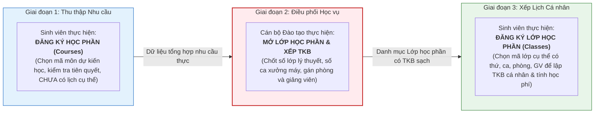
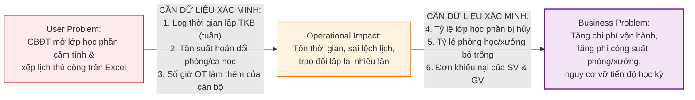
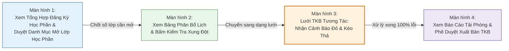

# ĐẠI HỌC BÁCH KHOA HÀ NỘI
## TRƯỜNG CÔNG NGHỆ THÔNG TIN VÀ TRUYỀN THÔNG (SOICT)
### HỌC PHẦN: PHÂN TÍCH VÀ THIẾT KẾ HỆ THỐNG (IT3120)

---

# BÁO CÁO BÀI TẬP 1: PROBLEM DISCOVERY, LEAN UX CANVAS & MVP EXPERIMENT
## ĐỀ TÀI: HỆ THỐNG QUẢN TRỊ ĐÀO TẠO ĐẠI HỌC THEO HỌC CHẾ TÍN CHỈ (HBA SIS)
### TỔ CHỨC NGHIÊN CỨU: HỌC VIỆN BÁCH NGHỆ HÀ NỘI (HBA)
### BỐI CẢNH: CHUYỂN ĐỔI MÔ HÌNH QUẢN TRỊ TỪ NIÊN CHẾ SANG HỌC CHẾ TÍN CHỈ

---

> **THÔNG TIN DỰ ÁN & NHÓM THỰC HIỆN:**
> - **Học phần:** Phân tích và Thiết kế Hệ thống (IT3120) — Kỳ 2026.1
> - **Đơn vị đào tạo:** Viện CNTT&TT — Đại học Bách Khoa Hà Nội
> - **Cơ quan giả định:** Học viện Bách Nghệ Hà Nội (HBA) — Quy mô ~35.000 sinh viên, ~1.500 giảng viên
> - **Phương pháp luận:** Product Discovery, Problem Statement Canvas, Lean UX Canvas & MVP Usability Testing
> - **Mô hình tham chiếu nghiệp vụ:** Chu trình 2 giai đoạn đăng ký tín chỉ chuẩn hóa của Đại học Bách Khoa Hà Nội (HUST)

---

## MỤC LỤC BÁO CÁO

- [PHẦN MỞ ĐẦU: BỐI CẢNH NGHIỆP VỤ TẠI HBA](#phần-mở-đầu-bối-cảnh-nghiệp-vụ-tại-hba)
  - [1. Cú sốc chuyển đổi mô hình từ Niên chế sang Tín chỉ](#1-cú-sốc-chuyển-đổi-mô-hình-từ-niên-chế-sang-tín-chỉ)
  - [2. Phân biệt nghiệp vụ cốt lõi: Đăng ký Học phần (Course) vs Đăng ký Lớp học phần (Class)](#2-phân-biệt-nghiệp-vụ-cốt-lõi-đăng-ký-học-phần-course-vs-đăng-ký-lớp-học-phần-class)
  - [3. Nút thắt cổ chai cấp bách: Mở lớp theo cảm tính & Vỡ trận điều phối thời khóa biểu](#3-nút-thắt-cổ-chai-cấp-bách-mở-lớp-theo-cảm-tính--vỡ-trận-điều-phối-thời-khóa-biểu)
- [BÀI TẬP 1: USER NEEDS & USER PROBLEM STATEMENT](#bài-tập-1-user-needs--user-problem-statement)
  - [1.1. Bảng xác định 4 User Needs cốt lõi của 4 tác nhân](#11-bảng-xác-định-4-user-needs-cốt-lõi-của-4-tác-nhân)
  - [1.2. Lựa chọn User Need ưu tiên của Cán bộ Đào tạo](#12-lựa-chọn-user-need-ưu-tiên-của-cán-bộ-đào-tạo)
  - [1.3. Phát biểu User Problem Statement trọng tâm của Cán bộ Đào tạo](#13-phát-biểu-user-problem-statement-trọng-tâm-của-cán-bộ-đào-tạo)
- [BÀI TẬP 2: USER PROBLEM STATEMENT CANVAS](#bài-tập-2-user-problem-statement-canvas)
- [BÀI TẬP 3: USER PROBLEM VÀ BUSINESS PROBLEM](#bài-tập-3-user-problem-và-business-problem)
  - [3.1. Bảng bộ tứ liên kết nhân quả xuyên suốt](#31-bảng-bộ-tứ-liên-kết-nhân-quả-xuyên-suốt)
  - [3.2. Danh mục dữ liệu vận hành cần thu thập để xác minh mối liên hệ](#32-danh-mục-dữ-liệu-vận-hành-cần-thu-thập-để-xác-minh-mối-liên-hệ)
  - [3.3. Phân tích nguyên nhân gốc rễ bằng kỹ thuật 5 Whys](#33-phân-tích-nguyên-nhân-gốc-rễ-bằng-kỹ-thuật-5-whys)
- [BÀI TẬP 4: LEAN UX CANVAS](#bài-tập-4-lean-ux-canvas)
  - [4.1. Bảng Lean UX Canvas hoàn chỉnh](#41-bảng-lean-ux-canvas-hoàn-chỉnh)
  - [4.2. Hệ thống 3 Giả thuyết kiểm chứng](#42-hệ-thống-3-giả-thuyết-kiểm-chứng)
- [BÀI TẬP 5: MVP VÀ KẾ HOẠCH THỬ NGHIỆM](#bài-tập-5-mvp-và-kế-hoạch-thử-nghiệm)
  - [5.1. Mục tiêu thử nghiệm](#51-mục-tiêu-thử-nghiệm)
  - [5.2. MVP: Đặc tả nguyên mẫu bấm được (Clickable Prototype 4 màn hình)](#52-mvp-đặc-tả-nguyên-mẫu-bấm-được-clickable-prototype-4-màn-hình)
  - [5.3. Quy trình thử nghiệm thực địa (Usability Testing)](#53-quy-trình-thử-nghiệm-thực-địa-usability-testing)
  - [5.4. Hệ thống chỉ số đo lường thành công](#54-hệ-thống-chỉ-số-đo-lường-thành-công)

---

# PHẦN MỞ ĐẦU: BỐI CẢNH NGHIỆP VỤ & CÚ SỐC VẬN HÀNH TẠI HBA

### 1. Cú sốc chuyển đổi mô hình từ Niên chế sang Tín chỉ
Học viện Bách Nghệ Hà Nội (HBA) là cơ sở giáo dục đại học công lập trọng điểm đào tạo khối ngành kỹ thuật và công nghệ ứng dụng với quy mô khoảng **35.000 sinh viên** chính quy và hơn **1.500 cán bộ, giảng viên**.

Trước thời điểm nghiên cứu, Học viện vận hành hoàn toàn theo mô hình **Học chế Niên chế**:
* Sinh viên khi nhập học được xếp cố định vào các lớp sinh hoạt hành chính (30–40 sinh viên/lớp) và gắn bó suốt 4–5 năm.
* Nhà trường lập sẵn **thời khóa biểu trọn gói cố định** cho từng lớp sinh hoạt; sinh viên chỉ việc đi học theo lịch cứng, hoàn toàn không có khái niệm tự chọn môn hay đăng ký môn học trực tuyến.
* Học phí được thu cào bằng phẳng một lần vào đầu năm học.

Học viện vừa quyết định chuyển đổi toàn diện mô hình quản trị sang **Học chế Tín chỉ**. Mô hình mới trao quyền chủ động cho người học: sinh viên được tự chọn môn, tự lập tiến độ học tập, đăng ký học phần lý thuyết và ghép ca xưởng thực hành phù hợp với năng lực cá nhân.

---

### 2. Phân biệt nghiệp vụ cốt lõi: Đăng ký Học phần (Course) vs Đăng ký Lớp học phần (Class)
Để phân tích chính xác quy trình quản trị đào tạo theo học chế tín chỉ, cần phân định rạch ròi 2 khái niệm nghiệp vụ nền tảng:

* **Đăng ký Học phần (Course Registration):** Diễn ra trước kỳ học (6–8 tuần trước khai giảng). Sinh viên đăng ký danh mục các **học phần** (môn học, ví dụ: *IT3120, MI1111*) dự định học kỳ tới dựa trên chương trình đào tạo và điều kiện tiên quyết. Ở bước này, **hoàn toàn chưa có thời khóa biểu cụ thể**. Mục đích là xác định chính xác tổng nhu cầu người học đối với từng học phần.
* **Đăng ký Lớp học phần (Class Registration):** Diễn ra sau khi Phòng Đào tạo đã lập và công bố thời khóa biểu (2–3 tuần trước khai giảng). Sinh viên đăng ký vào các **lớp học phần cụ thể** (đã có mã lớp, thứ, ca, phòng học, giảng viên phụ trách, ví dụ: *Lớp IT3120-145620, Thứ 3 ca 1–3, Phòng D9-401*) để tạo lập thời khóa biểu cá nhân chính thức và làm căn cứ tính học phí tín chỉ.

---

### 3. Nút thắt cổ chai cấp bách: Mở lớp theo cảm tính & Vỡ trận điều phối thời khóa biểu
Khi chuyển sang tín chỉ, nút thắt đầu tiên, nặng nề và cấp bách nhất đè nặng lên vai **Cán bộ Phòng Đào tạo (CBĐT)** nằm ở khoảng trống giữa 2 giai đoạn trên:
* **Mở lớp theo cảm tính do thiếu bước Đăng ký học phần:** Phần mềm niên chế cũ không hỗ trợ cổng cho sinh viên Đăng ký học phần trước kỳ. Do đó, Phòng Đào tạo hoàn toàn "mù thông tin" về nhu cầu thực tế của từng môn. Việc quyết định mở bao nhiêu **lớp học phần lý thuyết** và bao nhiêu **ca xưởng máy** chủ yếu dựa vào ước lượng cảm tính, dẫn đến tình trạng nhiều lớp học phần mở ra không đủ sĩ số sàn phải hủy, trong khi nhiều lớp học phần chuyên ngành lại thiếu chỗ nghiêm trọng.
* **Bùng nổ dữ liệu và xung đột tài nguyên:** Từ hơn 100 lớp niên chế cố định trước đây, nay bùng nổ thành hơn 2.500 lớp học phần tín chỉ rời rạc. Việc phân bổ phòng học lý thuyết (180 phòng) và các xưởng thực hành công nghệ (giới hạn nghiêm ngặt $\le 20$ sinh viên/ca máy) vẫn làm thủ công trên các **bảng tính Excel rời rạc**. Hậu quả là tỷ lệ trùng phòng, trùng giờ giảng viên lên tới 15%, thời gian lập TKB kéo dài 4 tuần làm chậm trễ đợt Đăng ký lớp học phần của toàn trường.

Do đó, nhiệm vụ số hóa cấp bách hàng đầu trong giai đoạn đầu chuyển đổi tín chỉ chính là **xây dựng công cụ thu thập nhu cầu Đăng ký học phần của sinh viên, hỗ trợ Cán bộ Đào tạo lập kế hoạch mở các lớp học phần chuẩn xác và điều phối thời khóa biểu chống xung đột**.

---

# BÀI TẬP 1: XÁC ĐỊNH NHU CẦU NGƯỜI DÙNG & PHÁT BIỂU VẤN ĐỀ (USER NEEDS & PROBLEM STATEMENT)

### 1.1. Bảng xác định 4 User Needs cốt lõi của 4 tác nhân
Nhóm đã tiến hành khảo sát toàn diện 4 nhóm tác nhân liên quan trong cuộc chuyển đổi tại Học viện Bách Nghệ Hà Nội:

| Mã | Tác nhân | Nhu cầu người dùng (Bắt đầu bằng động từ hành động) | Bối cảnh xảy ra | Rào cản hiện tại | Hệ quả thực tế | Phân loại |
|:---:|---|---|---|---|---|:---:|
| **UN-01** | **Cán bộ Đào tạo** | **Tổng hợp nhu cầu và điều phối** kế hoạch mở lớp học phần và thời khóa biểu dựa trên dữ liệu Đăng ký học phần của sinh viên | 6–8 tuần trước khi học kỳ mới bắt đầu, khi chuẩn bị danh mục các lớp học phần tín chỉ | Chưa có kênh thu thập Đăng ký học phần tập trung; việc xếp phòng học và giảng viên vẫn làm thủ công trên các file Excel phân tán | Mở lớp học phần theo cảm tính dẫn đến thừa/thiếu lớp; dễ xung đột phòng học, mất 4 tuần lập TKB làm trễ tiến độ toàn trường | `[Evidence]` |
| **UN-02** | **Sinh viên** | **Đăng ký học phần** dự kiến học và tra cứu sơ đồ cây môn tiên quyết để chủ động lộ trình học kỳ tới | 8–10 tuần trước ngày khai giảng học kỳ mới | Hệ thống cũ không có tính năng Đăng ký học phần trước kỳ; sinh viên quen tâm lý niên chế thụ động | Không chủ động được lộ trình học, đến đợt Đăng ký lớp học phần mới biết học phần mình cần không được mở hoặc hết chỗ | `[Evidence]` |
| **UN-03** | **Giảng viên** | **Tiếp nhận và xác nhận** lịch phân công giảng dạy các lớp học phần lý thuyết và ca xưởng thực hành ổn định | 3–4 tuần trước ngày khai giảng năm học mới | Lịch lớp học phần liên tục bị điều chỉnh thủ công do giải quyết xung đột phòng học của Phòng Đào tạo | Giảng viên bị động trong sắp xếp lịch nghiên cứu và công tác; khó chuẩn bị giáo án và vật tư xưởng | `[Assumption]` |
| **UN-04** | **Cán bộ Tài chính** | **Thiết lập cấu hình** bảng đơn giá học phí theo từng tín chỉ (nhân hệ số ca xưởng 1.2–1.5) và định mức công nợ | Giai đoạn chuẩn bị dữ liệu tài chính đầu kỳ | Phần mềm tài vụ cũ chỉ hỗ trợ thu phẳng trọn gói theo năm, không liên thông với danh mục lớp học phần mở | Phải tính toán học phí thủ công từng sinh viên trên bảng tính; chậm ra thông báo công nợ sau đợt Đăng ký lớp học phần | `[Evidence]` |

---

### 1.2. Lựa chọn User Need ưu tiên của Cán bộ Đào tạo
* **User Need được chọn làm trọng tâm:** **UN-01 — Cán bộ Đào tạo**.
* **Lý do lựa chọn:** Trong mô hình đào tạo theo học chế tín chỉ, kế hoạch mở các lớp học phần và thời khóa biểu là **điều kiện tiên quyết số 1** kích hoạt toàn bộ chu trình đào tạo:
  1. Sinh viên chỉ có thể thực hiện **Đăng ký lớp học phần (Class Registration)** khi Phòng Đào tạo đã công bố danh mục lớp học phần mở và khung giờ học chuẩn xác.
  2. Giảng viên chỉ có thể lên giáo án và sắp xếp lịch công tác khi có lịch phân công giảng dạy lớp học phần chính thức.
  3. Cán bộ Tài chính chỉ có thể xác định học phí khi danh mục lớp học phần và số ca xưởng đã được phê duyệt.
* Giải quyết triệt để nút thắt của Cán bộ Đào tạo là bước đi then chốt và cấp bách nhất để toàn bộ hệ thống HBA SIS đi vào vận hành thông suốt.

---

### 1.3. Phát biểu User Problem Statement trọng tâm của Cán bộ Đào tạo
Áp dụng công thức chuẩn mực:
$$\text{[Người dùng]} + \text{gặp khó khăn khi [Mục tiêu]} + \text{trong [Bối cảnh]} + \text{vì [Trở ngại]} + \text{dẫn đến [Hệ quả]}$$

> **TUYÊN BỐ VẤN ĐỀ NGƯỜI DÙNG (USER PROBLEM STATEMENT):**
> 
> *"**Cán bộ Phòng Đào tạo Học viện Bách Nghệ Hà Nội** gặp khó khăn nghiêm trọng khi **thiết lập kế hoạch mở các lớp học phần và điều phối thời khóa biểu** trong **giai đoạn chuẩn bị học kỳ tín chỉ đầu tiên khi vừa chuyển đổi từ mô hình niên chế**, vì **chưa có kênh tổng hợp dữ liệu Đăng ký học phần thực tế của sinh viên và các công cụ bảng tính Excel thủ công cũ không kiểm soát nổi sự bùng nổ của hơn 2.500 lớp học phần cùng ma trận phòng học/xưởng phức tạp**, dẫn đến **tiến độ lập TKB bị trễ hạn 3–4 tuần, hơn 15% lớp học phần bị xung đột phòng/giờ hoặc mất cân đối sĩ số nghiêm trọng, khiến kế hoạch đào tạo đầu kỳ bị xáo trộn và cán bộ giáo vụ bị kiệt sức**."*

---

# BÀI TẬP 2: BẢN ĐỒ VẤN ĐỀ NGƯỜI DÙNG (USER PROBLEM STATEMENT CANVAS)

### 2.1. Bảng User Problem Statement Canvas chuẩn 6 thành phần

| Thành phần Canvas | Nội dung phân tích chi tiết đối với Cán bộ Đào tạo HBA |
|---|---|
| **1. User** *(Ai là người dùng?)* | Chuyên viên quản lý đào tạo, cán bộ giáo vụ phụ trách kế hoạch học vụ và xếp thời khóa biểu tại Phòng Đào tạo và Văn phòng các Khoa/Viện thuộc Học viện Bách Nghệ Hà Nội. |
| **2. Context** *(Xảy ra khi nào, ở đâu?)* | Xảy ra trong khoảng 6–8 tuần trước khi học kỳ mới bắt đầu, tại Văn phòng Phòng Đào tạo HBA trong đợt chuẩn bị triển khai học kỳ tín chỉ. |
| **3. Goal** *(Mục tiêu người dùng muốn đạt được?)* | Nắm bắt chính xác nhu cầu qua dữ liệu Đăng ký học phần của sinh viên để thiết lập danh mục lớp học phần mở sát thực tế, tối ưu hóa công suất phòng học lý thuyết và xưởng thực hành, hoàn tất thời khóa biểu chuẩn xác không xung đột phòng/giờ trước đợt Đăng ký lớp học phần 2 tuần. |
| **4. Pain Point** *(Điểm đau / khó khăn gặp phải?)* | Mở lớp học phần theo cảm tính do thiếu số liệu Đăng ký học phần trước kỳ; việc xếp lịch thủ công trên bảng tính Excel rất dễ trùng phòng học và trùng giờ giảng viên; mất hàng tuần để rà soát lỗi thủ công và liên tục phải chắp vá sửa đổi TKB khi bị phản ánh. |
| **5. Current Alternative** *(Cách đang tự giải quyết hiện tại?)* | - Thu thập đề xuất mở lớp học phần và danh sách giảng viên từ các Bộ môn qua file Excel rời rạc gửi email. - Nhập liệu thủ công từng lớp học phần vào bảng tính tổng hợp. - Dò tìm phòng học trống và kiểm tra trùng lịch giảng viên bằng mắt thường. - Xử lý khiếu nại trùng lịch bằng cách hoán đổi thủ công từng ca học trên Excel. |
| **6. Evidence / Assumptions** *(Bằng chứng và Giả định)* | **• Đã biết từ tình huống (Evidence):** - Quy chế đào tạo tín chỉ mới đã ban hành chính thức, quy định rõ điều kiện tiên quyết và quy chuẩn mở lớp học phần. - Số lượng lớp học phần tăng vọt từ hơn 100 lớp niên chế lên hơn 2.500 lớp học phần tín chỉ. - Công cụ làm việc duy nhất hiện tại là phần mềm niên chế cũ và các bảng tính Excel ngoại tuyến.  **• Cần nghiên cứu / khảo sát thêm để xác minh (Assumptions):** - Tỷ lệ sinh viên chủ động tham gia Đăng ký học phần sớm trước kỳ mới. - Tần suất phát sinh lỗi trùng phòng và trùng giờ giảng viên trong các bản dự thảo TKB đầu tiên. - Số giờ làm thêm ngoài giờ (OT) của cán bộ giáo vụ để hoàn thành TKB cho 1 Khoa. |

---

# BÀI TẬP 3: MỐI QUAN HỆ GIỮA VẤN ĐỀ NGƯỜI DÙNG VÀ VẤN ĐỀ TỔ CHỨC (USER PROBLEM & BUSINESS PROBLEM)

### 3.1. Bảng bộ tứ liên kết nhân quả xuyên suốt

| Thành phần kết nối | Nội dung đặc tả bám sát bối cảnh Học viện Bách Nghệ Hà Nội |
|---|---|
| **1. User Problem** *(Vấn đề người dùng)* | Cán bộ Đào tạo khó thiết lập kế hoạch mở lớp học phần phù hợp khi chưa có dữ liệu Đăng ký học phần thực tế của sinh viên và phải điều phối lịch học thủ công trên bảng tính Excel dễ phát sinh xung đột. |
| **2. Operational Impact có thể có** *(Tác động vận hành nội bộ)* | - Cán bộ giáo vụ tốn hàng trăm giờ công nhập liệu, dò tìm phòng trống và sửa đổi lịch học thủ công. - Thường xuyên phát sinh sai lệch thông tin thời khóa biểu lớp học phần giữa Phòng Đào tạo, các Khoa và Giảng viên. - Lịch học bị chậm trễ làm dồn ứ toàn bộ các khâu Đăng ký lớp học phần, thu học phí và chuẩn bị phôi liệu xưởng thực hành. |
| **3. Business Problem giả định** *(Vấn đề kinh doanh tổ chức)* | Quy trình mở lớp học phần cảm tính và xếp thời khóa biểu thủ công có thể làm tăng chi phí vận hành hành chính, gây lãng phí 20% công suất phòng học/xưởng và đe dọa trực tiếp đến sự thành công của công cuộc chuyển đổi sang học chế tín chỉ của Học viện. |
| **4. Desired Outcomes** *(Kết quả mong muốn)* | - Giảm thời gian lập kế hoạch mở lớp học phần và hoàn tất thời khóa biểu từ 4 tuần xuống $\le 7$ ngày làm việc. - Triệt tiêu hoàn toàn lỗi trùng phòng học lý thuyết, trùng ca xưởng và trùng giờ giảng viên trước khi công bố TKB chính thức. - Giảm tỷ lệ lớp học phần bị hủy đột ngột do thiếu sĩ số sàn từ 12% xuống $< 4\%$. - Nâng cao hiệu suất khai thác phòng học lý thuyết lên $75–80\%$ và xưởng thực hành lên $65–70\%$ (đảm bảo thời gian bảo trì máy móc an toàn). |

---

### 3.2. Danh mục dữ liệu vận hành cần thu thập để xác minh mối liên hệ
*Nguyên tắc phương pháp luận: "Mối liên hệ giữa hai vấn đề cần được xác minh bằng dữ liệu vận hành, không suy diễn trực tiếp thành kết luận"*:

* **Dữ liệu 1:** Bảng chấm công làm thêm giờ (OT) của chuyên viên Phòng Đào tạo trong tháng cao điểm lập TKB (hiện ghi nhận trung bình 40–50 giờ OT/người).
* **Dữ liệu 2:** Thống kê số lượng lớp học phần bị hủy do không đủ sĩ số sàn trong kỳ chuyển đổi đầu tiên (chiếm khoảng 12% tổng số lớp mở).
* **Dữ liệu 3:** Sổ nhật ký điều chỉnh thời khóa biểu tại các Giảng đường: ghi nhận số ca lớp học phần phải đổi phòng hoặc đổi giờ đột xuất trong tuần đầu khai giảng.

---

### 3.3. Phân tích nguyên nhân gốc rễ bằng kỹ thuật 5 Whys

* **Vấn đề xuất phát:** Thời khóa biểu học kỳ tín chỉ đầu tiên của Học viện Bách Nghệ Hà Nội bị trễ hạn 4 tuần, phát sinh nhiều lớp học phần bị hủy và gây bức xúc lớn cho giảng viên lẫn sinh viên.

| Tầng Why | Câu hỏi đào sâu | Câu trả lời phân tích nghiệp vụ tại HBA |
|:---:|---|---|
| **Why 1** | *Tại sao thời khóa biểu bị trễ hạn và xảy ra hàng loạt xung đột phòng/giờ?* | Vì Cán bộ Đào tạo phải mất quá nhiều thời gian để dò tìm thủ công lịch bận của hơn 1.500 giảng viên và ghép lịch hơn 2.500 lớp học phần vào phòng học trên các bảng tính Excel phân tán. |
| **Why 2** | *Tại sao việc xếp lịch trên bảng tính Excel lại tốn thời gian và dễ phát sinh xung đột?* | Vì các bảng tính Excel hoạt động ngoại tuyến, không có cơ chế tự động kiểm tra chéo các quy tắc ràng buộc (không trùng phòng, không trùng GV, đúng sĩ số ca xưởng) giữa hàng nghìn lớp học phần cùng lúc. |
| **Why 3** | *Tại sao không có kế hoạch mở lớp học phần ổn định ngay từ đầu mà phải liên tục chắp vá sửa đổi TKB?* | Vì danh mục lớp học phần mở ban đầu không khớp với nhu cầu học thực tế của sinh viên, dẫn đến nhiều lớp học phần mở ra bị thiếu người phải hủy, trong khi nhiều lớp chuyên ngành lại thiếu chỗ. |
| **Why 4** | *Tại sao Phòng Đào tạo lại không nắm được nhu cầu thực tế của người học trước khi mở lớp?* | Vì nhà trường chưa có quy trình và cổng trực tuyến cho sinh viên **Đăng ký học phần (Course Registration)** trước khi lập kế hoạch mở các **Lớp học phần (Classes)**. |
| **Why 5 (Root Cause)** | *Tại sao lại có sự lệch pha nghiêm trọng giữa quy chế mới và công cụ quản trị?* | Học viện chuyển đổi sang mô hình tín chỉ về mặt **chính sách đào tạo**, nhưng **quy trình thu thập nhu cầu người học (Đăng ký học phần) và công cụ điều phối lớp học phần vẫn giữ nguyên tư duy thụ động thời niên chế**, dẫn đến tình trạng quá tải hành chính khi dữ liệu bùng nổ. |

---

# BÀI TẬP 4: KHUNG GIẢI PHÁP TINH GỌN (LEAN UX CANVAS)

### 4.1. Bảng Lean UX Canvas hoàn chỉnh
Bảng tổng hợp bám sát cấu trúc phân định chuẩn mực giữa Vấn đề & Mục tiêu và Giải pháp & Thử nghiệm theo Slide 59 & Slide 60:

| Tên thành phần | Nội dung chi tiết chuẩn mực bám sát Slide 59 & Slide 60 |
|---|---|
|**Business Problem** *(Vấn đề kinh doanh)* | Quy trình mở lớp học phần theo cảm tính và xếp thời khóa biểu thủ công trên Excel khi chưa thu thập dữ liệu Đăng ký học phần của sinh viên tiêu tốn hàng trăm giờ công của cán bộ giáo vụ, làm chậm trễ tiến độ công bố lịch học 3–4 tuần, gây lãng phí 20% công suất phòng/xưởng và đe dọa uy tín chất lượng đào tạo của Học viện. |
|**Business Outcomes** *(Kết quả kinh doanh kỳ vọng)* | - Giảm thời gian lập kế hoạch mở lớp học phần và hoàn tất TKB từ 4 tuần xuống $\le 7$ ngày làm việc. - Triệt tiêu hoàn toàn lỗi xung đột phòng học, ca xưởng và trùng giờ giảng viên trước khi công bố TKB chính thức. - Giảm tỷ lệ lớp học phần bị hủy đột ngột do thiếu sĩ số sàn từ 12% xuống $< 4\%$. - Nâng cao hiệu suất khai thác phòng học lý thuyết lên $75–80\%$ và xưởng thực hành lên $65–70\%$ (đảm bảo thời gian bảo trì máy móc an toàn). |
|**Users** *(Người sử dụng — Gồm cả 2 phía Slide 59)* | **• Người dùng nội bộ trực tiếp:** Cán bộ Phòng Đào tạo (chuyên viên lập kế hoạch & điều phối TKB); Ban Chủ nhiệm Khoa/Bộ môn (phân công giảng viên). **• Người dùng thụ hưởng / liên đới:** Giảng viên (nhận lịch dạy lớp học phần cố định); Sinh viên HBA (Đăng ký học phần và nhận danh mục lớp học phần mở đủ chỗ để tiến hành Đăng ký lớp học phần). |
|**User Outcomes & Benefits** *(Lợi ích đạt được — Tách rõ 2 phía)* | **• Đối với Cán bộ Đào tạo / Giáo vụ (Người dùng nội bộ):** - Nắm rõ số lượng lớp học phần cần mở dựa trên dữ liệu Đăng ký học phần thực tế của sinh viên. - Nhận diện tức thì các vị trí xung đột phòng/giờ trên giao diện trực quan, giảm 70% thao tác kiểm tra thủ công lặp lại. **• Đối với Giảng viên & Sinh viên (Người dùng thụ hưởng):** - Giảng viên nhận lịch giảng dạy lớp học phần cố định sớm 3 tuần, an tâm chuẩn bị giáo án và vật tư xưởng. - Sinh viên chủ động đăng ký học phần theo lộ trình, được học đúng các lớp học phần cần thiết, không lo bị hủy lớp đột ngột. |
|**Solutions** *(Ý tưởng giải pháp)* | **Phân hệ Hỗ trợ Lập Kế hoạch Mở Lớp & Điều Phối Thời Khóa Biểu (HBA Course Planner & Timetable Assistant):** 1. Cổng Đăng ký học phần (Course Registration) cho sinh viên trước kỳ học. 2. Bảng tổng hợp nhu cầu tự động đối chiếu điều kiện tiên quyết và đề xuất số lớp học phần lý thuyết/ca xưởng cần mở. 3. Công cụ hỗ trợ phân bổ lịch học dự thảo theo các quy tắc ràng buộc (không trùng phòng, trùng GV, đúng sĩ số ca xưởng). 4. Giao diện lưới thời khóa biểu tương tác hỗ trợ kéo thả vi chỉnh và cảnh báo xung đột trực quan. |
|**Hypotheses** *(Hệ thống giả thuyết kiểm chứng)* | *"Chúng tôi tin rằng **thời gian lập TKB sẽ rút ngắn 75% và không còn xung đột phòng/giờ khi xuất bản** nếu **Cán bộ Đào tạo** đạt được **khả năng phát hiện xung đột tức thì và thao tác điều chỉnh kéo thả dễ dàng** nhờ vào **Giao diện Lưới Thời khóa biểu Tương tác có kiểm soát ràng buộc tự động**."* |
|**What We Need to Learn** *(Điều cần học hỏi / Giả định rủi ro)* | - Sinh viên có tích cực tham gia Đăng ký học phần sớm trước kỳ không (tỷ lệ tham gia kỳ vọng $\ge 80\%$)? - Cán bộ giáo vụ có hiểu và thao tác thuận tiện với các thông báo cảnh báo lỗi xung đột màu đỏ trên giao diện lưới không? - Cơ chế gợi ý ô trống màu xanh có giúp họ xử lý các ca điều chỉnh lịch nhanh hơn bảng tính Excel không? |
|**MVP / Experiment** *(Nguyên mẫu thử nghiệm nhỏ nhất)* | Tạo một **nguyên mẫu tương tác có thể bấm được trên Figma (Clickable Prototype gồm 4 màn hình)** cho luồng nghiệp vụ: Xem tổng hợp nhu cầu từ Đăng ký học phần $\rightarrow$ Xem bảng phân bổ lịch dự thảo $\rightarrow$ Kiểm tra cảnh báo đỏ & kéo thả vi chỉnh sang ô xanh $\rightarrow$ Phê duyệt xuất bản TKB; tiến hành thử nghiệm với cán bộ giáo vụ HBA. |

---

### 4.2. Hệ thống 3 Giả thuyết kiểm chứng
Áp dụng mẫu câu giả thuyết chuẩn:
> *"Chúng tôi tin rằng **[Business Outcome]** sẽ đạt được nếu **[Đối tượng người dùng]** đạt được **[User Benefit]** nhờ vào **[Tính năng / Solution]**."*

1. **Giả thuyết 1 (Về Xác định nhu cầu thực tế qua Đăng ký học phần):**  
   *"Chúng tôi tin rằng **tỷ lệ lớp học phần bị hủy do thiếu sĩ số sàn sẽ giảm từ 12% xuống dưới 4%** nếu **Cán bộ Đào tạo** đạt được **dữ liệu nhu cầu học tập thực tế và chính xác của sinh viên trước kỳ** nhờ vào **Tính năng Đăng ký Học phần Trực tuyến**."*

2. **Giả thuyết 2 (Về Kiểm soát ràng buộc & Loại bỏ xung đột):**  
   *"Chúng tôi tin rằng **tỷ lệ xung đột phòng học lý thuyết và xưởng thực hành sẽ triệt tiêu về 0% trước khi xuất bản** nếu **Cán bộ Đào tạo** đạt được **cảnh báo tức thời về các vị trí trùng phòng/giờ** nhờ vào **Bộ máy Kiểm tra Quy tắc Ràng buộc Tự động**."*

3. **Giả thuyết 3 (Về Năng suất vận hành & Tinh chỉnh linh hoạt):**  
   *"Chúng tôi tin rằng **thời gian hoàn tất thời khóa biểu toàn trường sẽ rút ngắn từ 4 tuần xuống dưới 7 ngày** nếu **Cán bộ Đào tạo** đạt được **khả năng kéo thả điều chỉnh các ca học ngoại lệ trên giao diện lưới trực quan** nhờ vào **Giao diện Lưới Thời khóa biểu Tương tác Hỗ trợ Quyết định**."*

---

# BÀI TẬP 5: NGUYÊN MẪU KHẢ THI TỐI THIỂU & KẾ HOẠCH THỬ NGHIỆM (MVP & USABILITY EXPERIMENT)

### 5.1. Mục tiêu thử nghiệm
* **Mục tiêu:** Kiểm tra liệu việc **nắm bắt nhu cầu thực qua dữ liệu Đăng ký học phần kết hợp với giao diện lưới xếp lịch tương tác có cảnh báo xung đột trực quan** có giúp **Cán bộ Đào tạo lập kế hoạch mở các lớp học phần chuẩn xác và hoàn tất thời khóa biểu dễ dàng, nhanh chóng hơn** so với quy trình lập bảng tính Excel thủ công hay không.

---

### 5.2. MVP: Đặc tả nguyên mẫu bấm được (Clickable Prototype 4 màn hình)
Nguyên mẫu tương tác kiểm chứng 1 luồng công việc (Use Case) cốt lõi nhất của Cán bộ Đào tạo trên Figma, gồm đúng 4 bước màn hình theo cấu trúc:

1. **Màn hình 1: Tổng hợp Nhu cầu từ Đăng ký Học phần của Sinh viên & Phê duyệt Mở Lớp học phần**
   - Hiển thị danh sách các học phần tín chỉ kèm số lượng sinh viên thực tế đã thực hiện Đăng ký học phần trực tuyến (ví dụ: *Học phần Kỹ thuật số: 245 SV đăng ký học phần; 210 SV đủ điều kiện tiên quyết*).
   - Hệ thống tự động đề xuất số lớp học phần lý thuyết cần mở (sĩ số chuẩn 70–80 SV/lớp) và số ca xưởng thực hành (giới hạn nghiêm ngặt $\le 20$ SV/ca máy).
   - Cán bộ kiểm tra số liệu thực tế và bấm nút: **"PHÊ DUYỆT DANH MỤC LỚP HỌC PHẦN MỞ"**.

2. **Màn hình 2: Bảng Phân bổ Lịch học Dự thảo theo Ràng buộc**
   - Hiển thị danh sách các lớp học phần đã được gán phòng học lý thuyết, xưởng máy và giảng viên theo quy tắc cơ bản.
   - Cán bộ xem xét tổng thể danh sách và bấm nút chuyển sang giao diện kiểm tra: **"KIỂM TRA XUNG ĐỘT TRÊN LƯỚI THỜI KHÓA BIỂU"**.

3. **Màn hình 3: Lưới Thời khóa biểu Tương tác — Nhận diện Xung đột & Vi chỉnh Kéo thả**
   - Hệ thống hiển thị toàn bộ lịch học trên lưới tuần trực quan (Thứ 2 đến Thứ 7, Ca 1 đến Ca 6).
   - **Mô phỏng tình huống xung đột:** Có 1 ca học bị **nhấp nháy viền đỏ kèm icon cảnh báo (!): "Trùng phòng Xưởng Cơ khí 1 vào Sáng Thứ 4 với lớp CK02"**.
   - **Tương tác người dùng:** Cán bộ nhấp chuột vào ca học bị lỗi $\rightarrow$ Hệ thống tự động làm sáng các ô trống khả dụng màu xanh lá cây (các ô không bị trùng phòng và giảng viên rảnh) $\rightarrow$ Cán bộ **kéo thả (drag-and-drop)** ca học sang ô xanh $\rightarrow$ Viền đỏ biến mất, lịch chuyển sang trạng thái an toàn.

4. **Màn hình 4: Báo cáo Công suất Phòng/Xưởng & Xác nhận Xuất bản**
   - Hiển thị bảng tổng hợp trước khi ban hành: Tỷ lệ lấp đầy phòng học ($73\%$), tỷ lệ lấp đầy xưởng máy ($68\%$), thông báo xác nhận: *"0 xung đột phòng học và giảng viên"*.
   - Cán bộ kiểm tra lần cuối và bấm nút: **"PHÊ DUYỆT & XUẤT BẢN THỜI KHÓA BIỂU CHÍNH THỨC"**.
   - Hệ thống hiển thị thông báo thành công và chuyển dữ liệu danh mục lớp học phần sang cổng **Đăng ký Lớp học phần (Class Registration)** của sinh viên.

---

### 5.3. Quy trình thử nghiệm thực địa (Usability Testing)

1. **Mời nhóm người dùng thử nghiệm:**
   - Mời **5–6 chuyên viên Phòng Đào tạo và cán bộ giáo vụ Khoa** tại Học viện Bách Nghệ Hà Nội trực tiếp tham gia thử nghiệm trên nguyên mẫu Figma.
   - Giao nhiệm vụ cụ thể (Task Scenario):  
     *"Thầy/Cô hãy sử dụng nguyên mẫu để xem xét số lượng sinh viên Đăng ký học phần, duyệt mở các lớp học phần cho Khoa Cơ khí, phát hiện ca học đang bị cảnh báo trùng phòng trên lưới thời khóa biểu, thực hiện kéo thả sang vị trí hợp lệ và bấm xuất bản thời khóa biểu."*

2. **Quan sát trực tiếp quá trình thao tác:**
   - Người điều phối quan sát và ghi nhận:
     - Thời gian để cán bộ nhận biết được ca lớp học phần bị cảnh báo viền đỏ trên lưới lịch.
     - Cán bộ có hiểu ý nghĩa của các ô màu xanh khi nhấp vào ca lỗi hay không.
     - Số lần thao tác nhầm hoặc ngập ngừng khi thực hiện kéo thả ca học.

3. **Phỏng vấn định tính sau thử nghiệm (Bám sát Slide 61–62):**
   - Phỏng vấn người tham gia dựa trên 2 câu hỏi trọng tâm:
     1. *"Thầy/Cô có gặp điểm nào khó hiểu hoặc khó thao tác trên giao diện lưới kéo thả khi xử lý ca trùng phòng không?"*
     2. *"So với việc dò tìm thủ công trên bảng tính Excel, Thầy/Cô cảm thấy tự tin bao nhiêu phần trăm về tính chính xác khi bấm nút 'Phê duyệt & Xuất bản' để mở cổng Đăng ký lớp học phần cho sinh viên?"*

---

### 5.4. Hệ thống chỉ số đo lường thành công
Tuân thủ đầy đủ 3 nhóm chỉ số định lượng bắt buộc tại **Slide 61 & 62**:

| Nhóm chỉ số đo lường | Định nghĩa & Phương pháp đo | Mục tiêu kỳ vọng (Target) | Ý nghĩa đánh giá theo Lean UX |
|---|---|:---:|---|
| **1. Tỷ lệ hoàn thành nhiệm vụ** | Tỷ lệ cán bộ giáo vụ hoàn thành trọn vẹn luồng từ Màn hình 1 đến Màn hình 4 mà không cần người hướng dẫn trợ giúp. | $\mathbf{\ge 85\%}$ | Đánh giá tính khả dụng và sự rõ ràng của luồng nghiệp vụ mở lớp học phần và xếp lịch mới. |
| **2. Thời gian nhận diện và xử lý lỗi** | Thời gian trung bình để cán bộ phát hiện ca trùng phòng viền đỏ và kéo thả thành công sang ô xanh hợp lệ. | $\mathbf{\le 1.5\text{ phút}}$ | Chứng minh sự đột phá về năng suất so với hiện trạng dò tìm thủ công mất 15–20 phút trên Excel. |
| **3. Độ dễ hiểu và phản hồi định tính** | - Tỷ lệ nhận diện đúng nguyên nhân cảnh báo đỏ. - Điểm tự tin khi xác nhận xuất bản TKB. | **$\ge 90\%$ nhận diện đúng** $\mathbf{\ge 8.5/10}$ điểm tự tin | Khẳng định tính trực quan của UI; giải tỏa áp lực tâm lý lo sợ sai sót hành chính của cán bộ giáo vụ. |
