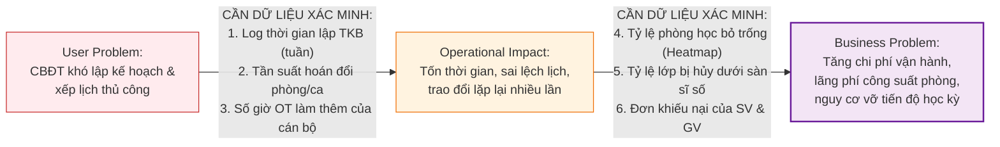
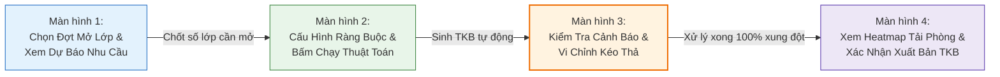

# ĐẠI HỌC BÁCH KHOA HÀ NỘI
## TRƯỜNG CÔNG NGHỆ THÔNG TIN VÀ TRUYỀN THÔNG (SOICT)
### HỌC PHẦN: PHÂN TÍCH VÀ THIẾT KẾ HỆ THỐNG (IT3120)

---

# BÁO CÁO BÀI TẬP 1: PROBLEM DISCOVERY, LEAN UX CANVAS & MVP EXPERIMENT
## ĐỀ TÀI: HỆ THỐNG QUẢN TRỊ ĐÀO TẠO ĐẠI HỌC THEO HỌC CHẾ TÍN CHỈ (HBA SIS)
### TỔ CHỨC NGHIÊN CỨU: HỌC VIỆN BÁCH NGHỆ HÀ NỘI (HBA)
### BỐI CẢNH: CHUYỂN ĐỔI MÔ HÌNH QUẢN TRỊ TỪ NIÊN CHẾ SANG HỌC CHẾ TÍN CHỈ

---

> **THÔNG TIN DỰ ÁN & NHÓM THỰC HIỆN:**
> - **Học phần:** Phân tích và Thiết kế Hệ thống (IT3120) — Kỳ 2026.1
> - **Đơn vị đào tạo:** Viện CNTT&TT — Đại học Bách Khoa Hà Nội
> - **Cơ quan giả định:** Học viện Bách Nghệ Hà Nội (HBA) — Quy mô ~35.000 sinh viên, ~1.500 giảng viên
> - **Phương pháp luận:** Product Discovery, Problem Statement Canvas, Lean UX Canvas & MVP Usability Testing
> - **Căn cứ tài liệu bài giảng:** Bám sát 62 slides bài giảng và Slide đáp án chuẩn (Slide 57–61) trong `docs/OOAD_Lab_B1-5.md`

---

## MỤC LỤC BÁO CÁO

- [ĐẠI HỌC BÁCH KHOA HÀ NỘI](#đại-học-bách-khoa-hà-nội)
  - [TRƯỜNG CÔNG NGHỆ THÔNG TIN VÀ TRUYỀN THÔNG (SOICT)](#trường-công-nghệ-thông-tin-và-truyền-thông-soict)
    - [HỌC PHẦN: PHÂN TÍCH VÀ THIẾT KẾ HỆ THỐNG (IT3120)](#học-phần-phân-tích-và-thiết-kế-hệ-thống-it3120)
- [BÁO CÁO BÀI TẬP 1: PROBLEM DISCOVERY, LEAN UX CANVAS \& MVP EXPERIMENT](#báo-cáo-bài-tập-1-problem-discovery-lean-ux-canvas--mvp-experiment)
  - [ĐỀ TÀI: HỆ THỐNG QUẢN TRỊ ĐÀO TẠO ĐẠI HỌC THEO HỌC CHẾ TÍN CHỈ (HBA SIS)](#đề-tài-hệ-thống-quản-trị-đào-tạo-đại-học-theo-học-chế-tín-chỉ-hba-sis)
    - [TỔ CHỨC NGHIÊN CỨU: HỌC VIỆN BÁCH NGHỆ HÀ NỘI (HBA)](#tổ-chức-nghiên-cứu-học-viện-bách-nghệ-hà-nội-hba)
    - [BỐI CẢNH: CHUYỂN ĐỔI MÔ HÌNH QUẢN TRỊ TỪ NIÊN CHẾ SANG HỌC CHẾ TÍN CHỈ](#bối-cảnh-chuyển-đổi-mô-hình-quản-trị-từ-niên-chế-sang-học-chế-tín-chỉ)
  - [MỤC LỤC BÁO CÁO](#mục-lục-báo-cáo)
- [PHẦN MỞ ĐẦU: BỐI CẢNH NGHIỆP VỤ TẠI HBA](#phần-mở-đầu-bối-cảnh-nghiệp-vụ-tại-hba)
    - [1. Cú sốc chuyển đổi mô hình từ Niên chế sang Tín chỉ](#1-cú-sốc-chuyển-đổi-mô-hình-từ-niên-chế-sang-tín-chỉ)
    - [2. Nút thắt cổ chai cấp bách: Cán bộ Đào tạo vỡ trận trong khâu mở lớp \& xếp TKB](#2-nút-thắt-cổ-chai-cấp-bách-cán-bộ-đào-tạo-vỡ-trận-trong-khâu-mở-lớp--xếp-tkb)
- [BÀI TẬP 1: USER NEEDS \& USER PROBLEM STATEMENT](#bài-tập-1-user-needs--user-problem-statement)
    - [1.1. Bảng xác định 4 User Needs cốt lõi của 4 tác nhân](#11-bảng-xác-định-4-user-needs-cốt-lõi-của-4-tác-nhân)
    - [1.2. Lựa chọn User Need ưu tiên](#12-lựa-chọn-user-need-ưu-tiên)
    - [1.3. Phát biểu User Problem Statement trọng tâm của Cán bộ Đào tạo](#13-phát-biểu-user-problem-statement-trọng-tâm-của-cán-bộ-đào-tạo)
- [BÀI TẬP 2: USER PROBLEM STATEMENT CANVAS](#bài-tập-2-user-problem-statement-canvas)
- [BÀI TẬP 3: USER PROBLEM VÀ BUSINESS PROBLEM](#bài-tập-3-user-problem-và-business-problem)
    - [3.1. Bảng bộ tứ liên kết nhân quả xuyên suốt](#31-bảng-bộ-tứ-liên-kết-nhân-quả-xuyên-suốt)
    - [3.2. Danh mục dữ liệu vận hành cần thu thập để xác minh mối liên hệ](#32-danh-mục-dữ-liệu-vận-hành-cần-thu-thập-để-xác-minh-mối-liên-hệ)
    - [3.3. Phân tích nguyên nhân gốc rễ bằng kỹ thuật 5 Whys](#33-phân-tích-nguyên-nhân-gốc-rễ-bằng-kỹ-thuật-5-whys)
- [BÀI TẬP 4: LEAN UX CANVAS](#bài-tập-4-lean-ux-canvas)
    - [4.1. Bảng Lean UX Canvas hoàn chỉnh](#41-bảng-lean-ux-canvas-hoàn-chỉnh)
    - [4.2. Hệ thống 3 Giả thuyết kiểm chứng](#42-hệ-thống-3-giả-thuyết-kiểm-chứng)
- [BÀI TẬP 5: MVP VÀ KẾ HOẠCH THỬ NGHIỆM](#bài-tập-5-mvp-và-kế-hoạch-thử-nghiệm)
    - [5.1. Mục tiêu thử nghiệm](#51-mục-tiêu-thử-nghiệm)
    - [5.2. MVP: Đặc tả nguyên mẫu bấm được (Clickable Prototype 4 màn hình)](#52-mvp-đặc-tả-nguyên-mẫu-bấm-được-clickable-prototype-4-màn-hình)
    - [5.3. Quy trình thử nghiệm thực địa](#53-quy-trình-thử-nghiệm-thực-địa)
    - [5.4. Hệ thống chỉ số đo lường thành công](#54-hệ-thống-chỉ-số-đo-lường-thành-công)

---

# PHẦN MỞ ĐẦU: BỐI CẢNH NGHIỆP VỤ TẠI HBA

### 1. Cú sốc chuyển đổi mô hình từ Niên chế sang Tín chỉ
Học viện Bách Nghệ Hà Nội (HBA) là cơ sở giáo dục đại học công lập trọng điểm đào tạo khối ngành kỹ thuật và công nghệ ứng dụng với quy mô khoảng **35.000 sinh viên** chính quy và hơn **1.500 cán bộ, giảng viên**.

Trước thời điểm nghiên cứu, Học viện vận hành hoàn toàn theo mô hình **Học chế Niên chế**:
* Sinh viên khi nhập học được xếp cố định vào các lớp sinh hoạt hành chính (30–40 sinh viên/lớp) và gắn bó suốt 4–5 năm.
* Nhà trường lập sẵn **thời khóa biểu trọn gói cố định** cho từng lớp sinh hoạt; sinh viên chỉ việc đi học theo lịch cứng, **hoàn toàn không có nhu cầu hay khái niệm tự đăng ký môn học trực tuyến**.
* Học phí được thu cào bằng phẳng một lần vào đầu năm học.

Học viện vừa quyết định chuyển đổi toàn diện mô hình quản trị sang **Học chế Tín chỉ**. Mô hình mới trao quyền chủ động cho người học: sinh viên được tự chọn môn, tự lập tiến độ học tập, đăng ký lớp học phần lý thuyết và ghép ca xưởng thực hành phù hợp với năng lực cá nhân.

---

### 2. Nút thắt cổ chai cấp bách: Cán bộ Đào tạo vỡ trận trong khâu mở lớp & xếp TKB
Khi chuyển sang tín chỉ, **hệ thống cổng đăng ký học phần trực tuyến cho sinh viên chưa từng tồn tại**. Nhưng trước khi sinh viên có thể đăng ký học, nút thắt đầu tiên, nặng nề và cấp bách nhất đè nặng lên vai **Cán bộ Phòng Đào tạo (CBĐT)**:
* **Bùng nổ dữ liệu:** Từ vài chục lớp niên chế cố định trước đây, nay bùng nổ thành hàng nghìn lớp học phần tín chỉ rời rạc.
* **Mất kiểm soát nhu cầu:** Phòng Đào tạo hoàn toàn "mù thông tin" về số lượng sinh viên dự kiến học từng môn trong kỳ tới. Chưa có công cụ tổng hợp tự động số lượng sinh viên đã trượt môn tiên quyết, số sinh viên cần học vượt, dẫn đến việc ước lượng số lớp cần mở chỉ dựa trên cảm tính.
* **Xung đột tài nguyên trầm trọng:** Việc xếp thời khóa biểu cho hơn 3.000 lớp học phần, cân đối giữa giảng viên, phòng học lý thuyết và các xưởng thực hành (bị giới hạn nghiêm ngặt 15–20 sinh viên/ca máy) vẫn thực hiện thủ công trên các **bảng tính Excel rời rạc**. Hậu quả là tỷ lệ trùng phòng, trùng giờ giảng viên lên tới 15–20%, thời gian lập TKB kéo dài 4–6 tuần làm chậm trễ tiến độ toàn bộ học kỳ.

Do đó, nhiệm vụ số hóa cấp bách hàng đầu trong giai đoạn đầu chuyển đổi tín chỉ chính là **xây dựng công cụ hỗ trợ Cán bộ Đào tạo lập kế hoạch mở lớp học phần và xếp thời khóa biểu tự động dựa trên dữ liệu nhu cầu thực tế**.

---

# BÀI TẬP 1: USER NEEDS & USER PROBLEM STATEMENT

### 1.1. Bảng xác định 4 User Needs cốt lõi của 4 tác nhân
Nhóm đã tiến hành khảo sát toàn diện 4 nhóm tác nhân liên quan trong cuộc chuyển đổi tại Học viện Bách Nghệ Hà Nội:

| Mã | Tác nhân | Nhu cầu người dùng | Bối cảnh xảy ra | Rào cản hiện tại | Hệ quả thực tế | Phân loại |
|:---:|---|---|---|---|---|:---:|
| **UN-01** | **Cán bộ Đào tạo** | **Thiết lập và điều phối** kế hoạch mở lớp học phần và thời khóa biểu dựa trên dữ liệu nhu cầu thực tế | 6–8 tuần trước khi học kỳ mới bắt đầu, khi chuyển đổi sang tín chỉ | Chưa có công cụ dự báo số lượng sinh viên; việc xếp phòng học và giảng viên vẫn làm thủ công trên Excel thời niên chế | Dễ xảy ra xung đột phòng học, trùng giờ giảng viên; mất 4 tuần lập TKB làm chậm trễ tiến độ toàn trường | `[Evidence]` |
| **UN-02** | **Sinh viên** | **Tra cứu và nắm bắt** sơ đồ cây môn học tiên quyết và danh mục lớp mở để chuẩn bị kế hoạch học tập | 2–4 tuần trước ngày bắt đầu đợt đăng ký tín chỉ | Chưa có hệ thống tra cứu trực quan; quy chế tín chỉ mới phức tạp, sinh viên quen tâm lý niên chế thụ động | Sinh viên bỡ ngỡ, không biết chọn môn nào trước, đăng ký sai môn dẫn đến nguy cơ chậm tiến độ tốt nghiệp | `[Evidence]` |
| **UN-03** | **Giảng viên** | **Tiếp nhận và xác nhận** lịch phân công giảng dạy lý thuyết và ca xưởng thực hành ổn định trước học kỳ | 4 tuần trước ngày khai giảng năm học mới | Lịch học phần liên tục bị điều chỉnh thủ công do giải quyết xung đột phòng học của Phòng Đào tạo | Giảng viên bị động trong sắp xếp lịch nghiên cứu và công tác; khó chuẩn bị giáo án thực hành xưởng | `[Assumption]` |
| **UN-04** | **Cán bộ Tài chính** | **Thiết lập cấu hình** bảng đơn giá học phí theo từng tín chỉ (nhân hệ số ca xưởng 1.2–1.5) và định mức công nợ | Giai đoạn chuẩn bị dữ liệu tài chính đầu kỳ | Phần mềm tài vụ cũ chỉ hỗ trợ thu phẳng trọn gói theo năm, không liên thông với dữ liệu lớp học phần | Phải tính toán học phí thủ công từng sinh viên trên bảng tính; chậm ra thông báo nợ học phí | `[Evidence]` |

---

### 1.2. Lựa chọn User Need ưu tiên
* **User Need được chọn làm trọng tâm:** **UN-01 — Cán bộ Đào tạo**.
* **Lý do lựa chọn:** Trong mô hình đào tạo theo học chế tín chỉ, kế hoạch mở lớp học phần và thời khóa biểu là **điều kiện tiên quyết số 1** của toàn bộ chu trình đào tạo. Nếu Cán bộ Đào tạo không thể mở lớp và không thể xếp được thời khóa biểu chống trùng phòng/giờ thì:
  1. Sinh viên hoàn toàn không có dữ liệu lớp để đăng ký học tập.
  2. Giảng viên không có lịch để chuẩn bị bài giảng và xưởng thực hành.
  3. Cán bộ Tài chính không có căn cứ số lượng tín chỉ/ca học để tính học phí.
* Do đó, tháo gỡ điểm nghẽn của Cán bộ Đào tạo là bước đi sống còn để kích hoạt toàn bộ hệ thống HBA SIS.

---

### 1.3. Phát biểu User Problem Statement trọng tâm của Cán bộ Đào tạo
> 
> *"**Cán bộ Phòng Đào tạo Học viện Bách Nghệ Hà Nội** gặp khó khăn nghiêm trọng khi **thiết lập kế hoạch mở lớp học phần và điều phối thời khóa biểu** trong **giai đoạn chuẩn bị học kỳ tín chỉ đầu tiên khi vừa chuyển đổi từ mô hình niên chế**, vì **các công cụ bảng tính Excel thủ công cũ không thể dự báo nhu cầu người học và không kiểm soát nổi sự bùng nổ của hàng nghìn lớp học phần cùng ma trận phòng học/xưởng phức tạp**, dẫn đến **tiến độ lập TKB bị trễ hạn 3–4 tuần, hơn 15% lớp học phần bị xung đột phòng/giờ hoặc mất cân đối sĩ số nghiêm trọng, khiến toàn bộ hoạt động đào tạo đầu kỳ bị xáo trộn và cán bộ giáo vụ bị kiệt sức (burnout)**."*

---

# BÀI TẬP 2: USER PROBLEM STATEMENT CANVAS

| Thành phần Canvas | Nội dung phân tích chi tiết đối với Cán bộ Đào tạo HBA |
|---|---|
| **1. User** *(Ai là người dùng?)* | Chuyên viên quản lý đào tạo, cán bộ giáo vụ phụ trách kế hoạch học vụ và xếp thời khóa biểu tại Phòng Đào tạo và Văn phòng các Khoa/Viện thuộc Học viện Bách Nghệ Hà Nội. |
| **2. Context** *(Xảy ra khi nào, ở đâu?)* | Xảy ra trong khoảng 6–8 tuần trước khi học kỳ mới bắt đầu, tại Văn phòng Phòng Đào tạo HBA trong đợt chuẩn bị triển khai học chế tín chỉ đầu tiên. |
| **3. Goal** *(Mục tiêu người dùng muốn đạt được?)* | Thiết lập danh mục lớp học phần đáp ứng đủ nhu cầu sinh viên, tối ưu hóa công suất phòng học lý thuyết và xưởng thực hành, hoàn tất thời khóa biểu chuẩn xác không xung đột phòng/giờ trước khai giảng 4 tuần. |
| **4. Pain Point** *(Điểm đau / khó khăn gặp phải?)* | Không thể nắm bắt nhu cầu người học thực tế do thiếu dữ liệu dự báo; việc xếp lịch thủ công trên bảng tính Excel rất dễ trùng phòng học và trùng giờ giảng viên; mất hàng tuần để rà soát lỗi thủ công và liên tục phải chắp vá sửa đổi TKB khi bị phản ánh. |
| **5. Current Alternative** *(Cách đang tự giải quyết hiện tại?)* | - Thu thập đề xuất mở lớp và danh sách giảng viên từ các Bộ môn qua file Excel rời rạc gửi email. - Nhập liệu thủ công từng lớp vào bảng tính tổng hợp. - Dò tìm phòng học trống và kiểm tra trùng lịch giảng viên bằng mắt thường. - Xử lý khiếu nại trùng lịch bằng cách hoán đổi thủ công từng ca học. |
| **6. Evidence / Assumptions** *(Bằng chứng và Giả định)* | **• Đã biết từ tình huống (Evidence):** - Quy chế đào tạo tín chỉ mới đã ban hành chính thức, quy định rõ điều kiện tiên quyết và quy chuẩn mở lớp. - Số lượng lớp học phần tăng vọt từ 120 lớp niên chế lên hơn 2.500 lớp tín chỉ. - Công cụ làm việc duy nhất hiện tại là phần mềm niên chế cũ và các bảng tính Excel ngoại tuyến.  **• Cần nghiên cứu / khảo sát thêm để xác minh (Assumptions):** - Tần suất phát sinh lỗi trùng phòng và trùng giờ giảng viên trong các bản dự thảo TKB đầu tiên. - Thời gian trung bình và số giờ làm thêm ngoài giờ (OT) của cán bộ giáo vụ để hoàn thành TKB cho 1 Khoa. - Mức độ bất tiện và tỷ lệ giảng viên phản ánh về lịch dạy bị đảo lộn trong tuần đầu tiên. |

---

# BÀI TẬP 3: USER PROBLEM VÀ BUSINESS PROBLEM

### 3.1. Bảng bộ tứ liên kết nhân quả xuyên suốt 

| Thành phần kết nối | Nội dung đặc tả bám sát bối cảnh Học viện Bách Nghệ Hà Nội (Slide 58) |
|---|---|
| **1. User Problem** *(Vấn đề người dùng)* | Cán bộ Đào tạo khó thiết lập và điều phối kế hoạch mở lớp học phần phù hợp khi chưa có dữ liệu dự báo nhu cầu thực tế của sinh viên và phải xếp lịch thủ công trên bảng tính Excel dễ phát sinh xung đột. |
| **2. Operational Impact có thể có** *(Tác động vận hành nội bộ)* | - Cán bộ giáo vụ dành nhiều thời gian (hàng trăm giờ công) nhập liệu, kiểm tra chéo và sửa đổi lịch học. - Có thể phát sinh trao đổi lặp lại nhiều lần hoặc sai lệch thông tin thời khóa biểu giữa Phòng Đào tạo, các Khoa và Giảng viên. - Lịch học bị chậm trễ làm dồn ứ toàn bộ các khâu đăng ký học phần, thu học phí và chuẩn bị cơ sở vật chất xưởng thực hành. |
| **3. Business Problem giả định** *(Vấn đề kinh doanh tổ chức)* | Quy trình lập kế hoạch và xếp thời khóa biểu thủ công có thể làm tăng công sức vận hành hành chính, hạn chế năng lực điều phối đào tạo của Học viện, gây lãng phí 20–30% công suất phòng học/xưởng và đe dọa trực tiếp đến sự thành công của công cuộc chuyển đổi sang học chế tín chỉ. |
| **4. Desired Outcomes** *(Kết quả mong muốn)* | - Giảm thời gian lập kế hoạch mở lớp và hoàn tất thời khóa biểu từ 4 tuần xuống $\le 5$ ngày. - Tăng tỷ lệ lớp học phần được xếp lịch thành công ngay trong lần chạy đầu tiên lên $\ge 95\%$. - Giảm lỗi trùng phòng học lý thuyết, trùng ca xưởng thực hành và trùng giờ giảng viên về **0%**. - Giảm tỷ lệ lớp học phần bị hủy do thiếu sĩ số sàn từ 12% xuống **< 3%**. |

---

### 3.2. Danh mục dữ liệu vận hành cần thu thập để xác minh mối liên hệ
Theo lưu ý cốt lõi tại **Slide 58**: *"Mối liên hệ giữa hai vấn đề cần được xác minh bằng dữ liệu vận hành, không suy diễn trực tiếp thành kết luận"*:

* **Dữ liệu 1:** Bảng chấm công làm thêm giờ (OT) của chuyên viên Phòng Đào tạo trong 2 tháng cao điểm trước học kỳ mới (hiện ghi nhận trung bình 40–50 giờ OT/người).
* **Dữ liệu 2:** Sổ nhật ký điều chỉnh thời khóa biểu tại các Giảng đường: ghi nhận số ca học phải đổi phòng đột xuất trong tuần đầu khai giảng.
* **Dữ liệu 3:** Báo cáo thống kê hiệu suất sử dụng phòng học (Room Utilization Rate): đo lường công suất khai thác thực tế của 180 phòng học lý thuyết và 35 xưởng thực hành công nghệ tại HBA.

---

### 3.3. Phân tích nguyên nhân gốc rễ bằng kỹ thuật 5 Whys

* **Vấn đề xuất phát:** Thời khóa biểu học kỳ tín chỉ đầu tiên của Học viện Bách Nghệ Hà Nội bị trễ hạn 4 tuần, phát sinh hàng trăm xung đột phòng học và gây bức xúc lớn cho giảng viên lẫn sinh viên.

| Tầng Why | Câu hỏi đào sâu | Câu trả lời phân tích nghiệp vụ tại HBA |
|:---:|---|---|
| **Why 1** | *Tại sao thời khóa biểu bị trễ hạn và xảy ra hàng loạt xung đột phòng/giờ?* | Vì Cán bộ Đào tạo phải mất quá nhiều thời gian để dò tìm thủ công lịch bận của hơn 1.500 giảng viên và xếp thủ công hơn 2.500 lớp học phần vào 180 phòng học trên các bảng tính Excel phân tán. |
| **Why 2** | *Tại sao không thể xếp lịch nhanh và chính xác hơn trên bảng tính Excel?* | Vì bảng tính Excel không có thuật toán tự động giải bài toán ràng buộc (Constraint Satisfaction) và không thể phát hiện xung đột thời gian thực giữa ca thực hành xưởng (15–20 SV) và giờ lý thuyết tập trung (80–120 SV). |
| **Why 3** | *Tại sao không biết trước số lượng lớp cần mở để chủ động phân bổ phòng học hợp lý?* | Vì Phòng Đào tạo không có công cụ tự động quét cây môn tiên quyết và lịch sử học tập để dự báo chính xác có bao nhiêu sinh viên đủ điều kiện học từng học phần trong kỳ tới. |
| **Why 4** | *Tại sao lại thiếu các công cụ dự báo và tự động hóa xếp lịch thiết yếu này?* | Vì Học viện vẫn tận dụng lại hạ tầng phần mềm quản lý niên chế cũ; phần mềm cũ chỉ thiết kế để gán cứng một thời khóa biểu duy nhất cho cả lớp sinh hoạt hành chính cố định. |
| **Why 5 (Root Cause)** | *Tại sao lại có sự lệch pha nghiêm trọng giữa quy chế mới và công cụ cũ?* | Học viện Bách Nghệ Hà Nội thực hiện chuyển đổi mô hình đào tạo từ Niên chế sang Tín chỉ về mặt **chính sách** nhưng chưa chuẩn bị kịp thời nền tảng **chuyển đổi số** tương ứng, dẫn đến việc dùng nhân lực hành chính thủ công để gánh vác sự bùng nổ phức tạp khổng lồ của mô hình tín chỉ. |

---

# BÀI TẬP 4: LEAN UX CANVAS

### 4.1. Bảng Lean UX Canvas hoàn chỉnh

Bảng tổng hợp bám sát cấu trúc phân định rạch ròi giữa Vấn đề & Mục tiêu và Giải pháp & Thử nghiệm:

| Tên thành phần | Nội dung chi tiết chuẩn mực bám sát Slide 59 & Slide 60 |
|---|---|
|**Business Problem** *(Vấn đề kinh doanh)* | Quy trình dự báo nhu cầu mở lớp và xếp thời khóa biểu thủ công có thể tiêu tốn hàng trăm giờ công của nhân viên, làm chậm trễ tiến độ công bố lịch học 3–4 tuần, gây lãng phí 20–30% công suất phòng học/xưởng và đe dọa uy tín chất lượng đào tạo của Học viện Bách Nghệ Hà Nội. |
|**Business Outcomes** *(Kết quả kinh doanh kỳ vọng)* | - Giảm thời gian lập kế hoạch mở lớp và hoàn tất TKB từ 4 tuần xuống $\le 5$ ngày. - Giảm tỷ lệ xung đột phòng học, trùng giờ giảng viên về **0%**. - Giảm tỷ lệ lớp học phần bị hủy do không đủ sĩ số sàn (<15 SV) từ 12% xuống **< 3%**. - Nâng cao hiệu suất khai thác phòng học lý thuyết và xưởng thực hành từ 65% lên tối thiểu **88%**. |
|**Users** *(Người sử dụng — Gồm cả 2 phía Slide 59)* | **• Người dùng nội bộ trực tiếp:** Cán bộ Phòng Đào tạo (chuyên viên lập kế hoạch & điều phối TKB); Ban Chủ nhiệm Khoa/Bộ môn (phân công giảng viên). **• Người dùng thụ hưởng / liên đới:** Giảng viên (nhận lịch dạy cố định); Sinh viên HBA (nhận danh mục lớp mở đủ chỗ để chuẩn bị đăng ký học phần). |
|**User Outcomes & Benefits** *(Lợi ích đạt được — Tách rõ 2 phía)* | **• Đối với Cán bộ Đào tạo / Giáo vụ (Người dùng nội bộ):** - Tự động tính toán số lớp lý thuyết và số ca xưởng cần mở dựa trên dữ liệu dự báo sạch. - Thuật toán tự động xếp lịch và cảnh báo xung đột tức thì, giảm 80% thao tác kiểm tra thủ công lặp lại. **• Đối với Giảng viên & Sinh viên (Người dùng thụ hưởng):** - Giảng viên nhận lịch giảng dạy cố định sớm 4 tuần, an tâm chuẩn bị giáo án và công tác. - Sinh viên có đầy đủ lớp học phần theo đúng tiến độ lộ trình tín chỉ, không lo bị hủy lớp đột ngột. |
|**Solutions** *(Ý tưởng giải pháp)* | **Phân hệ Quản trị Kế hoạch Mở Lớp & Xếp Thời Khóa Biểu Tín chỉ Tự động (HBA Course Planner & Timetable Engine):** 1. Module tổng hợp dự báo nhu cầu học phần dựa trên chương trình khung và lịch sử học bạ. 2. Bộ máy thuật toán xếp lịch tự động giải bài toán ràng buộc (phòng, giảng viên, ca xưởng). 3. Giao diện lưới thời khóa biểu tương tác hỗ trợ phát hiện xung đột và vi chỉnh kéo thả trực quan. 4. Bảng điều khiển (Dashboard) phân tích công suất phòng học và xuất bản TKB tự động. |
|**Hypotheses** *(Hệ thống giả thuyết kiểm chứng)* | *"Chúng tôi tin rằng **thời gian hoàn thành TKB sẽ giảm 75% và không còn xung đột phòng** nếu **Cán bộ Đào tạo** đạt được **khả năng chạy thuật toán xếp lịch tự động và vi chỉnh kéo thả với cảnh báo tức thì** nhờ vào **Bộ máy Xếp TKB & Phát hiện Xung đột Tự động**."* |
|**What We Need to Learn** *(Điều cần học hỏi / Giả định rủi ro)* | - Cán bộ Đào tạo có hiểu và tin tưởng vào kết quả phân bổ phòng/giờ của thuật toán tự động không? - Giao diện lưới kéo thả có giúp họ xử lý các ca xung đột ngoại lệ dễ dàng hơn bảng tính Excel không? - Thuật toán có đáp ứng được các ràng buộc phức tạp của các ca xưởng thực hành (15–20 SV/ca máy) không? |
|**MVP / Experiment** *(Nguyên mẫu thử nghiệm nhỏ nhất)* | Tạo một **nguyên mẫu tương tác có thể bấm được trên máy tính (Clickable Prototype gồm 4 màn hình Figma)** cho luồng nghiệp vụ: Dự báo nhu cầu $\rightarrow$ Chạy thuật toán xếp lịch $\rightarrow$ Kiểm tra cảnh báo & vi chỉnh kéo thả $\rightarrow$ Xác nhận xuất bản TKB; tiến hành thử nghiệm với một nhóm cán bộ giáo vụ HBA. |

---

### 4.2. Hệ thống 3 Giả thuyết kiểm chứng 
Áp dụng mẫu câu giả thuyết chuẩn:
> *"Chúng tôi tin rằng **[Business Outcome]** sẽ đạt được nếu **[Đối tượng người dùng]** đạt được **[User Benefit]** nhờ vào **[Tính năng / Solution]**."*

1. **Giả thuyết 1 (Về Dự báo nhu cầu mở lớp):**  
   *"Chúng tôi tin rằng **tỷ lệ lớp học phần bị hủy do thiếu sĩ số sàn sẽ giảm từ 12% xuống dưới 3%** nếu **Cán bộ Đào tạo và Lãnh đạo Khoa** đạt được **dữ liệu dự báo chính xác số lượng sinh viên đủ điều kiện học từng môn** nhờ vào **Module Dự báo Nhu cầu Học phần Tín chỉ**."*

2. **Giả thuyết 2 (Về Tự động hóa xếp lịch & Xóa bỏ xung đột):**  
   *"Chúng tôi tin rằng **tỷ lệ xung đột phòng học lý thuyết và xưởng thực hành sẽ giảm về 0%** nếu **Cán bộ Đào tạo** đạt được **kết quả phân bổ phòng/giờ tối ưu kèm cảnh báo xung đột thời gian thực** nhờ vào **Bộ máy Xếp Lịch Tự Động dựa trên bài toán ràng buộc**."*

3. **Giả thuyết 3 (Về Năng suất vận hành & Tinh chỉnh linh hoạt):**  
   *"Chúng tôi tin rằng **thời gian lập thời khóa biểu toàn trường sẽ rút ngắn từ 4 tuần xuống dưới 5 ngày** nếu **Cán bộ Đào tạo** đạt được **khả năng vi chỉnh kéo thả các ca học ngoại lệ trên giao diện lưới trực quan** nhờ vào **Giao diện Lưới Thời khóa biểu Tương tác Chống Xung đột**."*

---

# BÀI TẬP 5: MVP VÀ KẾ HOẠCH THỬ NGHIỆM

### 5.1. Mục tiêu thử nghiệm
* **Mục tiêu:** Kiểm tra liệu việc **tự động hóa dự báo nhu cầu mở lớp, chạy thuật toán xếp lịch và hỗ trợ công cụ vi chỉnh kéo thả có cảnh báo xung đột tức thì** có giúp **Cán bộ Đào tạo lập kế hoạch mở lớp và hoàn tất thời khóa biểu dễ dàng, nhanh chóng và chính xác hơn** so với việc dùng bảng tính Excel thủ công hay không.

---

### 5.2. MVP: Đặc tả nguyên mẫu bấm được (Clickable Prototype 4 màn hình)
Nguyên mẫu tương tác kiểm chứng 1 luồng công việc (Use Case) cốt lõi nhất của Cán bộ Đào tạo, gồm đúng 4 bước màn hình theo cấu trúc:

1. **Màn hình 1: Chọn đợt mở lớp và xem dự báo nhu cầu học phần**
   - Cán bộ chọn học kỳ tác nghiệp (ví dụ: *Học kỳ 1 — Năm học 2026–2027*).
   - Hệ thống hiển thị danh sách các môn tín chỉ của Học viện kèm số lượng sinh viên dự kiến đủ điều kiện học (tự động tính từ cây tiên quyết).
   - Hệ thống tự động đề xuất số lớp lý thuyết cần mở (sĩ số chuẩn 80 SV/lớp) và số ca xưởng thực hành (sĩ số tối đa 20 SV/ca). Cán bộ bấm nút "Duyệt kế hoạch mở lớp".

2. **Màn hình 2: Cấu hình ràng buộc & Chạy thuật toán xếp lịch**
   - Hiển thị danh mục tài nguyên: Danh sách phòng học lý thuyết, xưởng máy khả dụng và danh sách giảng viên đã được Khoa phân công.
   - Cán bộ thiết lập các tham số ưu tiên (tránh xếp ca xưởng buổi tối, ưu tiên giảng viên cơ hữu).
   - Cán bộ bấm nút nổi bật: **"⚡ CHẠY THUẬT TOÁN XẾP LỊCH TỰ ĐỘNG"**.

3. **Màn hình 3: Lưới Thời khóa biểu tương tác — Kiểm tra xung đột & Vi chỉnh kéo thả**
   - Hệ thống hiển thị kết quả phân bổ trên lưới TKB tuần trực quan (Thứ 2 đến Thứ 7, Ca 1 đến Ca 6).
   - **Xử lý xung đột thực tế:** Nếu có 2 ca học bị trùng giảng viên hoặc trùng phòng thực hành xưởng, ô thời khóa biểu sẽ **nhấp nháy viền đỏ kèm icon cảnh báo (!)**.
   - Cán bộ nhấp chuột vào ca học bị lỗi, hệ thống tự động làm sáng các ô trống khả dụng màu xanh lá cây; cán bộ chỉ việc **kéo thả (drag-and-drop)** ca học sang ô xanh để triệt tiêu xung đột.

4. **Màn hình 4: Báo cáo công suất phòng học & Màn hình xác nhận**
   - Hiển thị báo cáo tổng quan trước khi phê duyệt: Biểu đồ nhiệt (Heatmap) thể hiện tỷ lệ lấp đầy phòng học/xưởng (đạt 89%), thống kê 0% xung đột phòng/giờ.
   - Cán bộ kiểm tra lại lần cuối danh sách lớp và bấm nút: **"PHÊ DUYỆT & XUẤT BẢN THỜI KHÓA BIỂU"**.
   - Hệ thống hiển thị hộp thoại xác nhận thành công và tự động đồng bộ TKB lên cổng dữ liệu chung.

---

### 5.3. Quy trình thử nghiệm thực địa

1. **Mời nhóm người dùng thử nghiệm:**
   - Mời **6–8 chuyên viên Phòng Đào tạo và cán bộ giáo vụ Khoa** tại Học viện Bách Nghệ Hà Nội trực tiếp tham gia thử nghiệm.
   - Giao nhiệm vụ cụ thể: *"Hãy sử dụng nguyên mẫu để hoàn tất kế hoạch mở lớp và xếp thời khóa biểu cho Khoa Cơ khí (gồm 30 lớp học phần lý thuyết và 45 ca thực hành xưởng), xử lý hết các cảnh báo trùng phòng/giờ và bấm xuất bản TKB"*.

2. **Quan sát trực tiếp quá trình thao tác:**
   - Người điều phối quan sát và ghi hình màn hình thao tác:
     - Ghi nhận thời gian hoàn thành từng bước.
     - Đếm số lần cán bộ thao tác nhầm hoặc bối rối không biết kéo thả ca học về đâu.
     - Ghi lại các thắc mắc, câu hỏi phát sinh khi thấy thông báo cảnh báo xung đột màu đỏ.

3. **Phỏng vấn định tính sau thử nghiệm:**
   - Phỏng vấn người tham gia dựa trên 2 câu hỏi trọng tâm của Slide 61:
     1. *"Thầy/Cô có gặp điểm nào khó hiểu hoặc khó thao tác trên giao diện lưới kéo thả không?"*
     2. *"Thầy/Cô cảm thấy tự tin bao nhiêu phần trăm về tính chính xác khi bấm nút 'Phê duyệt & Xuất bản Thời khóa biểu'?"*

---

### 5.4. Hệ thống chỉ số đo lường thành công
Tuân thủ đầy đủ 3 nhóm chỉ số định lượng bắt buộc tại **Slide 61**:

| Nhóm chỉ số đo lường | Định nghĩa & Phương pháp đo | Mục tiêu kỳ vọng (Target) | Ý nghĩa đánh giá theo Lean UX |
|---|---|:---:|---|
| **1. Tỷ lệ hoàn thành nhiệm vụ** | Tỷ lệ cán bộ giáo vụ hoàn thành trọn vẹn luồng từ Màn hình 1 đến Màn hình 4 mà không cần người hướng dẫn can thiệp trợ giúp. | $\mathbf{\ge 8 5\%}$ | Đánh giá tính khả dụng và mức độ trực quan của quy trình nghiệp vụ mới trên phần mềm. |
| **2. Thời gian hoàn tất nhiệm vụ** | Thời gian trung bình để một cán bộ hoàn tất xếp TKB cho 30 lớp học phần của Khoa thí điểm. | $\mathbf{\le 15\text{ phút}}$ | Chứng minh sự đột phá về năng suất so với hiện trạng làm thủ công mất 3–4 ngày trên Excel. |
| **3. Số lỗi và phản hồi định tính** | - Số lỗi xung đột phòng/giờ còn sót lại sau khi xuất bản TKB. - Mức độ tự tin khi xác nhận xuất bản. | **0 lỗi sót** $\mathbf{\ge 8.5/10}$ điểm tự tin | Khẳng định độ tin cậy tuyệt đối của thuật toán; giải tỏa áp lực lo sợ trách nhiệm hành chính của cán bộ. |

---

