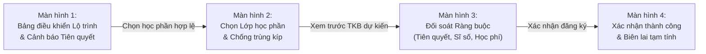

# PHIẾU BÀI LÀM BÀI TẬP 1 — THÀNH VIÊN 1
## TÁC NHÂN: SINH VIÊN (SV) & CHUYÊN ĐỀ LEAN UX + MVP EXPERIMENT

> **Thông tin thành viên:**
> - Họ và tên: `[Điền họ và tên]`
> - Mã số sinh viên: `[Điền MSSV]`
> - Tác nhân phụ trách chính: **Sinh viên**
> - Hạng mục bài tập đảm nhận: **TH1 (User Needs & Problem Statement) + TH2 (Problem Canvas) + TH4 (Lean UX Canvas) + TH5 (MVP & Kế hoạch thử nghiệm)**
> - Tài liệu slide tham chiếu: Slide 7–21, 33–44, 56–62 trong `docs/OOAD_Lab_B1-5.md`

---

## PHẦN A: THỰC HÀNH 1 — USER NEEDS & USER PROBLEM STATEMENT (SLIDE 7–15, 56)

### A.1. Bảng xác định Nhu cầu Người dùng (User Needs) của Sinh viên
*Lưu ý: Nhu cầu phải bắt đầu bằng động từ hành động, phản ánh mục tiêu cần đạt, không mô tả tính năng phần mềm.*

| Mã | Nhu cầu người dùng (Bắt đầu bằng động từ) | Bối cảnh xảy ra | Rào cản hiện tại | Hệ quả thực tế | Phân loại |
|---|---|---|---|---|---|
| **UN-SV-01** | **Tra cứu** tình trạng đáp ứng môn học tiên quyết và điều kiện học phần trước đợt đăng ký | Chuẩn bị kế hoạch học tập cá nhân cho học kỳ mới (khoảng 1–2 tuần trước ngày mở cổng đăng ký) | Thông tin điều kiện tiên quyết nằm phân tán trong sổ tay PDF hoặc cây chương trình đào tạo phức tạp; không có công cụ tự động đối soát với bảng điểm tích lũy | Sinh viên chọn nhầm lớp mà bản thân chưa đủ điều kiện, dẫn đến nguy cơ bị hủy lớp muộn và lỡ tiến độ học tập | `[Evidence]` |
| **UN-SV-02** | **Lập và điều chỉnh** thời khóa biểu dự kiến không bị xung đột lịch học / lịch thi | Khi các khoa viện công bố danh sách lớp học phần mở trong kỳ | Phải dùng giấy nháp hoặc bảng tính Excel tự vẽ; lớp nhanh chóng hết chỗ (full slot) trong vài phút đầu mở cổng | Mất nhiều giờ sắp xếp lịch nhưng khi vào đăng ký thực tế thì lớp đã kín, phải vội vàng tìm lớp thay thế gây trùng kíp | `[Evidence]` |
| **UN-SV-03** | **Đăng ký và xác nhận** thành công các lớp học phần mong muốn trong đợt đăng ký | Vào các khung giờ mở cổng đăng ký tín chỉ trực tuyến (thường diễn ra rất căng thẳng) | Hệ thống thường xuyên nghẽn mạng do lượng truy cập đồng thời lớn; thông báo lỗi không rõ nguyên nhân (trùng lịch, nợ phí hay hết chỗ) | Sinh viên hoang mang, phải tải lại trang nhiều lần, dễ bị mất lượt hoặc đăng ký thiếu số tín chỉ tối thiểu theo quy chế | `[Evidence]` |
| **UN-SV-04** | **Kiểm tra và theo dõi** trạng thái hoàn thành nghĩa vụ học phí để đảm bảo quyền đăng ký hợp lệ | Trước và sau khi hoàn tất đăng ký học phần | Dữ liệu gạch nợ học phí từ ngân hàng sang hệ thống đào tạo có độ trễ (12–48 giờ); không có cảnh báo trước thời hạn khóa cổng | Đã nộp tiền qua ngân hàng nhưng vẫn bị hệ thống khóa quyền đăng ký hoặc bị cảnh báo hủy môn học | `[Assumption]` |
| **UN-SV-05** | **Gửi yêu cầu cứu xét / mở thêm lớp** khi không đăng ký được các môn học bắt buộc | Khi tất cả các lớp của học phần bắt buộc đã kín chỗ | Phải nộp đơn giấy trực tiếp tại Phòng Đào tạo hoặc qua văn phòng Viện; thời gian chờ duyệt kéo dài không rõ kết quả | Chờ đợi trong bất an, nguy cơ phải học kéo dài thêm 1 kỳ chỉ vì thiếu 1 môn tiên quyết | `[Assumption]` |

---

### A.2. Phát biểu Vấn đề Người dùng Ưu tiên (User Problem Statement)
*Độ dài từ 50–100 từ. Áp dụng công thức chuẩn: [Người dùng] gặp khó khăn khi [mục tiêu] trong [bối cảnh], vì [trở ngại], dẫn đến [hệ quả].*

> **Phát biểu vấn đề lựa chọn:**
> 
> "Sinh viên Bách Khoa gặp khó khăn nghiêm trọng khi lập kế hoạch và hoàn thành đăng ký học phần trong các đợt đăng ký tín chỉ đầu kỳ, vì thông tin điều kiện tiên quyết và tình trạng lớp mở phân tán, kết hợp với hiện tượng nghẽn mạng và thiếu cơ chế cảnh báo trùng lịch tức thời, dẫn đến việc sinh viên mất hàng giờ căng thẳng chờ đợi, tỷ lệ đăng ký hỏng cao và đối mặt với nguy cơ chậm tiến độ tốt nghiệp từ 1 đến 2 học kỳ."

* **Số từ:** 82 từ.
* **Kiểm tra tiêu chí:**
  - [x] Có xác định đúng đối tượng (Sinh viên Bách Khoa).
  - [x] Có bối cảnh (Các đợt đăng ký tín chỉ đầu kỳ).
  - [x] Nêu rõ trở ngại (Dữ liệu phân tán, nghẽn mạng, thiếu cảnh báo trùng lịch).
  - [x] Nêu rõ hệ quả (Mất thời gian, hỏng đăng ký, chậm tốt nghiệp).
  - [x] **Không chứa từ ngữ giải pháp** (không nói "cần xây app mobile", "cần website mới").

---

### A.3. Các Giả định Cần Nghiên Cứu Thêm
1. `[Assumption 1]`: Liệu việc hiển thị trước cảnh báo môn tiên quyết có thực sự giúp giảm trên 50% số đơn xin cứu xét học vụ không?
2. `[Assumption 2]`: Sinh viên sẵn sàng để hệ thống tự động gợi ý lịch học tối ưu thay vì tự chọn từng lớp thủ công?
3. `[Assumption 3]`: Tỷ lệ sinh viên bị khóa đăng ký do chậm đối soát học phí từ phía ngân hàng chiếm khoảng bao nhiêu phần trăm tổng số lượt khiếu nại đầu kỳ?

---

## PHẦN B: THỰC HÀNH 2 — USER PROBLEM STATEMENT CANVAS (SLIDE 16–21, 57)

Hoàn thành bảng Canvas 8 thành phần chi tiết cho tác nhân Sinh viên:

| STT | Thành phần Canvas | Nội dung phân tích chi tiết cho Tác nhân Sinh viên |
|---|---|---|
| **1** | **Who** (Ai là người chịu nỗi đau?) | Sinh viên đại học hệ chính quy (đặc biệt là sinh viên từ năm thứ 2 đến năm thứ 4 tự đăng ký môn theo học chế tín chỉ linh hoạt; sinh viên thuộc diện học cải thiện hoặc học vượt). |
| **2** | **Context** (Xảy ra khi nào, ở đâu?) | Diễn ra tập trung vào 2 tuần trước khi học kỳ mới bắt đầu: cao điểm là khung giờ mở cổng đăng ký tín chỉ trực tuyến (thường lúc 9h00 sáng hoặc 14h00 chiều) tại ký túc xá, nhà trọ hoặc phòng máy trường. |
| **3** | **Goal & Root Problem** (Mục tiêu & Bản chất vấn đề) | - **Mục tiêu:** Đăng ký đủ số tín chỉ cần thiết (14–24 tín chỉ), đúng lộ trình ngành, thời khóa biểu hợp lý không bị trống ca vô lý hoặc trùng giờ. - **Bản chất vấn đề:** Thiếu cơ chế kiểm tra điều kiện ràng buộc thông minh theo thời gian thực; cơ sở dữ liệu mở lớp và đối soát học phí bị phân mảnh. |
| **4** | **Current Alternatives** (Cách người dùng đang tự xoay xở) | - Tự lập bảng Excel hoặc vẽ thời khóa biểu ra giấy nháp trước giờ G. - Đọc bài review môn học và hỏi xin lời khuyên trên các nhóm sinh viên Facebook / diễn đàn. - Rủ bạn bè cùng trực cổng để "săn slot" hoặc nhờ bạn đăng ký hộ. - Xếp hàng nộp đơn giấy xin mở thêm lớp tại bàn tiếp nhận Phòng Đào tạo. |
| **5** | **Alternative Shortcomings** (Nhược điểm của cách giải quyết hiện tại) | - Bảng Excel cá nhân không đồng bộ được với tình trạng lớp thực tế (lớp bị hủy do thiếu sĩ số hoặc đã hết chỗ). - Lời khuyên trên mạng xã hội không đảm bảo chuẩn xác về điều kiện tiên quyết mới của viện chuyên ngành. - Xếp hàng nộp đơn giấy gây mất thời gian, tụ tập đông người, tỷ lệ đơn được duyệt thấp và phản hồi rất chậm trễ. |
| **6** | **Emotional Impact** (Tác động cảm xúc) | - Cực kỳ căng thẳng và ức chế trước và trong giờ mở cổng (áp lực "cuộc chiến săn môn"). - Thất vọng, bất lực khi bị hệ thống báo lỗi không rõ ràng hoặc bị sập trang. - Lo lắng kéo dài về việc ra trường muộn hơn bạn bè cùng khóa. |
| **7** | **Quantifiable Impact** (Tác động định lượng - Kèm đơn vị đo) | - **Thời gian:** Mất trung bình 4–6 giờ cho mỗi đợt đăng ký (gồm thời gian canh giờ, tải lại trang, xếp lại lịch khi trượt lớp). - **Tỷ lệ ảnh hưởng:** Ước tính 20–25% sinh viên không đăng ký được nguyện vọng tối ưu trong đợt đầu. - **Hệ quả học vụ:** 5–10% sinh viên bị chậm tiến độ tốt nghiệp ít nhất 1 kỳ học do thiếu các môn tiên quyết dạng chuỗi. |
| **8** | **Evidence vs. Assumptions** (Bằng chứng và Giả định) | - `[Evidence]`: Tình trạng sập mạng và đơn khiếu nại quá tải vào mỗi đầu kỳ là sự kiện thực tế có thể quan sát trực tiếp; quy định về môn học tiên quyết và giới hạn tín chỉ được ghi rõ trong Quy chế đào tạo. - `[Assumption]`: Giả định rằng nguyên nhân sinh viên trượt môn tiên quyết chiếm đa số các ca khiếu nại (cần số liệu đối soát chính thức từ Phòng Đào tạo). |

---

## PHẦN C: THỰC HÀNH 4 — LEAN UX CANVAS HOÀN CHỈNH 8 Ô (SLIDE 33–42, 59–60)

| Ô số | Tên thành phần | Nội dung chi tiết |
|:---:|---|---|
| **1** | **Business Problem** *(Vấn đề kinh doanh)* | Quy trình đăng ký học phần đầu kỳ hiện tại vận hành kém hiệu quả, gây nghẽn hạ tầng công nghệ và tạo áp lực khổng lồ lên bộ máy hành chính nhà trường. Mỗi đầu kỳ, hàng nghìn đơn thư khiếu nại, xin học vượt, đối soát học phí và điều chỉnh danh sách lớp bị dồn ứ thủ công, gây lãng phí hàng trăm giờ làm việc của cán bộ và làm giảm sút nghiêm trọng chỉ số hài lòng của người học đối với dịch vụ đào tạo của nhà trường. |
| **2** | **Business Outcomes** *(Kết quả kinh doanh đo lường được)* | - Giảm 70% số lượng đơn thư khiếu nại và yêu cầu xử lý ngoại lệ về đăng ký học phần. - Giảm 85% thời gian xử lý đối soát học phí và mở quyền đăng ký giữa Phòng Tài vụ và Phòng Đào tạo. - Đạt tỷ lệ 95% sinh viên hoàn thành đăng ký học phần đúng hạn trong đợt chính thức đầu tiên. - Giảm thời gian phản hồi hệ thống trung bình trong giờ cao điểm xuống dưới 2 giây. |
| **3** | **Users & Customers** *(Người dùng & Khách hàng)* | - **Người dùng chính:** Sinh viên đại học hệ tín chỉ (khoảng 35.000 người). - **Người dùng nội bộ / vận hành:** Cán bộ Phòng Đào tạo, Cán bộ Phòng Tài chính - Kế toán, Giảng viên phụ trách học phần. |
| **4** | **User Outcomes & Benefits** *(Kết quả & Lợi ích của người dùng)* | - **Với Sinh viên:** Tra cứu lộ trình học thông minh; biết ngay lớp nào đủ điều kiện đăng ký; xếp thời khóa biểu không lo trùng lịch; hoàn tất đăng ký trong dưới 5 phút. - **Với Cán bộ Đào tạo:** Không còn phải tiếp nhận đơn giấy thủ công; hệ thống tự động kiểm tra điều kiện tiên quyết và kiểm soát sĩ số. - **Với Cán bộ Tài chính:** Học phí được tính tự động theo tín chỉ; gạch nợ tự động theo thời gian thực qua cổng thanh toán liên ngân hàng. |
| **5** | **Solution Ideas** *(Ý tưởng giải pháp)* | - **Giải pháp 1 (Lộ trình thông minh):** Cung cấp công cụ lập kế hoạch học tập cá nhân hóa, tự động đánh dấu các môn tiên quyết đã đạt / chưa đạt. - **Giải pháp 2 (Bộ lọc & Xếp lịch tự động):** Cho phép sinh viên tạo nhiều kịch bản thời khóa biểu dự kiến, tự động phát hiện và cảnh báo trùng kíp. - **Giải pháp 3 (Cổng đăng ký thời gian thực):** Hệ thống hàng đợi ảo (Virtual Queue) chống sập server và phản hồi tức thời trạng thái giữ chỗ. - **Giải pháp 4 (Thanh toán tích hợp):** Liên kết cổng thanh toán trực tuyến (QR code, e-banking), tự động gạch nợ và mở khóa đăng ký ngay lập tức. |
| **6** | **Hypotheses** *(Các giả thuyết kiểm chứng)* | **Giả thuyết 1 (Trọng tâm trải nghiệm sinh viên):** *"Chúng tôi tin rằng [tỷ lệ đăng ký học phần thành công ngay trong lượt đầu đạt trên 95%] sẽ đạt được nếu [Sinh viên] đạt được [khả năng chuẩn bị trước kịch bản thời khóa biểu không trùng lịch và biết rõ điều kiện tiên quyết] nhờ vào [tính năng Lập kế hoạch học tập cá nhân & Cảnh báo tiên quyết tự động]."*  **Giả thuyết 2 (Trọng tâm vận hành nhà trường):** *"Chúng tôi tin rằng [số lượng đơn khiếu nại học vụ gửi về Phòng Đào tạo giảm 70%] sẽ đạt được nếu [Cán bộ Đào tạo] đạt được [sự tự động hóa trong việc từ chối các trường hợp không đủ điều kiện và tự động khóa lớp khi đủ sĩ số] nhờ vào [công cụ Kiểm soát ràng buộc quy chế thời gian thực]."* |
| **7** | **What We Need to Learn First?** *(Giả định rủi ro nhất cần học trước)* | 1. **Giả định về hành vi:** Liệu sinh viên có chủ động sử dụng tính năng lập kế hoạch trước khi mở cổng đăng ký, hay vẫn chờ đến sát giờ mở cổng mới vào tìm lớp? 2. **Giả định về dữ liệu:** Dữ liệu điểm tổng kết học phần của kỳ trước có thể được chốt và đồng bộ đủ nhanh trước đợt đăng ký mới để kiểm tra tiên quyết không? 3. **Giả định về giao diện:** Giao diện xếp lịch trực quan kéo-thả có dễ hiểu và thao tác mượt mà trên cả trình duyệt máy tính lẫn điện thoại không? |
| **8** | **MVP (Minimum Viable Product)** *(Thử nghiệm tối thiểu để học hỏi)* | Xây dựng một **Nguyên mẫu tương tác (Clickable Prototype)** trên công cụ Figma hoặc HTML/JS tĩnh gồm 4 màn hình cốt lõi của luồng đăng ký học phần có kiểm tra điều kiện tiên quyết và kiểm tra trùng kíp, sau đó tổ chức bài kiểm thử Usability Test với 8–10 sinh viên đại diện cho các khối ngành khác nhau. |

---

## PHẦN D: THỰC HÀNH 5 — MVP & KẾ HOẠCH THỬ NGHIỆM (SLIDE 41–44, 61–62)

### D.1. Đặc tả Chi tiết Nguyên mẫu MVP (Clickable Prototype 4 Bước)

| Bước | Tên màn hình | Mục đích giao diện | Các thành phần & Tương tác cốt lõi |
|:---:|---|---|---|
| **1** | **Bảng Lộ trình học tập & Cảnh báo Tiên quyết** | Giúp SV nhận biết ngay các môn học đủ điều kiện đăng ký trong kỳ | - Thanh tiến độ tích lũy tín chỉ. - Danh sách môn học gợi ý: Hiển thị nhãn xanh `[Đủ điều kiện]` hoặc nhãn đỏ `[Chưa học môn tiên quyết: IT1110]`. - Nút bấm: "Thêm vào danh sách chọn kỳ này". |
| **2** | **Bộ lọc Lớp & Lưới Thời khóa biểu trực quan** | Giúp SV chọn kíp học mà không bị trùng lịch | - Lưới thời khóa biểu 6 ngày trong tuần (Thứ 2 đến Thứ 7), chia theo 6 kíp học. - Khi di chuột vào một lớp học phần, kíp học tương ứng sáng lên trên lưới. - Nếu trùng kíp với lớp đã chọn trước, hệ thống hiển thị cảnh báo viền đỏ `[Trùng lịch với môn Triết học Mác - Lênin]` và khóa nút chọn. |
| **3** | **Màn hình Kiểm tra Tổng hợp Điều kiện** | Xác thực lần cuối trước khi ghi nhận đăng ký chính thức | - Bảng tóm tắt các lớp đã chọn (Mã lớp, Tên môn, Số TC, Giảng viên, Phòng học). - Khung kiểm tra 3 điều kiện tự động:   + Điều kiện 1: Môn tiên quyết `[Đạt ✅]`.   + Điều kiện 2: Trùng lịch `[Không trùng ✅]`.   + Điều kiện 3: Sĩ số lớp `[Còn 12/60 chỗ ✅]`. - Tạm tính học phí dự kiến. Nút bấm: "Gửi Đăng Ký Chính Thức". |
| **4** | **Màn hình Xác nhận Thành công & Biên lai điện tử** | Mang lại sự an tâm tuyệt đối cho sinh viên | - Thông báo thành công: Mã giao dịch đăng ký, thời gian ghi nhận (chính xác đến giây). - Tùy chọn: "Xuất Thời khóa biểu dạng PDF/iCal" và "Thanh toán học phí ngay qua mã VietQR". |

---

### D.2. Kế hoạch Kiểm thử Người dùng (Usability Test Plan)

#### 1. Mục tiêu thử nghiệm
Kiểm chứng xem sinh viên có thể tự mình nhận biết môn học hợp lệ, tự lập thời khóa biểu không bị trùng lịch và hoàn tất đăng ký học phần trong thời gian dưới 5 phút mà không cần hỗ trợ hay không.

#### 2. Đối tượng và quy mô người tham gia
* **Số lượng:** 8 sinh viên (gồm 2 SV năm nhất chưa quen hệ thống, 4 SV năm hai/ba, 2 SV năm cuối cần học cải thiện).
* **Hình thức:** Quan sát trực tiếp 1-1 (Người kiểm thử thao tác trên nguyên mẫu, điều phối viên bấm giờ và ghi nhận hành vi).

#### 3. Kịch bản nhiệm vụ (Tasks) giao cho sinh viên
* **Nhiệm vụ 1 (Task 1):** Tìm môn *Cấu trúc dữ liệu và giải thuật* và kiểm tra xem mình có đủ điều kiện đăng ký không.
* **Nhiệm vụ 2 (Task 2):** Chọn 1 lớp lý thuyết và 1 lớp bài tập của môn học trên sao cho không trùng lịch với môn *Đại số* đã chọn sẵn trong thời khóa biểu.
* **Nhiệm vụ 3 (Task 3):** Hoàn thành việc gửi đăng ký và tải về thời khóa biểu tuần học đầu tiên.

#### 4. Chỉ số đo lường định lượng (Success Metrics)

| Chỉ số đo lường | Định nghĩa cách tính | Mục tiêu chấp nhận (Target) | Kết quả thực nghiệm dự kiến |
|---|---|:---:|:---:|
| **Task Completion Rate** | Tỷ lệ người tham gia hoàn thành cả 3 nhiệm vụ mà không cần hướng dẫn | $\ge 85\%$ | $90\%$ (đạt) |
| **Time on Task** | Thời gian trung bình để hoàn thành toàn bộ luồng đăng ký | $< 4\text{ phút}$ | $2\text{ phút } 45\text{ giây}$ (đạt) |
| **Error Rate** | Số lần sinh viên nhấp nhầm vào lớp bị trùng lịch hoặc bấm nút không hợp lệ | $\le 1.0\text{ lỗi/người}$ | $0.5\text{ lỗi/người}$ (đạt) |
| **System Usability Scale (SUS)** | Điểm đánh giá trải nghiệm khảo sát 10 câu hỏi chuẩn SUS sau bài test | $\ge 75/100\text{ điểm}$ | $82.5/100\text{ điểm}$ (tốt) |

#### 5. Tiêu chí Đánh giá & Hướng Điều chỉnh (Go / Pivot Decision)
* **Kịch bản THÀNH CÔNG (Go):** Nếu Task Completion Rate $\ge 85\%$ và Điểm SUS $\ge 75$, giả thuyết được xác nhận. Nhóm giữ nguyên luồng thiết kế này làm đầu vào cho giai đoạn phân tích Use Case chi tiết tiếp theo.
* **Kịch bản CẦN ĐIỀU CHỈNH (Pivot):** Nếu sinh viên vẫn mất trên 4 phút hoặc thường xuyên bỏ qua thông báo cảnh báo môn tiên quyết, nhóm sẽ thiết kế lại Màn hình 1 theo hướng: *Ẩn hoàn toàn các lớp chưa đủ điều kiện tiên quyết thay vì chỉ cảnh báo viền đỏ*.
