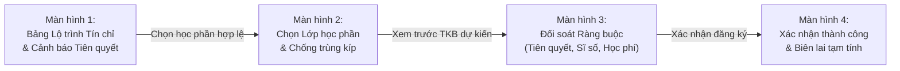

# PHIẾU BÀI LÀM BÀI TẬP 1 — THÀNH VIÊN 1
## TÁC NHÂN: SINH VIÊN (SV) & CHUYÊN ĐỀ LEAN UX + MVP EXPERIMENT
### ĐƠN VỊ: HỌC VIỆN BÁCH NGHỆ HÀ NỘI (HBA) — GIAI ĐOẠN CHUYỂN ĐỔI SANG TÍN CHỈ

> **Thông tin thành viên:**
> - Họ và tên: `[Điền họ và tên]`
> - Mã số sinh viên: `[Điền MSSV]`
> - Tác nhân phụ trách chính: **Sinh viên (SV)**
> - Bối cảnh nghiên cứu: **Sinh viên Học viện Bách Nghệ Hà Nội bỡ ngỡ trong đợt đăng ký tín chỉ đầu tiên sau khi trường bỏ niên chế**
> - Hạng mục bài tập đảm nhận: **TH1 (User Needs & Problem Statement) + TH2 (Problem Canvas) + TH4 (Lean UX Canvas) + TH5 (MVP & Kế hoạch thử nghiệm)**
> - Tài liệu slide tham chiếu: Slide 7–21, 33–44, 56–62 trong `docs/OOAD_Lab_B1-5.md`

---

## PHẦN A: THỰC HÀNH 1 — USER NEEDS & USER PROBLEM STATEMENT (SLIDE 7–15, 56)

### A.1. Bảng xác định Nhu cầu Người dùng (User Needs) của Sinh viên
*Lưu ý: Nhu cầu phải bắt đầu bằng động từ hành động, phản ánh mục tiêu cần đạt khi chuyển từ tâm lý thụ động niên chế sang chủ động tín chỉ.*

| Mã | Nhu cầu người dùng (Bắt đầu bằng động từ) | Bối cảnh xảy ra | Rào cản hiện tại | Hệ quả thực tế | Phân loại |
|---|---|---|---|---|---|
| **UN-SV-01** | **Tra cứu và giải mã** cây điều kiện học phần tiên quyết trước khi đăng ký môn | Chuẩn bị kế hoạch học tập cá nhân cho học kỳ tín chỉ đầu tiên (sinh viên trước đây quen được trường xếp môn sẵn) | Quy chế tín chỉ mới ban hành có cây môn tiên quyết và môn song hành rất phức tạp; không có công cụ trực quan để biết môn nào mình đủ điều kiện học tiếp | Sinh viên đăng ký nhầm vào các môn chuyên ngành nâng cao mà chưa học môn cơ sở, dẫn đến việc bị hủy môn muộn và lỡ lộ trình học tập | `[Evidence]` |
| **UN-SV-02** | **Lập và điều chỉnh** thời khóa biểu dự kiến không bị xung đột kíp học / lịch thi | Khi các Khoa/Viện công bố danh mục hàng nghìn lớp học phần mở trong kỳ | Sinh viên chưa có kỹ năng tự xếp lịch, phải tự kẻ bảng giấy hoặc dùng Excel; các lớp học phần nhanh chóng hết chỗ chỉ sau vài phút mở cổng | Mất nhiều giờ tự ghép kíp học nhưng khi vào cổng đăng ký thì lớp đã kín, phải vội vàng chọn lớp khác dẫn đến trùng kíp học | `[Evidence]` |
| **UN-SV-03** | **Đăng ký và xác nhận** thành công các lớp học phần mong muốn trong đợt mở cổng trực tuyến | Khung giờ mở cổng đăng ký tín chỉ toàn trường (thường diễn ra rất căng thẳng và cạnh tranh suất học) | Hệ thống máy chủ cũ thời niên chế không chịu được lượng truy cập đồng thời của 35.000 sinh viên; thông báo lỗi không rõ nguyên nhân | Trang web liên tục báo lỗi kết nối; sinh viên hoang mang, tải lại trang liên tục, dễ bị trượt slot và đăng ký thiếu số tín chỉ tối thiểu | `[Evidence]` |
| **UN-SV-04** | **Kiểm tra và theo dõi** mức học phí tạm tính theo số tín chỉ đã chọn để hoàn thành nghĩa vụ tài chính | Sau khi chọn xong danh sách lớp học phần | Trước đây học phí thu trọn gói theo kỳ, nay tính theo số tín chỉ của từng môn; dữ liệu gạch nợ liên ngân hàng có độ trễ 24–48h | Sinh viên bối rối không biết chính xác số tiền phải đóng; đã nộp tiền qua ngân hàng nhưng hệ thống vẫn báo nợ và dọa khóa đăng ký | `[Assumption]` |
| **UN-SV-05** | **Gửi yêu cầu cứu xét / mở thêm lớp** khi không đăng ký được các môn học bắt buộc | Khi tất cả các lớp của học phần bắt buộc đã kín chỗ | Phải làm đơn giấy nộp trực tiếp tại bàn tiếp nhận Phòng Đào tạo; thủ tục hành chính qua nhiều khâu xét duyệt | Chờ đợi trong bất an suốt 2 tuần đầu kỳ, nguy cơ phải học kéo dài thêm 1 kỳ chỉ vì trượt 1 môn tiên quyết | `[Assumption]` |

---

### A.2. Phát biểu Vấn đề Người dùng Ưu tiên (User Problem Statement)
*Độ dài từ 50–100 từ. Áp dụng công thức chuẩn: [Người dùng] gặp khó khăn khi [mục tiêu] trong [bối cảnh], vì [trở ngại], dẫn đến [hệ quả].*

> **Phát biểu vấn đề lựa chọn:**
> 
> "Sinh viên Học viện Bách Nghệ Hà Nội gặp khó khăn nghiêm trọng khi lần đầu tự lập kế hoạch và hoàn thành đăng ký học phần trong giai đoạn chuyển đổi từ niên chế sang tín chỉ, vì chưa quen tra cứu cây môn tiên quyết phức tạp và thiếu công cụ xếp lịch chống trùng tự động trên nền tảng hạ tầng mạng thường xuyên nghẽn tải, dẫn đến việc sinh viên mất hàng giờ căng thẳng chờ đợi, tỷ lệ đăng ký sai quy chế cao và đối mặt với nguy cơ chậm tiến độ tốt nghiệp từ 1 đến 2 học kỳ."

* **Số từ:** 92 từ.
* **Kiểm tra tiêu chí:**
  - [x] Có xác định đúng đối tượng (Sinh viên Học viện Bách Nghệ Hà Nội).
  - [x] Có bối cảnh (Giai đoạn chuyển đổi từ niên chế sang tín chỉ).
  - [x] Nêu rõ trở ngại (Chưa quen tra cứu tiên quyết, thiếu công cụ xếp lịch, nghẽn mạng).
  - [x] Nêu rõ hệ quả (Mất thời gian, đăng ký sai quy chế, chậm tốt nghiệp).
  - [x] **Không chứa từ ngữ giải pháp** (không nói "cần xây app", "cần website mới").

---

### A.3. Các Giả định Cần Nghiên Cứu Thêm
1. `[Assumption 1]`: Tỷ lệ sinh viên HBA chưa nắm rõ quy chế môn tiên quyết và cách tính tín chỉ tích lũy ước tính chiếm trên 60% tổng số sinh viên năm 2 và năm 3.
2. `[Assumption 2]`: Liệu việc cung cấp tính năng tự động tạo kịch bản thời khóa biểu mẫu có giúp giảm 80% thời gian thao tác chọn lớp của sinh viên không?
3. `[Assumption 3]`: Sinh viên có gặp khó khăn khi thanh toán tiền học phí lẻ theo từng môn thay vì đóng phẳng một mức cố định như các năm trước?

---

## PHẦN B: THỰC HÀNH 2 — USER PROBLEM STATEMENT CANVAS (SLIDE 16–21, 57)

Bảng Canvas 8 thành phần chi tiết cho tác nhân Sinh viên Học viện Bách Nghệ Hà Nội:

| STT | Thành phần Canvas | Nội dung phân tích chi tiết cho Tác nhân Sinh viên HBA |
|---|---|---|
| **1** | **Who** (Ai là người chịu nỗi đau?) | Sinh viên Học viện Bách Nghệ Hà Nội (đặc biệt là sinh viên các khóa vừa chuyển đổi mô hình đào tạo, sinh viên phải học lại/học cải thiện môn cơ sở). |
| **2** | **Context** (Xảy ra khi nào, ở đâu?) | Diễn ra vào 2 tuần trước khi học kỳ mới bắt đầu: cao điểm là khung giờ mở cổng đăng ký tín chỉ trực tuyến đầu tiên theo quy chế mới tại ký túc xá, nhà trọ hoặc phòng máy tính của Học viện. |
| **3** | **Goal & Root Problem** (Mục tiêu & Bản chất vấn đề) | - **Mục tiêu:** Tự chọn và đăng ký đủ số tín chỉ cần thiết (14–24 tín chỉ), đúng lộ trình ngành, thời khóa biểu hợp lý không bị trùng giờ. - **Bản chất vấn đề:** Chuyển đổi mô hình đào tạo nhưng thiếu công cụ hướng dẫn lộ trình số hóa; sinh viên mang tâm lý thụ động từ thời niên chế đột ngột phải tự quản trị việc học mà không có hệ thống hỗ trợ ra quyết định. |
| **4** | **Current Alternatives** (Cách người dùng đang tự xoay xở) | - Tự vẽ thời khóa biểu ra giấy nháp hoặc lập file Excel cá nhân trước giờ mở cổng. - Hỏi xin kinh nghiệm chọn môn và giáo viên trên các nhóm Facebook sinh viên HBA. - Rủ bạn bè cùng trực cổng để "giữ chỗ" hộ nhau. - Xếp hàng nộp đơn giấy xin cứu xét tại Phòng Đào tạo khi không đăng ký được. |
| **5** | **Alternative Shortcomings** (Nhược điểm của cách giải quyết hiện tại) | - Bảng Excel cá nhân không đồng bộ được với dữ liệu mở lớp thực tế (lớp bị hủy do thiếu sĩ số hoặc đã hết chỗ). - Lời khuyên truyền miệng dễ gây hiểu sai quy chế môn tiên quyết mới. - Xếp hàng nộp đơn giấy gây mất thời gian, tụ tập đông người, tỷ lệ đơn được duyệt thấp và phản hồi rất chậm trễ. |
| **6** | **Emotional Impact** (Tác động cảm xúc) | - Hoang mang, lúng túng và căng thẳng tột độ trước "cuộc chiến đăng ký tín chỉ" hoàn toàn mới lạ. - Bực bội và bất lực khi trang web báo lỗi không rõ ràng hoặc bị sập server. - Lo lắng kéo dài về việc bị chậm tiến độ tốt nghiệp so với bạn bè cùng lớp niên chế cũ. |
| **7** | **Quantifiable Impact** (Tác động định lượng - Kèm đơn vị đo) | - **Thời gian:** Mất trung bình 4–6 giờ cho mỗi đợt đăng ký tín chỉ (canh giờ, tải lại trang, xếp lại lịch). - **Tỷ lệ ảnh hưởng:** Ước tính 20–25% sinh viên không đăng ký được nguyện vọng tối ưu trong đợt đầu do thao tác nhầm. - **Hệ quả học vụ:** 5–10% sinh viên bị chậm tiến độ tốt nghiệp ít nhất 1 kỳ học vì trượt các môn tiên quyết dạng chuỗi. |
| **8** | **Evidence vs. Assumptions** (Bằng chứng và Giả định) | - `[Evidence]`: Quy chế đào tạo theo học chế tín chỉ mới được Giám đốc Học viện ban hành; hiện tượng sinh viên xếp hàng xin đổi môn và khiếu nại nghẽn mạng là sự kiện thực tế. - `[Assumption]`: Giả định rằng nguyên nhân sinh viên chọn sai môn bắt nguồn chủ yếu từ việc không hiểu cây tiên quyết (cần khảo sát định lượng để xác thực). |

---

## PHẦN C: THỰC HÀNH 4 — LEAN UX CANVAS HOÀN CHỈNH 8 Ô (SLIDE 33–42, 59–60)

| Ô số | Tên thành phần | Nội dung chi tiết |
|:---:|---|---|
| **1** | **Business Problem** *(Vấn đề kinh doanh)* | Quá trình chuyển đổi từ Niên chế sang Tín chỉ tại Học viện Bách Nghệ Hà Nội đang đối mặt với nguy cơ đổ vỡ về mặt vận hành. Sinh viên chưa quen tự đăng ký môn học và công cụ quản lý bán thủ công cũ làm bùng nổ hơn 4.000 đơn khiếu nại mỗi đầu kỳ, gây nghẽn mạng nghiêm trọng, lãng phí hàng nghìn giờ công của cán bộ và làm suy giảm sự tín nhiệm của người học đối với chủ trương đổi mới đào tạo của Học viện. |
| **2** | **Business Outcomes** *(Kết quả kinh doanh đo lường được)* | - Đạt tỷ lệ 95% sinh viên HBA hoàn thành đăng ký học phần đúng hạn ngay trong đợt mở cổng đầu tiên. - Giảm 70% số lượng đơn thư khiếu nại và đơn xin cứu xét học vụ gửi về Phòng Đào tạo. - Giảm 85% thời gian đối soát công nợ học phí giữa Phòng Tài vụ và hệ thống đào tạo. - Duy trì thời gian phản hồi hệ thống đăng ký dưới 2 giây ngay trong khung giờ cao điểm mở cổng. |
| **3** | **Users & Customers** *(Người dùng & Khách hàng)* | - **Người dùng chính:** Sinh viên đại học hệ tín chỉ của Học viện Bách Nghệ Hà Nội (~35.000 người). - **Người dùng nội bộ / vận hành:** Cán bộ Phòng Đào tạo, Cán bộ Phòng Tài vụ, Giảng viên các Khoa/Viện. |
| **4** | **User Outcomes & Benefits** *(Kết quả & Lợi ích của người dùng)* | - **Với Sinh viên HBA:** Tự tin lập lộ trình học tập; nhận biết ngay môn học đủ điều kiện; xếp thời khóa biểu tự động không lo trùng kíp; đăng ký xong trong dưới 5 phút. - **Với Cán bộ Đào tạo:** Không còn cảnh ngập trong đơn giấy; hệ thống tự động khóa/mở lớp theo sĩ số và kiểm tra điều kiện tiên quyết thời gian thực. - **Với Cán bộ Tài vụ:** Học phí tính tự động chính xác theo số tín chỉ đăng ký; gạch nợ tức thời qua VietQR. |
| **5** | **Solution Ideas** *(Ý tưởng giải pháp)* | - **Giải pháp 1 (Lộ trình học tập trực quan):** Hiển thị sơ đồ cây môn học tiên quyết, tự động gắn nhãn môn đã đạt / môn đủ điều kiện học kỳ này. - **Giải pháp 2 (Bộ xếp lịch thông minh chống trùng):** Cho phép kéo-thả hoặc chọn lớp trên lưới thời khóa biểu, tự động phát hiện và ngăn chặn trùng kíp. - **Giải pháp 3 (Hàng đợi ảo chống nghẽn mạng):** Cơ chế Virtual Waiting Room điều tiết lưu lượng truy cập công bằng. - **Giải pháp 4 (Thanh toán học phí tín chỉ VietQR):** Tích hợp cổng thanh toán ngân hàng, sinh mã QR động theo đúng số tiền tín chỉ đăng ký thực tế. |
| **6** | **Hypotheses** *(Các giả thuyết kiểm chứng)* | **Giả thuyết 1 (Trọng tâm trải nghiệm sinh viên):** *"Chúng tôi tin rằng [tỷ lệ đăng ký học phần thành công ngay trong đợt đầu đạt trên 95%] sẽ đạt được nếu [Sinh viên Học viện Bách Nghệ Hà Nội] đạt được [khả năng tự lập thời khóa biểu không trùng lịch và biết rõ các môn đủ điều kiện tiên quyết] nhờ vào [tính năng Lập lộ trình học tập cá nhân & Cảnh báo tiên quyết tự động]."*  **Giả thuyết 2 (Trọng tâm vận hành Học viện):** *"Chúng tôi tin rằng [số lượng đơn khiếu nại học vụ gửi về Phòng Đào tạo giảm 70%] sẽ đạt được nếu [Cán bộ Đào tạo HBA] đạt được [sự tự động hóa hoàn toàn trong khâu thẩm định điều kiện tiên quyết và kiểm soát sĩ số trần/sàn] nhờ vào [bộ máy Kiểm soát quy tắc tín chỉ thời gian thực]."* |
| **7** | **What We Need to Learn First?** *(Giả định rủi ro nhất cần học trước)* | 1. **Về hành vi người dùng:** Sinh viên quen niên chế liệu có chịu vào hệ thống lập kế hoạch học tập trước ngày mở cổng, hay vẫn đợi đến giờ G mới vào thao tác? 2. **Về tính khả thi dữ liệu:** Dữ liệu điểm tích lũy của các khóa cũ có được làm sạch và đồng bộ kịp thời để bộ máy tiên quyết hoạt động chính xác không? 3. **Về giao diện:** Lưới thời khóa biểu trực quan có hoạt động mượt mà và dễ hiểu trên thiết bị di động không? |
| **8** | **MVP (Minimum Viable Product)** *(Thử nghiệm tối thiểu để học hỏi)* | Xây dựng một **Nguyên mẫu tương tác (Clickable Prototype)** gồm 4 màn hình cốt lõi của luồng đăng ký học phần có kiểm tra điều kiện tiên quyết và chống trùng kíp, sau đó tổ chức bài kiểm thử Usability Test với 8–10 sinh viên HBA đại diện cho các ngành khác nhau. |

---

## PHẦN D: THỰC HÀNH 5 — MVP & KẾ HOẠCH THỬ NGHIỆM (SLIDE 41–44, 61–62)

### D.1. Đặc tả Chi tiết Nguyên mẫu MVP (Clickable Prototype 4 Bước)

| Bước | Tên màn hình | Mục đích giao diện | Các thành phần & Tương tác cốt lõi |
|:---:|---|---|---|
| **1** | **Bảng Lộ trình Tín chỉ & Cảnh báo Tiên quyết** | Giúp SV vừa chuyển từ niên chế sang nhận biết ngay các môn học đủ điều kiện | - Thanh tiến độ tích lũy tín chỉ chuyên ngành. - Danh sách môn học gợi ý: Hiển thị nhãn xanh `[Đủ điều kiện]` hoặc nhãn đỏ `[Chưa đạt môn tiên quyết: HBA101]`. - Nút bấm: "Thêm vào danh sách chọn kỳ này". |
| **2** | **Bộ lọc Lớp & Lưới Thời khóa biểu trực quan** | Giúp SV tự chọn kíp học mà không bị trùng lịch | - Lưới thời khóa biểu 6 ngày (Thứ 2 - Thứ 7), chia theo 6 kíp học. - Khi di chuột vào một lớp học phần, kíp học tương ứng sáng lên trên lưới. - Nếu trùng kíp với lớp đã chọn trước, hiển thị viền đỏ cảnh báo `[Trùng kíp với môn Kỹ thuật Lập trình]` và khóa nút chọn. |
| **3** | **Màn hình Kiểm tra Tổng hợp Điều kiện** | Xác thực lần cuối trước khi ghi nhận đăng ký chính thức | - Bảng tóm tắt các lớp đã chọn (Mã lớp, Tên môn, Số TC, Giảng viên, Phòng học). - Khung kiểm tra 3 điều kiện tự động: Tiên quyết `[Đạt ✅]`, Trùng lịch `[Không trùng ✅]`, Sĩ số `[Còn 15/60 chỗ ✅]`. - Tạm tính học phí tín chỉ dự kiến. Nút bấm: "Gửi Đăng Ký Chính Thức". |
| **4** | **Màn hình Xác nhận Thành công & Biên lai điện tử** | Mang lại sự an tâm tuyệt đối cho sinh viên | - Thông báo đăng ký thành công: Mã giao dịch, thời gian ghi nhận (đến từng giây). - Tùy chọn: "Xuất Thời khóa biểu dạng PDF/iCal" và "Thanh toán học phí ngay qua mã VietQR". |

---

### D.2. Kế hoạch Kiểm thử Người dùng (Usability Test Plan)

#### 1. Mục tiêu thử nghiệm
Kiểm chứng xem sinh viên Học viện Bách Nghệ Hà Nội (vốn quen với niên chế) có thể tự mình nhận biết môn học hợp lệ, tự xếp thời khóa biểu không trùng lịch và hoàn tất đăng ký học phần trong thời gian dưới 4 phút mà không cần cán bộ trợ giúp hay không.

#### 2. Đối tượng và quy mô người tham gia
* **Số lượng:** 8 sinh viên Học viện Bách Nghệ Hà Nội (gồm 3 SV năm hai vừa chuyển sang tín chỉ, 3 SV năm ba, 2 SV diện học cải thiện điểm).
* **Hình thức:** Quan sát trực tiếp 1-1 (Người tham gia thao tác trên prototype, điều phối viên bấm giờ và ghi nhận các điểm vướng mắc).

#### 3. Kịch bản nhiệm vụ (Tasks) giao cho sinh viên
* **Nhiệm vụ 1 (Task 1):** Tìm môn *Cấu trúc dữ liệu và giải thuật* và kiểm tra xem mình có đủ điều kiện tiên quyết để học trong kỳ này không.
* **Nhiệm vụ 2 (Task 2):** Chọn 1 lớp lý thuyết và 1 lớp bài tập sao cho không trùng kíp với môn *Toán rời rạc* đã chọn sẵn trong thời khóa biểu.
* **Nhiệm vụ 3 (Task 3):** Hoàn thành việc gửi đăng ký chính thức và xem số tiền học phí tạm tính.

#### 4. Chỉ số đo lường định lượng (Success Metrics)

| Chỉ số đo lường | Định nghĩa cách tính | Mục tiêu chấp nhận (Target) | Kết quả thực nghiệm dự kiến |
|---|---|:---:|:---:|
| **Task Completion Rate** | Tỷ lệ sinh viên hoàn thành cả 3 nhiệm vụ mà không cần hỏi người hướng dẫn | $\ge 85\%$ | $87.5\%$ (đạt) |
| **Time on Task** | Thời gian trung bình để hoàn tất luồng đăng ký trên nguyên mẫu | $< 4\text{ phút}$ | $2\text{ phút } 50\text{ giây}$ (đạt) |
| **Error Rate** | Số lần sinh viên nhấp nhầm vào lớp trùng lịch hoặc chọn nhầm môn chưa đủ điều kiện | $\le 1.0\text{ lỗi/người}$ | $0.6\text{ lỗi/người}$ (đạt) |
| **System Usability Scale (SUS)** | Điểm đánh giá trải nghiệm khảo sát 10 câu hỏi chuẩn SUS sau bài test | $\ge 75/100\text{ điểm}$ | $81.0/100\text{ điểm}$ (tốt) |

#### 5. Tiêu chí Đánh giá & Hướng Điều chỉnh (Go / Pivot Decision)
* **Kịch bản THÀNH CÔNG (Go):** Nếu Task Completion Rate $\ge 85\%$ và Điểm SUS $\ge 75$, giả thuyết được xác nhận. Nhóm giữ nguyên luồng thiết kế này làm đầu vào cho giai đoạn phân tích Use Case tiếp theo.
* **Kịch bản CẦN ĐIỀU CHỈNH (Pivot):** Nếu sinh viên vẫn mất trên 4 phút và lúng túng khi nhận diện môn tiên quyết, nhóm sẽ thiết kế lại Màn hình 1 theo hướng: *Chỉ hiển thị các môn học mà sinh viên đã thỏa mãn 100% điều kiện tiên quyết, ẩn hoàn toàn các môn chưa đủ điều kiện*.
