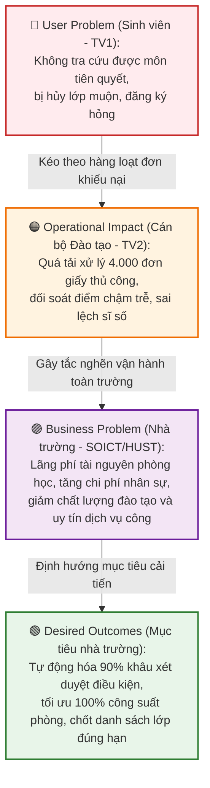

# PHIẾU BÀI LÀM BÀI TẬP 1 — THÀNH VIÊN 2
## TÁC NHÂN: CÁN BỘ ĐÀO TẠO (CBĐT) & CHUYÊN ĐỀ BUSINESS PROBLEM + 5 WHYS

> **Thông tin thành viên:**
> - Họ và tên: `[Điền họ và tên]`
> - Mã số sinh viên: `[Điền MSSV]`
> - Tác nhân phụ trách chính: **Cán bộ Đào tạo (CBĐT)**
> - Hạng mục bài tập đảm nhận: **TH1 (User Needs của CBĐT) + TH2 (Problem Canvas của CBĐT) + TH3 (Chuyên đề Business Problem, Phân tích 5 Whys & Chỉ số KPI)**
> - Tài liệu slide tham chiếu: Slide 7–19, 22–35, 54, 58 trong `docs/OOAD_Lab_B1-5.md`

---

## PHẦN A: THỰC HÀNH 1 — USER NEEDS CỦA CÁN BỘ ĐÀO TẠO (SLIDE 7–15)

### A.1. Bảng xác định Nhu cầu Người dùng (User Needs) của Cán bộ Đào tạo
*Lưu ý: Bắt đầu bằng động từ hành động, phản ánh nhiệm vụ nghiệp vụ quản lý đào tạo.*

| Mã | Nhu cầu người dùng (Bắt đầu bằng động từ) | Bối cảnh xảy ra | Rào cản hiện tại | Hệ quả thực tế | Phân loại |
|---|---|---|---|---|---|
| **UN-CBĐT-01** | **Thiết lập và công bố** kế hoạch mở lớp học phần và thời khóa biểu trước mỗi học kỳ | 4–6 tuần trước khi học kỳ mới bắt đầu, khi các Viện/Khoa gửi dự kiến phân công giảng dạy | Phải tổng hợp thủ công từ hàng chục file Excel phân tán của các bộ môn; xung đột phòng học và giảng viên khó phát hiện tự động | Lịch học bị trùng phòng, trùng giờ giảng viên, phải điều chỉnh nhiều lần gây chậm tiến độ mở cổng đăng ký | `[Evidence]` |
| **UN-CBĐT-02** | **Cấu hình và kiểm soát** các quy tắc điều kiện tiên quyết và giới hạn sĩ số của từng lớp | Khi chuẩn bị dữ liệu đợt đăng ký tín chỉ | Hệ thống cũ không hỗ trợ kiểm tra điều kiện tiên quyết phức tạp (ví dụ: chuỗi tiên quyết hoặc điều kiện học phần song hành); phải nhập tay giới hạn | Sinh viên không đủ điều kiện vẫn đăng ký được, hoặc lớp quá tải vượt quá công suất phòng học thực tế | `[Evidence]` |
| **UN-CBĐT-03** | **Tiếp nhận và xử lý** các đơn xin học vượt, học cải thiện, hoặc mở thêm lớp học phần | Trong suốt 2 tuần đăng ký và tuần đầu học kỳ | Tiếp nhận đơn bằng giấy hoặc email cá nhân; phải đối soát hồ sơ học tập của từng sinh viên qua nhiều màn hình khác nhau | Quá tải đơn thư, thời gian xử lý kéo dài (3–7 ngày), sinh viên phải chờ đợi trong tình trạng lo âu | `[Evidence]` |
| **UN-CBĐT-04** | **Theo dõi và điều tiết** sĩ số thực tế của các lớp học phần (hủy lớp thiếu sĩ số / tách lớp quá tải) | Sau khi kết thúc đợt đăng ký chính thức | Dữ liệu sĩ số không được cập nhật tập trung theo thời gian thực; việc liên hệ với sinh viên thuộc lớp bị hủy gặp nhiều khó khăn | Chậm ra quyết định hủy lớp; sinh viên không kịp đăng ký lớp thay thế, ảnh hưởng quyền lợi học tập | `[Assumption]` |
| **UN-CBĐT-05** | **Khóa và xuất** danh sách lớp chính thức để bàn giao cho Giảng viên và Phòng Thanh tra | Tuần học đầu tiên của học kỳ | Danh sách lớp liên tục biến động do sinh viên vẫn rút môn hoặc xin vào bổ sung; dữ liệu tài chính chưa chốt | Giảng viên nhận danh sách lớp không chuẩn xác, khó khăn trong quản lý chuyên cần và chấm bài | `[Assumption]` |

---

### A.2. Phát biểu Vấn đề của Cán bộ Đào tạo (User Problem Statement)
> **Phát biểu vấn đề lựa chọn:**
> 
> "Cán bộ Phòng Đào tạo gặp áp lực quá tải nghiêm trọng khi điều phối lịch học và xử lý các yêu cầu đăng ký học vụ trong các tuần cao điểm đầu kỳ, vì các quy tắc ràng buộc tiên quyết và sĩ số phải kiểm tra thủ công trên nhiều nguồn dữ liệu rời rạc, dẫn đến việc xử lý đơn thư bị chậm trễ từ 3 đến 7 ngày, phát sinh nhiều sai sót trong danh sách lớp và gây bức xúc lớn cho cả giảng viên lẫn sinh viên."

---

## PHẦN B: THỰC HÀNH 2 — USER PROBLEM STATEMENT CANVAS CHO CÁN BỘ ĐÀO TẠO (SLIDE 16–21)

| STT | Thành phần Canvas | Phân tích chi tiết đối với Cán bộ Đào tạo |
|---|---|---|
| **1** | **Who** (Ai chịu nỗi đau?) | Chuyên viên quản lý đào tạo, cán bộ giáo vụ phụ trách lập thời khóa biểu và xử lý học vụ tại Phòng Đào tạo và Văn phòng các Viện/Khoa. |
| **2** | **Context** (Xảy ra khi nào, ở đâu?) | Giai đoạn chuẩn bị mở kỳ học mới và đợt cao điểm đăng ký học phần (kéo dài khoảng 3–4 tuần) tại văn phòng làm việc Phòng Đào tạo. |
| **3** | **Goal & Root Problem** (Mục tiêu & Bản chất vấn đề) | - **Mục tiêu:** Vận hành đợt đăng ký thông suốt, tối ưu hóa công suất phòng học, đảm bảo 100% sinh viên đăng ký đúng quy chế và bàn giao danh sách lớp chuẩn cho giảng viên đúng hạn. - **Bản chất vấn đề:** Thiếu công cụ tự động hóa việc thẩm định quy chế đào tạo và đồng bộ dữ liệu thời gian thực giữa Đào tạo - Tài chính - Giảng viên. |
| **4** | **Current Alternatives** (Cách đang tự giải quyết) | - Nhận đơn giấy tại bàn một cửa, ghi sổ theo dõi thủ công. - Tra cứu bảng điểm sinh viên trên phần mềm quản lý điểm cũ để kiểm tra môn tiên quyết từng người một. - Dùng bảng tính Excel ngoại tuyến để cộng trừ sĩ số và lập danh sách lớp mở bổ sung. |
| **5** | **Alternative Shortcomings** (Nhược điểm của cách hiện tại) | - Tốn rất nhiều nhân lực và thời gian cho các thao tác lặp đi lặp lại. - Dễ xảy ra sai sót con người (bỏ sót đơn, nhìn nhầm mã môn, tính sai điều kiện). - Không có cơ chế lưu vết lịch sử xử lý đơn để giải trình khi có khiếu nại. |
| **6** | **Emotional Impact** (Tác động cảm xúc) | - Căng thẳng tột độ (burnout) do phải làm thêm giờ liên tục trong mùa cao điểm. - Ức chế khi phải đối mặt với thái độ bức xúc của phụ huynh và sinh viên xếp hàng chờ đợi. - Lo lắng về trách nhiệm hành chính khi để lọt sai phạm quy chế. |
| **7** | **Quantifiable Impact** (Tác động định lượng - Kèm đơn vị) | - **Thời gian ngoài giờ:** Mỗi cán bộ phải làm thêm 40–60 giờ trong tháng cao điểm. - **Khối lượng đơn từ:** Tiếp nhận và xử lý thủ công từ 3.000 đến 5.000 đơn xin học vụ mỗi học kỳ. - **Thời gian xử lý:** Trung bình mất 15–20 phút để kiểm tra và xử lý 1 trường hợp đơn ngoại lệ. |
| **8** | **Evidence vs. Assumptions** (Bằng chứng và Giả định) | - `[Evidence]`: Quy định kiểm tra môn học tiên quyết và cảnh báo học vụ được quy định cứng trong Quy chế Đào tạo ĐHBK Hà Nội; cảnh sinh viên xếp hàng nộp đơn là hiện tượng thực tế. - `[Assumption]`: Giả định 70% số đơn xin cứu xét có thể tự động duyệt nếu hệ thống có thuật toán kiểm tra ràng buộc trước. |

---

## PHẦN C: THỰC HÀNH 3 — BUSINESS PROBLEM, ROOT CAUSE ANALYSIS & REQUIREMENTS (SLIDE 22–35, 54, 58)

### C.1. Chuỗi Lập Luận Nhân Quả Xuyên Tác Nhân (User Problem $\rightarrow$ Business Problem) (Slide 25)

---

### C.2. Phân Tích Nguyên Nhân Gốc Rễ: Kỹ Thuật 5 Whys (Năm Câu Hỏi Vì Sao) (Slide 28, 35)

* **Vấn đề xuất phát (Problem):** Hàng nghìn sinh viên bị trễ hạn đăng ký học phần và phải nộp đơn khiếu nại làm tê liệt hoạt động Phòng Đào tạo đầu mỗi học kỳ.

| Tầng Why | Câu hỏi | Câu trả lời phân tích |
|:---:|---|---|
| **Why 1** | *Tại sao sinh viên phải nộp đơn khiếu nại và xếp hàng tại Phòng Đào tạo nhiều như vậy?* | Vì sinh viên không thể đăng ký trực tuyến các lớp học phần mình cần do hệ thống báo lỗi không đủ điều kiện hoặc lớp đã hết chỗ. |
| **Why 2** | *Tại sao sinh viên không biết trước mình thiếu điều kiện hoặc tại sao lớp lại nhanh hết chỗ bất thường?* | Vì hệ thống đăng ký không cung cấp thông tin kiểm tra trước điều kiện tiên quyết và không dự báo được nhu cầu môn học thực tế của sinh viên để mở số lớp tương ứng. |
| **Why 3** | *Tại sao hệ thống không kiểm tra tự động và không dự báo được nhu cầu học phần?* | Vì dữ liệu kết quả học tập kỳ trước và dữ liệu mở lớp nằm ở hai phân hệ riêng biệt không đồng bộ thời gian thực; việc lập kế hoạch mở lớp hiện tại dựa vào ước lượng cảm tính của các bộ môn. |
| **Why 4** | *Tại sao dữ liệu học vụ không được đồng bộ thời gian thực và tự động hóa quy tắc?* | Vì hệ thống phần mềm hiện tại được xây dựng từ nhiều năm trước theo kiến trúc module rời rạc, thiếu bộ máy xử lý quy tắc nghiệp vụ (Business Rules Engine) tập trung. |
| **Why 5 (Root Cause)** | *Tại sao nhà trường vẫn duy trì quy trình kiểm tra thủ công và hệ thống rời rạc này?* | **NGUYÊN NHÂN GỐC RỄ:** Quy trình đào tạo tín chỉ chưa được chuẩn hóa về mặt số hóa; nhà trường thiếu một cơ chế quản trị luồng dữ liệu học vụ thống nhất, dẫn đến việc dùng nhân lực hành chính để "chắp vá" các lỗ hổng của quy trình nghiệp vụ thủ công. |

---

### C.3. Phân Tích Đa Chiều: Kỹ Thuật 5W-1H và Phân Loại Xương Cá (Fishbone) (Slide 29, 35)

#### 1. Bảng phân tích 5W-1H
* **WHO (Ai bị ảnh hưởng?):** 35.000 sinh viên, toàn bộ đội ngũ cán bộ Phòng Đào tạo, Phòng Tài vụ và hơn 1.500 giảng viên.
* **WHAT (Họ gặp vấn đề gì?):** Tắc nghẽn đăng ký, sai lệch danh sách lớp, quá tải xử lý đơn từ hành chính.
* **WHERE (Xảy ra ở đâu?):** Cổng thông tin đào tạo trực tuyến và văn phòng tiếp nhận một cửa của trường.
* **WHEN (Xảy ra khi nào?):** Vào 2–4 tuần cao điểm trước và sau ngày khai giảng mỗi học kỳ.
* **WHY (Tại sao nghiêm trọng?):** Đe dọa chất lượng giảng dạy, làm chậm tiến độ tốt nghiệp của sinh viên, lãng phí ngân sách vận hành của trường.
* **HOW (Tác động như thế nào?):** Tốn hàng nghìn giờ công lao động hành chính; tỷ lệ sinh viên bức xúc về dịch vụ công tăng cao.

#### 2. Phân loại theo 4 nhóm nguyên nhân (Fishbone Categories)
1. **Quy trình (Process):** Quy trình xử lý đơn ngoại lệ vẫn mang tính chất thủ công, nhiều bước xét duyệt trung gian qua giấy tờ.
2. **Hệ thống / Công nghệ (Platform):** Hạ tầng không chịu được tải đồng thời cao; thiếu API kết nối dữ liệu giữa điểm thi, công nợ và đăng ký học phần.
3. **Con người (People):** Cán bộ đào tạo quá tải; sinh viên thiếu kỹ năng lập kế hoạch học tập theo học chế tín chỉ.
4. **Quy chế (Policy):** Quy định về môn tiên quyết, học phần thay thế, và trần tín chỉ phức tạp nhưng không được cấu hình hóa thành luật phần mềm.

---

### C.4. Danh Sách 3 Business Problems Chuẩn Cấu Trúc 5 Mục (Slide 30–32)

#### 📌 BUSINESS PROBLEM 1: Quá tải và tắc nghẽn quy trình xử lý đơn ngoại lệ học vụ
1. **Context (Bối cảnh):** Hoạt động tiếp nhận và xử lý các trường hợp ngoại lệ trong đăng ký học phần (xin học vượt, học cải thiện, hủy môn, mở thêm lớp) diễn ra vào 2 tuần đầu kỳ.
2. **Current State (Hiện trạng):** Hơn 4.000 đơn giấy được gửi về Phòng Đào tạo mỗi kỳ; cán bộ phải mở từng hồ sơ điểm trên hệ thống cũ để kiểm tra thủ công điều kiện tiên quyết và tính hợp lệ.
3. **Problem (Vấn đề chính):** Quy trình xử lý hoàn toàn thủ công, thiếu công cụ tự động đối soát điều kiện quy chế và thiếu hệ thống lưu vết điện tử.
4. **Impact (Tác động):** Thời gian phản hồi kéo dài từ 5–7 ngày làm việc; 15% đơn bị xử lý nhầm hoặc thất lạc; cán bộ phải làm thêm 50 giờ/người/tháng; sinh viên bỏ lỡ tuần học đầu tiên.
5. **Desired State (Trạng thái mong muốn):** 90% các yêu cầu ngoại lệ được gửi và xét duyệt trực tuyến; hệ thống tự động thẩm định điều kiện tiên quyết và trả kết quả trong vòng dưới 24 giờ.

---

#### 📌 BUSINESS PROBLEM 2: Lãng phí tài nguyên phòng học và mất cân đối sĩ số lớp học phần
1. **Context (Bối cảnh):** Hoạt động lập kế hoạch mở lớp học phần và phân bổ phòng học theo thời khóa biểu học kỳ.
2. **Current State (Hiện trạng):** Việc mở lớp dựa trên số liệu ước đoán của kỳ trước; không có số liệu khảo sát nguyện vọng đăng ký theo thời gian thực của sinh viên.
3. **Problem (Vấn đề chính):** Tình trạng mất cân đối trầm trọng: nhiều lớp học phần chuyên ngành bị hủy do không đủ sĩ số tối thiểu (< 15 SV), trong khi nhiều lớp đại cương lại quá tải (> 80 SV/phòng).
4. **Impact (Tác động):** Lãng phí 20–30% công suất sử dụng phòng học; chi phí vận hành điều hòa/điện năng không tối ưu; trường phải hủy hàng chục lớp sau khi đã xếp thời khóa biểu.
5. **Desired State (Trạng thái mong muốn):** Tự động dự báo nhu cầu mở lớp dựa trên tiến độ học tập của sinh viên; tỷ lệ lấp đầy phòng học đạt trên 85%; giảm số lớp bị hủy do thiếu sĩ số xuống dưới 3%.

---

#### 📌 BUSINESS PROBLEM 3: Danh sách lớp học phần biến động kéo dài ảnh hưởng chất lượng đào tạo
1. **Context (Bối cảnh):** Hoạt động chốt danh sách lớp học phần để bàn giao cho Giảng viên giảng dạy và đánh giá chuyên cần.
2. **Current State (Hiện trạng):** Sau đợt đăng ký chính thức, sinh viên vẫn được phép rút môn hoặc xin vào lớp thủ công kéo dài đến hết tuần thứ 3 của kỳ học.
3. **Problem (Vấn đề chính):** Thiếu cơ chế chốt thời hạn đăng ký dứt khoát và hệ thống không tự động cập nhật danh sách lớp tới giảng viên khi có biến động sinh viên.
4. **Impact (Tác động):** Giảng viên không thể ổn định nhóm thảo luận/bài tập lớn trong 3 tuần đầu; điểm danh bị nhầm lẫn; sinh viên vào muộn bị hổng kiến thức dẫn đến tỷ lệ rớt môn tăng 8%.
5. **Desired State (Trạng thái mong muốn):** Danh sách lớp được chốt cố định ngay sau ngày kết thúc đợt đăng ký điều chỉnh; giảng viên xem danh sách lớp cập nhật thời gian thực trên cổng thông tin giảng viên.

---

### C.5. Dữ Liệu Vận Hành Cần Thu Thập & Chỉ Số KPI Đo Lường (Slide 26, 27)

#### 1. Dữ liệu vận hành cần thu thập để xác minh
* Nhật ký truy cập (Access Log) và lưu lượng yêu cầu (Request/sec) tại cổng đăng ký trong giờ cao điểm.
* Số lượng đơn khiếu nại học vụ phân loại theo nguyên nhân (trượt môn tiên quyết, trùng lịch, hết chỗ, nợ học phí).
* Thời gian trung bình để cán bộ xử lý xong 1 lá đơn cứu xét học vụ.
* Tỷ lệ các lớp học phần bị hủy sau khi mở cổng đăng ký do không đạt sĩ số sàn.

#### 2. Chỉ số KPI đo lường thành công
| Mã KPI | Tên chỉ số KPI | Hiện trạng (Baseline) | Mục tiêu sau cải tiến (Target) |
|---|---|:---:|:---:|
| **KPI-01** | Thời gian xử lý đơn yêu cầu học vụ ngoại lệ | 5–7 ngày làm việc | $\le 24\text{ giờ}$ |
| **KPI-02** | Tỷ lệ tự động hóa kiểm tra điều kiện tiên quyết | $0\%$ (thủ công) | $\ge 98\%$ |
| **KPI-03** | Tỷ lệ lớp học phần bị hủy do thiếu sĩ số | $12\%$ | $< 3\%$ |
| **KPI-04** | Số giờ làm thêm ngoài giờ của cán bộ đào tạo đầu kỳ | $50\text{ giờ/người}$ | $\le 10\text{ giờ/người}$ |

---

### C.6. Chuyển Hóa Thành Danh Sách Business Requirements (Slide 34, 54)
*Công thức:* $\text{Business Problem} \longrightarrow \text{Business Requirement}$

1. **BRQ-01:** Hệ thống phải tự động kiểm tra điều kiện tiên quyết của học phần dựa trên lịch sử điểm tích lũy của sinh viên và ngăn chặn đăng ký không hợp lệ ngay tại thời điểm thao tác.
2. **BRQ-02:** Hệ thống phải cung cấp cổng tiếp nhận và luồng duyệt đơn ngoại lệ học vụ điện tử, cho phép cán bộ phê duyệt với thông tin đối soát tự động hiển thị trên 1 màn hình.
3. **BRQ-03:** Hệ thống phải tự động kiểm soát sĩ số trần/sàn của từng lớp học phần theo thời gian thực và tự động khóa lớp khi đạt sĩ số tối đa.
4. **BRQ-04:** Hệ thống phải cung cấp báo cáo phân tích nhu cầu học phần dựa trên dữ liệu môn nợ và môn tích lũy của sinh viên toàn trường để hỗ trợ lập kế hoạch mở lớp tối ưu.
