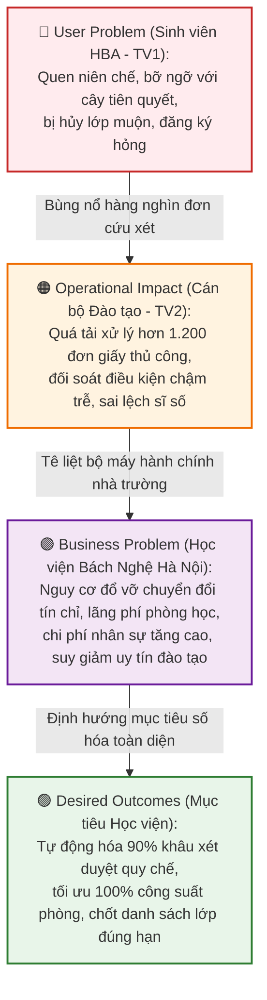

# PHIẾU BÀI LÀM BÀI TẬP 1 — THÀNH VIÊN 2
## TÁC NHÂN: CÁN BỘ ĐÀO TẠO (CBĐT) & CHUYÊN ĐỀ BUSINESS PROBLEM + 5 WHYS
### ĐƠN VỊ: HỌC VIỆN BÁCH NGHỆ HÀ NỘI (HBA) — GIAI ĐOẠN CHUYỂN ĐỔI SANG TÍN CHỈ

> **Công việc của TV2: **
> - Tác nhân phụ trách chính: **Cán bộ Đào tạo (Phòng Đào tạo HBA)**
> - Bối cảnh nghiên cứu: **Bộ máy quản lý đào tạo dùng công cụ niên chế cũ để điều phối hàng nghìn lớp tín chỉ mới dẫn đến tình trạng quá tải nghiêm trọng**
> - Hạng mục bài tập đảm nhận: **TH1 (User Needs của CBĐT) + TH2 (Problem Canvas của CBĐT) + TH3 (Chuyên đề Business Problem, Phân tích 5 Whys & Chỉ số KPI)**
> - Tài liệu slide tham chiếu: Slide 7–19, 22–35, 54, 58 trong `docs/OOAD_Lab_B1-5.md`

---

## PHẦN A: THỰC HÀNH 1 — USER NEEDS CỦA CÁN BỘ ĐÀO TẠO (SLIDE 7–15)

### A.1. Bảng xác định Nhu cầu Người dùng (User Needs) của Cán bộ Đào tạo HBA
*Lưu ý: Bắt đầu bằng động từ hành động, phản ánh áp lực điều phối lớp học phần khi chuyển từ niên chế sang tín chỉ.*

| Mã | Nhu cầu người dùng (Bắt đầu bằng động từ) | Bối cảnh xảy ra | Rào cản hiện tại | Hệ quả thực tế | Phân loại |
|---|---|---|---|---|---|
| **UN-CBĐT-01** | **Thiết lập và điều phối** kế hoạch mở lớp học phần và thời khóa biểu dựa trên dữ liệu nhu cầu thực tế | 6–8 tuần trước khi học kỳ mới bắt đầu, khi các Khoa/Viện gửi dự thảo phân công giảng dạy | Chưa có công cụ tổng hợp số lượng sinh viên đăng ký trước; việc xếp phòng học và giảng viên vẫn làm thủ công trên bảng tính | Dễ xảy ra xung đột phòng học, trùng giờ giảng viên; phải điều chỉnh thời khóa biểu nhiều lần làm chậm ngày mở cổng đăng ký | `[Evidence]` |
| **UN-CBĐT-02** | **Cấu hình và kiểm soát** các ràng buộc môn tiên quyết và giới hạn sĩ số của từng lớp học phần | Giai đoạn chuẩn bị dữ liệu đợt đăng ký tín chỉ | Hệ thống phần mềm cũ thời niên chế không có bộ máy kiểm tra điều kiện tiên quyết tự động; cán bộ phải nhập tay giới hạn sĩ số từng lớp | Sinh viên chưa đủ điều kiện vẫn lọt vào lớp; các lớp chuyên ngành bị quá tải vượt công suất phòng học thực tế | `[Evidence]` |
| **UN-CBĐT-03** | **Tiếp nhận và xử lý** các đơn cứu xét học vụ ngoại lệ (xin mở thêm lớp, xin học vượt trần tín chỉ, rút môn) | Suốt 2 tuần đăng ký và tuần đầu học kỳ tín chỉ | Tiếp nhận đơn bằng giấy tờ thủ công; cán bộ phải mở từng hồ sơ học bạ trên phần mềm cũ để đối soát điều kiện quy chế | Cán bộ kiệt sức vì quá tải; thời gian trả kết quả đơn kéo dài từ 5 đến 7 ngày, sinh viên nháo nhác chờ đợi | `[Evidence]` |
| **UN-CBĐT-04** | **Theo dõi và ra quyết định** hủy các lớp học phần không đủ sĩ số sàn hoặc tách các lớp quá tải | Ngay sau khi đóng đợt đăng ký chính thức | Dữ liệu sĩ số không được cập nhật tập trung theo thời gian thực; việc liên lạc với sinh viên thuộc diện lớp bị hủy gặp nhiều bế tắc | Chậm ra quyết định hủy lớp; sinh viên không kịp trở tay đăng ký lớp thay thế, phát sinh khiếu nại gay gắt | `[Assumption]` |
| **UN-CBĐT-05** | **Khóa và xuất** danh sách lớp học phần chính thức cho Giảng viên trước ngày khai giảng | Tuần học đầu tiên của học kỳ | Danh sách lớp liên tục biến động do sinh viên vẫn rút môn hoặc xin vào bổ sung; dữ liệu tài chính chưa kịp gạch nợ | Giảng viên nhận danh sách lớp không chuẩn xác, khó khăn trong quản lý chuyên cần và chia nhóm học tập | `[Assumption]` |

---

### A.2. Phát biểu Vấn đề của Cán bộ Đào tạo (User Problem Statement)
> **Phát biểu vấn đề lựa chọn:**
> 
> "Cán bộ Phòng Đào tạo Học viện Bách Nghệ Hà Nội gặp áp lực quá tải nghiêm trọng khi điều phối lịch học và xử lý các yêu cầu học vụ trong các đợt đăng ký tín chỉ đầu tiên, vì các công cụ bảng tính thủ công kế thừa từ thời niên chế không thể xử lý nổi sự bùng nổ của hàng nghìn lớp học phần và các quy tắc môn tiên quyết phức tạp, dẫn đến việc xử lý đơn thư bị chậm trễ từ 5 đến 7 ngày, phát sinh nhiều sai sót trong danh sách lớp và gây bức xúc lớn cho cả giảng viên lẫn sinh viên."

---

## PHẦN B: THỰC HÀNH 2 — USER PROBLEM STATEMENT CANVAS CHO CÁN BỘ ĐÀO TẠO (SLIDE 16–21)

| STT | Thành phần Canvas | Phân tích chi tiết đối với Cán bộ Đào tạo HBA |
|---|---|---|
| **1** | **Who** (Ai chịu nỗi đau?) | Chuyên viên quản lý đào tạo, cán bộ giáo vụ phụ trách thời khóa biểu và xử lý học vụ tại Phòng Đào tạo và Văn phòng các Khoa/Viện thuộc Học viện Bách Nghệ Hà Nội. |
| **2** | **Context** (Xảy ra khi nào, ở đâu?) | Giai đoạn chuẩn bị học kỳ mới và cao điểm đợt đăng ký tín chỉ đầu tiên theo quy chế mới (kéo dài 3–4 tuần) tại Văn phòng Phòng Đào tạo HBA. |
| **3** | **Goal & Root Problem** (Mục tiêu & Bản chất vấn đề) | - **Mục tiêu:** Vận hành đợt đăng ký tín chỉ thông suốt, tối ưu hóa công suất phòng học, đảm bảo 100% sinh viên đăng ký đúng quy chế và bàn giao danh sách lớp chuẩn cho giảng viên đúng hạn. - **Bản chất vấn đề:** Đổi mới quy chế đào tạo sang tín chỉ nhưng hạ tầng công nghệ và công cụ quản trị vẫn dừng lại ở thời niên chế; thiếu cơ chế tự động hóa kiểm soát quy chế theo thời gian thực. |
| **4** | **Current Alternatives** (Cách đang tự giải quyết) | - Nhận đơn giấy tại bàn một cửa, vào sổ theo dõi thủ công. - Tra cứu bảng điểm sinh viên trên phần mềm niên chế cũ để kiểm tra môn tiên quyết từng người một. - Dùng bảng tính Excel ngoại tuyến để cộng trừ sĩ số và lập danh sách lớp mở bổ sung. |
| **5** | **Alternative Shortcomings** (Nhược điểm của cách hiện tại) | - Tốn quá nhiều nhân lực và thời gian cho các thao tác lặp đi lặp lại. - Dễ xảy ra sai sót con người (bỏ sót đơn, nhìn nhầm mã môn, tính sai điều kiện tiên quyết). - Không có cơ chế lưu vết lịch sử xử lý đơn để giải trình khi sinh viên khiếu nại. |
| **6** | **Emotional Impact** (Tác động cảm xúc) | - Căng thẳng tột độ (burnout) do phải làm thêm ngoài giờ liên tục trong mùa cao điểm. - Ức chế khi phải đối mặt với thái độ bức xúc của sinh viên và phụ huynh xếp hàng chờ đợi. - Lo lắng về trách nhiệm hành chính khi để lọt sinh viên không đủ điều kiện vào học. |
| **7** | **Quantifiable Impact** (Tác động định lượng - Kèm đơn vị) | - **Khối lượng đơn từ:** Tiếp nhận và xử lý thủ công từ 1.200 đến 1.500 đơn cứu xét học vụ ngoại lệ mỗi học kỳ. - **Thời gian xử lý:** Mất trung bình 8–10 phút để tra cứu hồ sơ và kiểm tra tính hợp lệ của 1 lá đơn. - **Thời gian làm thêm giờ:** Mỗi cán bộ phụ trách học vụ phải làm thêm 40–50 giờ trong tháng cao điểm chuyển đổi để giải quyết tồn đọng đơn từ. |
| **8** | **Evidence vs. Assumptions** (Bằng chứng và Giả định) | - `[Evidence]`: Quy định kiểm tra môn học tiên quyết và cảnh báo học vụ được quy định cứng trong Quy chế Đào tạo mới của HBA; cảnh sinh viên xếp hàng nộp đơn tràn ra hành lang là sự thật. - `[Assumption]`: Giả định 75% số đơn xin cứu xét học vụ có thể được duyệt tự động nếu hệ thống có bộ máy kiểm tra ràng buộc trước. |

---

## PHẦN C: THỰC HÀNH 3 — BUSINESS PROBLEM, ROOT CAUSE ANALYSIS & REQUIREMENTS (SLIDE 22–35, 54, 58)

### C.1. Chuỗi Lập Luận Nhân Quả Xuyên Tác Nhân Tại Học Viện Bách Nghệ Hà Nội (Slide 25)

---

### C.2. Phân Tích Nguyên Nhân Gốc Rễ: Kỹ Thuật 5 Whys (Năm Câu Hỏi Vì Sao) (Slide 28, 35)

* **Vấn đề xuất phát (Problem):** Hàng nghìn sinh viên Học viện Bách Nghệ Hà Nội bị trễ hạn đăng ký học phần và làm tê liệt hoạt động của Phòng Đào tạo ngay trong kỳ đầu áp dụng quy chế tín chỉ.

| Tầng Why | Câu hỏi | Câu trả lời phân tích bám sát bối cảnh HBA |
|:---:|---|---|
| **Why 1** | *Tại sao sinh viên phải nộp đơn khiếu nại và xếp hàng tại Phòng Đào tạo nhiều đột biến như vậy?* | Vì sinh viên không thể đăng ký trực tuyến các lớp học phần mình cần do hệ thống báo lỗi không đủ điều kiện tiên quyết hoặc các lớp đều đã kín chỗ. |
| **Why 2** | *Tại sao sinh viên không biết trước mình thiếu điều kiện và tại sao các lớp lại nhanh hết chỗ bất thường?* | Vì hệ thống chưa có tính năng trực quan hóa cây điều kiện tiên quyết để sinh viên tự kiểm tra trước; đồng thời Học viện chưa tổ chức khảo sát đăng ký nguyện vọng để nắm bắt nhu cầu thực tế trước khi mở lớp. |
| **Why 3** | *Tại sao hệ thống không kiểm tra tự động và Phòng Đào tạo không nắm bắt được nhu cầu học phần?* | Vì phần mềm cũ chưa có module quản lý tín chỉ tích hợp; quy trình lập kế hoạch mở lớp chưa có bước khảo sát nguyện vọng trực tuyến mà dựa trên ước tính cảm tính của các bộ môn. |
| **Why 4** | *Tại sao dữ liệu học vụ không được tích hợp và tự động hóa quy tắc kiểm tra?* | Vì Học viện vừa đổi quy chế đào tạo nhưng vẫn tận dụng lại phần mềm quản lý và quy trình hành chính cũ thời niên chế, chưa đầu tư xây dựng bộ máy quy tắc nghiệp vụ (Business Rules Engine) cho học chế tín chỉ. |
| **Why 5 (Root Cause)** | *Tại sao lại có sự lệch pha nghiêm trọng giữa quy chế mới và công cụ cũ?* | **NGUYÊN NHÂN GỐC RỄ:** Học viện Bách Nghệ Hà Nội thực hiện chuyển đổi mô hình đào tạo từ Niên chế sang Tín chỉ về mặt **chính sách (Policy)** nhưng chưa chuẩn bị kịp thời nền tảng **chuyển đổi số (Digital Transformation)** tương ứng, dẫn đến việc dùng nhân lực hành chính thủ công để gánh vác sự phức tạp khổng lồ của mô hình tín chỉ. |

---

### C.3. Phân Tích Đa Chiều: Kỹ Thuật 5W-1H và Phân Loại Xương Cá (Fishbone) (Slide 29, 35)

#### 1. Bảng phân tích 5W-1H
* **WHO (Ai bị ảnh hưởng?):** 35.000 sinh viên HBA, toàn bộ đội ngũ cán bộ Phòng Đào tạo, Phòng Tài vụ và hơn 1.500 giảng viên.
* **WHAT (Họ gặp vấn đề gì?):** Tắc nghẽn đăng ký, sai lệch danh sách lớp, quá tải xử lý đơn từ hành chính.
* **WHERE (Xảy ra ở đâu?):** Cổng thông tin đào tạo trực tuyến và văn phòng tiếp nhận một cửa của Học viện.
* **WHEN (Xảy ra khi nào?):** Vào 2–4 tuần cao điểm đợt đăng ký tín chỉ đầu kỳ.
* **WHY (Tại sao nghiêm trọng?):** Đe dọa chất lượng giảng dạy, làm chậm tiến độ tốt nghiệp của sinh viên, lãng phí ngân sách vận hành của Học viện.
* **HOW (Tác động như thế nào?):** Tốn hàng nghìn giờ công lao động hành chính; tỷ lệ sinh viên bức xúc về dịch vụ công tăng cao.

#### 2. Phân loại theo 4 nhóm nguyên nhân (Fishbone Categories)
1. **Quy trình (Process):** Quy trình xử lý đơn ngoại lệ vẫn mang tính chất thủ công bằng giấy tờ kế thừa từ thời niên chế.
2. **Hệ thống / Công nghệ (Platform):** Phần mềm cũ xây dựng cho niên chế, không có tính năng kiểm tra cây tiên quyết thời gian thực và không chịu được tải lớn.
3. **Con người (People):** Cán bộ đào tạo quá tải; sinh viên thiếu kỹ năng tự lập kế hoạch học tập theo học chế tín chỉ.
4. **Quy chế (Policy):** Quy định về môn tiên quyết, học phần tương đương phức tạp nhưng chưa được mã hóa thành các luật phần mềm.

---

### C.4. Danh Sách 3 Business Problems Chuẩn Cấu Trúc 5 Mục (Slide 30–32)

#### 📌 BUSINESS PROBLEM 1: Quá tải và tắc nghẽn quy trình xử lý đơn ngoại lệ học vụ do chuyển đổi mô hình
1. **Context (Bối cảnh):** Hoạt động tiếp nhận và xử lý các trường hợp ngoại lệ trong đăng ký học phần (xin mở thêm lớp do hết chỗ, xin học vượt trần tín chỉ, hoãn thi/rút môn) diễn ra vào 2 tuần đầu kỳ tại Học viện Bách Nghệ Hà Nội.
2. **Current State (Hiện trạng):** Hơn 1.200 đơn giấy được gửi về Phòng Đào tạo mỗi kỳ; cán bộ phải mở từng hồ sơ học bạ trên phần mềm cũ để kiểm tra thủ công điều kiện quy chế và tính hợp lệ.
3. **Problem (Vấn đề chính):** Quy trình xử lý hoàn toàn thủ công bằng giấy tờ kế thừa thời niên chế, thiếu công cụ tự động đối soát điều kiện quy chế và thiếu hệ thống lưu vết điện tử.
4. **Impact (Tác động):** Thời gian phản hồi kéo dài từ 5–7 ngày làm việc; khoảng 10% đơn bị xử lý chậm trễ hoặc thất lạc; cán bộ phải làm thêm 40–50 giờ/người/tháng; sinh viên bị trễ hạn nhập học.
5. **Desired State (Trạng thái mong muốn):** 90% các yêu cầu ngoại lệ được gửi và xét duyệt trực tuyến; hệ thống tự động thẩm định điều kiện quy chế và trả kết quả trong vòng dưới 24 giờ.

---

#### 📌 BUSINESS PROBLEM 2: Lãng phí tài nguyên phòng học và mất cân đối sĩ số lớp học phần
1. **Context (Bối cảnh):** Hoạt động lập kế hoạch mở lớp học phần và phân bổ phòng học theo thời khóa biểu học kỳ tại HBA.
2. **Current State (Hiện trạng):** Việc mở lớp dựa trên số liệu ước đoán của thời niên chế; không có số liệu khảo sát nguyện vọng đăng ký học phần trước đợt học của sinh viên.
3. **Problem (Vấn đề chính):** Tình trạng mở lớp chưa bám sát nhu cầu thực tế: nhiều lớp học phần chuyên ngành bị hủy do không đủ sĩ số tối thiểu (< 15 SV), trong khi nhiều lớp đại cương lại quá tải (> 80 SV/phòng).
4. **Impact (Tác động):** Lãng phí phòng học đã bố trí; phát sinh chi phí vận hành; Học viện phải hủy nhiều lớp học phần sau khi đã công bố thời khóa biểu khiến sinh viên phải vất vả tìm lớp thay thế.
5. **Desired State (Trạng thái mong muốn):** Thu thập và tổng hợp dữ liệu đăng ký nguyện vọng trực tuyến trước kỳ học để xác định chính xác số lớp cần mở; cảnh báo trùng lịch phòng/giảng viên khi xếp lịch; giảm số lớp bị hủy do thiếu sĩ số xuống dưới 3%.

---

#### 📌 BUSINESS PROBLEM 3: Danh sách lớp học phần biến động kéo dài ảnh hưởng chất lượng đào tạo
1. **Context (Bối cảnh):** Hoạt động chốt danh sách lớp học phần để bàn giao cho Giảng viên giảng dạy và đánh giá chuyên cần.
2. **Current State (Hiện trạng):** Sau đợt đăng ký chính thức, sinh viên vẫn nộp đơn xin rút môn hoặc bổ sung vào lớp kéo dài đến hết tuần thứ 3 của kỳ học.
3. **Problem (Vấn đề chính):** Thiếu cơ chế chốt thời hạn đăng ký dứt khoát trên hệ thống và danh sách lớp không được cập nhật kịp thời tới giảng viên khi có biến động sinh viên.
4. **Impact (Tác động):** Giảng viên không thể ổn định danh sách nhóm học tập/bài tập lớn trong những tuần đầu; điểm danh nhầm lẫn; sinh viên vào lớp muộn bị hổng kiến thức dẫn đến kết quả học tập sa sút.
5. **Desired State (Trạng thái mong muốn):** Danh sách lớp được chốt cố định ngay sau ngày kết thúc đợt đăng ký điều chỉnh; giảng viên xem danh sách lớp cập nhật thời gian thực trên cổng thông tin giảng viên.

---

### C.5. Dữ Liệu Vận Hành Cần Thu Thập & Chỉ Số KPI Đo Lường (Slide 26, 27)

#### 1. Dữ liệu vận hành cần thu thập để xác minh
* Nhật ký truy cập (Access Log) và lưu lượng yêu cầu (Request/sec) tại cổng đăng ký trong giờ cao điểm.
* Số lượng đơn khiếu nại học vụ phân loại theo nguyên nhân (chưa học môn tiên quyết, trùng kíp, hết chỗ, nợ học phí tín chỉ).
* Thời gian trung bình để cán bộ đào tạo xử lý xong 1 lá đơn cứu xét học vụ.
* Tỷ lệ các lớp học phần bị hủy sau khi mở cổng đăng ký do không đạt sĩ số sàn.

#### 2. Chỉ số KPI đo lường thành công
| Mã KPI | Tên chỉ số KPI | Hiện trạng (Baseline) | Mục tiêu sau cải tiến (Target) |
|---|---|:---:|:---:|
| **KPI-01** | Thời gian xử lý đơn yêu cầu học vụ ngoại lệ | 5–7 ngày làm việc | $\le 24\text{ giờ}$ |
| **KPI-02** | Tỷ lệ tự động hóa kiểm tra điều kiện tiên quyết | $0\%$ (thủ công) | $\ge 98\%$ |
| **KPI-03** | Tỷ lệ lớp học phần bị hủy do thiếu sĩ số | $12\%$ | $< 3\%$ |
| **KPI-04** | Số giờ làm thêm ngoài giờ của cán bộ đào tạo đầu kỳ | $50\text{ giờ/người}$ | $\le 10\text{ giờ/người}$ |

---

### C.6. Chuyển Hóa Thành Danh Sách Business Requirements (Slide 34, 54)
*Công thức:* $\text{Business Problem} \longrightarrow \text{Business Requirement}$

1. **BRQ-01:** Hệ thống phải tự động kiểm tra điều kiện tiên quyết của học phần dựa trên lịch sử điểm tích lũy của sinh viên và ngăn chặn đăng ký không hợp lệ ngay tại thời điểm thao tác.
2. **BRQ-02:** Hệ thống phải cung cấp cổng tiếp nhận và luồng duyệt đơn ngoại lệ học vụ điện tử, cho phép cán bộ phê duyệt với thông tin đối soát tự động hiển thị trên 1 màn hình.
3. **BRQ-03:** Hệ thống phải tự động kiểm soát sĩ số trần/sàn của từng lớp học phần theo thời gian thực và tự động khóa lớp khi đạt sĩ số tối đa.
4. **BRQ-04:** Hệ thống phải cung cấp chức năng đăng ký nguyện vọng học phần sơ bộ trước học kỳ và tự động kết xuất báo cáo tổng hợp số lượng đăng ký theo từng môn học để hỗ trợ Phòng Đào tạo lập kế hoạch mở lớp chính xác.
