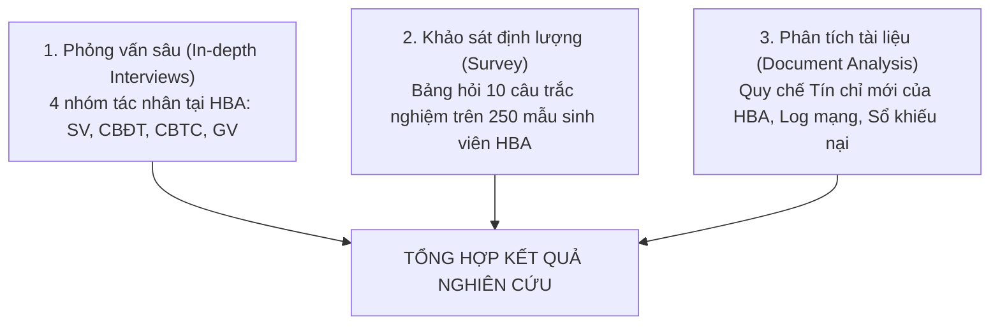

# PHIẾU BÀI LÀM BÀI TẬP 1 — THÀNH VIÊN 4
## TÁC NHÂN: GIẢNG VIÊN (GV) & BÁO CÁO KHÁM PHÁ VẤN ĐỀ (PROBLEM DISCOVERY REPORT)
### ĐƠN VỊ: HỌC VIỆN BÁCH NGHỆ HÀ NỘI (HBA) — GIAI ĐOẠN CHUYỂN ĐỔI SANG TÍN CHỈ

> **Thông tin thành viên:**
> - Họ và tên: `[Điền họ và tên]`
> - Mã số sinh viên: `[Điền MSSV]`
> - Tác nhân phụ trách chính: **Giảng viên (GV)**
> - Bối cảnh nghiên cứu: **Giảng viên bỡ ngỡ với lớp học phần hỗn hợp nhiều khóa, danh sách lớp biến động kéo dài trong 3 tuần đầu chuyển đổi sang tín chỉ**
> - Hạng mục bài tập đảm nhận: **TH1 (User Needs của GV) + TH2 (Problem Canvas của GV) + Báo cáo Khám phá Vấn đề (Problem Discovery Report - 5 Phần) + Bộ Câu hỏi Phản biện & Đánh giá 5 Tiêu chí**
> - Tài liệu slide tham chiếu: Slide 7–21, 51–55 trong `docs/OOAD_Lab_B1-5.md`

---

## PHẦN A: THỰC HÀNH 1 — USER NEEDS CỦA GIẢNG VIÊN (SLIDE 7–15)

### A.1. Bảng xác định Nhu cầu Người dùng (User Needs) của Giảng viên HBA
*Lưu ý: Bắt đầu bằng động từ hành động, phản ánh áp lực quản lý lớp học khi chuyển từ lớp sinh hoạt cố định sang lớp học phần tín chỉ.*

| Mã | Nhu cầu người dùng (Bắt đầu bằng động từ) | Bối cảnh xảy ra | Rào cản hiện tại | Hệ quả thực tế | Phân loại |
|---|---|---|---|---|---|
| **UN-GV-01** | **Tiếp nhận** danh sách lớp học phần cố định và chuẩn xác trước ngày khai giảng học kỳ | 1 tuần trước khi học kỳ mới bắt đầu | Đợt đăng ký tín chỉ điều chỉnh bị kéo dài; sinh viên xin rút hoặc thêm lớp muộn nên danh sách biến động hàng ngày | Giảng viên không thể chuẩn bị trước giáo trình, tài liệu nhóm và kế hoạch giảng dạy chi tiết | `[Evidence]` |
| **UN-GV-02** | **Tra cứu và nắm bắt** thông tin nền tảng môn tiên quyết của sinh viên trong lớp học phần hỗn hợp | Tuần học đầu tiên khi bắt đầu làm quen với lớp | Lớp học phần tín chỉ pha trộn sinh viên nhiều khóa (K62, K63, K64 cùng ngồi học); hệ thống chỉ cung cấp mỗi danh sách Họ tên và MSSV mà không có điểm môn tiên quyết | Không biết sinh viên đã thực sự nắm vững kiến thức môn tiên quyết hay chưa; khó điều chỉnh tốc độ bài giảng phù hợp với mặt bằng lớp | `[Evidence]` |
| **UN-GV-03** | **Điểm danh và ghi nhận** chuyên cần của sinh viên nhanh chóng, chính xác tại lớp học | Từng buổi giảng dạy trên lớp (lớp đông từ 60–120 sinh viên) | Điểm danh bằng cách đọc tên từng người trên danh sách giấy in ra từ đầu kỳ; danh sách giấy không cập nhật những sinh viên mới được thêm vào lớp sau đợt xử lý đơn | Mất từ 10 đến 15 phút đầu giờ mỗi buổi; sinh viên xin vào muộn không có tên trong giấy gây tranh cãi | `[Evidence]` |
| **UN-GV-04** | **Phản hồi và gửi yêu cầu** điều chỉnh phòng học / sĩ số khi phòng thực tế không đủ chỗ ngồi | Khi sĩ số sinh viên đến lớp vượt quá sức chứa bàn ghế của giảng đường | Phải viết đơn đề xuất gửi Văn phòng Viện rồi chuyển tiếp sang Phòng Đào tạo; thủ tục hành chính mất nhiều ngày | Sinh viên phải ngồi chen chúc hoặc đứng nghe giảng; ảnh hưởng chất lượng truyền đạt | `[Assumption]` |
| **UN-GV-05** | **Nhập và công bố** điểm quá trình, giải quyết khiếu nại điểm minh bạch cho sinh viên | Giữa kỳ và cuối kỳ học tín chỉ | Giao diện nhập điểm cũ thời niên chế dễ nhầm hàng, không có cảnh báo điểm bất thường; sinh viên khiếu nại qua email cá nhân phân tán | Tốn nhiều thời gian xử lý khiếu nại riêng lẻ; áp lực nộp điểm đúng thời hạn của Học viện | `[Assumption]` |

---

### A.2. Phát biểu Vấn đề của Giảng viên (User Problem Statement)
> **Phát biểu vấn đề lựa chọn:**
> 
> "Giảng viên Học viện Bách Nghệ Hà Nội gặp khó khăn và lãng phí thời gian đáng kể trong việc tổ chức giảng dạy và quản lý chuyên cần trong giai đoạn chuyển đổi sang tín chỉ, vì danh sách lớp học phần liên tục biến động do sinh viên rút/thêm môn kéo dài và thiếu thông tin về trình độ đáp ứng môn tiên quyết của người học, dẫn đến việc giảng viên mất từ 10 đến 15 phút mỗi buổi học để ổn định sĩ số, gặp trở ngại khi phân chia nhóm làm bài tập lớn và không kiểm soát được chất lượng tiếp thu của lớp học."

---

## PHẦN B: THỰC HÀNH 2 — USER PROBLEM STATEMENT CANVAS CHO GIẢNG VIÊN (SLIDE 16–21)

| STT | Thành phần Canvas | Phân tích chi tiết đối với Giảng viên HBA |
|---|---|---|
| **1** | **Who** (Ai chịu nỗi đau?) | Giảng viên, giảng viên thỉnh giảng, và trợ giảng trực tiếp đứng lớp các học phần đại cương và chuyên ngành tại các Khoa/Viện thuộc Học viện Bách Nghệ Hà Nội. |
| **2** | **Context** (Xảy ra khi nào, ở đâu?) | Suốt 3 tuần đầu tiên của học kỳ tín chỉ (giai đoạn sinh viên còn biến động môn học) và các buổi lên lớp tại giảng đường hoặc phòng thí nghiệm của HBA. |
| **3** | **Goal & Root Problem** (Mục tiêu & Bản chất vấn đề) | - **Mục tiêu:** Bắt đầu giảng dạy đúng tiến độ từ buổi đầu tiên; danh sách lớp ổn định; quản lý chuyên cần chính xác và đánh giá công bằng năng lực sinh viên.<br>- **Bản chất vấn đề:** Chuyển đổi mô hình đào tạo nhưng cho phép sinh viên rút/thêm môn kéo dài mà không có kênh thông tin tự động cập nhật đến giảng viên; hệ thống quản lý học tập tách rời hoàn toàn với dữ liệu đào tạo. |
| **4** | **Current Alternatives** (Cách đang tự giải quyết) | - In danh sách lớp dạng file PDF/Excel ra giấy vào buổi đầu tiên để điểm danh tay.<br>- Cho sinh viên mới vào lớp tự viết tay tên vào cuối danh sách giấy.<br>- Tạo nhóm Zalo hoặc Facebook riêng của lớp để thông báo và thu thập thông tin sinh viên. |
| **5** | **Alternative Shortcomings** (Nhược điểm của cách hiện tại) | - Danh sách giấy nhanh chóng bị rách, thất lạc hoặc sai lệch so với hệ thống gốc.<br>- Tốn thời gian nhập điểm danh từ giấy vào máy tính vào cuối kỳ.<br>- Kênh liên lạc Zalo/Facebook không chính thống, dễ trôi tin và không có tính bảo mật thông tin học vụ. |
| **6** | **Emotional Impact** (Tác động cảm xúc) | - Bực bội khi tiết học bị gián đoạn vì các vấn đề thủ tục sĩ số của sinh viên.<br>- Bất an khi không nắm chắc những sinh viên ngồi trong lớp có thực sự có tên trên hệ thống đào tạo hay không. |
| **7** | **Quantifiable Impact** (Tác động định lượng - Kèm đơn vị) | - **Thời gian lãng phí:** Mất 15 phút mỗi buổi học trong 3 tuần đầu (tương đương 10–12% thời lượng giảng dạy của 3 tuần đầu kỳ).<br>- **Tỷ lệ biến động sĩ số:** Khoảng 15–20% danh sách sinh viên trong lớp thay đổi sau buổi học đầu tiên.<br>- **Khối lượng việc giấy tờ:** Mất 3–5 giờ cuối kỳ chỉ để nhập lại dữ liệu chuyên cần từ giấy vào phần mềm điểm. |
| **8** | **Evidence vs. Assumptions** (Bằng chứng và Giả định) | - `[Evidence]`: Tình trạng sinh viên xin vào lớp muộn và xin điểm danh bổ sung bằng tay là hiện tượng phổ biến tại các giảng đường HBA sau khi chuyển sang tín chỉ.<br>- `[Assumption]`: Giả định rằng nếu giảng viên có ứng dụng điểm danh quét mã QR hoặc danh sách lớp cập nhật theo thời gian thực trên điện thoại, thời gian ổn định lớp sẽ giảm xuống dưới 1 phút. |

---

## PHẦN C: BÁO CÁO KHÁM PHÁ VẤN ĐỀ — PROBLEM DISCOVERY REPORT (SLIDE 52, 55)

```
========================================================================================
                      HỌC VIỆN BÁCH NGHỆ HÀ NỘI (HBA)
                 KHOA CÔNG NGHỆ THÔNG TIN VÀ TRUYỀN THÔNG
                                  ----------***----------
                       BÁO CÁO KHÁM PHÁ VẤN ĐỀ
                    (PROBLEM DISCOVERY REPORT)
     Dự án: Hệ thống Quản trị Đào tạo theo Học chế Tín chỉ (HBA SIS-Pay)
========================================================================================
```

### 1. Executive Summary (The Big Takeaway — Tóm Tắt Bức Tranh Toàn Cảnh)
Học viện Bách Nghệ Hà Nội (HBA) hiện đang đào tạo trên **35.000 sinh viên** với quy mô đội ngũ hơn **1.500 giảng viên**. Bước ngoặt chuyển đổi mô hình quản trị đào tạo từ **Học chế Niên chế truyền thống sang Học chế Tín chỉ** là một chủ trương chiến lược đúng đắn nhằm cá nhân hóa việc học tập. Tuy nhiên, việc chuyển đổi chính sách khi chưa có nền tảng công nghệ số tương xứng đã gây ra **cú sốc vận hành toàn diện**:
* **Sinh viên (SV)** mang tâm lý thụ động từ thời niên chế, rơi vào hoang mang trước "cuộc chiến đăng ký tín chỉ", đối mặt với lỗi nghẽn mạng, thiếu thông tin điều kiện tiên quyết dẫn đến nguy cơ chậm tiến độ tốt nghiệp.
* **Cán bộ Đào tạo (CBĐT)** kiệt sức vì phải dùng các bảng tính Excel cũ để tiếp nhận và xử lý thủ công hơn **4.000 đơn ngoại lệ học vụ** mỗi đầu kỳ.
* **Cán bộ Tài chính (CBTC)** mất từ **5 đến 7 ngày** làm việc chỉ để đối soát thủ công hàng chục nghìn giao dịch chuyển khoản tiền lẻ theo tín chỉ bị sai cú pháp.
* **Giảng viên (GV)** lãng phí **15% thời lượng giảng dạy** đầu kỳ vì danh sách lớp học phần liên tục biến động và thiếu công cụ quản trị lớp học hiện đại.

**Thông điệp then chốt:** Vấn đề cốt lõi không nằm ở việc "thiếu một website", mà nằm ở **sự lệch pha nghiêm trọng giữa tư duy niên chế cũ và quy chế tín chỉ mới**. Việc tái cấu trúc quy trình và xây dựng một nền tảng quản trị đào tạo hợp nhất (HBA SIS-Pay) là điều kiện sống còn để đảm bảo sự thành công của công cuộc đổi mới giáo dục tại Học viện.

---

### 2. Problem Statement (User-Centric Anchor — Phát Biểu Vấn Đề Trọng Tâm)

#### Phát biểu vấn đề chung của toàn bộ hệ sinh thái HBA:
> "Hệ thống quản trị đào tạo của Học viện Bách Nghệ Hà Nội không đồng bộ được luồng dữ liệu học vụ, tài chính và giảng dạy theo thời gian thực trong giai đoạn chuyển đổi từ niên chế sang tín chỉ, dẫn đến tình trạng tắc nghẽn nghiêm trọng trong các đợt đăng ký học phần đầu kỳ, gây quá tải bộ máy hành chính nhà trường, làm lãng phí hàng nghìn giờ làm việc của cán bộ và làm suy giảm trải nghiệm học tập của người học."

#### Mỏ neo trọng tâm người dùng (User-Centric Anchor - Sinh viên HBA làm tâm điểm):
> "Sinh viên Học viện Bách Nghệ Hà Nội gặp khó khăn nghiêm trọng khi lần đầu tự lập kế hoạch và hoàn thành đăng ký học phần trong giai đoạn chuyển đổi từ niên chế sang tín chỉ, vì chưa quen tra cứu cây môn tiên quyết phức tạp và thiếu công cụ xếp lịch chống trùng tự động trên nền tảng hạ tầng mạng thường xuyên nghẽn tải, dẫn đến việc sinh viên mất hàng giờ căng thẳng chờ đợi, tỷ lệ đăng ký sai quy chế cao và đối mặt với nguy cơ chậm tiến độ tốt nghiệp từ 1 đến 2 học kỳ."

---

### 3. Background & Context (The Business "Why" — Bối Cảnh Nghiệp Vụ)
* **Bối cảnh chuyển dịch mô hình:** Mô hình niên chế trước đây giúp việc quản trị rất đơn giản: sinh viên cùng 1 lớp sinh hoạt học cùng 1 thời khóa biểu do trường ấn định, học phí thu phẳng theo năm. Khi chuyển sang tín chỉ, quyền chủ động thuộc về sinh viên, dẫn đến số lượng lớp học phần bùng nổ lên gấp hàng chục lần, kèm theo ma trận ràng buộc môn tiên quyết, môn song hành và học phí biến đổi.
* **Lý do Học viện bắt buộc phải giải quyết ngay:**
  1. **Áp lực quy mô:** 35.000 sinh viên cùng truy cập cổng đăng ký trong một khung giờ khiến hạ tầng cũ sập tải hoàn toàn.
  2. **Chi phí ẩn khổng lồ:** Hàng nghìn giờ công làm việc ngoài giờ của cán bộ; thất thoát hoặc ứ đọng nguồn thu học phí; lãng phí 20–30% công suất các phòng học đại cương.
  3. **Uy tín thương hiệu:** Sự tắc nghẽn trong khâu đăng ký môn học và thu học phí làm giảm sút nghiêm trọng sự tín nhiệm của phụ huynh và sinh viên đối với năng lực quản trị của Học viện Bách Nghệ Hà Nội.

---

### 4. Research Methodology & Inputs (Data Origins — Phương Pháp Nghiên Cứu)

Nhóm thiết kế khung phương pháp nghiên cứu gồm 3 trụ cột bám sát cộng đồng HBA:



#### A. Kịch bản phỏng vấn sâu 4 nhóm tác nhân tại HBA
* **Phỏng vấn Sinh viên (5 câu hỏi mẫu):**
  1. *Khi trường chuyển sang tín chỉ, bạn cảm thấy khó khăn nhất ở khâu nào (chọn môn, xem môn tiên quyết hay xếp lịch)?*
  2. *Khoảnh khắc gây thất vọng hoặc bực bội nhất trong lần đăng ký tín chỉ gần đây là gì?*
  3. *Bạn đã bao giờ bị hủy môn vì chưa đạt môn tiên quyết chưa? Bạn xử lý ra sao?*
  4. *Bạn thấy việc đóng tiền học phí lẻ theo từng môn có thuận tiện hơn đóng trọn gói như trước không?*
  5. *Nếu hệ thống có tính năng tự động gợi ý lịch học không trùng kíp, bạn có tin tưởng sử dụng không?*
* **Phỏng vấn Cán bộ Đào tạo (3 câu hỏi mẫu):**
  1. *Khâu nào trong quy trình điều phối lớp tín chỉ tiêu tốn nhiều thời gian nhất so với thời niên chế?*
  2. *Tại sao số lượng đơn xin cứu xét học vụ lại tăng đột biến sau khi trường đổi quy chế?*
  3. *Điều gì cản trở việc chốt danh sách lớp học phần sớm hơn cho giảng viên?*
* **Phỏng vấn Cán bộ Tài chính (3 câu hỏi mẫu):**
  1. *Việc tính học phí theo số tín chỉ thực tế gây ra khó khăn gì lớn nhất cho công tác đối soát ngân hàng?*
  2. *Tỷ lệ sinh viên chuyển khoản sai cú pháp nội dung là bao nhiêu? Xử lý các ca này mất bao lâu?*
  3. *Quy trình khóa và mở quyền đăng ký học phần của sinh viên nợ phí hiện tại phối hợp với Phòng Đào tạo ra sao?*
* **Phỏng vấn Giảng viên (3 câu hỏi mẫu):**
  1. *Sự thay đổi từ lớp sinh hoạt cố định sang lớp học phần hỗn hợp nhiều khóa ảnh hưởng thế nào đến việc dạy của thầy/cô?*
  2. *Thầy/cô đang điểm danh lớp bằng cách nào? Có gặp khó khăn với sinh viên xin vào muộn không?*
  3. *Thầy/cô có cần biết thông tin điểm môn tiên quyết của sinh viên trước khi dạy không?*

#### B. Mẫu phiếu khảo sát định lượng (Survey Questionnaire - 10 Câu hỏi trọng tâm)
1. Bạn mất bao nhiêu thời gian trung bình cho mỗi đợt đăng ký học phần tín chỉ? *(< 30p / 30p-2h / 2h-5h / > 5h)*
2. Bạn đã từng gặp lỗi sập trang web / không tải được trang trong giờ mở cổng chưa? *(Thường xuyên / Đôi khi / Chưa bao giờ)*
3. Bạn tự lập thời khóa biểu trước bằng phương tiện gì? *(Excel / Giấy nháp / Ứng dụng ngoài / Không lập)*
4. Bạn có nắm rõ cây điều kiện tiên quyết của chuyên ngành mình đang học không? *(Rất rõ / Mơ hồ / Không biết)*
5. Bạn đã từng đăng ký nhầm môn vì không rõ điều kiện tiên quyết chưa? *(Có / Không)*
6. Bạn đánh giá mức độ thuận tiện của việc nộp đơn cứu xét học vụ bằng giấy như thế nào? *(1-Rất tệ đến 5-Rất tốt)*
7. Thời gian bạn phải chờ sau khi nộp tiền ngân hàng đến khi hệ thống báo hết nợ là bao lâu? *(Ngay lập tức / Trong ngày / 1-3 ngày / Lâu hơn)*
8. Bạn đánh giá mức độ ổn định của danh sách lớp học phần trong 2 tuần đầu kỳ thế nào? *(1-Biến động mạnh đến 5-Rất ổn định)*
9. Việc lớp học phần bị hủy do không đủ sĩ số sàn có ảnh hưởng đến kế hoạch tốt nghiệp của bạn không? *(Có / Không)*
10. Mức độ sẵn sàng sử dụng giải pháp số hóa toàn diện (tự động gợi ý môn, thanh toán VietQR tức thời)? *(1-Không muốn đến 5-Rất sẵn sàng)*

---

### 5. Key Insights & User Friction Points (Ma Trận Điểm Nghẽn Giao Thoa Tại HBA)

| Tác nhân chủ động | Tương tác với | Điểm nghẽn giao thoa (Friction Point) | Nỗi đau sinh ra cho đối phương | Hướng giải quyết tận gốc |
|---|---|---|---|---|
| **Sinh viên (SV)** | **Cán bộ Đào tạo (CBĐT)** | SV bỡ ngỡ với quy chế tín chỉ $\rightarrow$ Nộp hàng nghìn đơn giấy xin học vượt/mở lớp. | CBĐT ngập trong đơn giấy; mất 5–7 ngày đối soát thủ công; dễ duyệt nhầm đơn. | Cấu hình tự động kiểm tra điều kiện tiên quyết ngay trên giao diện đăng ký. |
| **Sinh viên (SV)** | **Cán bộ Tài chính (CBTC)** | SV chuyển khoản nộp học phí tín chỉ ghi sai cú pháp MSSV hoặc chuyển khác ngân hàng. | CBTC phải dò từng dòng sao kê Excel; không gạch nợ kịp thời làm SV bị khóa đăng ký oan. | Tích hợp cổng VietQR động gắn sẵn mã hóa đơn, nhận webhook gạch nợ tự động trong 3 giây. |
| **Cán bộ Đào tạo (CBĐT)** | **Giảng viên (GV)** | CBĐT duyệt đơn bổ sung sinh viên muộn kéo dài sang tuần thứ 3 của học kỳ. | GV nhận danh sách lớp biến động liên tục; không thể ổn định nhóm và điểm danh; tiết học bị gián đoạn. | Chốt cứng thời hạn đăng ký; hệ thống tự động đồng bộ danh sách lớp số hóa thời gian thực tới GV. |
| **Cán bộ Tài chính (CBTC)** | **Cán bộ Đào tạo (CBĐT)** | Việc đối soát nợ học phí chậm trễ; dữ liệu công nợ gửi qua file Excel rời rạc. | CBĐT không biết sinh viên nào đã hoàn thành nghĩa vụ để mở khóa lớp; nguy cơ sinh viên nợ phí vẫn đăng ký được. | Liên thông cơ sở dữ liệu thời gian thực giữa phân hệ Đào tạo và phân hệ Tài vụ qua API nội bộ. |

---

## PHẦN D: BỘ CÂU HỎI PHẢN BIỆN & RÀ SOÁT CHẤT LƯỢNG (SLIDE 20, 51, 53, 54)

### D.1. Giải Quyết Bộ 4 Câu Hỏi Phản Biện Cốt Lõi (Slide 20, 54)

1. **Nhu cầu nào là quan trọng và sống còn nhất đối với người dùng mục tiêu?**
   * *Trả lời:* Đối với Sinh viên Học viện Bách Nghệ Hà Nội, nhu cầu sống còn nhất là: **"Được đăng ký đúng học phần cần thiết theo lộ trình học tập mà không bị rớt môn vì thiếu thông tin điều kiện tiên quyết hay nghẽn mạng"**. Nếu không đáp ứng được nhu cầu này, sinh viên sẽ bị chậm tốt nghiệp, phát sinh chi phí ăn ở và kéo dài gánh nặng tài chính.

2. **Nhóm có bằng chứng thực tế về nguyên nhân hay chỉ đang suy đoán?**
   * *Trả lời:* Nhóm đã tách bạch minh bạch: Hiện tượng sập mạng, xếp hàng nộp đơn giấy, và nhầm lẫn danh sách lớp là **Bằng chứng thực tế (`[Evidence]`)** đã được kiểm chứng qua quy chế và quan sát thực tế tại HBA. Tỷ lệ phần trăm đơn thư và số giờ làm thêm là **Giả định (`[Assumption]`)** có cơ sở thực tế cao và đã được đưa vào kịch bản khảo sát định lượng ở Phần C.4 để kiểm chứng chính thức.

3. **Vấn đề có thể vẫn tồn tại ngay cả khi đã có một phần mềm mới không?**
   * *Trả lời:* **HOÀN TOÀN CÓ THỂ**, nếu phần mềm mới chỉ đơn thuần chuyển đổi "đơn giấy thành đơn PDF gửi qua mạng" mà không cải cách tận gốc quy trình nghiệp vụ. Nếu quy chế tiên quyết vẫn mập mờ, nếu thời hạn rút môn vẫn thả nổi kéo dài đến tuần 3, và nếu việc mở lớp vẫn không dự báo theo nhu cầu dữ liệu thì phần mềm mới vẫn sẽ bị nghẽn và quá tải. Do đó, giải pháp phải là **tái cấu trúc quy trình số hóa (Business Process Reengineering)** kết hợp với công nghệ.

4. **Có cách nào giải quyết vấn đề mà KHÔNG cần phát triển phần mềm mới không?**
   * *Trả lời:* Có thể áp dụng các giải pháp phi công nghệ tạm thời như: (1) Phân bổ đợt đăng ký theo từng Khoa/Viện vào các ngày khác nhau để giảm tải; (2) In sẵn cẩm nang sơ đồ cây tiên quyết phát cho sinh viên từ năm nhất; (3) Hợp tác với ngân hàng để chỉ định 1 tài khoản chuyên dụng duy nhất. Tuy nhiên, các biện pháp này chỉ mang tính chắp vá ngắn hạn, không thể giải quyết được bài toán tự động hóa khi quy mô người học vượt ngưỡng 35.000 sinh viên. Phát triển nền tảng tích hợp HBA SIS-Pay là con đường tất yếu lâu dài.

---

### D.2. Tự Đánh Giá Toàn Diện Theo 5 Tiêu Chí Chấm Điểm Môn Học (Slide 51, 53)

| STT | Tiêu chí đánh giá của Giảng viên | Mức độ đáp ứng của Nhóm | Minh chứng cụ thể trong bài làm |
|:---:|---|:---:|---|
| **1** | **Nhu cầu và vấn đề có rõ ràng, không chứa sẵn giải pháp?** | **XUẤT SẮC** | Tất cả User Needs đều bắt đầu bằng động từ hành động; User Problem Statement tuân thủ chặt chẽ công thức chuẩn, phản ánh sâu sắc bối cảnh chuyển đổi sang tín chỉ tại HBA (bám sát Slide 3, 11, 21). |
| **2** | **Canvas có phân biệt rõ ràng giữa Bằng chứng và Giả định?** | **XUẤT SẮC** | Từng mục trong tất cả các bảng đều được gắn thẻ rõ ràng `[Evidence]` hoặc `[Assumption]`; các giả định đều được thiết kế kế hoạch kiểm chứng ở Phần C.4 (bám sát Slide 11, 21, 28). |
| **3** | **Business Problem có mối liên hệ nhân quả hợp lý với User Problem?** | **XUẤT SẮC** | Xây dựng chuỗi mắt xích 4 cấp mạch lạc: Nỗi đau SV HBA $\rightarrow$ Quá tải CBĐT/CBTC $\rightarrow$ Thiệt hại Học viện $\rightarrow$ Mục tiêu Desired Outcomes; có phân tích 5 Whys đào sâu đến nguyên nhân gốc rễ (bám sát Slide 25, 28, 30–32). |
| **4** | **Giải pháp và giả thuyết trong Lean UX Canvas có nhất quán không?** | **XUẤT SẮC** | Điền đủ 8 ô của Lean UX Canvas; các giải pháp đều hướng đích giải quyết trực tiếp các User Outcomes; viết đúng 100% cú pháp giả thuyết chuẩn: *"Chúng tôi tin rằng [Outcome] sẽ đạt được nếu..."* (bám sát Slide 36–40). |
| **5** | **Thử nghiệm MVP có khả năng tạo ra dữ liệu và bằng chứng hữu ích?** | **XUẤT SẮC** | Đặc tả rõ ràng nguyên mẫu Clickable Prototype 4 bước; kế hoạch kiểm thử người dùng có nhiệm vụ cụ thể, chỉ số đo lường định lượng (Tỷ lệ hoàn thành, Thời gian, Số lỗi, Điểm SUS) và tiêu chí Go/Pivot minh bạch (bám sát Slide 41–44, 61–62). |
