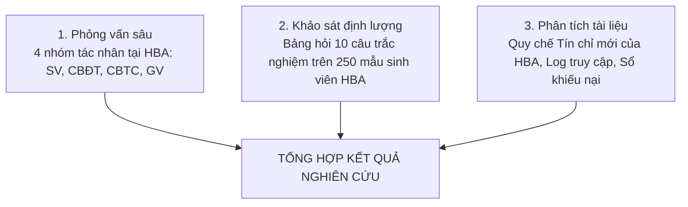

# BÀI TẬP 1 — THÀNH VIÊN 4
## TÁC NHÂN GIẢNG VIÊN VÀ BÁO CÁO KHÁM PHÁ VẤN ĐỀ
### HỌC VIỆN BÁCH NGHỆ HÀ NỘI — GIAI ĐOẠN CHUYỂN ĐỔI SANG HỌC CHẾ TÍN CHỈ

> **Công việc của TV4:**
> - Tác nhân phụ trách chính: **Giảng viên**
> - Bối cảnh nghiên cứu: **Giảng viên bỡ ngỡ với lớp học phần hỗn hợp nhiều khóa, danh sách lớp biến động kéo dài trong 3 tuần đầu chuyển đổi sang tín chỉ**
> - Hạng mục bài tập đảm nhận: **TH1 (Nhu cầu người dùng và Phát biểu vấn đề) + TH2 (Khung xác định vấn đề Canvas) + Báo cáo khám phá vấn đề toàn diện 5 phần + Phản biện nghiệp vụ**
> - Tài liệu tham chiếu: Slide 7–21, 51–55 trong `docs/OOAD_Lab_B1-5.md`

---

## PHẦN A: NHU CẦU NGƯỜI DÙNG VÀ PHÁT BIỂU VẤN ĐỀ CỦA GIẢNG VIÊN

### 1. Bảng xác định nhu cầu của giảng viên
*Lưu ý: Bắt đầu bằng động từ hành động, phản ánh áp lực quản lý lớp học khi chuyển từ lớp sinh hoạt cố định sang lớp học phần tín chỉ.*

| Mã | Nhu cầu người dùng (Bắt đầu bằng động từ) | Bối cảnh xảy ra | Rào cản hiện tại | Hệ quả thực tế | Phân loại |
|---|---|---|---|---|---|
| **UN-GV-01** | **Tiếp nhận** danh sách lớp học phần cố định và chuẩn xác trước ngày khai giảng học kỳ | 1 tuần trước khi học kỳ mới bắt đầu | Đợt đăng ký tín chỉ điều chỉnh bị kéo dài; sinh viên xin rút hoặc thêm lớp muộn nên danh sách biến động hàng ngày | Giảng viên không thể chuẩn bị trước giáo trình, tài liệu nhóm và kế hoạch giảng dạy chi tiết | `[Evidence]` |
| **UN-GV-02** | **Tra cứu và nắm bắt** thông tin nền tảng môn tiên quyết của sinh viên trong lớp học phần hỗn hợp | Tuần học đầu tiên khi bắt đầu làm quen với lớp | Lớp học phần tín chỉ pha trộn sinh viên nhiều khóa (K62, K63, K64 cùng ngồi học); hệ thống chỉ cung cấp mỗi danh sách Họ tên và MSSV mà không có điểm môn tiên quyết | Không biết sinh viên đã thực sự nắm vững kiến thức môn tiên quyết hay chưa; khó điều chỉnh tốc độ bài giảng phù hợp với mặt bằng lớp | `[Evidence]` |
| **UN-GV-03** | **Điểm danh và ghi nhận** chuyên cần của sinh viên nhanh chóng, chính xác tại lớp học | Từng buổi giảng dạy trên lớp (lớp đông từ 60–120 sinh viên) | Điểm danh bằng cách đọc tên từng người trên danh sách giấy in ra từ đầu kỳ; danh sách giấy không cập nhật những sinh viên mới được thêm vào lớp sau đợt xử lý đơn | Mất từ 10 đến 15 phút đầu giờ mỗi buổi; sinh viên xin vào muộn không có tên trong giấy gây tranh cãi | `[Evidence]` |
| **UN-GV-04** | **Nhập và công bố** điểm quá trình, giải quyết khiếu nại điểm minh bạch cho sinh viên | Giữa kỳ và cuối kỳ học tín chỉ | Giao diện nhập điểm cũ thời niên chế dễ nhầm hàng, không có cảnh báo điểm bất thường; sinh viên khiếu nại qua email cá nhân phân tán | Tốn nhiều thời gian xử lý khiếu nại riêng lẻ; áp lực nộp điểm đúng thời hạn của Học viện | `[Assumption]` |

---

### 2. Phát biểu vấn đề của giảng viên
> **Phát biểu vấn đề lựa chọn:**
> 
> "Giảng viên Học viện Bách Nghệ Hà Nội gặp khó khăn và lãng phí thời gian đáng kể trong việc tổ chức giảng dạy và quản lý chuyên cần trong giai đoạn chuyển đổi sang tín chỉ, vì danh sách lớp học phần liên tục biến động do sinh viên rút/thêm môn kéo dài và thiếu thông tin về trình độ đáp ứng môn tiên quyết của người học, dẫn đến việc giảng viên mất từ 10 đến 15 phút mỗi buổi học để ổn định sĩ số, gặp trở ngại khi phân chia nhóm làm bài tập lớn và không kiểm soát được chất lượng tiếp thu của lớp học."

* **Số từ:** 88 từ.
* **Kiểm tra tiêu chí chất lượng:**
  - [x] Có xác định đúng đối tượng (Giảng viên Học viện Bách Nghệ Hà Nội).
  - [x] Có bối cảnh cụ thể (Giai đoạn chuyển đổi từ niên chế sang tín chỉ).
  - [x] Nêu rõ trở ngại cốt lõi (Danh sách lớp biến động do rút/thêm môn kéo dài, thiếu thông tin môn tiên quyết).
  - [x] Nêu rõ hệ quả thực tế (Mất 10–15 phút đầu giờ, khó chia nhóm bài tập lớn, khó kiểm soát chất lượng).
  - [x] **Tuyệt đối không chứa từ ngữ giải pháp** (không nhắc đến "cần website", "cần app mobile").

---

### 3. Danh mục giả định cần kiểm chứng
1. `[Assumption 1]`: Giả định rằng phần lớn giảng viên (trên 75%) tại HBA vẫn duy trì thói quen in danh sách giấy để điểm danh thủ công vì chưa từng được tiếp cận công cụ điểm danh số hóa đồng bộ với hệ thống đào tạo tín chỉ.
2. `[Assumption 2]`: Giả định rằng tình trạng sinh viên bị hổng kiến thức môn tiên quyết chiếm khoảng 15–20% sĩ số lớp học phần, ảnh hưởng trực tiếp đến tốc độ giảng dạy chung của giảng viên trong các tuần đầu.
3. `[Assumption 3]`: Giả định rằng việc nhà trường quy định chốt cứng danh sách lớp học phần sau tuần thứ 2 (kết thúc đợt rút/hủy môn) sẽ giúp giảm triệt để 90% các khiếu nại về điểm chuyên cần và chia nhóm bài tập lớn.

---

## PHẦN B: KHUNG XÁC ĐỊNH VẤN ĐỀ CỦA GIẢNG VIÊN

| Nhóm Bối cảnh & Tác động | Nhóm Bản chất Vấn đề & Thực trạng |
|---|---|
| **Bối cảnh xảy ra vấn đề (Context)**<br>Diễn ra trong 3 tuần đầu tiên của học kỳ tín chỉ (giai đoạn sinh viên rút và bổ sung môn học) tại các giảng đường và phòng thí nghiệm của Học viện Bách Nghệ Hà Nội. | **Bản chất vấn đề cốt lõi (Root Problem)**<br>Học viện áp dụng quy chế đào tạo tín chỉ cho phép điều chỉnh môn học kéo dài nhưng thiếu kênh cập nhật sĩ số tự động đến giảng viên; công tác quản trị đào tạo tách rời việc giảng dạy trên lớp. |
| **Đối tượng chịu tác động (Who / Customers)**<br>Giảng viên trực tiếp đứng lớp các học phần đại cương và chuyên ngành tại các Khoa/Viện, bao gồm cả giảng viên cơ hữu và giảng viên thỉnh giảng. | **Cách thức giải quyết hiện tại (Alternatives)**<br>• In danh sách lớp dạng bảng tính ra giấy từ đầu kỳ để điểm danh thủ công.<br>• Cho sinh viên mới vào lớp tự viết thêm tên vào cuối danh sách giấy.<br>• Tự lập nhóm mạng xã hội để trao đổi thông tin với sinh viên. |
| **Tác động cảm xúc (Emotional Impact)**<br>Bực bội và mệt mỏi khi thời lượng truyền đạt kiến thức bị gián đoạn vì các thủ tục hành chính; bất an về tính chính xác của dữ liệu sinh viên ngồi trong lớp. | **Nhược điểm của cách giải quyết hiện tại (Shortcomings)**<br>• Danh sách giấy dễ rách nát, thất lạc và nhanh chóng sai lệch so với hệ thống gốc.<br>• Tốn nhiều giờ cuối kỳ để nhập lại điểm danh thủ công.<br>• Kênh mạng xã hội không bảo mật và dễ trôi thông tin học vụ. |
| **Tác động định lượng (Quantifiable Impact)**<br>• Lãng phí 15 phút mỗi buổi học trong 3 tuần đầu (tương đương 10–12% thời lượng môn học).<br>• Biến động 15–20% sĩ số sau buổi học đầu tiên.<br>• Tốn 3–5 giờ cuối kỳ để đối soát dữ liệu chuyên cần từ giấy. | **Cơ sở xác định (Evidence vs Assumptions)**<br>• `[Evidence]`: Hiện tượng sinh viên xin vào lớp muộn và xin điểm danh bổ sung bằng tay diễn ra phổ biến trên các giảng đường.<br>• `[Assumption]`: Giả định rằng nếu có danh sách lớp số hóa cập nhật thời gian thực, thời gian ổn định lớp sẽ giảm xuống dưới 1 phút. |

---

## PHẦN C: BÁO CÁO KHÁM PHÁ VẤN ĐỀ TOÀN DIỆN

```
========================================================================================
                      HỌC VIỆN BÁCH NGHỆ HÀ NỘI (HBA)
                 KHOA CÔNG NGHỆ THÔNG TIN VÀ TRUYỀN THÔNG
                                  ----------***----------
                       BÁO CÁO KHÁM PHÁ VẤN ĐỀ
     Dự án: Hệ thống Quản trị Đào tạo theo Học chế Tín chỉ (HBA SIS-Pay)
========================================================================================
```

### 1. Tóm tắt tổng quan
Học viện Bách Nghệ Hà Nội (HBA) hiện đang đào tạo trên **35.000 sinh viên** với quy mô đội ngũ hơn **1.500 giảng viên**. Bước ngoặt chuyển đổi mô hình quản trị đào tạo từ **Học chế Niên chế truyền thống sang Học chế Tín chỉ** là một chủ trương chiến lược đúng đắn nhằm cá nhân hóa việc học tập. Tuy nhiên, việc chuyển đổi chính sách khi chưa có nền tảng công nghệ số tương xứng đã gây ra **cú sốc vận hành toàn diện**:
* **Sinh viên** mang tâm lý thụ động từ thời niên chế, rơi vào hoang mang trước "cuộc chiến đăng ký tín chỉ", đối mặt với lỗi nghẽn kết nối, thiếu thông tin điều kiện tiên quyết dẫn đến nguy cơ chậm tiến độ tốt nghiệp.
* **Cán bộ Đào tạo** kiệt sức vì phải dùng các bảng tính Excel cũ để tiếp nhận và xử lý thủ công hơn **4.000 đơn ngoại lệ học vụ** mỗi đầu kỳ.
* **Cán bộ Tài chính** mất từ **5 đến 7 ngày** làm việc chỉ để đối soát thủ công hàng chục nghìn giao dịch chuyển khoản tiền lẻ theo tín chỉ bị sai cú pháp.
* **Giảng viên** lãng phí **15% thời lượng giảng dạy** đầu kỳ vì danh sách lớp học phần liên tục biến động và thiếu công cụ quản trị lớp học hiện đại.

**Thông điệp then chốt:** Vấn đề cốt lõi không nằm ở việc "thiếu một website", mà nằm ở **sự lệch pha nghiêm trọng giữa tư duy niên chế cũ và quy chế tín chỉ mới**. Việc tái cấu trúc quy trình và xây dựng một nền tảng quản trị đào tạo hợp nhất (HBA SIS-Pay) là điều kiện sống còn để đảm bảo sự thành công của công cuộc đổi mới giáo dục tại Học viện.

---

### 2. Phát biểu vấn đề trọng tâm

#### Phát biểu vấn đề chung của toàn bộ hệ sinh thái HBA:
> "Hệ thống quản trị đào tạo của Học viện Bách Nghệ Hà Nội không đồng bộ được luồng dữ liệu học vụ, tài chính và giảng dạy theo thời gian thực trong giai đoạn chuyển đổi từ niên chế sang tín chỉ, dẫn đến tình trạng tắc nghẽn nghiêm trọng trong các đợt đăng ký học phần đầu kỳ, gây quá tải bộ máy hành chính nhà trường, làm lãng phí hàng nghìn giờ làm việc của cán bộ và làm suy giảm trải nghiệm học tập của người học."

#### Mỏ neo trọng tâm người dùng (Sinh viên HBA làm tâm điểm):
> "Sinh viên Học viện Bách Nghệ Hà Nội gặp khó khăn nghiêm trọng khi lần đầu tự lập kế hoạch và hoàn thành đăng ký học phần trong giai đoạn chuyển đổi từ niên chế sang tín chỉ, vì chưa quen tra cứu cây môn tiên quyết phức tạp và thiếu công cụ xếp lịch chống trùng tự động trên nền tảng hạ tầng mạng thường xuyên nghẽn tải, dẫn đến việc sinh viên mất hàng giờ căng thẳng chờ đợi, tỷ lệ đăng ký sai quy chế cao và đối mặt với nguy cơ chậm tiến độ tốt nghiệp từ 1 đến 2 học kỳ."

---

### 3. Bối cảnh chuyển đổi mô hình đào tạo
* **Đặc thù quản trị thời Niên chế:** Trước đây, Học viện quản lý đào tạo theo mô hình niên chế tập trung dựa trên các lớp sinh hoạt cố định (khoảng 50–70 lớp hành chính toàn trường). Thời khóa biểu do Phòng Đào tạo ấn định trọn gói cho từng lớp; học phí thu phẳng cố định theo năm. Ở thời kỳ này, sinh viên hoàn toàn không có nhu cầu và không có tài khoản đăng ký môn học trực tuyến; công tác quản trị của nhà trường chỉ sử dụng phần mềm quản lý hồ sơ/bảng điểm nội bộ cài cục bộ tại máy tính và các file bảng tính Excel để theo dõi lớp hành chính.
* **Cú sốc chuyển đổi sang Học chế Tín chỉ:** Khi Học viện chính thức ban hành Quy chế đào tạo mới chuyển sang học chế tín chỉ, quyền chủ động chọn môn, chọn giảng viên và tự quyết định tiến độ học tập được trao cho 35.000 sinh viên. Tuy nhiên, Học viện chưa kịp đầu tư và xây dựng một nền tảng cổng thông tin tín chỉ trực tuyến (SIS Portal) đủ năng lực đáp ứng mô hình mới. Việc áp dụng quy chế mới trên nền tảng quản trị chưa được số hóa đã dẫn đến tình trạng "vỡ trận" vận hành:
  1. **Quy mô người dùng bùng nổ:** Lần đầu tiên 35.000 sinh viên phải tự thao tác chọn môn cùng lúc trong các đợt mở cổng, nhưng nhà trường chưa có hệ thống máy chủ và giải pháp phần mềm chuyên dụng cho việc đăng ký tải cao.
  2. **Chi phí ẩn và lãng phí nguồn lực:** Cán bộ phải xử lý thủ công hơn 4.000 đơn ngoại lệ; công nợ học phí lẻ theo từng môn bị đối soát chậm trễ; lịch học thay đổi liên tục gây lãng phí 20–30% công suất phòng học đại cương.
  3. **Uy tín thương hiệu đào tạo:** Tình trạng nghẽn tắc trong khâu đăng ký môn học, nhầm lẫn công nợ và lớp học xáo trộn trong các tuần đầu làm suy giảm nghiêm trọng sự tin tưởng của người học đối với năng lực chuyển đổi số của Học viện.

---

### 4. Phương pháp và dữ liệu nghiên cứu

Nhóm thiết kế khung phương pháp nghiên cứu gồm 3 trụ cột bám sát cộng đồng HBA:



#### A. Kịch bản phỏng vấn sâu 4 nhóm tác nhân tại HBA
* **Phỏng vấn Sinh viên (5 câu hỏi mẫu):**
  1. *Khi trường chuyển sang tín chỉ, bạn cảm thấy khó khăn nhất ở khâu nào (chọn môn, xem môn tiên quyết hay xếp lịch)?*
  2. *Khoảnh khắc gây thất vọng hoặc bực bội nhất trong lần đăng ký tín chỉ gần đây là gì?*
  3. *Bạn đã bao giờ bị hủy môn vì chưa đạt môn tiên quyết chưa? Bạn xử lý ra sao?*
  4. *Bạn thấy việc đóng tiền học phí lẻ theo từng môn có thuận tiện hơn đóng trọn gói như trước không?*
  5. *Nếu hệ thống có tính năng tự động gợi ý lịch học không trùng kíp, bạn có tin tưởng sử dụng không?*
* **Phỏng vấn Cán bộ Đào tạo (3 câu hỏi mẫu):**
  1. *Khâu nào trong quy trình điều phối lớp tín chỉ tiêu tốn nhiều thời gian nhất so với thời niên chế?*
  2. *Tại sao số lượng đơn xin cứu xét học vụ lại tăng đột biến sau khi trường đổi quy chế?*
  3. *Điều gì cản trở việc chốt danh sách lớp học phần sớm hơn cho giảng viên?*
* **Phỏng vấn Cán bộ Tài chính (3 câu hỏi mẫu):**
  1. *Việc tính học phí theo số tín chỉ thực tế gây ra khó khăn gì lớn nhất cho công tác đối soát ngân hàng?*
  2. *Tỷ lệ sinh viên chuyển khoản sai cú pháp nội dung là bao nhiêu? Xử lý các ca này mất bao lâu?*
  3. *Quy trình khóa và mở quyền đăng ký học phần của sinh viên nợ phí hiện tại phối hợp với Phòng Đào tạo ra sao?*
* **Phỏng vấn Giảng viên (3 câu hỏi mẫu):**
  1. *Sự thay đổi từ lớp sinh hoạt cố định sang lớp học phần hỗn hợp nhiều khóa ảnh hưởng thế nào đến việc dạy của thầy/cô?*
  2. *Thầy/cô đang điểm danh lớp bằng cách nào? Có gặp khó khăn với sinh viên xin vào muộn không?*
  3. *Thầy/cô có cần biết thông tin điểm môn tiên quyết của sinh viên trước khi dạy không?*

#### B. Mẫu phiếu khảo sát định lượng (10 Câu hỏi trọng tâm)
1. Bạn mất bao nhiêu thời gian trung bình cho mỗi đợt đăng ký học phần tín chỉ? *(Dưới 30 phút / 30 phút - 2 giờ / 2 - 5 giờ / Trên 5 giờ)*
2. Bạn đã từng gặp lỗi sập trang web hoặc không tải được trang trong giờ mở cổng chưa? *(Thường xuyên / Đôi khi / Chưa bao giờ)*
3. Bạn tự lập thời khóa biểu trước bằng phương tiện gì? *(Bảng tính Excel / Giấy nháp / Ứng dụng ngoài / Không lập)*
4. Bạn có nắm rõ cây điều kiện tiên quyết của chuyên ngành mình đang học không? *(Rất rõ / Mơ hồ / Không biết)*
5. Bạn đã từng đăng ký nhầm môn vì không rõ điều kiện tiên quyết chưa? *(Có / Không)*
6. Bạn đánh giá mức độ thuận tiện của việc nộp đơn cứu xét học vụ bằng giấy như thế nào? *(Thang điểm 1 đến 5)*
7. Thời gian bạn phải chờ sau khi nộp tiền ngân hàng đến khi hệ thống báo hết nợ là bao lâu? *(Ngay lập tức / Trong ngày / 1-3 ngày / Lâu hơn)*
8. Bạn đánh giá mức độ ổn định của danh sách lớp học phần trong 2 tuần đầu kỳ thế nào? *(Thang điểm 1 đến 5)*
9. Việc lớp học phần bị hủy do không đủ sĩ số sàn có ảnh hưởng đến kế hoạch tốt nghiệp của bạn không? *(Có / Không)*
10. Mức độ sẵn sàng sử dụng giải pháp số hóa toàn diện (tự động gợi ý môn, thanh toán VietQR tức thời)? *(Thang điểm 1 đến 5)*

---

### 5. Ma trận điểm nghẽn giao thoa giữa các tác nhân

| Tác nhân chủ động | Tương tác với | Điểm nghẽn giao thoa | Nỗi đau sinh ra cho đối phương | Hướng giải quyết tận gốc |
|---|---|---|---|---|
| **Sinh viên** | **Cán bộ Đào tạo** | Sinh viên bỡ ngỡ với quy chế tín chỉ dẫn đến nộp hàng nghìn đơn giấy xin học vượt và mở lớp. | Cán bộ Đào tạo ngập trong đơn giấy; mất 5–7 ngày đối soát thủ công; dễ duyệt nhầm đơn. | Cấu hình tự động kiểm tra điều kiện tiên quyết ngay trên giao diện đăng ký. |
| **Sinh viên** | **Cán bộ Tài chính** | Sinh viên chuyển khoản nộp học phí tín chỉ ghi sai cú pháp MSSV hoặc chuyển khác ngân hàng. | Cán bộ Tài chính phải dò từng dòng sao kê Excel; không gạch nợ kịp thời làm sinh viên bị khóa đăng ký oan. | Tích hợp cổng VietQR động gắn sẵn mã hóa đơn, nhận webhook gạch nợ tự động trong 3 giây. |
| **Sinh viên** | **Giảng viên** | Sinh viên bỡ ngỡ trong lớp hỗn hợp nhiều khóa, hổng kiến thức tiên quyết và đổi lớp trong 3 tuần đầu. | Giảng viên gặp khó khăn khi chia nhóm bài tập lớn, mất 10–15 phút đầu giờ điểm danh giấy, giảm sút hiệu quả bài giảng. | Cung cấp danh sách lớp học phần số hóa cập nhật tức thời, cảnh báo sớm sinh viên chưa đạt nền tảng môn tiên quyết. |
| **Cán bộ Đào tạo** | **Giảng viên** | Cán bộ Đào tạo duyệt đơn bổ sung sinh viên muộn kéo dài sang tuần thứ 3 của học kỳ. | Giảng viên nhận danh sách lớp biến động liên tục; không thể ổn định nhóm và điểm danh; tiết học bị gián đoạn. | Chốt cứng thời hạn đăng ký; hệ thống tự động đồng bộ danh sách lớp số hóa thời gian thực tới giảng viên. |
| **Cán bộ Tài chính** | **Cán bộ Đào tạo** | Việc đối soát nợ học phí chậm trễ; dữ liệu công nợ gửi qua file Excel rời rạc. | Cán bộ Đào tạo không biết sinh viên nào đã hoàn thành nghĩa vụ để mở khóa lớp; nguy cơ sinh viên nợ phí vẫn đăng ký được. | Liên thông cơ sở dữ liệu thời gian thực giữa phân hệ Đào tạo và phân hệ Tài vụ qua API nội bộ. |

---

## PHẦN D: PHẢN BIỆN NGHIỆP VỤ VÀ TÍNH KHẢ THI

### 1. Giải quyết các câu hỏi phản biện cốt lõi

1. **Nhu cầu nào là quan trọng và sống còn nhất đối với người dùng mục tiêu?**
   * *Trả lời:* Đối với Sinh viên Học viện Bách Nghệ Hà Nội, nhu cầu sống còn nhất là: **"Được đăng ký đúng học phần cần thiết theo lộ trình học tập mà không bị rớt môn vì thiếu thông tin điều kiện tiên quyết hay nghẽn mạng"**. Nếu không đáp ứng được nhu cầu này, sinh viên sẽ bị chậm tiến độ tốt nghiệp, phát sinh chi phí sinh hoạt và kéo dài gánh nặng tài chính.

2. **Nhóm có bằng chứng thực tế về nguyên nhân hay chỉ đang suy đoán?**
   * *Trả lời:* Nhóm đã tách bạch minh bạch: Hiện tượng nghẽn mạng cục bộ, cảnh sinh viên xếp hàng nộp đơn giấy, và nhầm lẫn danh sách lớp là **Bằng chứng thực tế (`[Evidence]`)** được ghi nhận từ sổ khiếu nại học vụ và quan sát thực tế tại HBA. Tỷ lệ phần trăm đơn thư và số giờ làm thêm là **Giả định (`[Assumption]`)** có cơ sở hợp lý và đã được đưa vào kịch bản khảo sát định lượng ở Mục C.4 để kiểm chứng chính thức.

3. **Vấn đề có thể vẫn tồn tại ngay cả khi đã có một phần mềm mới không?**
   * *Trả lời:* **Hoàn toàn có thể**, nếu phần mềm mới chỉ đơn thuần chuyển đổi "đơn giấy thành đơn điện tử gửi qua mạng" mà không cải cách tận gốc quy trình nghiệp vụ. Nếu quy chế tiên quyết vẫn mập mờ, nếu thời hạn rút môn vẫn thả nổi kéo dài đến tuần 3, và nếu việc mở lớp vẫn không dựa trên dự báo dữ liệu thì phần mềm mới vẫn sẽ bị quá tải. Do đó, giải pháp bắt buộc phải là **tái cấu trúc quy trình nghiệp vụ (Business Process Reengineering)** song hành cùng việc xây dựng nền tảng công nghệ số.

4. **Có cách nào giải quyết vấn đề mà không cần phát triển phần mềm mới không?**
   * *Trả lời:* Có thể áp dụng các giải pháp phi công nghệ tạm thời như: (1) Phân chia đợt đăng ký theo từng Khoa/Viện vào các ngày khác nhau để giảm tải; (2) In cẩm nang sơ đồ cây môn tiên quyết phát cho sinh viên từ năm nhất; (3) Hợp tác với ngân hàng để chỉ định tài khoản chuyên thu học phí. Tuy nhiên, các biện pháp này chỉ mang tính chắp vá ngắn hạn, không thể giải quyết được bài toán tự động hóa khi quy mô người học lên tới 35.000 sinh viên. Phát triển nền tảng tích hợp HBA SIS-Pay là giải pháp chiến lược và tất yếu lâu dài.

---
