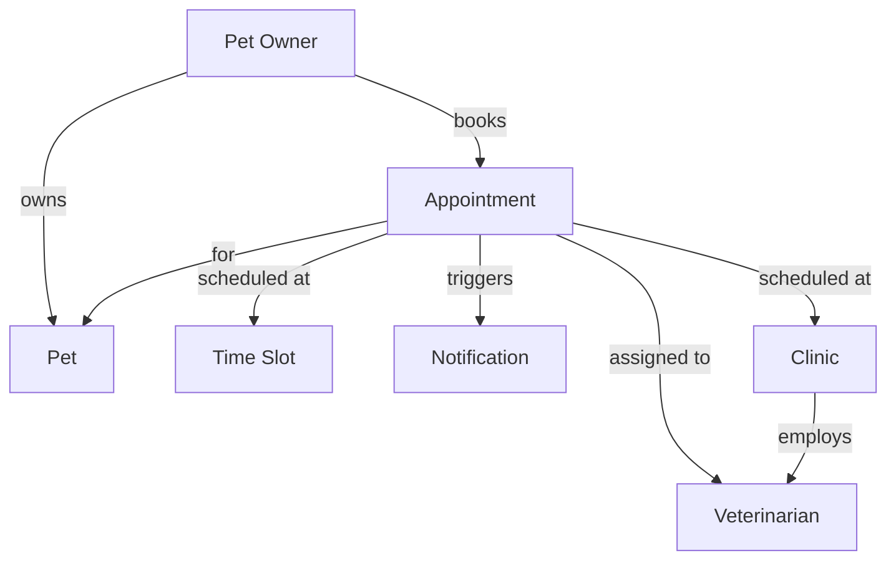

# BÀI THỰC HÀNH 3: STRUCTURAL ANALYSIS AND DESIGN (PHÂN TÍCH VÀ THIẾT KẾ CẤU TRÚC)

> **Đại học Bách Khoa Hà Nội**  
> **Trường Công nghệ Thông tin và Truyền thông (SoICT)**  
> *Slogan: ONE LOVE. ONE FUTURE.*

---

## MỤC LỤC
1. [Mục tiêu bài học](#1-mục-tiêu-bài-học)
2. [Bối cảnh & Dữ liệu đầu vào từ các bài trước](#2-bối-cảnh--dữ-liệu-đầu-vào-từ-các-bài-trước)
3. [Phần A: Structural Analysis – Domain Modeling & Analysis Class](#3-phần-a-structural-analysis--domain-modeling--analysis-class)
   - [Domain Concept là gì?](#domain-concept-là-gì)
   - [Trích xuất danh từ (Noun Extraction) & Từ điển thực thể (Noun Dictionary)](#trích-xuất-danh-từ-noun-extraction--từ-điển-thực-thể)
   - [Danh mục Domain Concepts & Thông tin chính (Key Information)](#danh-mục-domain-concepts--thông-tin-chính)
   - [Mối quan hệ & Bản đồ khái niệm (Concept Map)](#mối-quan-hệ--bản-đồ-khái-niệm-concept-map)
   - [Multiplicity & Bản nghĩa quan hệ (Relationship Semantics)](#multiplicity--bản-nghĩa-quan-hệ)
   - [Xây dựng Domain Model hoàn chỉnh](#xây-dựng-domain-model-hoàn-chỉnh)
   - [Từ Domain Model đến UML Analysis Class Diagram](#từ-domain-model-đến-uml-analysis-class-diagram)
   - [Mô hình đối tượng thực nghiệm (Object Diagram / Instance)](#mô-hình-đối-tượng-thực-nghiệm-object-diagram--instance)
   - [Kiểm tra mô hình với System Functions & Tổng kết đầu ra Phần A](#kiểm-tra-mô-hình-với-system-functions--tổng-kết-đầu-ra-phần-a)
4. [Phần B: Object / Class Design (Thiết kế lớp phần mềm)](#4-phần-b-object--class-design)
   - [Mục tiêu và Bối cảnh thiết kế lớp](#mục-tiêu-và-bối-cảnh-thiết-kế-lớp)
   - [Phân biệt Analysis Class và Design Class](#phân-biệt-analysis-class-và-design-class)
   - [Quyết định Giữ lại, Điều chỉnh hay Bổ sung lớp](#quyết-định-giữ-lại-điều-chỉnh-hay-bổ-sung-lớp)
   - [Xác định trách nhiệm của lớp (Single Responsibility Principle)](#xác-định-trách-nhiệm-của-lớp)
   - [B2: Xác định Collaborators & Lựa chọn kiến trúc (Thiết kế A vs Thiết kế B)](#b2-xác-định-collaborators--lựa-chọn-kiến-trúc)
   - [B3: Xác định Thuộc tính, Phương thức & Đặc tả chi tiết](#b3-xác-định-thuộc-tính-phương-thức--đặc-tả-chi-tiết)
   - [B3: Xác định quan hệ giữa các Design Classes & Vẽ Class Diagram](#b3-xác-định-quan-hệ-giữa-các-design-classes--vẽ-class-diagram)
   - [B4: Phân tích luồng cộng tác chức năng Submit Booking Request](#b4-phân-tích-luồng-cộng-tác-chức-năng-submit-booking-request)
   - [B4: Xử lý các trường hợp ngoại lệ / thay thế (Alternative Flows)](#b4-xử-lý-các-trường-hợp-ngoại-lệ--thay-thế-alternative-flows)
   - [B5: Hoàn thiện thiết kế & Checklist tự đánh giá](#b5-hoàn-thiện-thiết-kế--checklist-tự-đánh-giá)
5. [Bộ hồ sơ nhóm cần nộp (Deliverables)](#5-bộ-hồ-sơ-nhóm-cần-nộp-deliverables)

---

## 1. MỤC TIÊU BÀI HỌC

Sau bài thực hành, sinh viên phải trả lời được **03 câu hỏi cốt lõi**:
1. **Hệ thống cần quản lý những khái niệm và quan hệ nghiệp vụ nào?** (Structural Modeling / Domain Modeling).
2. **Hệ thống nên được tổ chức thành những thành phần nào, mỗi thành phần chịu trách nhiệm gì?** (Architecture & Class Design).
3. **Làm thế nào chứng minh các chức năng và khái niệm nghiệp vụ được hỗ trợ hoàn toàn bởi kiến trúc đã chọn?** (Traceability & Collaboration Modeling).

---

## 2. BỐI CẢNH & DỮ LIỆU ĐẦU VÀO TỪ CÁC BÀI TRƯỚC

### Bối cảnh Case Study: Pet Clinic
* **Hiện trạng:** Phòng khám thú y đang tiếp nhận lịch khám qua điện thoại, tin nhắn và mạng xã hội. Nhân viên phải kiểm tra lịch bác sĩ, xác nhận thông tin vật nuôi, ghi nhận lịch hẹn và thông báo kết quả thủ công cho chủ nuôi.
* **Mục tiêu hệ thống mới:** Hỗ trợ quy trình đặt lịch khám tập trung, hạn chế tối đa trùng lịch và giúp chủ vật nuôi chủ động theo dõi trạng thái yêu cầu.
* **Giới hạn phạm vi (Scope):** Chỉ tập trung vào quy trình quản lý lịch hẹn (xem lịch trống, gửi yêu cầu đặt lịch, kiểm tra khả dụng, xác nhận/từ chối và thông báo kết quả). Không yêu cầu cài đặt code thực tế, thiết kế database chi tiết hay xây dựng UI hoàn chỉnh.

### Đầu vào kế thừa:
* **Business Requirements (BR):**
  * `BR1`: Giảm công sức xử lý đặt lịch của nhân viên.
  * `BR2`: Cải thiện khả năng tiếp cận thông tin lịch khám.
  * `BR3`: Giảm lỗi và tình trạng trùng lịch.
  * `BR4`: Cải thiện khả năng theo dõi trạng thái đặt lịch.
* **System Functions (từ bài Functional Modeling):**
  * `F01`: Xem các khung giờ khám còn trống.
  * `F02`: Tiếp nhận yêu cầu đặt lịch.
  * `F03`: Kiểm tra khả dụng của khung giờ.
  * `F04`: Xử lý yêu cầu đặt lịch.
  * `F05`: Cập nhật trạng thái lịch hẹn.
  * `F06`: Thông báo kết quả cho chủ vật nuôi.

---

## 3. PHẦN A: STRUCTURAL ANALYSIS – DOMAIN MODELING & ANALYSIS CLASS

### Domain Concept là gì?
* **Domain Concept (Khái niệm miền):** Là khái niệm thuộc miền nghiệp vụ, đại diện cho một đối tượng, sự kiện hoặc thông tin có ý nghĩa sống còn trong phạm vi hệ thống.
* **Câu hỏi kiểm tra:** *Khái niệm này có ý nghĩa nghiệp vụ rõ ràng không? Hệ thống có thực sự cần lưu trữ, quản lý hoặc sử dụng thông tin liên quan đến nó không?*
* **Lưu ý:** Mục tiêu không phải là liệt kê càng nhiều khái niệm càng tốt, mà là xác định tập khái niệm **vừa đủ** để mô tả trọn vẹn nghiệp vụ.

---

### Trích xuất danh từ (Noun Extraction) & Từ điển thực thể

Từ việc quan sát thực tế và bản mô tả nghiệp vụ, tiến hành gạch chân danh từ và phân loại vào **Từ điển thực thể (Noun Dictionary)**:

| Thuật ngữ (Term) | Phân loại (Type) | Ý nghĩa nghiệp vụ (Description) | Ghi chú thiết kế (Note) |
| :--- | :--- | :--- | :--- |
| **Pet Owner** | Entity | Người sở hữu thú cưng, đưa thú cưng đi khám | Cần lưu trữ thông tin |
| **Pet** | Entity | Thú cưng cần được thăm khám | Cần gắn với Owner |
| **Appointment** | Entity | Lịch hẹn khám bệnh giữa thú cưng và bác sĩ | Khái niệm trung tâm |
| **Veterinarian** | Entity | Bác sĩ thú y phụ trách ca khám | Cần quản lý lịch làm việc |
| **Clinic** | Entity | Phòng khám nơi diễn ra dịch vụ | Đơn vị tổ chức |
| **Time Slot** | Value Object | Khoảng thời gian cụ thể (giờ bắt đầu - kết thúc) | Bất biến (*immutable*) |
| **Notification** | Entity | Thông báo gửi tới khách hàng (SMS/Email) | Kích hoạt khi có sự kiện |
| **Booking** | Action | Hành động khách đặt lịch hẹn | Chuyển thành Function/Event |
| **Cancellation** | Action | Hành động hủy lịch hẹn | Chuyển thành Function/Event |

---

### Danh mục Domain Concepts & Thông tin chính (Key Information)

Bảng xác định thuộc tính cốt lõi ở mức phân tích (chưa cần chỉ định kiểu dữ liệu kỹ thuật hay khóa chính/khóa ngoại database):

| Khái niệm (Concept) | Ý nghĩa nghiệp vụ | Các thông tin chính cần quản lý (Key Information) |
| :--- | :--- | :--- |
| **Owner** | Người đưa vật nuôi đi khám | `OwnerID`, `Name`, `Phone` |
| **Pet** | Vật nuôi cần được khám | `PetID`, `Name`, `Species` (loài thú cưng) |
| **Veterinarian** | Bác sĩ thú y phụ trách khám | `VetID`, `Name`, `Specialty` (chuyên môn) |
| **Appointment** | Lịch hẹn khám giữa vật nuôi và bác sĩ | `AppointmentID`, `DateTime`, `Status` (trạng thái) |
| **Schedule** | Thông tin lịch làm việc của bác sĩ | `VetID`, `WorkingDate`, `TimeSlot` |

---

### Mối quan hệ & Bản đồ khái niệm (Concept Map)

Các khái niệm không tồn tại độc lập mà liên kết chặt chẽ theo các quy tắc nghiệp vụ:

---

### Multiplicity & Bản nghĩa quan hệ (Relationship Semantics)

* **Multiplicity (Bội số trong UML):** Mô tả số lượng đối tượng có thể tham gia vào một mối quan hệ.
* **Quy tắc phân tích trong Pet Clinic:**
  * `PetOwner 1 —— 0..* Pet`: Một chủ nuôi có thể sở hữu 0 hoặc nhiều thú cưng (*owns $\rightarrow$ Association*).
  * `PetOwner 1 —— 0..* Appointment`: Một chủ nuôi có thể đặt nhiều lịch hẹn qua thời gian.
  * `Appointment 1 —— 1 Pet`: Mỗi lịch hẹn chỉ phục vụ cho đúng 1 thú cưng tại một thời điểm (*for $\rightarrow$ Association*).
  * `Appointment 1 —— 1 Veterinarian`: Mỗi lịch hẹn được phân công cho đúng 1 bác sĩ phụ trách (*assigned to $\rightarrow$ Association*).
  * `Appointment 1 —— 1 TimeSlot`: Mỗi lịch hẹn được cố định vào đúng 1 khung giờ (*scheduled at $\rightarrow$ Aggregation / Value Object*).
  * `Appointment 1 —— 0..* Notification`: Một lịch hẹn có thể kích hoạt nhiều thông báo (xác nhận, nhắc lịch trước 2h, thông báo hủy).
  * `Clinic 1 —— 1..* Veterinarian`: Phòng khám có nhiều bác sĩ làm việc (*employs $\rightarrow$ Association*).

---

### Từ Domain Model đến UML Analysis Class Diagram

* **Sự khác biệt:**
  * **Domain Model:** Nhấn mạnh vào khái niệm thực tế của thế giới nghiệp vụ và ý nghĩa ngôn ngữ miền.
  * **Analysis Class Diagram:** Biểu diễn cấu trúc miền bằng ký pháp hướng đối tượng UML ở mức phân tích (chuẩn hóa tên lớp, thuộc tính và mối quan hệ nhưng chưa đưa vào phương thức xử lý kỹ thuật).

#### Cấu trúc thuộc tính lớp phân tích:
* `PetOwner`: `ownerId`, `name`, `phone`
* `Pet`: `petId`, `name`, `species`
* `Appointment`: `appointmentId`, `date`, `status`
* `Veterinarian`: `vetId`, `name`, `specialization`
* `Clinic`: `clinicId`, `name`, `location`
* `TimeSlot` (*Value Object*): `startTime`, `endTime`
* `Notification`: `notificationId`, `message`, `sentTime`

---

### Mô hình đối tượng thực nghiệm (Object Diagram / Instance)

Mô hình hóa một kịch bản cụ thể tại thời điểm chạy thực tế (*Snapshot*) để kiểm chứng tính đúng đắn của cấu trúc lớp:

* **Đối tượng cụ thể:**
  * `nam: PetOwner`: `ownerId = "P0001"`, `name = "Nam"`, `phone = "0901234567"`
  * `mimi: Pet`: `petId = "P001"`, `name = "Mimi"`, `species = "Cat"`
  * `drLan: Veterinarian`: `vetId = "V001"`, `name = "Dr. Lan"`, `specialization = "General"`
  * `happyPet: Clinic`: `clinicId = "C001"`, `name = "Happy Pet Clinic"`, `location = "Hà Nội"`
  * `slot1: TimeSlot`: `startTime = "09:00"`, `endTime = "09:30"`
  * `appt1: Appointment`: `appointmentId = "A001"`, `date = "2026-04-20"`, `status = "Scheduled"`
  * `notif1: Notification`: `notificationId = "N001"`, `message = "Reminder: Appointment at 09:00"`, `sentTime = "2026-04-20 08:00"`
* **Liên kết (Links):**
  * `nam` sở hữu `mimi`.
  * `nam` đặt `appt1` cho `mimi`.
  * `appt1` được phân công cho `drLan` tại phòng khám `happyPet` vào khung giờ `slot1`.
  * `appt1` kích hoạt gửi thông báo `notif1`.

---

### Kiểm tra mô hình với System Functions & Tổng kết đầu ra Phần A

#### Bảng đối chiếu System Function – Domain Concepts:

| Mã Function | Tên chức năng hệ thống | Khái niệm miền liên quan | Kiểm tra tính đầy đủ |
| :--- | :--- | :--- | :--- |
| **F01** | Xem khung giờ khám còn trống | `Schedule`, `Veterinarian`, `TimeSlot` | Đạt |
| **F02** | Tiếp nhận yêu cầu đặt lịch | `Owner`, `Pet`, `Appointment` | Đạt |
| **F03** | Kiểm tra khả dụng của khung giờ | `Schedule`, `Appointment`, `TimeSlot` | Đạt |
| **F04** | Xử lý yêu cầu đặt lịch | `Appointment`, `Veterinarian` | Đạt |
| **F05** | Cập nhật trạng thái lịch hẹn | `Appointment` | Đạt |
| **F06** | Thông báo kết quả cho chủ nuôi | `Owner`, `Appointment`, `Notification` | Đạt |

#### Chuỗi 7 bước bàn giao của Phần A:
$$\text{Problem Domain} \longrightarrow \text{Noun Extraction} \longrightarrow \text{Dictionary} \longrightarrow \text{Concept Map} \longrightarrow \text{Concept Class} \longrightarrow \text{Domain Class Model} \longrightarrow \text{Class Diagram} \longrightarrow \text{Object Diagram}$$

---

## 4. PHẦN B: OBJECT / CLASS DESIGN (THIẾT KẾ LỚP PHẦN MỀM)

### Mục tiêu và Bối cảnh thiết kế lớp
* **Mục tiêu:** Chuyển đổi các lớp phân tích (*Analysis Classes*) thành các lớp phần mềm thiết kế (*Design Classes*); phân chia trách nhiệm rõ ràng; đặc tả kiểu dữ liệu, phương thức và mô hình hóa luồng cộng tác giải quyết chức năng.
* **Phạm vi trọng tâm:** Thiết kế chi tiết cho ca sử dụng chức năng: **Submit Booking Request** (Gửi yêu cầu đặt lịch).

---

### Phân biệt Analysis Class và Design Class

| Tiêu chí | Analysis Class (Lớp phân tích) | Design Class (Lớp thiết kế) |
| :--- | :--- | :--- |
| **Bản chất** | Mô tả khái niệm thuộc thế giới nghiệp vụ thực tế. | Mô tả thành phần phần mềm trực tiếp thực thi trên máy tính tính toán. |
| **Trọng tâm** | Tập trung vào thông tin dữ liệu và quan hệ nghiệp vụ. | Tập trung vào kiểu dữ liệu, cấu trúc phương thức (*methods*), tính đóng gói và trách nhiệm phần mềm. |
| **Mức độ xử lý** | Chưa cần xác định chi tiết cách tính toán, điều phối. | Xác định tường minh cách các lớp cộng tác để hoàn thành chức năng. |
| **Kiến trúc** | Chỉ gồm các lớp thực thể (*Entity*). | Bổ sung các lớp điều phối (*Controller/Service*) và lớp lưu trữ (*Repository/DAO*). |

---

### Quyết định Giữ lại, Điều chỉnh hay Bổ sung lớp

Để hỗ trợ chức năng **Submit Booking Request**, nhóm phân tích đưa ra bảng quyết định:

| Lớp phân tích | Quyết định | Lý do kiến trúc |
| :--- | :--- | :--- |
| **Owner** | Giữ lại | Biểu diễn thông tin chủ nuôi |
| **Pet** | Giữ lại | Biểu diễn thông tin thú cưng được khám |
| **Veterinarian** | Giữ lại | Xác định bác sĩ liên quan đến lịch hẹn |
| **Appointment** | Giữ lại & Bổ sung hành vi | Quản lý dữ liệu và trạng thái lịch hẹn; thêm các phương thức nghiệp vụ: `confirm()`, `reject(reason)` |
| **Schedule** | Giữ lại / Điều chỉnh | Cung cấp thông tin về các slot khả dụng của bác sĩ |
| *(Chưa có)* | **Bổ sung `BookingController`** | Lớp điều phối luồng xử lý yêu cầu đặt lịch từ UI xuống hệ thống |
| *(Chưa có)* | **Bổ sung `ScheduleService`** | Lớp dịch vụ chuyên trách kiểm tra quy tắc nghiệp vụ xem slot có hợp lệ không |
| *(Chưa có)* | **Bổ sung `AppointmentRepository`**| Lớp trừu tượng hóa thao tác đọc/ghi dữ liệu lịch hẹn xuống cơ sở dữ liệu |

---

### Xác định trách nhiệm của lớp (Single Responsibility Principle)
* **Lớp nào lưu dữ liệu?** $\rightarrow$ `Owner`, `Pet`, `Veterinarian`, `Appointment`.
* **Lớp nào thực hiện quy tắc nghiệp vụ trạng thái?** $\rightarrow$ `Appointment` (tự kiểm tra và đổi trạng thái của chính nó).
* **Lớp nào điều phối quy trình nhiều bước?** $\rightarrow$ `BookingController`.
* **Lớp nào xử lý logic kiểm tra lịch trống?** $\rightarrow$ `ScheduleService`.
* **Lớp nào trực tiếp giao tiếp với hệ thống lưu trữ/DB?** $\rightarrow$ `AppointmentRepository`.

---

### B2: Xác định Collaborators & Lựa chọn kiến trúc

* **Thiết kế A (God Object / Fat Controller):** `BookingController` tự làm tất cả: vừa kiểm tra dữ liệu, vừa truy vấn lịch, vừa tạo đối tượng và trực tiếp lưu DB $\rightarrow$ *Vi phạm nguyên lý đơn trách nhiệm, khó kiểm thử, khó bảo trì.*
* **Thiết kế B (Separation of Concerns - Khuyên dùng):** `BookingController` chỉ đóng vai trò điều phối; ủy quyền kiểm tra lịch cho `ScheduleService`; ủy quyền lưu trữ cho `AppointmentRepository`.

#### Bảng CRC (Class – Responsibility – Collaborators):

| Class | Trách nhiệm chính (Responsibility) | Cộng tác với (Collaborators) | Lý do cộng tác |
| :--- | :--- | :--- | :--- |
| **BookingController** | Điều phối toàn bộ luồng quy trình đặt lịch | `ScheduleService` `AppointmentRepository` `Appointment` | Kiểm tra khả năng đặt lịch Lưu hoặc truy vấn lịch hẹn Khởi tạo và cập nhật đối tượng lịch |
| **ScheduleService** | Kiểm tra tính khả dụng của slot khám | Dữ liệu lịch làm việc bác sĩ | Kiểm tra khung giờ có bị trùng lặp không |
| **AppointmentRepository** | Thao tác đọc, ghi, cập nhật lịch hẹn vào DB | `Appointment` | Thực thi lưu trữ hoặc truy xuất đối tượng lịch |
| **Appointment** | Quản lý dữ liệu và vòng đời trạng thái lịch | `Pet`, `Veterinarian` | Gắn kết thông tin thú cưng và bác sĩ phụ trách |

---

### B3: Xác định Thuộc tính, Phương thức & Đặc tả chi tiết

#### 1. Thuộc tính & Kiểu dữ liệu (Attributes):
* `Owner`: `ownerId: String`, `name: String`, `phone: String`
* `Pet`: `petId: String`, `name: String`, `species: String`, `ownerId: String`
* `Veterinarian`: `veterinarianId: String`, `name: String`, `specialty: String`
* `Appointment`: `appointmentId: String`, `petId: String`, `veterinarianId: String`, `appointmentTime: DateTime`, `status: AppointmentStatus`
* `Schedule`: `veterinarianId: String`, `availableSlots: List<TimeSlot>`
* `TimeSlot`: `startTime: DateTime`, `endTime: DateTime`

#### 2. Đặc tả phương thức quan trọng (Methods):

| Method Name | Parameters (Tham số đầu vào) | Return Type (Kiểu trả về) | Lớp sở hữu | Mục đích nghiệp vụ |
| :--- | :--- | :--- | :--- | :--- |
| `submitBooking(...)` | `petId: String, vetId: String, time: DateTime` | `BookingResult` | `BookingController` | Tiếp nhận yêu cầu và điều phối luồng đặt lịch |
| `isSlotAvailable(...)`| `vetId: String, time: DateTime` | `Boolean` | `ScheduleService` | Kiểm tra khung giờ bác sĩ có trống không |
| `save(...)` | `appointment: Appointment` | `SaveResult` | `AppointmentRepository` | Lưu đối tượng lịch hẹn xuống cơ sở dữ liệu |
| `confirm()` | *(không có)* | `void` | `Appointment` | Chuyển trạng thái lịch hẹn sang "Confirmed" |
| `reject(...)` | `reason: String` | `void` | `Appointment` | Chuyển trạng thái lịch hẹn sang "Rejected" kèm lý do |

---

### B3: Xác định quan hệ giữa các Design Classes & Vẽ Class Diagram

* **Association:**
  * `Owner 1 —— 0..* Pet`
  * `Pet 1 —— 0..* Appointment`
  * `Veterinarian 1 —— 0..* Appointment`
* **Dependency (`<<uses>>`):**
  * `BookingController` $\dashrightarrow$ `ScheduleService`: Gọi kiểm tra lịch trống.
  * `BookingController` $\dashrightarrow$ `AppointmentRepository`: Gọi hàm lưu trữ.
  * `BookingController` $\dashrightarrow$ `Appointment`: Khởi tạo instance mới.

---

### B4: Phân tích luồng cộng tác chức năng Submit Booking Request

#### 1. Kịch bản luồng thành công (Happy Path):
1. Khách hàng gửi yêu cầu qua giao diện `Appointment UI`.
2. `Appointment UI` chuyển dữ liệu gọi `BookingController.submitBooking(...)`.
3. `BookingController` gọi `ScheduleService.isSlotAvailable(vetId, time)`.
4. `ScheduleService` trả về `true` (slot còn trống).
5. `BookingController` khởi tạo đối tượng `Appointment` mới.
6. `BookingController` gọi `AppointmentRepository.save(appointment)`.
7. `AppointmentRepository` lưu thành công và trả về `SaveResult.SUCCESS`.
8. `BookingController` trả về kết quả `BookingResult.SUCCESS` cho UI để hiển thị cho khách.

#### 2. Bảng cộng tác giữa các lớp (Step-by-Step Message Trace):

| Bước | Sender (Bên gửi) | Receiver (Bên nhận) | Message (Thông điệp / Lời gọi hàm) | Dữ liệu trả về (Return Data) |
| :---: | :--- | :--- | :--- | :--- |
| **1** | Appointment UI | BookingController | `submitBooking(petId, vetId, time)` | Đang chờ xử lý |
| **2** | BookingController | ScheduleService | `isSlotAvailable(vetId, time)` | `Boolean (true/false)` |
| **3** | BookingController | Appointment | `new Appointment(petId, vetId, time)` | `instance Appointment` |
| **4** | BookingController | AppointmentRepository| `save(appointment)` | `SaveResult` |
| **5** | BookingController | Appointment UI | Trả về `BookingResult` | Kết quả thông báo cho khách |

---

### B4: Xử lý các trường hợp ngoại lệ / thay thế (Alternative Flows)

Một thiết kế tốt bắt buộc phải xử lý trơn tru các trường hợp rủi ro hoặc dữ liệu không hợp lệ:

| Tình huống ngoại lệ | Lớp phát hiện vấn đề | Lớp quyết định xử lý | Đối tượng Appointment có được tạo/lưu? | Kết quả trả về cho UI |
| :--- | :--- | :--- | :---: | :--- |
| **Thiếu thông tin đặt lịch** | `BookingController` | `BookingController` | **Không** | Trả về thông báo lỗi: *"Thiếu trường thông tin bắt buộc"* |
| **Khung giờ không khả dụng** | `ScheduleService` | `BookingController` | **Không** | Trả về `BookingResult.SLOT_UNAVAILABLE`, gợi ý slot khác |
| **Không tìm thấy Pet/Owner** | `BookingController` / `Repository` | `BookingController` | **Không** | Báo lỗi hồ sơ không tồn tại, yêu cầu tạo mới hồ sơ |
| **Lỗi lưu DB thất bại** | `AppointmentRepository` | `BookingController` | Có tạo nhưng **Rollback/Hủy lưu** | Báo lỗi hệ thống bận, đề nghị khách thử lại sau |

---

### B5: Hoàn thiện thiết kế & Checklist tự đánh giá

Nhóm cần tự rà soát bản thiết kế dựa trên **10 tiêu chí đánh giá chuẩn mực**:
1. [x] Mỗi lớp đều có một trách nhiệm nghiệp vụ duy nhất, phân định rõ ràng.
2. [x] Không bỏ sót trách nhiệm quan trọng nào trong luồng xử lý.
3. [x] Các thuộc tính hỗ trợ đầy đủ cho hành vi và phương thức của lớp.
4. [x] Các phương thức có đầy đủ tên, tham số, kiểu dữ liệu trả về hợp lệ.
5. [x] Mọi thông điệp trong Bảng cộng tác đều có phương thức tương ứng trên sơ đồ lớp.
6. [x] Quan hệ giữa các lớp hợp lý; không có quan hệ phụ thuộc (*dependency*) vòng tròn hoặc vô lý.
7. [x] Thiết kế bao quát và xử lý được các luồng ngoại lệ/thay thế.
8. [x] Design Class Diagram nhất quán hoàn toàn với các mô hình hành vi (Sequence / Activity / Use Case).
9. [x] Các lớp được phân bổ đúng tầng kiến trúc (Presentation / Controller / Service / Repository / Domain Entity).
10. [x] Mọi quyết định thêm, sửa, xóa lớp đều có lý do nghiệp vụ và kiến trúc rõ ràng.

---

## 5. BỘ HỒ SƠ NHÓM CẦN NỘP (DELIVERABLES)

Khi hoàn thành bài thực hành 3, nhóm sinh viên bàn giao đầy đủ **06 tài liệu chuẩn hóa**:
1. **Danh sách Design Classes** kèm bản diễn giải lý do chuyển đổi từ Analysis Class.
2. **Bảng CRC (Class – Responsibility – Collaborators)** hoàn chỉnh.
3. **Bảng đặc tả thuộc tính và phương thức chi tiết** (đầy đủ kiểu dữ liệu, tham số, giá trị trả về).
4. **Sơ đồ Design Class Diagram phiên bản cuối cùng (UML)**.
5. **Bảng cộng tác lớp cho chức năng Submit Booking Request** (gồm cả luồng chính và tối thiểu 2 luồng ngoại lệ).
6. **Bảng tự đánh giá thiết kế** ghi lại ít nhất 3 vấn đề phát hiện trong quá trình làm, cách điều chỉnh và lý do kỹ thuật.
