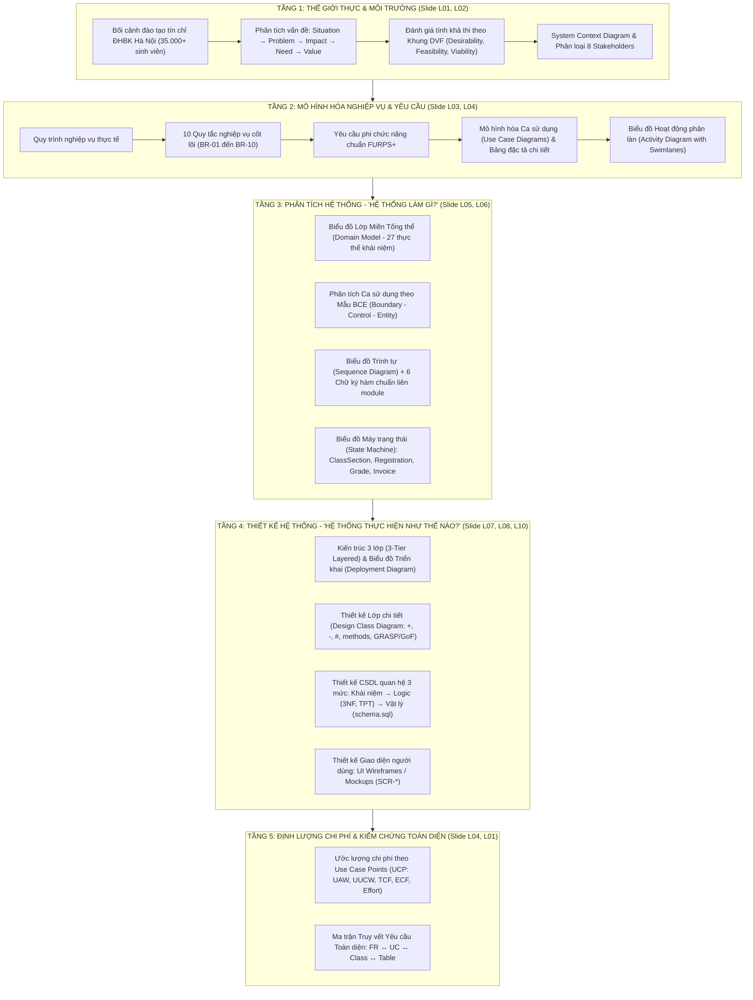

# BỨC TRANH TOÀN CẢNH & "SỢI CHỈ ĐỎ" XUYÊN SUỐT DỰ ÁN (THE BIG PICTURE & RED THREAD)

> **Môn học:** Phân tích và Thiết kế Hệ thống (IT3120) – Viện CNTT&TT (SOICT), ĐH Bách khoa Hà Nội  
> **Dự án:** Hệ thống Quản lý Đào tạo Đại học theo Học chế Tín chỉ  
> **Tài liệu làm việc nhóm:** Đã đồng bộ trực tiếp lên tab **"Bức tranh toàn cảnh"** trên [Google Docs của Nhóm](https://docs.google.com/document/d/1jiKlOosNQs4pjGGe4y44H7tnXUyxFF-9uj6AfKUexWs/edit)

---

## 📌 PHẦN I. BẢN CHẤT CỦA MÔN HỌC IT3120 & ĐẶC THÙ DỰ ÁN (TẠI SAO LẠI LÀ NO-CODE?)

### 1. Tại sao không lập trình ứng dụng mà tập trung vào Mô hình hóa và Thiết kế?
- Trong thực tế công nghiệp phần mềm, **hơn 80% sự thất bại của các dự án lớn không bắt nguồn từ cú pháp lập trình (coding)**, mà bắt nguồn từ việc:
  - Hiểu sai quy trình nghiệp vụ và các ràng buộc thực tế.
  - Thu thập thiếu hoặc không đầy đủ yêu cầu của các bên liên quan.
  - Kiến trúc hệ thống lỏng lẻo, phân rã module không độc lập, dẫn đến hiệu ứng domino khi bảo trì.
- Môn học **IT3120** trang bị cho sinh viên năng lực cốt lõi của một **Kỹ sư Kiến trúc Hệ thống (System Architect)** và **Chuyên viên Phân tích Nghiệp vụ (Business Analyst)**: Biến một bài toán thế giới thực phức tạp thành một bản thiết kế kỹ thuật chuẩn xác, nhất quán, khả thi và có thể kiểm chứng trước khi chuyển giao cho đội ngũ lập trình viên thi công.

### 2. Mục tiêu Tối thượng của Đề tài
- Vận dụng toàn diện **Tư duy hệ thống (Systems Thinking)** và **Phương pháp luận Hướng đối tượng (OOAD)** theo chuẩn UML 2.x.
- Thiết lập sự liên kết khép kín 100%: Từ Bối cảnh thế giới thực $\to$ 10 Quy tắc nghiệp vụ cốt lõi (`BR-01`..`10`) $\to$ Ca sử dụng (Use Cases) $\to$ Phân tích cấu trúc (Domain Model) $\to$ Phân tích hành vi (BCE & Sequence Diagrams) $\to$ Thiết kế Kiến trúc & CSDL quan hệ 3NF (PostgreSQL) $\to$ Ước lượng chi phí phần mềm (Use Case Points - UCP).

---

## 🧭 PHẦN II. "SỢI CHỈ ĐỎ" 5 TẦNG CHUYỂN ĐỔI (TỪ THẾ GIỚI THỰC ĐẾN THIẾT KẾ KỸ THUẬT)

---

### TẦNG 1: THẾ GIỚI THỰC & MÔ HÌNH HÓA MÔI TRƯỜNG (SLIDE BÀI 1 & BÀI 2)
1. **Phát biểu bài toán theo chuỗi nhân quả (Systems Thinking):**
   - **Situation (Bối cảnh):** Trường đại học quy mô 35.000+ sinh viên vận hành theo học chế tín chỉ. Sinh viên chủ động xây dựng lộ trình học tập, giảng viên quản lý điểm lớp học phần, phòng Đào tạo quản lý khung CTĐT.
   - **Problem (Vấn đề):** Nghẽn hệ thống giờ cao điểm mở cổng đăng ký; sinh viên đăng ký môn khi chưa đạt tiên quyết; trùng lịch phòng học và kíp dạy giảng viên; chậm trễ cập nhật công nợ học phí và sai sót khi xét cảnh báo học vụ.
   - **Impact (Tác động):** Bức xúc cho sinh viên, quá tải cho cán bộ đào tạo, rủi ro tài chính và sai lệch học vụ.
   - **Need & Goal (Nhu cầu & Mục tiêu):** Xây dựng hệ thống phần mềm quản lý đào tạo hợp nhất, tự động hóa toàn bộ việc kiểm tra ràng buộc nghiệp vụ theo thời gian thực.
   - **Value (Giá trị mang lại):** Đăng ký minh bạch, tối ưu hóa phòng học, giảm thiểu sai sót thủ công cho nhà trường.
2. **Đánh giá Tính khả thi theo Khung DVF (Slide Bài 2):**
   - **Desirability (Mong muốn):** Nhu cầu số hóa cấp thiết của toàn bộ sinh viên, giảng viên và cán bộ quản lý.
   - **Technical Feasibility (Kỹ thuật):** Khả thi về thuật toán đồ thị có hướng (DAG Cycle Detection) chặn vòng lặp tiên quyết; thuật toán kiểm tra giao đoạn thời gian chống trùng lịch; kiến trúc phân tầng 3 lớp và CSDL PostgreSQL.
   - **Operational Feasibility (Vận hành):** Phân định rõ quyền hạn giữa Phòng Đào tạo, Cán bộ Khoa, Giảng viên và Sinh viên qua cơ chế RBAC.
   - **Economic Viability (Kinh tế):** Ước lượng chi phí bài bản qua UCP, tiết kiệm chi phí nhân sự vận hành thủ công hàng kỳ.
3. **Ranh giới hệ thống & 8 Stakeholders:**
   - Sinh viên, Giảng viên, Cán bộ Đào tạo, Cán bộ Khoa, Cán bộ Tài chính, Quản trị hệ thống, Cổng thanh toán trực tuyến (hệ thống ngoài), Dịch vụ Email (hệ thống ngoài).
   - Thể hiện rõ qua Biểu đồ Ngữ cảnh Môi trường (System Context Diagram).

---

### TẦNG 2: MÔ HÌNH HÓA NGHIỆP VỤ & KỸ NGHỆ YÊU CẦU (SLIDE BÀI 3 & BÀI 4)
1. **Danh mục 10 Quy tắc Nghiệp vụ Cốt lõi (Business Rules - BR):**
   - `BR-01`: Tiên quyết bắt buộc (`hasPassed = true`).
   - `BR-02`: Giới hạn trần tín chỉ đăng ký kỳ theo mức Cảnh báo học vụ (Mức 0: 24TC, Mức 1: 18TC, Mức 2: 14TC, Mức 3: 8TC).
   - `BR-03`: Chống trùng kíp học: `(StartA < EndB) AND (EndA > StartB)`.
   - `BR-04`: Giới hạn sĩ số lớp học phần: `currentEnrollment < maxCapacity`.
   - `BR-05`: Khung thời hạn đợt đăng ký: `RegistrationPeriod.status == OPEN`.
   - `BR-06`: Công thức tính học phí: $\text{Credits} \times \text{TuitionRate} \times \text{Factor} - \text{Waiver}$.
   - `BR-07`: Điểm tổng kết học phần = $\sum (\text{Trọng số} \times \text{Điểm thành phần})$, quy đổi sang thang chữ và thang điểm 4.0.
   - `BR-08`: GPA học kỳ và CPA tích lũy (khi học lại lấy điểm cao nhất).
   - `BR-09`: Tự động xét mức cảnh báo học vụ (Mức 0, 1, 2, 3) dựa trên ngưỡng CPA.
   - `BR-10`: Phân quyền nhập điểm: Chỉ Giảng viên phụ trách chính thức trong `InstructorAssignment`.
2. **Yêu cầu Phi chức năng theo chuẩn FURPS+ (Slide Bài 3):**
   - **F**unctionality (Bảo mật JWT, phân quyền Role-based, toàn vẹn dữ liệu).
   - **U**sability (Giao diện thân thiện, thông báo lỗi kiểm tra BR rõ ràng).
   - **R**eliability (Độ tin cậy dữ liệu điểm số, giao dịch học phí ACID).
   - **P**erformance (Chịu tải $\ge 10.000$ requests/phút đợt mở đăng ký, phản hồi $\le 2s$).
   - **S**upportability (Kiến trúc mô-đun hóa dễ bảo trì, mở rộng).
3. **Mô hình hóa Ca sử dụng (Use Case Modeling - Slide Bài 4):**
   - Biểu đồ phân rã Use Case tổng quan và chi tiết 4 phân hệ (`CUR`, `SCH`, `REG`, `GRD`).
   - 4 Use Case Lõi phân tích sâu: `UC-CUR-01`, `UC-SCH-01`, `UC-REG-01`, `UC-GRD-01` kèm Bảng đặc tả chi tiết và Biểu đồ Hoạt động phân làn (Activity Diagram with Swimlanes) thể hiện rõ luồng chính và các luồng ngoại lệ.

---

### TẦNG 3: PHÂN TÍCH HỆ THỐNG - "HỆ THỐNG LÀM GÌ?" (SLIDE BÀI 5 & BÀI 6)
1. **Phân tích Cấu trúc (Slide Bài 5) - Biểu đồ Lớp Miền Tổng thể (Domain Model):**
   - Biểu diễn 27 thực thể thế giới thực trong trường đại học.
   - **QUY TẮC SỐNG CÒN:** Domain Model ở mức Khái niệm (Conceptual Level), chỉ chứa thuộc tính thực tế, tuyệt đối **KHÔNG chứa kiểu dữ liệu kỹ thuật SQL** (`VARCHAR`, `SERIAL`), **KHÔNG chứa khóa ngoại (foreign keys)** và **KHÔNG chứa phương thức (methods)**.
2. **Phân tích Ca sử dụng theo Mẫu BCE (Boundary - Control - Entity) / Robustness (Slide Bài 6):**
   - **Boundary:** Giao diện tiếp xúc với Actor (`*Page`, `*Form`, `*Dialog`).
   - **Control:** Bộ điều phối quy tắc nghiệp vụ (`*Controller`, `*Service`).
   - **Entity:** Thực thể chứa dữ liệu nghiệp vụ (lấy từ Domain Model).
   - **Luật BCE:** $\text{Actor} \to \text{Boundary} \to \text{Control} \to \text{Entity}$. Boundary **không bao giờ** nói chuyện trực tiếp với Entity!
3. **Biểu đồ Trình tự (Sequence Diagram) & 6 Chữ ký Hàm Giao tiếp Liên Module:**
   - REG gọi SCH: `SCH_Service.getOpenSections(semesterId: String) : List<ClassSection>`
   - REG gọi CUR: `CUR_Service.getCourseInfo(courseCode: String) : CourseInfoDTO {credits, prerequisites}`
   - REG gọi GRD: `GRD_Service.hasPassed(studentId: String, courseCode: String) : Boolean`
   - REG gọi GRD: `GRD_Service.getWarningLevel(studentId: String, semesterId: String) : Int`
   - GRD gọi REG: `REG_Service.getRegisteredStudents(sectionId: String) : List<String>`
   - GRD gọi SCH: `SCH_Service.getSectionInstructor(sectionId: String) : String`
4. **Biểu đồ Máy trạng thái (State Machine Diagram - Slide Bài 6):**
   - Vòng đời `ClassSection`: `DRAFT` $\to$ `OPEN_FOR_REG` $\to$ `CLOSED_FOR_REG` $\to$ `IN_PROGRESS` $\to$ `COMPLETED` | `CANCELLED`.
   - Vòng đời `Registration`: `REGISTERED` $\to$ `WITHDRAWN` | `CANCELLED`.
   - Vòng đời `Invoice`: `UNPAID` $\to$ `PARTIALLY_PAID` $\to$ `PAID` | `OVERDUE`.
   - Vòng đời `Grade`: `DRAFT` $\to$ `PUBLISHED` $\to$ `UNDER_APPEAL` $\to$ `LOCKED`.

---

### TẦNG 4: THIẾT KẾ HỆ THỐNG - "HỆ THỐNG THỰC HIỆN NHƯ THẾ NÀO?" (SLIDE BÀI 7, 8 & 10)
1. **Thiết kế Kiến trúc (Slide Bài 7):**
   - **Kiến trúc Logic 3 lớp (3-Tier Layered Architecture):** Presentation Layer (Giao diện Web), Business Logic/Service Layer (Xử lý nghiệp vụ), Persistence/Data Access Layer (Truy xuất CSDL).
   - **Biểu đồ Triển khai (Deployment Diagram):** Client Browser Nodes $\to$ HTTPS $\to$ Application Server (Web/API Server) $\to$ JDBC/TCP $\to$ PostgreSQL Database Server.
2. **Thiết kế Lớp Chi tiết (Slide Bài 8):**
   - Nâng cấp từ BCE sang Design Class Diagram: Bổ sung đầy đủ phạm vi truy cập (`+`, `-`, `#`), kiểu dữ liệu ngôn ngữ lập trình và chữ ký phương thức hoàn chỉnh.
   - Áp dụng nguyên lý thiết kế **GRASP** (Information Expert, Controller, Low Coupling, High Cohesion) và Design Patterns.
3. **Thiết kế CSDL Lưu trữ Bền vững qua 3 Mức (Slide Bài 10):**
   - **Mức 1 - Khái niệm:** Xuất phát từ Domain Model.
   - **Mức 2 - Logic:** Ánh xạ quan hệ Association ($1-N$, $N-N$ qua bảng trung gian); Ánh xạ kế thừa hướng đối tượng sang CSDL quan hệ (áp dụng mô hình Class Table / Table-per-Type cho `User` $\to$ `Student`, `Instructor`); Chứng minh CSDL đạt Chuẩn hóa bậc 3 (3NF).
   - **Mức 3 - Vật lý:** Biểu đồ ERD chi tiết, Từ điển dữ liệu (Data Dictionary 27 bảng dữ liệu), và kịch bản DDL PostgreSQL (`schema.sql`) với các ràng buộc CHECK, ENUM, FOREIGN KEY và chỉ mục tối ưu.
4. **Thiết kế Giao diện Người dùng (UI Wireframes / Mockups):**
   - Thiết kế giao diện cho 4 màn hình trọng tâm: Quản lý CTĐT (`SCR-CUR-01`), Mở lớp & Xếp TKB (`SCR-SCH-01`), Đăng ký học phần (`SCR-REG-01`), Nhập và công bố điểm (`SCR-GRD-01`).

---

### TẦNG 5: ĐỊNH LƯỢNG CHI PHÍ & KIỂM CHỨNG TOÀN DIỆN (SLIDE BÀI 4 & BÀI 1)
1. **Ước lượng Chi phí Phần mềm theo Use Case Points (UCP - Slide Bài 4):**
   - Bước 1: Tính Trọng số Tác nhân Chưa điều chỉnh ($UAW$): Simple (1), Average (2), Complex (3).
   - Bước 2: Tính Trọng số Ca sử dụng Chưa điều chỉnh ($UUCW$): Simple (5), Average (10), Complex (15).
   - Bước 3: Tính $UUCP = UAW + UUCW$.
   - Bước 4: Đánh giá 13 hệ số phức tạp kỹ thuật ($TCF$) và 8 hệ số môi trường ($ECF$).
   - Bước 5: Tính tổng điểm $UCP = UUCP \times TCF \times ECF$; Tính Giờ công Nỗ lực ($\text{Effort} = UCP \times 20$) và Số tháng công ($\text{Man-months} = \frac{\text{Effort}}{160}$).
2. **Ma trận Truy vết Toàn diện (Traceability Matrix):**
   - Đối soát khép kín 100%: $\text{FR} \longleftrightarrow \text{UC} \longleftrightarrow \text{Class} \longleftrightarrow \text{Table}$, đảm bảo không có yêu cầu nào bị bỏ sót và không có bảng CSDL nào bị thừa.

---

## 🤝 PHẦN III. NGUYÊN TẮC VÀNG PHỐI HỢP SONG SONG KHÔNG BỊ "DẪM CHÂN NHAU"

1. **Nguyên tắc Phân rã theo Lát cắt Dọc (Vertical Slice by Domain Module):**
   - Mỗi thành viên phụ trách trọn vẹn 1 phân hệ xuyên suốt từ Yêu cầu (FR) $\to$ Ca sử dụng (UC) $\to$ Phân tích BCE & Sequence $\to$ Wireframe Mockup.
   - Thành viên A: Module CUR (Danh mục & Hệ thống).
   - Thành viên B: Module SCH (Tổ chức Giảng dạy).
   - Thành viên C: Module REG (Đăng ký HP & Học phí - Nặng nhất).
   - Thành viên D: Module GRD (Kết quả Học tập & CSDL).
2. **Nguyên tắc Độc quyền Sở hữu Thực thể (Single Entity Ownership):**
   - Mỗi thực thể chỉ do 1 Module làm chủ sở hữu.
   - Thành viên sở hữu có toàn quyền thiết kế bảng CSDL, thuộc tính và trạng thái của thực thể đó. Các module khác chỉ tham chiếu qua khóa ngoại id hoặc gọi qua Interface.
3. **Nguyên tắc Hợp đồng Giao diện (Interface-First / Contract-Driven):**
   - Khi cần dữ liệu của module khác, BẮT BUỘC sử dụng đúng 6 chữ ký hàm chuẩn trong Interfaces Matrix.
4. **Quy trình Cộng tác trên GitHub:**
   - Nhánh `main` là vùng cấm (không commit trực tiếp).
   - Tạo nhánh theo quy ước `feat/module-name` $\to$ Commit `[MODULE] Add:...` $\to$ Mở Pull Request (PR) $\to$ Review & Merge.
   - GitHub Actions sẽ tự động render toàn bộ sơ đồ PlantUML (`.puml`) sang ảnh (`.png`).

---

## 🛡️ PHẦN IV. BỘ CHECKLIST 7 "CẠM BẪY" CẦN TRÁNH TRƯỚC KHI NỘP BÁO CÁO & BẢO VỆ

- [ ] **Bẫy 1:** Không nhầm lẫn Domain Model (Lớp khái niệm thế giới thực) với ERD (Lược đồ CSDL vật lý).
- [ ] **Bẫy 2:** Biểu đồ Sequence Diagram phải tuân thủ nghiêm ngặt mô hình BCE ($\text{Actor} \to \text{Boundary} \to \text{Control} \to \text{Entity}$).
- [ ] **Bẫy 3:** Biểu đồ Sequence và Activity phải có khối `alt` / rẽ nhánh xử lý ngoại lệ khi vi phạm các `BR-01`..`10`, không chỉ vẽ mỗi luồng thành công (Happy Path).
- [ ] **Bẫy 4:** Tên hàm gọi chéo liên module phải khớp 100% giữa các Sequence Diagrams theo đúng file [`docs/interfaces-matrix.md`](./docs/interfaces-matrix.md).
- [ ] **Bẫy 5:** CSDL PostgreSQL phải chứng minh đạt Chuẩn hóa bậc 3 (3NF), giải trình rõ cơ chế ánh xạ kế thừa `User` $\to$ `Student`, `Instructor`.
- [ ] **Bẫy 6:** Ước lượng chi phí UCP phải có bảng thuyết minh căn cứ cho từng hệ số trong 13 TCF và 8 ECF.
- [ ] **Bẫy 7:** Báo cáo phải có Ma trận Truy vết Yêu cầu hoàn chỉnh ở Phụ lục A để chứng minh tính nhất quán toàn diện.
