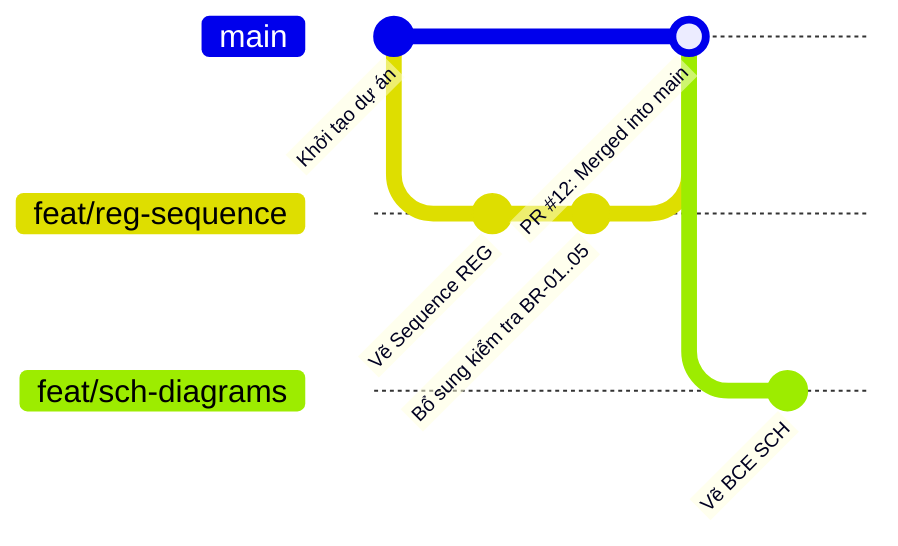

# QUY TRÌNH THAO TÁC GIT & CỘNG TÁC GITHUB (GIT & GITHUB COLLABORATION WORKFLOW)

> **Dự án:** Hệ thống Quản lý Đào tạo Đại học theo Học chế Tín chỉ (IT3120 - SOICT, ĐH Bách khoa Hà Nội)  
> **Mục đích:** Chuẩn hóa quy trình làm việc song song giữa 4 thành viên, ngăn chặn triệt để xung đột mã nguồn (Merge Conflict), bảo vệ nhánh `main` và tận dụng quy trình CI/CD tự động kết xuất biểu đồ PlantUML.

---

## 📌 PHẦN I. NGUYÊN TẮC BẤT KHẢ XÂM PHẠM

1. **Nhánh `main` là "Bất khả xâm phạm" (Protected Branch):**
   - Tuyệt đối **không được commit hoặc push trực tiếp lên `main`**.
   - Nhánh `main` chỉ chứa các phiên bản đã được Trưởng nhóm (hoặc thành viên phụ trách) duyệt qua Pull Request (PR).
2. **Quyền hạn Merge:**
   - Mọi thay đổi đều phải thông qua **Pull Request (PR)**.
   - Chỉ được Merge sau khi ít nhất 1 thành viên review và kiểm tra không vi phạm lỗi cú pháp PlantUML hay vi phạm giao tiếp liên module.
3. **Quy tắc đầu ngày (Sync First):**
   - Trước khi tạo nhánh mới hoặc bắt đầu ca làm việc, luôn chuyển về `main` và kéo code mới nhất về máy cục bộ (`git pull origin main`).

---

## 🏷️ PHẦN II. QUY CHUẨN ĐẶT TÊN NHÁNH & COMMIT

### 1. Quy ước Đặt tên Nhánh (Branch Naming)
Cú pháp chuẩn:
```text
<loại-công-việc>/<mã-module>-<nội-dung-ngắn>
```

| Tiền tố | Mục đích sử dụng | Ví dụ thực tế |
|---|---|---|
| `feat/` | Thêm mới đặc tả Use Case, biểu đồ `.puml`, giao diện mockup | `feat/cur-uc01-spec`, `feat/reg-sequence-diagram`, `feat/sch-overlap-algorithm` |
| `fix/` | Sửa lỗi logic, sửa cú pháp PlantUML, sửa công thức BR | `fix/grd-gpa-formula`, `fix/reg-bce-naming` |
| `docs/` | Viết/cập nhật tài liệu báo cáo Markdown, từ điển dữ liệu | `docs/grd-data-dictionary`, `docs/sch-furps-nfr` |
| `chore/` | Cấu hình công cụ, script PowerShell, GitHub Actions | `chore/update-render-script` |

### 2. Quy ước Đặt tên Commit (Commit Message Convention)
Cú pháp chuẩn:
```text
[<MÃ_MODULE>] <Action>: <Nội dung chi tiết>
```

- **Mã Module hợp lệ:** `[CUR]`, `[SCH]`, `[REG]`, `[GRD]`, `[OVERALL]`, `[DOCS]`, `[DB]`, `[CI]`.
- **Hành động (Action):** `Add`, `Update`, `Fix`, `Refactor`, `Remove`, `Docs`.
- **Ví dụ chuẩn:**
  - `[REG] Add: UC-REG-01 sequence diagram and activity diagram`
  - `[GRD] Fix: Update grade state machine and BR-07 formula`
  - `[DB] Update: Add check constraints and indexes to schema.sql`
  - `[CUR] Docs: Explain DAG cycle detection algorithm in report`

---

## 🚀 PHẦN III. QUY TRÌNH 5 BƯỚC THAO TÁC CƠ BẢN



### Bước 1: Đồng bộ mã nguồn mới nhất từ remote `main`
Mở Terminal tại thư mục gốc của repository:
```bash
git checkout main
git pull origin main
```

### Bước 2: Tạo nhánh làm việc mới từ `main`
```bash
# Ví dụ bạn C bắt đầu vẽ biểu đồ Sequence cho Module REG:
git checkout -b feat/reg-sequence
```

### Bước 3: Làm việc & Kiểm tra tại máy cục bộ (Local Verification)
1. Chỉnh sửa hoặc tạo mới file `.md`, `.puml`, `.sql`.
2. **Kiểm tra trước khi commit:**
   - Nhấn `Alt + D` trên VS Code để xem trước biểu đồ PlantUML (đảm bảo không bị lỗi cú pháp đỏ).
   - Có thể chạy script PowerShell: `./scripts/render.ps1` để xuất ảnh kiểm tra trực quan.
3. Commit công việc theo từng mốc hợp lý:
```bash
git status
git add .
git commit -m "[REG] Add: UC-REG-01 sequence diagram with BCE pattern"
```

### Bước 4: Đẩy nhánh lên GitHub & Mở Pull Request (PR)
```bash
git push -u origin feat/reg-sequence
```
1. Truy cập vào trang GitHub của dự án: Bạn sẽ thấy gợi ý màu vàng kèm nút **"Compare & pull request"**.
2. Nhấp vào nút đó, chọn nhánh gốc là `base: main` $\leftarrow$ nhánh nguồn `compare: feat/reg-sequence`.
3. Điền tiêu đề và mô tả PR (theo mẫu ở Phần V bên dưới).
4. Nhấn **"Create pull request"**.

### Bước 5: Review, Sửa đổi (nếu có) & Merge
- Báo link PR vào nhóm Zalo/Discord để Trưởng nhóm hoặc bạn cùng nhóm review chéo.
- **Nếu cần sửa đổi theo góp ý của reviewer:**
  - Sửa trực tiếp trên máy cục bộ của bạn (vẫn đang ở nhánh `feat/reg-sequence`).
  - `git add .` $\to$ `git commit -m "[REG] Fix: Update interface method signature"` $\to$ `git push`.
  - GitHub sẽ tự động cập nhật commit mới này vào PR đang mở!
- **Sau khi PR được Merge vào `main`:**
  - Xóa nhánh tính năng trên GitHub (nút **Delete branch**).
  - Về máy cục bộ chuyển về `main` và xóa nhánh cũ:
    ```bash
    git checkout main
    git pull origin main
    git branch -d feat/reg-sequence
    ```

---

## 🤖 PHẦN IV. LƯU Ý VỀ WORKFLOW TỰ ĐỘNG CỦA GITHUB ACTIONS

Repository đã tích hợp sẵn luồng CI/CD [`.github/workflows/render-plantuml.yml`](../.github/workflows/render-plantuml.yml):
1. **Nguyên lý hoạt động:** Mỗi khi có commit mới được push hoặc merge vào `main` có chứa thay đổi trong thư mục `diagrams/`, máy ảo Ubuntu của GitHub sẽ tự động chạy PlantUML để kết xuất ảnh `.png` ra thư mục `renders/`, sau đó tạo một commit do `github-actions[bot]` đẩy ngược lại vào `main`.
2. **Quy tắc cho thành viên:**
   - **Chỉ cần quản lý file nguồn `.puml`**, không bắt buộc phải tự commit ảnh `.png` lên remote.
   - **Bắt buộc pull thường xuyên:** Do `github-actions[bot]` thường xuyên tạo commit sinh ảnh trên `main`, trước khi bắt đầu bất kỳ nhánh mới nào, **nhất định phải gõ `git checkout main && git pull origin main`** để máy cục bộ không bị lệch lịch sử commit so với remote.

---

## 📝 PHẦN V. MẪU MÔ TẢ PULL REQUEST (PR TEMPLATE)

Khi tạo Pull Request, thành viên hãy copy mẫu sau vào phần Description:

```markdown
### 📌 Tóm tắt Thay đổi:
- **Module phụ trách:** [CUR / SCH / REG / GRD]
- **Tệp tin ảnh hưởng:** 
  - `docs/use-cases/UC-REG-01.md`
  - `diagrams/03-reg/UC-REG-01-sequence.puml`
- **Mục tiêu thay đổi:** Thêm đặc tả chi tiết và biểu đồ Trình tự thể hiện việc kiểm tra chuỗi quy tắc nghiệp vụ BR-01..05.

### ✅ Checklist Tự Kiểm Tra Trước Khi Review:
- [ ] Biểu đồ PlantUML preview hiển thị tốt (Alt + D), không lỗi cú pháp.
- [ ] Tuân thủ đúng mẫu phân tích BCE (Actor -> Boundary -> Control -> Entity).
- [ ] Tên hàm gọi chéo liên module khớp 100% với `docs/interfaces-matrix.md`.
- [ ] Không tự ý sửa thuộc tính của các thực thể thuộc quyền sở hữu của module khác.
- [ ] Đã kéo `main` mới nhất về nhánh trước khi mở PR.
```

---

## 🚑 PHẦN VI. BỘ "CỨU HỘ" XỬ LÝ SỰ CỐ GIT THƯỜNG GẶP

### 1. Lỡ sửa code/vẽ hình trên nhánh `main` mà chưa tạo nhánh riêng
```bash
# Không sao cả, chỉ cần tạo nhánh mới, toàn bộ nội dung chưa commit sẽ tự động chuyển sang nhánh mới:
git checkout -b feat/ten-nhanh-moi
git add .
git commit -m "[MODULE] Add: Content here"
git push -u origin feat/ten-nhanh-moi
```

### 2. Bị từ chối push do remote `main` có commit mới hơn (Non-fast-forward)
```bash
# Cách xử lý an toàn:
git checkout main
git pull origin main
git checkout <nhanh-cua-ban>
git merge main
# Nếu không có xung đột:
git push origin <nhanh-cua-ban>
```

### 3. Gặp xung đột mã nguồn (Merge Conflict)
- Mở VS Code: Các file bị xung đột sẽ hiện màu đỏ với các nút bấm trực quan:
  - **Accept Current Change:** Giữ nguyên code của nhánh bạn.
  - **Accept Incoming Change:** Lấy code mới từ nhánh `main`.
  - **Accept Both Changes:** Giữ cả hai.
- Sau khi chọn xong phương án đúng cho từng đoạn:
  ```bash
  git add .
  git commit -m "Merge and resolve conflicts with main"
  git push origin <nhanh-cua-ban>
  ```

### 4. Muốn hủy bỏ toàn bộ thay đổi cục bộ chưa commit để làm lại từ đầu
```bash
git restore .
```

