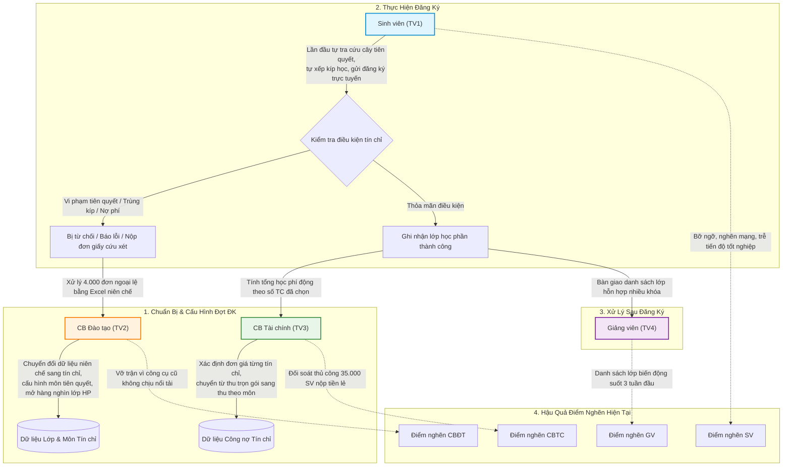
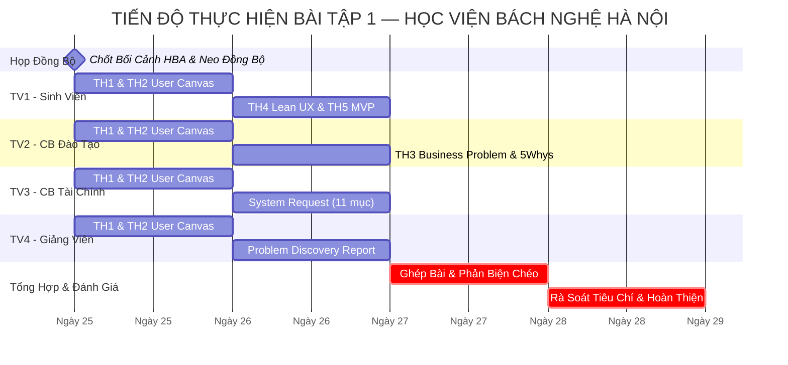

# KỊCH BẢN KẾ HOẠCH & BÀN GIAO CÔNG VIỆC CHI TIẾT — BÀI TẬP 1
## MÔN HỌC: PHÂN TÍCH VÀ THIẾT KẾ HỆ THỐNG (IT3120 - SOICT, ĐHBK HÀ NỘI)
### TỔ CHỨC NGHIÊN CỨU: HỌC VIỆN BÁCH NGHỆ HÀ NỘI (HBA)
### BỐI CẢNH TOÀN CỤC: CHUYỂN ĐỔI MÔ HÌNH QUẢN TRỊ TỪ NIÊN CHẾ SANG HỌC CHẾ TÍN CHỈ
### MÔ HÌNH BÀI LÀM: 4 TÁC NHÂN (SV - CBĐT - CBTC - GV) + 1 LUỒNG NGHIỆP VỤ XUYÊN SUỐT

---

## MỤC LỤC
1. [Phần I: Bối Cảnh Nghiệp Vụ & Nguyên Tắc Cốt Lõi](#phần-i-bối-cảnh-nghiệp-vụ--nguyên-tắc-cốt-lõi-slide-3-11-21-23-39)
2. [Phần II: Chốt Nhanh "Neo Đồng Bộ" (5 Phút Trước Khi Làm)](#phần-ii-chốt-nhanh-neo-đồng-bộ-5-phút-trước-khi-làm)
3. [Phần III: Hướng Dẫn Chi Tiết Cho Từng Thành Viên](#phần-iii-hướng-dẫn-chi-tiết-cho-từng-thành-viên)
   - [Thành viên 1: Sinh viên + Trọn gói Lean UX & MVP](#-thành-viên-1-sinh-viên--luồng-lean-ux--mvp-th1-th2-th4-th5)
   - [Thành viên 2: Cán bộ Đào tạo + Business Problem & 5 Whys](#-thành-viên-2-cán-bộ-đào-tạo--chuyên-đề-business-problem-th1-th2-th3)
   - [Thành viên 3: Cán bộ Tài chính + Hồ sơ System Request](#-thành-viên-3-cán-bộ-tài-chính--chuyên-đề-system-request-th1-th2-system-request)
   - [Thành viên 4: Giảng viên + Báo cáo Problem Discovery Report](#-thành-viên-4-giảng-viên--tổng-hợp-problem-discovery-report-th1-th2-report)
4. [Phần IV: Lịch Trình Phối Hợp & Checklist Bàn Giao](#phần-iv-lịch-trình-phối-hợp--checklist-bàn-giao)

---

## PHẦN I: BỐI CẢNH NGHIỆP VỤ & NGUYÊN TẮC CỐT LÕI (SLIDE 3, 11, 21, 23, 39)

### 1. Bối Cảnh Toàn Cục: Cú Sốc Chuyển Đổi Niên Chế $\rightarrow$ Tín Chỉ Tại Học Viện Bách Nghệ Hà Nội
* **Học viện Bách Nghệ Hà Nội (HBA):** Là cơ sở giáo dục đại học định hướng công nghệ và kỹ thuật ứng dụng quy mô lớn với **~35.000 sinh viên** và **~1.500 giảng viên**.
* **Bước ngoặt lịch sử:** Học viện vừa chính thức ban hành Quy chế Đào tạo mới, bãi bỏ hoàn toàn mô hình **Niên chế truyền thống** (vốn gắn liền với việc xếp lớp cố định theo khóa, nhà trường lên sẵn thời khóa biểu từ năm nhất đến khi tốt nghiệp, học phí thu phẳng theo kỳ/năm) để chuyển dịch sang **Học chế Tín chỉ** (người học tự chọn môn, tự quyết định tiến độ học tập, học phí tính động theo số tín chỉ thực tế, mở rộng cơ hội học văn bằng 2 và học vượt).
* **Cú sốc vận hành ("Tư duy niên chế đối đầu quy chế tín chỉ"):**
  1. **Sinh viên:** Mang thói quen thụ động từ thời niên chế, đột ngột phải tự đọc cây điều kiện tiên quyết phức tạp, tự xếp thời khóa biểu không trùng lịch và trực cổng đăng ký cạnh tranh suất học.
  2. **Cán bộ Đào tạo:** Quen xếp lịch cho 50–70 lớp hành chính cố định, nay phải quản lý hàng nghìn lớp học phần riêng rẽ; công cụ bảng tính Excel và phần mềm cũ thời niên chế hoàn toàn "vỡ trận" trước khối lượng dữ liệu khổng lồ.
  3. **Cán bộ Tài chính:** Quen thu tiền học phí một mức trọn gói theo lớp niên chế, nay phải tính tiền lẻ biến đổi theo từng tín chỉ sinh viên đăng ký, đối soát giao dịch ngân hàng theo thời gian thực và quản lý hoàn/hủy học phí khi lớp bị hủy.
  4. **Giảng viên:** Quen giảng dạy một tập thể lớp cố định 50 sinh viên quen mặt, nay tiếp nhận các lớp học phần hỗn hợp sinh viên nhiều khóa (K62, K63, K64 cùng ngồi học), danh sách sinh viên liên tục biến động trong 3 tuần đầu kỳ.

---

### 2. Ba Nguyên Tắc Cốt Lõi Bắt Buộc Tuân Thủ

#### Nguyên tắc 1: Tuyệt Đối Không Nhảy Bổ Vào Solution (Slide 3, 11, 21)
* **Lỗi sai kinh điển:** Viết phát biểu vấn đề dưới dạng thiếu một tính năng cụ thể hoặc đòi hỏi xây dựng phần mềm mới.
  * ❌ *Sai:* "Vấn đề của sinh viên là Học viện chưa có app mobile để đăng ký môn học."
  * ❌ *Sai:* "Phòng Đào tạo gặp vấn đề do thiếu hệ thống phần mềm mới."
* **Cách viết chuẩn xác:** Tập trung hoàn toàn vào **Nỗi đau (Pain)**, **Rào cản quy trình (Barrier)** và **Hệ quả thực tế (Consequence)** do cú sốc chuyển đổi mô hình gây ra.
  * ✅ *Đúng:* "Sinh viên Học viện Bách Nghệ Hà Nội gặp khó khăn nghiêm trọng khi chuyển sang mô hình tín chỉ vì chưa quen tự tra cứu cây môn tiên quyết và phải dùng các bảng tính rời rạc để xếp lịch, dẫn đến việc thường xuyên đăng ký trùng kíp, bị hủy môn muộn và kéo dài thời gian học tập."
* **Công thức vàng:**
  $$\text{Current Situation (Niên chế $\rightarrow$ Tín chỉ)} \longrightarrow \text{Pain Point / Barrier} \longrightarrow \text{Quantifiable Impact} \longrightarrow \text{Desired State}$$

#### Nguyên tắc 2: Tách Bạch Rõ Ràng Bằng Chứng (Evidence) và Giả Định (Assumption) (Slide 23, 28)
* Mọi nhận định về hành vi, sự cố và số liệu phải được gắn thẻ nguồn gốc rõ ràng:
  * `[Evidence]` (Bằng chứng): Thông tin lấy từ Quy chế đào tạo tín chỉ mới ban hành của Học viện Bách Nghệ Hà Nội, kết quả ghi nhận từ hệ thống mạng và sổ khiếu nại học vụ thực tế.
  * `[Assumption]` (Giả định): Những suy đoán hợp lý của nhóm về nguyên nhân tâm lý, tỷ lệ bỡ ngỡ của sinh viên cần được kiểm chứng độc lập thông qua phỏng vấn và khảo sát.
* **Nguyên tắc tài chính:** Không tự tiện suy diễn số liệu thiệt hại tài chính khi chưa có khảo sát thực tế; đo lường bằng **thời gian lãng phí** hoặc **tỷ lệ công việc hành chính phải làm lại**.

#### Nguyên tắc 3: Chuỗi Liên Kết Nhân Quả Xuyên Tác Nhân (Slide 25)
* Mọi phân tích phải tuân theo chuỗi liên kết nhân quả 4 cấp:
  $$\begin{aligned}
  \text{User Problem (SV)} &\longrightarrow \text{Operational Impact (CBĐT / CBTC)} \\
  &\longrightarrow \text{Business Problem (Học viện Bách Nghệ Hà Nội)} \longrightarrow \text{Desired Outcomes}
  \end{aligned}$$
* *Ví dụ mắt xích tại HBA:*
  1. **Sinh viên:** Bỡ ngỡ với quy chế tín chỉ, không kiểm tra môn tiên quyết nên đăng ký nhầm vào lớp chuyên ngành cao cấp.
  2. **Cán bộ Đào tạo:** Quá tải vì phải duyệt 4.000 đơn giấy xin cứu xét do hệ thống cũ thời niên chế không tự động chặn đăng ký sai.
  3. **Cán bộ Tài chính:** Xuất hóa đơn học phí, sau đó sinh viên bị hủy môn lại phải làm thủ tục hoàn trả công nợ phức tạp.
  4. **Giảng viên:** Danh sách lớp học phần biến động liên tục trong 3 tuần đầu, không thể ổn định nhóm bài tập lớn.
  5. **Học viện:** Lãng phí tài nguyên phòng học, tăng chi phí làm thêm giờ cho cán bộ và làm suy giảm uy tín cải cách giáo dục.

---

## PHẦN II: CHỐT NHANH "NEO ĐỒNG BỘ" (5 PHÚT TRƯỚC KHI LÀM)

Để tránh tình trạng mỗi thành viên phân tích một hướng rời rạc, cả 4 thành viên thống nhất neo vào cùng một kịch bản nghiệp vụ lõi:

### 1. Kịch Bản Lõi: "Đăng Ký Học Phần, Kiểm Tra Tiên Quyết & Đối Soát Công Nợ Học Phí Đầu Kỳ Trong Giai Đoạn Chuyển Đổi Sang Tín Chỉ Tại Học Viện Bách Nghệ Hà Nội"

### 2. Ma Trận Tác Nhân & Điểm Nghẽn Trọng Tâm Trong Luồng Chuyển Đổi

| Tác nhân | Vai trò trong luồng neo | Điểm nghẽn (Friction Point) trong giai đoạn chuyển đổi | Tác động định lượng ước tính |
|---|---|---|---|
| **Sinh viên (TV1)** | Lần đầu tự chọn môn, tự xếp TKB, tự thanh toán học phí theo tín chỉ | Bỡ ngỡ với khái niệm môn tiên quyết/song hành; không biết cách xếp lịch tránh trùng; trực cổng giờ cao điểm bị nghẽn mạng | Mất 4–6 giờ trực cổng đăng ký; 20–25% SV đăng ký hỏng trong đợt đầu do thao tác sai |
| **Cán bộ Đào tạo (TV2)** | Mở hàng nghìn lớp tín chỉ, kiểm soát sĩ số trần/sàn, duyệt đơn xin học vượt | Dùng công cụ bảng tính Excel cũ thời niên chế để theo dõi; tiếp nhận hàng nghìn đơn giấy xin mở lớp và học vượt | Mất 40–60 giờ làm thêm trong tháng cao điểm; thời gian duyệt 1 đơn mất 15–20 phút |
| **Cán bộ Tài chính (TV3)** | Chuyển từ thu trọn gói sang thu học phí động theo tín chỉ, đối soát ngân hàng | Dữ liệu chuyển khoản không khớp mã sinh viên do nộp tiền lẻ theo tín chỉ; gạch nợ thủ công từng dòng sao kê | Mất 5–7 ngày đối soát sao kê; tỷ lệ sai lệch đối soát thủ công ~8–12% |
| **Giảng viên (TV4)** | Nhận danh sách lớp học phần hỗn hợp, giảng dạy theo chuẩn đầu ra tín chỉ | Lớp không còn là tập thể cố định; sinh viên xin rút/thêm môn kéo dài trong 3 tuần đầu; không kiểm soát được nền tảng môn tiên quyết | Mất 15 phút mỗi buổi học trong 3 tuần đầu để ổn định danh sách; khó chia nhóm bài tập lớn |

---

## PHẦN III: HƯỚNG DẪN CHI TIẾT CHO TỪNG THÀNH VIÊN

---

### 👤 THÀNH VIÊN 1: SINH VIÊN + LUỒNG LEAN UX & MVP (TH1, TH2, TH4, TH5)
* **File làm việc:** [`bai-tap-1/TV1-SinhVien.md`](../bai-tap-1/TV1-SinhVien.md)
* **Tài liệu tham chiếu:** Slides 7–15, 16–21, 33–42, 56–61 trong `docs/OOAD_Lab_B1-5.md`.

#### Nhiệm vụ 1: Thực hành 1 — User Needs & User Problem Statement (Slide 7–15, 56)
1. **Xác định 3–5 User Needs của Sinh viên:**
   * Bắt đầu bằng động từ hành động, nhấn mạnh vào sự bỡ ngỡ của sinh viên khi chuyển từ niên chế sang tín chỉ (*Tra cứu cây tiên quyết*, *Tự lập thời khóa biểu chống trùng*, *Đăng ký và xác nhận lớp*, *Theo dõi học phí tín chỉ*, *Gửi đơn xin cứu xét học vụ*).
   * Điền đủ 5 cột kèm tag `[Evidence]` / `[Assumption]`.
2. **Viết User Problem Statement ưu tiên:**
   * Độ dài 50–100 từ bám sát bối cảnh Học viện Bách Nghệ Hà Nội:
     $$\text{[Sinh viên HBA]} \text{ gặp khó khăn khi } \text{[mục tiêu]} \text{ trong } \text{[bối cảnh]}, \text{ vì } \text{[trở ngại]}, \text{ dẫn đến } \text{[hệ quả]}.$$
3. **Liệt kê 2–3 Giả định cần kiểm chứng thêm.**

#### Nhiệm vụ 2: Thực hành 2 — User Problem Statement Canvas (Slide 16–21, 57)
* Hoàn thành đầy đủ 8 ô của Canvas cho Sinh viên HBA (Who, Context, Goal & Root Problem, Current Alternatives, Alternative Shortcomings, Emotional Impact, Quantifiable Impact, Evidence vs Assumptions).

#### Nhiệm vụ 3: Thực hành 4 — Lean UX Canvas hoàn chỉnh 8 ô (Slide 33–40, 59–60)
* Điền trọn vẹn 8 ô kết nối người học và Học viện Bách Nghệ Hà Nội:
  * **Ô 1 - Business Problem:** Quá tải chuyển đổi từ niên chế sang tín chỉ gây nghẽn mạng và ứ đọng thủ tục.
  * **Ô 2 - Business Outcomes:** Tỷ lệ đăng ký thành công ngay đợt đầu $\ge 95\%$, giảm 70% đơn khiếu nại.
  * **Ô 3 - Users:** Sinh viên HBA, Cán bộ Đào tạo, Cán bộ Tài vụ, Giảng viên.
  * **Ô 4 - User Outcomes & Benefits:** SV nắm rõ lộ trình, đăng ký xong trong $< 5$ phút, không trùng lịch.
  * **Ô 5 - Solutions:** Công cụ lập lộ trình cá nhân hóa, lưới xếp TKB chống trùng tự động, cổng thanh toán VietQR.
  * **Ô 6 - Hypotheses:** Đúng cú pháp chuẩn Slide 36: *"Chúng tôi tin rằng [Business Outcome] sẽ đạt được nếu [Sinh viên HBA] đạt được [User Benefit] với [Solution]."*
  * **Ô 7 - What We Need to Learn First (Riskiest Assumptions):** Sinh viên có sẵn sàng tự lập kế hoạch trước không?
  * **Ô 8 - MVP:** Nguyên mẫu Clickable Prototype 4 màn hình.

#### Nhiệm vụ 4: Thực hành 5 — MVP & Experiment Plan (Slide 41–42, 61)
1. **Đặc tả Clickable Prototype (4 bước màn hình cốt lõi):**
   * Màn hình 1: Lộ trình tín chỉ & Cảnh báo tiên quyết.
   * Màn hình 2: Lưới chọn lớp học phần & Chống trùng kíp tự động.
   * Màn hình 3: Kiểm tra tổng hợp điều kiện (Tiên quyết ✅, Không trùng lịch ✅, Sĩ số ✅).
   * Màn hình 4: Xác nhận đăng ký & Biên lai điện tử tạm tính.
2. **Kế hoạch kiểm thử Usability Test:**
   * 8 sinh viên HBA thực hiện 3 nhiệm vụ trong 5 phút.
   * Đo lường: Tỷ lệ hoàn thành $\ge 85\%$, Thời gian $< 4$ phút, Số lỗi $\le 1$, Điểm SUS $\ge 75$.

---

### 👤 THÀNH VIÊN 2: CÁN BỘ ĐÀO TẠO + CHUYÊN ĐỀ BUSINESS PROBLEM (TH1, TH2, TH3)
* **File làm việc:** [`bai-tap-1/TV2-CanBoDaoTao.md`](../bai-tap-1/TV2-CanBoDaoTao.md)
* **Tài liệu tham chiếu:** Slides 7–19, 22–35, 54, 58 trong `docs/OOAD_Lab_B1-5.md`.

#### Nhiệm vụ 1: Phân tích Tác nhân Cán bộ Đào tạo (Slide 7–19)
1. **Xác định 3–5 User Needs của CBĐT HBA:**
   * Phản ánh rõ nhiệm vụ điều phối lớp học phần khi chuyển từ niên chế sang tín chỉ.
2. **Lập bảng Problem Statement Canvas cho CBĐT:**
   * Làm rõ nỗi đau: Công cụ Excel thời niên chế bị sụp đổ trước hàng nghìn lớp tín chỉ mới.

#### Nhiệm vụ 2: Thực hành 3 — Xác Định Business Problem & Phân Tích Gốc Rễ (Slide 22–32, 54, 58)
1. **Chuỗi lập luận nhân quả 4 cấp:** User Problem (SV) $\rightarrow$ Operational Impact (CBĐT) $\rightarrow$ Business Problem (Học viện) $\rightarrow$ Desired Outcomes.
2. **Kỹ thuật 5 Whys (Năm câu hỏi Vì sao) (Slide 28, 35):**
   * Đào sâu 5 tầng câu hỏi, tìm đến nguyên nhân gốc rễ: **Quy trình và công cụ quản lý kế thừa từ thời niên chế không tương thích với quy chế tín chỉ phức tạp.**
3. **Kỹ thuật Fishbone / 5W-1H (Slide 29, 35):**
   * Phân tích 4 nhóm: Process, Platform, People, Policy trong bối cảnh chuyển đổi sang tín chỉ.
4. **Viết 3–5 Business Problems chuẩn cấu trúc 5 mục (Slide 30–32):**
   * Mỗi Problem viết đủ: (1) Context, (2) Current State, (3) Problem, (4) Impact, (5) Desired State.
5. **Dữ liệu Vận Hành & Chỉ số KPI đo lường (Slide 26, 27).**
6. **Danh sách Business Requirements (Slide 34, 54).**

---

### 👤 THÀNH VIÊN 3: CÁN BỘ TÀI CHÍNH + CHUYÊN ĐỀ SYSTEM REQUEST (TH1, TH2, SYSTEM REQUEST)
* **File làm việc:** [`bai-tap-1/TV3-CanBoTaiChinh.md`](../bai-tap-1/TV3-CanBoTaiChinh.md)
* **Tài liệu tham chiếu:** Slides 7–19, 45–51 trong `docs/OOAD_Lab_B1-5.md`.

#### Nhiệm vụ 1: Phân tích Tác nhân Cán bộ Tài chính (Slide 7–19)
1. **Xác định 3–5 User Needs của CBTC HBA:**
   * Nổi bật bài toán chuyển từ thu học phí phẳng trọn gói sang thu tiền lẻ động theo số tín chỉ đăng ký thực tế.
2. **Lập bảng Problem Statement Canvas cho CBTC:**
   * Làm bật nỗi đau: Đối soát thủ công hàng chục nghìn giao dịch chuyển khoản ngân hàng bị sai cú pháp.

#### Nhiệm vụ 2: Lập Hồ Sơ Đề Xuất Hệ Thống — System Request (Slide 45–51)
* Soạn thảo văn bản **System Request chính thức chuẩn 11 mục** của HBA SIS:
  1. **Project Title:** Hệ thống Quản trị Đào tạo Đại học theo Học chế Tín chỉ và Thanh toán Học phí Trực tuyến (HBA SIS-Pay).
  2. **Project Sponsor / Requestor:** Ban Giám đốc Học viện Bách Nghệ Hà Nội, Phòng Đào tạo & Phòng Tài vụ.
  3. **Business Need / Problem Statement:** Khắc phục triệt để sự đổ vỡ của quy trình thủ công thời niên chế khi chuyển sang tín chỉ.
  4. **Project Vision / Goals:** Mục tiêu cụ thể định lượng (SMART).
  5. **Business Benefits:** Phân tích chi tiết Lợi ích Kinh tế, Lợi ích Vận hành (bảng số liệu trước/sau), Lợi ích Chiến lược.
  6. **High-level Requirements:** 8–10 yêu cầu chức năng và phi chức năng.
  7. **Constraints / Assumptions:** Ngân sách, thời gian 6 tháng, hạ tầng máy chủ.
  8. **Feasibility Assessment:** Đánh giá 4 chiều (Technical, Economic, Operational, Schedule).
  9. **Expected Deliverables:** Các sản phẩm bàn giao phần mềm, CSDL, tài liệu.
  10. **Risks & Mitigation:** Nhận diện 4 rủi ro chính kèm biện pháp giảm thiểu.
  11. **Approval / Sign-off:** Khung ký duyệt của lãnh đạo Học viện.

---

### 👤 THÀNH VIÊN 4: GIẢNG VIÊN + TỔNG HỢP PROBLEM DISCOVERY REPORT (TH1, TH2, REPORT)
* **File làm việc:** [`bai-tap-1/TV4-GiangVien.md`](../bai-tap-1/TV4-GiangVien.md)
* **Tài liệu tham chiếu:** Slides 7–19, 20, 51–55 trong `docs/OOAD_Lab_B1-5.md`.

#### Nhiệm vụ 1: Phân tích Tác nhân Giảng viên (Slide 7–19)
1. **Xác định 3–5 User Needs của GV HBA:**
   * Tiếp nhận danh sách lớp ổn định, nắm bắt kiến thức tiên quyết của sinh viên, quản lý lớp hỗn hợp nhiều khóa.
2. **Lập bảng Problem Statement Canvas cho Giảng viên:**
   * Nỗi đau: Lớp học biến động suốt 3 tuần đầu, lãng phí thời gian ổn định lớp học phần.

#### Nhiệm vụ 2: Biên Soạn Báo Cáo Khám Phá Vấn Đề — Problem Discovery Report (Slide 52, 55)
* Viết hoàn chỉnh **5 phần của Problem Discovery Report** cho Học viện Bách Nghệ Hà Nội:
  1. **Executive Summary:** Toàn cảnh cú sốc chuyển đổi từ niên chế sang tín chỉ của 35.000 SV và 1.500 GV.
  2. **Problem Statement:** Phát biểu vấn đề chung và mỏ neo người dùng (Sinh viên HBA).
  3. **Background & Context:** Bối cảnh chuyển đổi mô hình đào tạo của Học viện Bách Nghệ Hà Nội.
  4. **Research Methodology & Inputs:** Kịch bản phỏng vấn sâu 4 tác nhân, Bảng hỏi khảo sát 10 câu, phân tích tài liệu quy chế HBA.
  5. **Key Insights & User Friction Points:** Ma trận điểm nghẽn giao thoa giữa 4 tác nhân.

#### Nhiệm vụ 3: Trả Lời Bộ Câu Hỏi Phản Biện & Tự Đánh Giá (Slide 20, 51, 53, 54)
* Giải quyết 4 câu hỏi phản biện cốt lõi và tự đánh giá theo 5 tiêu chí chấm điểm môn học.

---

## PHẦN IV: LỊCH TRÌNH PHỐI HỢP & CHECKLIST BÀN GIAO

### 1. Lịch Trình Thực Hiện (Mô Hình 4 Ngày Tương Đối)

---

### 2. Checklist Nghiệm Thu Đầu Ra Từng Thành Viên

#### ✅ Checklist Thành viên 1 (Sinh viên + Lean UX + MVP)
- [ ] Bảng User Needs có ít nhất 3 nhu cầu, bắt đầu bằng động từ hành động, phản ánh đúng sự bỡ ngỡ của sinh viên HBA khi chuyển sang tín chỉ.
- [ ] User Problem Statement không chứa từ ngữ giải pháp, độ dài 50–100 từ.
- [ ] Bảng Problem Statement Canvas có đủ 8 ô, ô Quantifiable Impact có đơn vị đo lường cụ thể.
- [ ] Lean UX Canvas điền đủ 8 ô; Ô số 6 viết đúng cú pháp giả thuyết chuẩn: *"Chúng tôi tin rằng..."*.
- [ ] Clickable Prototype đặc tả đủ 4 bước màn hình mạch lạc.
- [ ] Kế hoạch kiểm thử có chỉ số rõ ràng (Tỷ lệ hoàn thành %, Thời gian thao tác phút, Số lỗi, Điểm SUS).

#### ✅ Checklist Thành viên 2 (Cán bộ Đào tạo + Business Problem)
- [ ] Bảng User Needs và Canvas của Cán bộ Đào tạo làm nổi bật sự đổ vỡ của công cụ Excel niên chế trước hàng nghìn lớp tín chỉ.
- [ ] Chuỗi lập luận nhân quả liên kết chặt chẽ: Nỗi đau SV HBA $\rightarrow$ Quá tải CBĐT $\rightarrow$ Thiệt hại Học viện.
- [ ] Biểu đồ / Bảng 5 Whys đào sâu đủ 5 tầng câu hỏi tìm đến nguyên nhân gốc rễ về sự lệch pha giữa công cụ cũ và quy chế mới.
- [ ] Có ít nhất 3 Business Problems viết chuẩn 5 thành phần: Context, Current State, Problem, Impact, Desired State.
- [ ] Bảng chỉ số KPI đo lường vận hành và danh sách Business Requirements tương ứng.

#### ✅ Checklist Thành viên 3 (Cán bộ Tài chính + System Request)
- [ ] Bảng User Needs và Canvas của Cán bộ Tài chính phân tích sâu khâu thu học phí lẻ theo tín chỉ và đối soát ngân hàng.
- [ ] Hồ sơ System Request đủ 11 mục không thiếu mục nào, tên tổ chức là Học viện Bách Nghệ Hà Nội.
- [ ] Mục Business Benefits phân tích chi tiết cả 3 mặt: Kinh tế, Vận hành (có số liệu trước/sau), Chiến lược.
- [ ] Mục Feasibility Assessment đánh giá chi tiết cả 4 khía cạnh: Kỹ thuật, Kinh tế, Vận hành, Lịch trình.
- [ ] Có bảng nhận diện ít nhất 4 rủi ro và biện pháp giảm thiểu tương ứng.

#### ✅ Checklist Thành viên 4 (Giảng viên + Problem Discovery Report)
- [ ] Bảng User Needs và Canvas của Giảng viên nêu bật vấn đề bỡ ngỡ với lớp học phần hỗn hợp sinh viên nhiều khóa.
- [ ] Problem Discovery Report có đủ 5 phần theo chuẩn Slide 52, bối cảnh Học viện Bách Nghệ Hà Nội chuyển đổi niên chế sang tín chỉ.
- [ ] Phần 4 có kịch bản phỏng vấn và câu hỏi khảo sát cụ thể cho cả 4 tác nhân tại HBA.
- [ ] Phần 5 có Ma trận Điểm Nghẽn Giao Thoa giữa 4 tác nhân.
- [ ] Trả lời thấu đáo 4 câu hỏi phản biện (Slide 20, 54) và đánh giá đạt 5 tiêu chí chấm điểm (Slide 51, 53).
