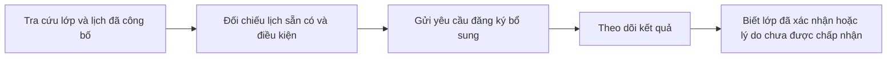

# Kế hoạch Bài tập 1 — Đăng ký bổ sung học phần tại HUST

## Bối cảnh và phạm vi

Nghiên cứu sinh viên K52 đủ điều kiện đăng ký bổ sung trong đợt điều chỉnh tại Trường Đại học Bách khoa Hà Nội giai đoạn 2007–2008. Theo quy chế, trường đăng ký đồng loạt ở đợt chính trong ba học kỳ đầu. Chỉ chọn một đợt thực tế để phân tích khi xác định được học kỳ và mốc thời gian. Giới hạn tín chỉ, điều kiện học phần và nghĩa vụ học phí là điều kiện đầu vào. [Nguồn và phạm vi nghiên cứu](../bai-tap-1/OOAD_BaoCaoVanDe.md#1-phạm-vi-và-nguồn)

UN-03 là một nhu cầu duy nhất. Sinh viên cần ghép lớp bổ sung vào lịch đã có mà không trùng giờ và được xác nhận vào lớp còn chỗ.

Sơ đồ là khung khảo sát. Kênh tiếp nhận, chủ thể xử lý từng bước và lý do từ chối cần được đối chiếu với hồ sơ cùng thời. Sinh viên và Phòng Đào tạo là hai đầu mối chính. Giáo viên chủ nhiệm tham gia cố vấn và duyệt kế hoạch theo quy chế. Kiểm tra đầu mối xác nhận nghĩa vụ học phí và việc bàn giao danh sách cho giảng viên khi có tư liệu của đợt.

## Phân công và đầu ra

| Thành viên | Đầu ra theo Lab 01 | Trọng tâm |
| --- | --- | --- |
| [TV1](../bai-tap-1/TV1-SinhVien.md) | TH1, TH2, TH4, TH5 | Phát biểu vấn đề, Problem Canvas và Lean UX Canvas tám ô, H1, thiết kế MVP theo hai tình huống hết chỗ. |
| [TV2](../bai-tap-1/TV2-CanBoDaoTao.md) | TH1, TH2, TH3 | Khảo sát đầu mối đào tạo, Business Problem năm thành phần, chuỗi nhân quả bốn cấp và dữ liệu đo từng mắt xích. |
| [TV3](../bai-tap-1/TV3-CanBoTaiChinh.md) | System Request 11 mục | Xác định giới hạn của điều kiện học phí, tổng hợp yêu cầu cấp cao và điều kiện để xem xét thí điểm. |
| [TV4](../bai-tap-1/TV4-GiangVien.md) | Problem Discovery Report 5 phần | Tổng hợp nguồn, kiểm tra điểm bàn giao danh sách và trả lời câu hỏi phản biện của slide 54. |

## Trình tự thực hiện

1. Chốt phạm vi, giữ UN-03 và lập bảng truy vết theo từng nhận định. Ưu tiên hồ sơ cùng thời có ngày, học kỳ và nguồn. Tách quy chế 2007 bản bổ sung 2008, tổng kết hồi cứu của trường và thông báo ở các kỳ năm 2026.
2. Thu thập lịch năm học, thông báo, lịch lớp, sĩ số, yêu cầu điều chỉnh, Phiếu học tập và mốc chốt danh sách. Nếu thiếu, ghi lời kể hồi cứu có chỉ rõ đợt và độ chắc chắn. Phân loại riêng có lớp phù hợp nhưng biết muộn, không có lớp phù hợp, và không xác định.
3. Rà soát Canvas và Business Problem. Với mỗi tác động, ghi nhãn [Evidence] trong phạm vi nguồn chứng minh hoặc [Assumption] nếu cần kiểm chứng. Ghi **chưa đo được** khi thiếu dữ liệu.
4. Chuẩn bị thử nghiệm mô phỏng với cả hai tình huống hết chỗ. Chấm hoàn thành UN-03 ở tình huống có lớp thay thế. Ở tình huống không còn lớp phù hợp, chấm mức độ hiểu trạng thái và bước tiếp theo. Tổng hợp hồ sơ nộp sau khi kiểm tra các tài liệu dùng cùng phạm vi.

## Nghiệm thu

- Hai Canvas đủ tám ô, Business Problem đủ năm thành phần và chuỗi bốn cấp.
- Dẫn nguồn theo đúng thời điểm. Kết luận về tần suất, công sức cán bộ và chậm chốt danh sách cần hồ sơ vận hành tương ứng.
- Các ngưỡng MVP là tiêu chí đề xuất. Kết quả mô phỏng và số liệu vận hành được báo cáo riêng.
- Kiểm tra [báo cáo tổng hợp](../bai-tap-1/BAO-CAO-TONG-HOP-NHOM.md) và [System Request cùng Problem Discovery Report](../bai-tap-1/TAI-LIEU-BO-TRO-SYSTEM-REQUEST-VA-REPORT.md) theo [Lab 01](Lab01_OOAD.md).
