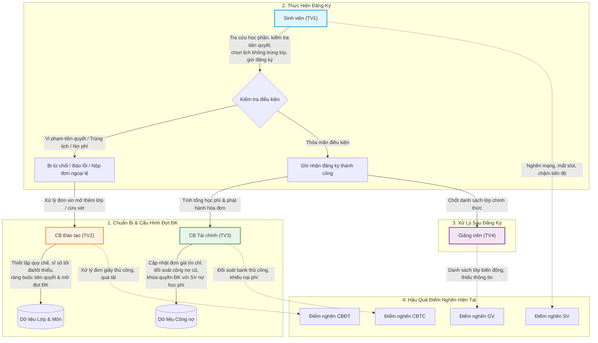
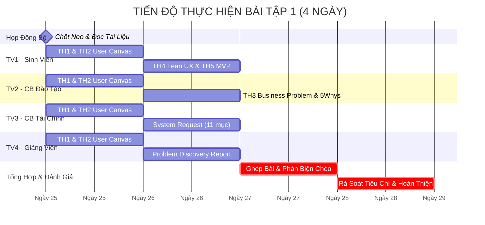

# KỊCH BẢN KẾ HOẠCH & BÀN GIAO CÔNG VIỆC CHI TIẾT — BÀI TẬP 1
## MÔN HỌC: PHÂN TÍCH VÀ THIẾT KẾ HỆ THỐNG (IT3120 - SOICT, ĐHBK HÀ NỘI)
### CHỦ ĐỀ: HỆ THỐNG QUẢN LÝ ĐÀO TẠO ĐẠI HỌC THEO HỌC CHẾ TÍN CHỈ (SIS)
### MÔ HÌNH: 4 TÁC NHÂN (SV - CBĐT - CBTC - GV) + 1 LUỒNG NGHIỆP VỤ XUYÊN SUỐT

---

## MỤC LỤC
1. [Phần I: Nguyên Tắc Cốt Lõi Cần Tuân Thủ](#phần-i-nguyên-tắc-cốt-lõi-cần-tuân-thủ-slide-3-11-21-23-39)
2. [Phần II: Chốt Nhanh "Neo Đồng Bộ" (5 Phút Trước Khi Làm)](#phần-ii-chốt-nhanh-neo-đồng-bộ-5-phút-trước-khi-làm)
3. [Phần III: Hướng Dẫn Chi Tiết Cho Từng Thành Viên](#phần-iii-hướng-dẫn-chi-tiết-cho-từng-thành-viên)
   - [Thành viên 1: Sinh viên + Trọn gói Lean UX & MVP](#-thành-viên-1-sinh-viên--luồng-lean-ux--mvp-th1-th2-th4-th5)
   - [Thành viên 2: Cán bộ Đào tạo + Business Problem & 5 Whys](#-thành-viên-2-cán-bộ-đào-tạo--chuyên-đề-business-problem-th1-th2-th3)
   - [Thành viên 3: Cán bộ Tài chính + Hồ sơ System Request](#-thành-viên-3-cán-bộ-tài-chính--chuyên-đề-system-request-th1-th2-system-request)
   - [Thành viên 4: Giảng viên + Báo cáo Problem Discovery Report](#-thành-viên-4-giảng-viên--tổng-hợp-problem-discovery-report-th1-th2-report)
4. [Phần IV: Lịch Trình Phối Hợp & Checklist Bàn Giao](#phần-iv-lịch-trình-phối-hợp--checklist-bàn-giao)

---

## PHẦN I: NGUYÊN TẮC CỐT LÕI CẦN TUÂN THỦ (SLIDE 3, 11, 21, 23, 39)

Tất cả 4 thành viên phải quán triệt 3 nguyên tắc nền tảng sau trước khi đặt bút viết:

### 1. Tuyệt Đối Không Nhảy Bổ Vào Solution (Slide 3, 11, 21)
* **Lỗi sai kinh điển:** Viết phát biểu vấn đề dưới dạng thiếu một tính năng cụ thể hoặc đòi hỏi xây dựng phần mềm mới.
  * ❌ *Sai:* "Vấn đề của sinh viên là chưa có ứng dụng di động để đăng ký môn học thuận tiện."
  * ❌ *Sai:* "Phòng Đào tạo gặp vấn đề do thiếu hệ thống tự động kiểm tra điều kiện tiên quyết."
* **Cách viết chuẩn xác:** Tập trung hoàn toàn vào **Nỗi đau (Pain)**, **Rào cản quy trình (Barrier)** và **Hệ quả thực tế (Consequence)**.
  * ✅ *Đúng:* "Sinh viên gặp khó khăn khi lập kế hoạch và đăng ký môn học đầu kỳ vì không thể tra cứu tức thời tình trạng đáp ứng môn tiên quyết và lịch trùng lặp, dẫn đến việc bị hủy môn muộn và kéo dài thời gian học tập."
* **Công thức vàng:**
  $$\text{Current Situation} \longrightarrow \text{Pain Point / Barrier} \longrightarrow \text{Quantifiable Impact} \longrightarrow \text{Desired State}$$

### 2. Tách Bạch Rõ Ràng Bằng Chứng (Evidence) và Giả Định (Assumption) (Slide 23, 28)
* Mọi nhận định về hành vi, sự cố và số liệu phải được gắn thẻ nguồn gốc rõ ràng:
  * `[Evidence]` (Bằng chứng): Thông tin lấy từ quy chế đào tạo tín chỉ chính thức (Quy chế đào tạo ĐHBK Hà Nội), kết quả khảo sát thực tế, hoặc nhật ký hệ thống ghi nhận được.
  * `[Assumption]` (Giả định): Những suy đoán hợp lý của nhóm nhưng **chưa có dữ liệu kiểm chứng độc lập**. Nhóm phải thừa nhận đây là giả định để thiết kế kế hoạch phỏng vấn/thử nghiệm kiểm chứng lại.
* **Nguyên tắc tài chính:** Không tự tiện bịa số liệu "thiệt hại hàng trăm triệu đồng" khi chưa có khảo sát tài chính thực tế; thay vào đó đo bằng **thời gian lãng phí** hoặc **tỷ lệ công việc phải làm lại**.

### 3. Chuỗi Liên Kết Nhân Quả Xuyên Tác Nhân (Slide 25)
* Nỗi đau của cá nhân người dùng không đứng độc lập mà là mắt xích tạo nên tổn thất vận hành của trường:
  $$\begin{aligned}
  \text{User Problem (SV)} &\longrightarrow \text{Operational Impact (CBĐT / CBTC)} \\
  &\longrightarrow \text{Business Problem (Nhà trường)} \longrightarrow \text{Desired Outcomes}
  \end{aligned}$$
* *Ví dụ mắt xích:*
  1. **Sinh viên:** Không biết mình trượt môn tiên quyết $A$ nên vẫn cố nộp đơn xin đăng ký môn kế tiếp $B$.
  2. **Cán bộ Đào tạo:** Quá tải vì phải rà soát thủ công bảng điểm của 2.000 sinh viên nộp đơn ngoại lệ.
  3. **Cán bộ Tài chính:** Xuất hóa đơn học phí môn $B$, sau đó sinh viên bị phòng Đào tạo hủy môn lại phải làm thủ tục hoàn trả / bù trừ công nợ phức tạp.
  4. **Giảng viên:** Danh sách lớp môn $B$ biến động liên tục trong 3 tuần đầu kỳ, không thể ổn định nhóm học tập và điểm danh.
  5. **Nhà trường:** Lãng phí tài nguyên phòng học, tăng chi phí nhân sự xử lý đơn thư và giảm độ hài lòng của người học.

---

## PHẦN II: CHỐT NHANH "NEO ĐỒNG BỘ" (5 PHÚT TRƯỚC KHI LÀM)

Để tránh tình trạng mỗi thành viên phân tích một hướng rời rạc, cả 4 thành viên thống nhất neo vào cùng một kịch bản nghiệp vụ lõi:

### 1. Kịch Bản Lõi: "Đăng Ký Học Phần, Kiểm Tra Tiên Quyết & Đối Soát Công Nợ Học Phí Đầu Kỳ"

### 2. Ma Trận Tác Nhân & Điểm Nghẽn Trọng Tâm Trong Luồng Neo

| Tác nhân | Vai trò trong luồng neo | Điểm nghẽn (Friction Point) hiện tại | Tác động định lượng ước tính |
|---|---|---|---|
| **Sinh viên (TV1)** | Chọn môn, xếp TKB, thanh toán học phí | Nghẽn mạng giờ mở cổng; không biết trước môn tiên quyết còn thiếu; bị hủy môn muộn do nợ phí dù đã đóng qua ngân hàng | Mất 3–5 giờ trực cổng đăng ký; 15–20% SV phải học chậm kỳ do trượt slot |
| **Cán bộ Đào tạo (TV2)** | Mở lớp, gán điều kiện, duyệt đơn xin học vượt/bổ sung | Tiếp nhận hàng nghìn đơn xin học vượt/mở thêm lớp bằng giấy hoặc email phân tán; đối soát điểm tiên quyết thủ công | Mất 2 tuần cao điểm (40–60 giờ làm thêm) chỉ để xử lý đơn ngoại lệ |
| **Cán bộ Tài chính (TV3)** | Tính học phí, đối soát sao kê ngân hàng, xuất biên lai | Dữ liệu chuyển khoản ngân hàng không khớp mã sinh viên; đối soát thủ công từng giao dịch; cập nhật trạng thái nợ chậm | Mất 5–7 ngày đối soát sao kê; tỷ lệ sai lệch đối soát thủ công ~8–12% |
| **Giảng viên (TV4)** | Nhận danh sách lớp, tổ chức dạy, quản lý chuyên cần | Danh sách lớp thay đổi liên tục trong 2–3 tuần đầu do SV rút/thêm môn; không nắm được thông tin SV có đủ điều kiện tiên quyết | Mất 15 phút đầu mỗi buổi học để ổn định danh sách; khó chia nhóm bài tập lớn |

---

## PHẦN III: HƯỚNG DẪN CHI TIẾT CHO TỪNG THÀNH VIÊN

---

### 👤 THÀNH VIÊN 1: SINH VIÊN + LUỒNG LEAN UX & MVP (TH1, TH2, TH4, TH5)
* **File làm việc:** [`bai-tap-1/TV1-SinhVien.md`](../bai-tap-1/TV1-SinhVien.md)
* **Tài liệu tham chiếu:** Slides 7–15, 16–21, 33–42, 56–61 trong `docs/OOAD_Lab_B1-5.md`.

#### Nhiệm vụ 1: Thực hành 1 — User Needs & User Problem Statement (Slide 7–15, 56)
1. **Xác định 3–5 User Needs của Sinh viên:**
   * Bắt đầu bằng động từ hành động (ví dụ: *Tra cứu*, *Đăng ký*, *Kiểm tra*, *Theo dõi*).
   * Điền đủ 5 cột: (1) Động từ/Nhu cầu, (2) Bối cảnh, (3) Rào cản, (4) Hệ quả, (5) Gắn thẻ `[Evidence]` hoặc `[Assumption]`.
2. **Viết User Problem Statement ưu tiên:**
   * Chọn 1 nhu cầu đau đớn nhất (Khó khăn khi đăng ký môn do thiếu thông tin môn tiên quyết và lịch trùng lặp).
   * Viết câu chuẩn từ 50–100 từ theo công thức:
     $$\text{[Sinh viên]} \text{ gặp khó khăn khi } \text{[mục tiêu]} \text{ trong } \text{[bối cảnh]}, \text{ vì } \text{[trở ngại]}, \text{ dẫn đến } \text{[hệ quả]}.$$
3. **Liệt kê 2–3 Giả định cần nghiên cứu thêm.**

#### Nhiệm vụ 2: Thực hành 2 — User Problem Statement Canvas (Slide 16–21, 57)
* Hoàn thành đầy đủ 8 ô của Canvas theo cấu trúc chuẩn:
  1. **Who:** Chân dung cụ thể (SV năm 2–4 hệ kỹ sư/cử nhân, tín chỉ tự do).
  2. **Context:** 1 tuần trước và trong tuần lễ đăng ký học phần đầu kỳ.
  3. **Goal & Root Problem:** Mục tiêu muốn đạt và bản chất gốc rễ cản trở.
  4. **Current Alternatives:** Cách SV đang tự xoay xở (hỏi anh chị trên nhóm Facebook, xem file Excel truyền tay, chạy lên phòng đào tạo xin giấy).
  5. **Alternative Shortcomings:** Nhược điểm của cách cũ (thông tin sai lệch, file lỗi thời, tốn công đi lại).
  6. **Emotional Impact:** Cảm xúc tiêu cực (lo lắng trễ tiến độ tốt nghiệp, bực bội vì sập web, ức chế).
  7. **Quantifiable Impact:** Đo lường bằng số liệu (mất 4 giờ mỗi kỳ, chậm tốt nghiệp 1 kỳ nếu trượt môn tiên quyết).
  8. **Evidence vs. Assumptions:** Phân định rõ điều đã biết và điều cần phỏng vấn.

#### Nhiệm vụ 3: Thực hành 4 — Lean UX Canvas hoàn chỉnh 8 ô (Slide 33–40, 59–60)
* Điền trọn vẹn 8 ô kết nối cả góc nhìn người dùng và nhà trường:
  * **Ô 1 - Business Problem:** Điểm nghẽn từ phía nhà trường khi quy trình ĐKHP thủ công/kém hiệu quả.
  * **Ô 2 - Business Outcomes:** Chỉ số đo lường thành công (Giảm 50% thời gian xử lý khiếu nại, giảm 80% đơn xin học vượt giấy, tăng tỷ lệ ĐK đúng hạn lên 95%).
  * **Ô 3 - Users:** Sinh viên (chính) và Cán bộ Đào tạo, Cán bộ Tài chính (phụ).
  * **Ô 4 - User Outcomes & Benefits:** SV đăng ký xong trong dưới 10 phút, không bị trùng lịch, biết ngay môn học hợp lệ.
  * **Ô 5 - Solutions:** Gợi ý lộ trình thông minh, cảnh báo sớm môn tiên quyết chưa đạt, xếp TKB tự động chống trùng kíp.
  * **Ô 6 - Hypotheses:** Viết ít nhất 2 câu giả thuyết theo mẫu:
    > *"Chúng tôi tin rằng [Business Outcome] sẽ đạt được nếu [Sinh viên] đạt được [User Benefit] với [Tính năng Solution]."*
  * **Ô 7 - What We Need to Learn First (Riskiest Assumptions):** Giả định rủi ro nhất (Liệu SV có tin tưởng thuật toán tự động gợi ý môn không? Liệu dữ liệu điểm tiên quyết có được cập nhật kịp thời không?).
  * **Ô 8 - MVP:** Phương án nguyên mẫu tối thiểu để kiểm chứng nhanh mà không tốn công xây hệ thống hoàn chỉnh.

#### Nhiệm vụ 4: Thực hành 5 — MVP & Experiment Plan (Slide 41–42, 61)
1. **Đặc tả Clickable Prototype (4 bước màn hình cốt lõi):**
   * Màn hình 1: Bảng điều khiển lộ trình học tập & cảnh báo môn tiên quyết khả dụng.
   * Màn hình 2: Lưới lọc lớp học phần và tính năng kéo-thả/chọn kíp học chống trùng.
   * Màn hình 3: Màn hình kiểm tra tổng hợp điều kiện (Tiên quyết ✅, Công nợ ✅, Sĩ số ✅).
   * Màn hình 4: Xác nhận đăng ký tức thời & Biên lai điện tử tạm tính.
2. **Kế hoạch kiểm thử với người dùng (Usability Test):**
   * Đối tượng tham gia: 5–8 sinh viên thuộc các năm khác nhau.
   * Nhiệm vụ (Task): Thực hiện chọn 4 môn học cho kỳ tới trong vòng 5 phút.
   * Chỉ số đo lường:
     * Task Completion Rate (Tỷ lệ hoàn thành): Mục tiêu $\ge 90\%$.
     * Time on Task (Thời gian thao tác): Mục tiêu $< 3\text{ phút}$.
     * Error Rate / Help Request (Số lần nhấp lỗi hoặc cần trợ giúp): Mục tiêu $\le 1\text{ lần/SV}$.
   * Tiêu chí đánh giá thành công / Thất bại và hướng điều chỉnh (Pivot).

---

### 👤 THÀNH VIÊN 2: CÁN BỘ ĐÀO TẠO + CHUYÊN ĐỀ BUSINESS PROBLEM (TH1, TH2, TH3)
* **File làm việc:** [`bai-tap-1/TV2-CanBoDaoTao.md`](../bai-tap-1/TV2-CanBoDaoTao.md)
* **Tài liệu tham chiếu:** Slides 7–19, 22–35, 54, 58 trong `docs/OOAD_Lab_B1-5.md`.

#### Nhiệm vụ 1: Phân tích Tác nhân Cán bộ Đào tạo (Slide 7–19)
1. **Xác định 3–5 User Needs của Cán bộ Đào tạo:**
   * Tập trung vào: Mở lớp học phần, kiểm soát sĩ số trần/sàn, kiểm tra sinh viên có đủ điều kiện tiên quyết, duyệt đơn cứu xét/học vượt, chốt TKB.
   * Lập bảng đầy đủ Động từ, Bối cảnh, Rào cản, Hệ quả, Evidence/Assumption.
2. **Lập 1 bảng Problem Statement Canvas cho Cán bộ Đào tạo:**
   * Làm rõ gánh nặng khi phải dùng phần mềm cũ chắp vá kết hợp rà soát bảng tính Excel thủ công.

#### Nhiệm vụ 2: Thực hành 3 — Xác Định Business Problem & Phân Tích Gốc Rễ (Slide 22–32, 54, 58)
1. **Xây dựng chuỗi lập luận nhân quả 4 cấp:**
   * Chỉ ra rõ ràng: Nỗi đau của Sinh viên (TV1) kéo theo sự quá tải của Cán bộ Đào tạo (TV2) ra sao, từ đó ảnh hưởng tới chỉ số vận hành của Nhà trường như thế nào.
2. **Áp dụng kỹ thuật 5 Whys (Năm câu hỏi Vì sao) để tìm nguyên nhân gốc rễ (Slide 28, 35):**
   * *Problem:* Hàng nghìn sinh viên phải nộp đơn khiếu nại và xếp hàng xin mở thêm lớp mỗi đầu kỳ.
   * Triển khai chi tiết đủ 5 tầng Why dẫn tới nguyên nhân cốt lõi về quy trình và dữ liệu rời rạc.
3. **Áp dụng kỹ thuật Fishbone (Biểu đồ xương cá) hoặc 5W-1H (Slide 29, 35):**
   * Phân tích theo 4 nhóm nguyên nhân: Con người (People), Quy trình (Process), Dữ liệu/Hệ thống (Platform), Quy chế (Policy).
4. **Viết 3–5 Business Problems chuẩn theo cấu trúc 5 mục (Slide 30–32):**
   * Mỗi Business Problem bắt buộc viết đủ:
     * (1) **Context:** Quy trình nào?
     * (2) **Current State:** Hiện trạng kèm số liệu?
     * (3) **Problem:** Pain point cốt lõi là gì?
     * (4) **Impact:** Thiệt hại vận hành, chi phí, uy tín?
     * (5) **Desired State:** Trạng thái mong muốn sau cải tiến?
5. **Đề xuất Dữ liệu Vận Hành & Chỉ số KPI đo lường (Slide 26, 27):**
   * Bảng danh sách các dữ liệu cần thu thập (nhật ký truy cập, số đơn khiếu nại, thời gian phản hồi đơn).
   * Các KPI đo lường hiệu quả vận hành.
6. **Chuyển hóa thành danh sách Business Requirements (Slide 34, 54):**
   * Áp dụng công thức: $\text{Business Problem} \longrightarrow \text{Business Requirement} \longrightarrow \text{System Feature}$.

---

### 👤 THÀNH VIÊN 3: CÁN BỘ TÀI CHÍNH + CHUYÊN ĐỀ SYSTEM REQUEST (TH1, TH2, SYSTEM REQUEST)
* **File làm việc:** [`bai-tap-1/TV3-CanBoTaiChinh.md`](../bai-tap-1/TV3-CanBoTaiChinh.md)
* **Tài liệu tham chiếu:** Slides 7–19, 45–51 trong `docs/OOAD_Lab_B1-5.md`.

#### Nhiệm vụ 1: Phân tích Tác nhân Cán bộ Tài chính (Slide 7–19)
1. **Xác định 3–5 User Needs của Cán bộ Tài chính:**
   * Tập trung vào: Định giá tín chỉ theo chương trình đào tạo, tự động hóa tính toán học phí theo danh sách tín chỉ đăng ký thực tế, đối soát giao dịch ngân hàng theo thời gian thực, cấp quyền thi/xác nhận hoàn thành nghĩa vụ tài chính, xuất hóa đơn điện tử.
   * Lập bảng chuẩn 5 cột kèm tag `[Evidence]` / `[Assumption]`.
2. **Lập 1 bảng Problem Statement Canvas cho Cán bộ Tài chính:**
   * Làm bật nỗi đau: Đối soát thủ công hàng chục nghìn giao dịch chuyển khoản ngân hàng bị sai cú pháp, sinh viên nộp tiền nhưng hệ thống chưa mở khóa học phần kịp thời.

#### Nhiệm vụ 2: Lập Hồ Sơ Đề Xuất Hệ Thống — System Request (Slide 45–51)
* Soạn thảo văn bản **System Request chính thức chuẩn 11 mục** của giai đoạn Khởi tạo Dự án (Planning Phase):
  1. **Project Title:** Tên dự án chuẩn mực (ví dụ: *Hệ thống Đăng ký Học phần và Quản trị Đào tạo Trực tuyến Thế hệ mới - HUST SIS*).
  2. **Project Sponsor / Requestor:** Ban Giám hiệu, Phòng Đào tạo & Phòng Tài chính Kế toán.
  3. **Business Need / Problem Statement:** Khái quát nhu cầu chuyển đổi số và giải quyết triệt để điểm nghẽn thủ công hiện hành.
  4. **Project Vision / Goals:** Mục tiêu cụ thể, định lượng (SMART).
  5. **Business Benefits:** Bắt buộc phân tích chi tiết ở 3 khía cạnh (có bảng so sánh Hiện tại vs Tương lai):
     * *Lợi ích kinh tế:* Giảm thất thoát học phí, tiết kiệm giấy tờ in ấn, giảm chi phí làm thêm giờ của nhân sự.
     * *Lợi ích vận hành:* Giảm thời gian xử lý đối soát từ 7 ngày xuống còn dưới 1 phút; giảm thời gian xác nhận nộp phí từ 24h xuống thời gian thực.
     * *Lợi ích chiến lược:* Chuẩn hóa dữ liệu toàn trường, nâng cao hình ảnh đại học số hiện đại.
  6. **High-level Requirements:** Danh sách 8–10 yêu cầu chức năng và phi chức năng cấp cao.
  7. **Constraints / Assumptions:** Ngân sách giả định, thời gian thực hiện, ràng buộc hạ tầng, công nghệ tương thích.
  8. **Feasibility Assessment (Đánh giá tính khả thi 4 chiều):**
     * *Technical Feasibility:* Công nghệ có khả thi với hạ tầng trường đại học không?
     * *Economic Feasibility:* Phân tích chi phí - lợi ích (Cost-Benefit Analysis) định tính và định lượng.
     * *Operational Feasibility:* Cán bộ và sinh viên có sẵn sàng đón nhận và dễ dàng sử dụng không?
     * *Schedule Feasibility:* Lộ trình triển khai có kịp cho năm học mới không?
  9. **Expected Deliverables:** Các sản phẩm bàn giao dự kiến (Phần mềm, CSDL, Tài liệu phân tích, Hướng dẫn sử dụng).
  10. **Risks & Mitigation:** Nhận diện ít nhất 4 rủi ro chính (Rủi ro kỹ thuật sập tải, rủi ro sai sót chuyển khoản ngân hàng, rủi ro người dùng kháng cự thay đổi) kèm phương án giảm thiểu cụ thể.
  11. **Approval / Sign-off:** Khung ký duyệt phê duyệt dự án.

---

### 👤 THÀNH VIÊN 4: GIẢNG VIÊN + TỔNG HỢP PROBLEM DISCOVERY REPORT (TH1, TH2, REPORT)
* **File làm việc:** [`bai-tap-1/TV4-GiangVien.md`](../bai-tap-1/TV4-GiangVien.md)
* **Tài liệu tham chiếu:** Slides 7–19, 20, 51–55 trong `docs/OOAD_Lab_B1-5.md`.

#### Nhiệm vụ 1: Phân tích Tác nhân Giảng viên (Slide 7–19)
1. **Xác định 3–5 User Needs của Giảng viên:**
   * Tập trung vào: Tiếp nhận danh sách lớp ổn định đúng hạn, theo dõi sĩ số thực, tra cứu nhanh thông tin sinh viên và điều kiện học phần, quản lý lịch dạy, ghi nhận điểm chuyên cần và giữa kỳ.
   * Lập bảng chuẩn 5 cột kèm tag `[Evidence]` / `[Assumption]`.
2. **Lập 1 bảng Problem Statement Canvas cho Giảng viên:**
   * Làm rõ nỗi đau: Danh sách sinh viên thay đổi liên tục trong 3 tuần đầu kỳ, sinh viên chưa đủ môn tiên quyết vẫn lọt vào lớp làm ảnh hưởng chất lượng giảng dạy chung.

#### Nhiệm vụ 2: Biên Soạn Báo Cáo Khám Phá Vấn Đề — Problem Discovery Report (Slide 52, 55)
* Tổng hợp dữ liệu từ cả 4 thành viên để viết hoàn chỉnh **5 phần của Problem Discovery Report**:
  1. **Section 1: Executive Summary (The Big Takeaway):** Tóm tắt 1 trang bức tranh toàn cảnh, quy mô người dùng ảnh hưởng (35.000 sinh viên, 1.500 giảng viên, hàng trăm cán bộ), và thông điệp then chốt giải thích vì sao hệ thống đào tạo hiện tại cần được nâng cấp toàn diện.
  2. **Section 2: Problem Statement (User-Centric Anchor):** Phát biểu vấn đề chung của toàn bộ hệ sinh thái và lấy phát biểu vấn đề của Sinh viên (từ TV1) làm mỏ neo trung tâm.
  3. **Section 3: Background & Context (The Business "Why"):** Bối cảnh vận hành đào tạo theo học chế tín chỉ đặc thù của ĐHBK Hà Nội (tự chọn linh hoạt, phụ thuộc tiên quyết phức tạp, phân kỳ học phí đa dạng) và lý do kinh doanh buộc Nhà trường phải chuyển đổi.
  4. **Section 4: Research Methodology & Inputs (Data Origins):** Thiết kế phương pháp nghiên cứu thực địa giả định:
     * Bộ câu hỏi phỏng vấn sâu (In-depth interview) dành cho 4 nhóm tác nhân (SV, CBĐT, CBTC, GV).
     * Mẫu phiếu khảo sát định lượng (Survey questionnaire) 10 câu hỏi trắc nghiệm đo lường điểm nghẽn.
     * Phương pháp phân tích tài liệu (Quy chế học vụ, nhật ký hỗ trợ kỹ thuật).
  5. **Section 5: Key Insights & User Friction Points:** Lập **Ma trận Điểm Nghẽn Giao Thoa** tổng hợp toàn bộ 4 tác nhân, phân tích các điểm nghẽn chéo nhau khi các tác nhân tương tác.

#### Nhiệm vụ 3: Trả Lời Bộ Câu Hỏi Phản Biện & Tự Đánh Giá (Slide 20, 51, 53, 54)
1. **Giải quyết bộ 4 câu hỏi phản biện cốt lõi (Slide 20, 54):**
   * *Nhu cầu nào là sống còn đối với người dùng mục tiêu?*
   * *Nhóm có bằng chứng thực tế về nguyên nhân hay chỉ đang suy đoán?*
   * *Vấn đề có thể vẫn tồn tại ngay cả khi đã xây dựng phần mềm mới không?*
   * *Có cách nào giải quyết triệt để vấn đề mà KHÔNG cần phát triển phần mềm mới (ví dụ: tối ưu lại quy trình hành chính)?*
2. **Rà soát chất lượng toàn nhóm theo 5 Tiêu chí đánh giá của giảng viên (Slide 51, 53):**
   * (1) Nhu cầu và vấn đề có rõ ràng, không chứa sẵn giải pháp?
   * (2) Bằng chứng và giả định có được tách bạch minh bạch?
   * (3) Business Problem có mắt xích hợp lý với User Problem?
   * (4) Giải pháp và giả thuyết Lean UX có nhất quán?
   * (5) Kế hoạch thử nghiệm MVP có sinh ra dữ liệu đánh giá hữu ích?

---

## PHẦN IV: LỊCH TRÌNH PHỐI HỢP & CHECKLIST BÀN GIAO

### 1. Lịch Trình Thực Hiện (Mô Hình 4 Ngày Tương Đối)

* **Ngày 0 (Khởi động - 15 phút):** Toàn nhóm đọc kỹ Phần II của tài liệu này để cùng hiểu chung kịch bản Đăng ký học phần.
* **Ngày 1:** Tất cả 4 thành viên hoàn thành song song **Phần A (TH1 - User Needs)** và **Phần B (TH2 - Problem Statement Canvas)** của tác nhân mình phụ trách.
* **Ngày 2:** Mỗi thành viên tập trung làm sâu chuyên đề lớn của mình (TV1: Lean UX + MVP; TV2: Business Problem & 5 Whys; TV3: System Request; TV4: Báo cáo khám phá vấn đề).
* **Ngày 3:** TV4 thu thập kết quả từ TV1, TV2, TV3 để hoàn thiện Section 2 và Section 5 trong Báo cáo. Cả nhóm thực hiện rà soát chéo (Cross-review).
* **Ngày 4:** Sửa chữa các điểm chưa khớp, rà soát 5 tiêu chí chấm điểm và chốt bộ hồ sơ hoàn chỉnh.

---

### 2. Checklist Nghiệm Thu Đầu Ra Từng Thành Viên

#### ✅ Checklist Thành viên 1 (Sinh viên + Lean UX + MVP)
- [ ] Bảng User Needs có ít nhất 3 nhu cầu, bắt đầu bằng động từ hành động.
- [ ] User Problem Statement không chứa từ ngữ giải pháp (không có "cần app", "thiếu web"), độ dài 50–100 từ.
- [ ] Bảng Problem Statement Canvas có đủ 8 ô, ô Quantifiable Impact có đơn vị đo lường cụ thể.
- [ ] Lean UX Canvas điền đủ 8 ô; Ô số 6 viết đúng cú pháp giả thuyết chuẩn: *"Chúng tôi tin rằng..."*.
- [ ] Clickable Prototype đặc tả đủ 4 bước màn hình mạch lạc.
- [ ] Kế hoạch kiểm thử có chỉ số rõ ràng (Tỷ lệ hoàn thành %, Thời gian thao tác phút, Số lỗi).

#### ✅ Checklist Thành viên 2 (Cán bộ Đào tạo + Business Problem)
- [ ] Bảng User Needs và Canvas của Cán bộ Đào tạo làm nổi bật gánh nặng xử lý ngoại lệ thủ công.
- [ ] Chuỗi lập luận nhân quả liên kết chặt chẽ: Nỗi đau SV $\rightarrow$ Quá tải CBĐT $\rightarrow$ Thiệt hại Nhà trường.
- [ ] Biểu đồ / Bảng 5 Whys đào sâu đủ 5 tầng câu hỏi tìm đến nguyên nhân quy trình/dữ liệu gốc rễ.
- [ ] Có ít nhất 3 Business Problems viết chuẩn 5 thành phần: Context, Current State, Problem, Impact, Desired State.
- [ ] Bảng chỉ số KPI đo lường vận hành và danh sách Business Requirements tương ứng.

#### ✅ Checklist Thành viên 3 (Cán bộ Tài chính + System Request)
- [ ] Bảng User Needs và Canvas của Cán bộ Tài chính phân tích sâu khâu đối soát và công nợ học phí.
- [ ] Hồ sơ System Request đủ 11 mục không thiếu mục nào.
- [ ] Mục Business Benefits phân tích chi tiết cả 3 mặt: Kinh tế, Vận hành (có số liệu trước/sau), Chiến lược.
- [ ] Mục Feasibility Assessment đánh giá chi tiết cả 4 khía cạnh: Kỹ thuật, Kinh tế, Vận hành, Lịch trình.
- [ ] Có bảng nhận diện ít nhất 4 rủi ro và biện pháp giảm thiểu tương ứng.

#### ✅ Checklist Thành viên 4 (Giảng viên + Problem Discovery Report)
- [ ] Bảng User Needs và Canvas của Giảng viên nêu bật vấn đề biến động danh sách lớp và chuẩn bị giảng dạy.
- [ ] Problem Discovery Report có đủ 5 phần theo chuẩn Slide 52.
- [ ] Phần 4 có kịch bản phỏng vấn và câu hỏi khảo sát cụ thể cho cả 4 tác nhân.
- [ ] Phần 5 có Ma trận Điểm Nghẽn Giao Thoa giữa 4 tác nhân.
- [ ] Trả lời thấu đáo 4 câu hỏi phản biện (Slide 20, 54) và đánh giá đạt 5 tiêu chí chấm điểm (Slide 51, 53).
