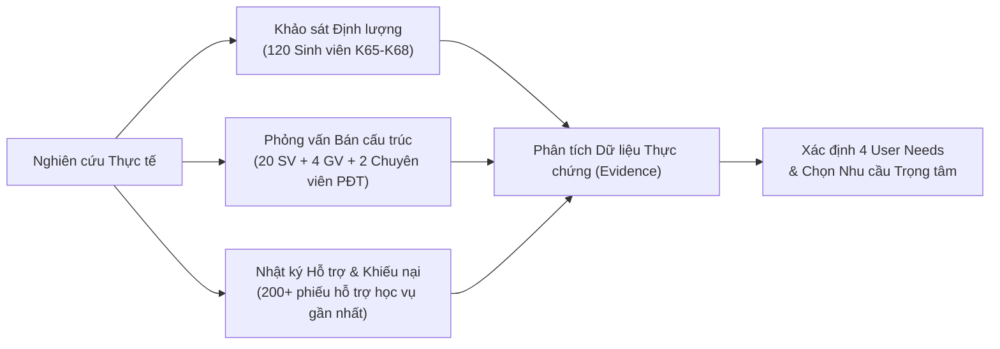
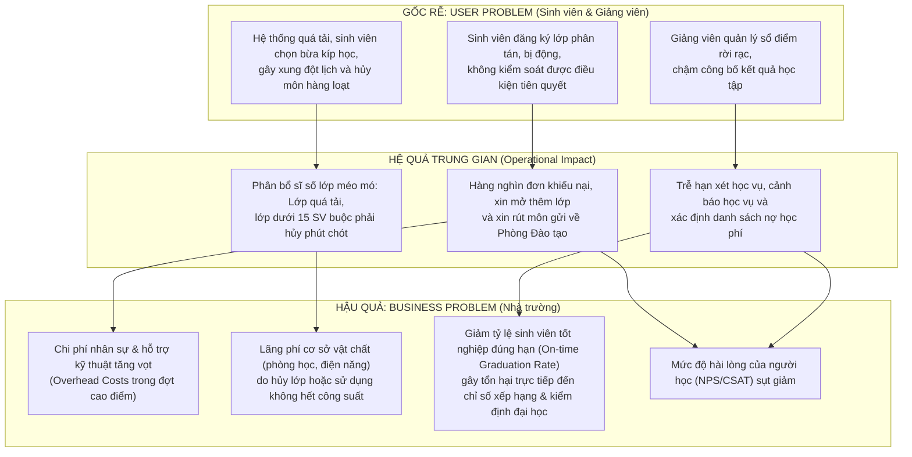
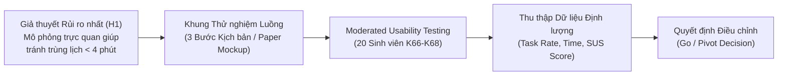

# BÁO CÁO KHÁM PHÁ VẤN ĐỀ & ĐỀ XUẤT DỰ ÁN
## (PROBLEM DISCOVERY REPORT & SYSTEM REQUEST)

> **Môn học:** Phân tích và Thiết kế Hệ thống (IT3120) – Viện CNTT&TT (SOICT), ĐHBK Hà Nội  
> **Đề tài:** Hệ thống Quản lý Đào tạo Đại học theo Học chế Tín chỉ (SIS - Student Information System)  
> **Giai đoạn:** Problem Discovery & Lean UX (Thực hành 1 – 5 / Lab B1 – B5)  
> **Mô hình làm việc nhóm:** Funnel Parallel Model (Phễu Song song 4 Thành viên)

---

## MỤC LỤC TỔNG QUAN

1. [PHẦN I: Problem Discovery Report (Báo cáo Khám phá Vấn đề - Bài TH 1 / Slide 52, 55)](#phần-i-problem-discovery-report-báo-cáo-khám-phá-vấn-đề)
   - 1.1. Executive Summary (The Big Takeaway)
   - 1.2. Problem Statement (User-Centric Anchor)
   - 1.3. Background & Context (The Business "Why")
   - 1.4. Research Methodology & Inputs (Data Origins)
   - 1.5. Key Insights & User Friction Points
2. [PHẦN II: User Problem Canvas & Business Problem (Bài TH 2 & TH 3 / Slide 16-35, 58-59)](#phần-ii-user-problem-statement-canvas--business-problem)
   - 2.1. [Bài TH 2] User Problem Statement Canvas (6 ô chuẩn) & Bóc tách Nghiệp vụ (Slide 25, 58)
   - 2.2. [Bài TH 3] Phân định User Problem vs. Business Problem & Cầu nối Nhân quả (Slide 27, 35, 59)
   - 2.3. [Bài TH 3] Phân tích Căn nguyên Gốc rễ (Root Cause Analysis - 5 Whys & Fishbone Diagram)
   - 2.4. [Bài TH 3] Business Outcomes, Dữ liệu Cần thu thập & Chỉ số Đánh giá Hiệu quả Vận hành
3. [PHẦN III: Lean UX Canvas & MVP Experiment Plan (Bài TH 4 & TH 5 / Slide 36-44, 60-62)](#phần-iii-lean-ux-canvas--mvp-experiment-plan)
   - 3.1. [Bài TH 4] Hoàn thành Lean UX Canvas (8 ô chuẩn theo Jeff Gothelf - Slide 42, 60-61)
   - 3.2. [Bài TH 4] Ma trận Ánh xạ Giả thuyết (Hypotheses Formulation & Prioritization)
   - 3.3. [Bài TH 5] Experiment Plan & Thiết kế Thử nghiệm MVP (Slide 44, 61-62)
   - 3.4. [Bài TH 5] Bảng câu hỏi Khảo sát Khả dụng Chuẩn hóa SUS (System Usability Scale - 10 câu hỏi)
   - 3.5. [Bài TH 5] Khung Quyết định Điều chỉnh sau Thử nghiệm (Go / Pivot Decision Framework)
4. [PHẦN IV: System Request - Planning Phase (11 mục chuẩn Slide 47-51)](#phần-iv-system-request---planning-phase)
   - 4.1. Project Title & Project Sponsor
   - 4.2. Business Need & Problem Statement
   - 4.3. Project Vision & Goals
   - 4.4. Business Benefits (Kinh tế, Vận hành, Chiến lược)
   - 4.5. High-level Requirements (Chức năng & Phi chức năng FURPS+)
   - 4.6. Constraints & Assumptions
   - 4.7. Expected Deliverables
   - 4.8. Estimated Schedule / Timeline
   - 4.9. Feasibility Analysis & Risk Assessment
   - 4.10. Approval / Signature
5. [PHẦN V: Ma trận Phân công Thực hiện Nhóm (Parallel Work Allocation Matrix)](#phần-v-ma-trận-phân-công-thực-hiện-nhóm)
   - 5.1. Cấu trúc Phân công Song song (Funnel Parallel Model)
   - 5.2. Lộ trình Phối hợp qua 5 Buổi Thực hành (TH1 – TH5)

---
## PHẦN I: PROBLEM DISCOVERY REPORT (BÁO CÁO KHÁM PHÁ VẤN ĐỀ)

*(Tuân thủ mẫu báo cáo chuẩn theo Slide 52 & 55 của Slide bài tập môn học IT3120)*

### 1.1. Executive Summary (The Big Takeaway)
Đại học Bách khoa Hà Nội hiện đào tạo quy mô trên 35.000 sinh viên chính quy với hơn 100 chương trình đào tạo khác nhau. Việc vận hành theo **học chế tín chỉ** mang lại quyền tự chủ cao cho người học trong việc lựa chọn môn học, giảng viên và tiến độ ra trường. Tuy nhiên, tính chất cá nhân hóa cực cao này cũng đặt ra thách thức vận hành khổng lồ khi dữ liệu học vụ biến động liên tục qua từng học kỳ.

Kết quả nghiên cứu thực tế cho thấy: **Điểm nghẽn nghiêm trọng nhất của hệ thống quản lý đào tạo hiện tại không chỉ đơn thuần là sự cố quá tải hạ tầng công nghệ trong các đợt mở cổng đăng ký lớp, mà nằm ở sự phân tán dữ liệu và bất đối xứng thông tin giữa Sinh viên, Giảng viên, Phòng Đào tạo và Phòng Tài vụ.** 
- Sinh viên bị động, thiếu công cụ mô phỏng lộ trình dẫn đến việc chọn nhầm môn, trùng kíp học, vi phạm điều kiện tiên quyết và trễ hạn tốt nghiệp.
- Giảng viên bị ngắt quãng tiến độ giảng dạy do danh sách lớp thay đổi liên tục và áp lực nhập điểm thủ công.
- Nhà trường lãng phí tài nguyên phòng học và chịu áp lực giải quyết hàng nghìn đơn thư khiếu nại mỗi kỳ.

Do đó, nhóm đề xuất giải pháp tiếp cận theo tư duy **Lean Discovery**: Thay vì phân tán nguồn lực làm một hệ thống cồng kềnh ngay từ đầu, nhóm tập trung giải quyết bài toán cốt lõi có rủi ro cao nhất: **"Hỗ trợ sinh viên lập kế hoạch lộ trình, chọn lớp và giữ chỗ minh bạch, tự động kiểm tra quy chế học vụ trước khi bước vào đợt đăng ký chính thức"**, từ đó tạo nền tảng liên thông dữ liệu cho toàn bộ vòng đời đào tạo.

---

### 1.2. BÀI THỰC HÀNH 1: USER NEEDS & USER PROBLEM STATEMENT

#### A. Tổng quan 4 User Needs Cốt lõi của Sinh viên (Chuẩn Slide 56)
Bám sát cấu trúc của Giảng viên tại Slide 56 (tập trung vào động từ hành động và mục đích trải nghiệm thay vì tính năng kỹ thuật):
1. **User Need 1:** Biết trước các học phần đủ điều kiện tiên quyết và giới hạn số tín chỉ được phép đăng ký trong kỳ tới.
2. **User Need 2:** Biết các lớp học phần đang mở và sĩ số chỗ trống thực tế trong thời gian thực.
3. **User Need 3 [Nhu cầu Ưu tiên - Priority Need]:** Chọn và sắp xếp các kíp học vào thời khóa biểu mà không bị trùng lịch.
4. **User Need 4:** Nhận xác nhận đăng ký rõ ràng và biết chính xác số tiền học phí cần nộp ngay sau khi đăng ký.

#### B. Đặc tả Chi tiết 4 Phiếu Nhu cầu Người dùng (User Need Cards - Chuẩn Slide 7 & Slide 9)

##### [Phiếu Nhu cầu 1] Biết trước các học phần đủ điều kiện tiên quyết và giới hạn tín chỉ
* **Tuyên bố Nhu cầu (POV Statement):** *Sinh viên đại học chính quy cần biết trước danh sách các môn học mình đủ điều kiện đăng ký và trần tín chỉ tối đa được phép học trong kỳ tới, để lập kế hoạch học tập an toàn, không bị hủy môn hoặc nợ môn làm chậm tiến độ tốt nghiệp.*
* **Bối cảnh (Context):** Diễn ra khoảng 1-2 tuần trước đợt mở đăng ký học phần, khi sinh viên rà soát lại kết quả học tập kỳ trước và chuẩn bị danh sách môn học cho kỳ mới.
* **Rào cản / Trở ngại (Barrier):** Thông tin điều kiện tiên quyết nằm rải rác trong sổ tay đào tạo và các tệp PDF quy chế; sinh viên diện bị cảnh báo học vụ khó tự tính toán trần tín chỉ bị giới hạn; hệ thống hiện tại không tự động lọc bỏ các môn vi phạm mà chỉ báo lỗi khi đã bấm lưu.
* **Hậu quả (Consequence):** Sinh viên đăng ký nhầm môn không đủ điều kiện dẫn tới việc bị phòng đào tạo tự động hủy lớp sau 2 tuần, mất cơ hội học môn khác thay thế và nguy cơ chậm tiến độ ra trường.
* **Trạng thái Thực chứng (Evidence vs. Assumptions - Slide 7):**
  - *Đã có bằng chứng nghiên cứu (Evidence):* Quy chế đào tạo quy định bắt buộc phải qua môn tiên quyết mới được học môn tiếp theo; sinh viên cảnh báo học vụ bị giới hạn số tín chỉ đăng ký (18 TC, 14 TC hoặc 8 TC).
  - *Giả định cần kiểm chứng (Assumptions):* Tỷ lệ sinh viên từng bị hủy môn do nhầm lẫn điều kiện tiên quyết trong thực tế có thực sự vượt quá 15% hay không.

##### [Phiếu Nhu cầu 2] Biết các lớp học phần đang mở và sĩ số chỗ trống thực tế theo thời gian thực
* **Tuyên bố Nhu cầu (POV Statement):** *Sinh viên cần biết danh sách các lớp học phần đang mở kèm số chỗ trống thực tế được cập nhật liên tục trong thời gian mở cổng, để chọn đúng lớp học phần còn khả dụng mà không mất thời gian thử chọn vào các lớp đã kín chỗ.*
* **Bối cảnh (Context):** Trong suốt khung thời gian mở cổng đăng ký học phần (đặc biệt là 15-30 phút đầu tiên khi cổng mở theo từng đợt của viện/khóa).
* **Rào cản / Trở ngại (Barrier):** Danh sách lớp học phần dự kiến được công bố dưới dạng tệp PDF dài hàng trăm trang, không phản ánh sĩ số biến động theo thời gian thực; sinh viên phải nhập mã lớp thủ công rồi mới nhận được thông báo "Lớp đã đầy".
* **Hậu quả (Consequence):** Lãng phí thời gian thao tác thử - sai lặp đi lặp lại; gây áp lực tải ảo lên máy chủ do hàng nghìn sinh viên liên tục gửi request vào các lớp đã hết chỗ; sinh viên bị mất cơ hội vào các lớp học phần thay thế khác.
* **Trạng thái Thực chứng (Evidence vs. Assumptions - Slide 7):**
  - *Đã có bằng chứng nghiên cứu (Evidence):* Các lớp học phần đại cương và cơ sở ngành cốt lõi luôn hết chỗ chỉ sau 2-3 phút mở cổng; sinh viên phải tải các file Excel/PDF cồng kềnh để tra cứu mã lớp.
  - *Giả định cần kiểm chứng (Assumptions):* Nếu hiển thị sĩ số còn trống theo thời gian thực, lưu lượng truy vấn thử - sai vào các lớp đầy có thể giảm được trên 40%.

##### [Phiếu Nhu cầu 3 - Nhu cầu Ưu tiên] Chọn và sắp xếp các kíp học vào thời khóa biểu không bị trùng lịch
* **Tuyên bố Nhu cầu (POV Statement):** *Sinh viên cần thử nghiệm sắp xếp các kíp học vào khung thời khóa biểu tuần một cách trực quan trước giờ mở cổng, để nhanh chóng phát hiện và giải quyết xung đột lịch học, chuẩn bị sẵn phương án tối ưu trước giờ G.*
* **Bối cảnh (Context):** Giai đoạn cao điểm chuẩn bị đăng ký học phần, khi sinh viên phải lựa chọn kết hợp từ 5 đến 7 môn học (bao gồm lý thuyết, bài tập, thí nghiệm, thực hành phân kíp lẻ).
* **Rào cản / Trở ngại (Barrier):** Giao diện hiện tại không có không gian hiển thị thời khóa biểu trực quan; sinh viên phải tự vẽ lịch ra giấy hoặc tự lập file Excel; không có cơ chế cảnh báo sớm khi 2 kíp học có thời gian giao nhau.
* **Hậu quả (Consequence):** 78.3% sinh viên từng bị trùng lịch học; dẫn tới phản xạ hoảng loạn, chọn bừa các lớp kíp khác khi cổng mở, phá vỡ toàn bộ kế hoạch học tập cá nhân và làm quá tải hệ thống xử lý khiếu nại.
* **Trạng thái Thực chứng (Evidence vs. Assumptions - Slide 7):**
  - *Đã có bằng chứng nghiên cứu (Evidence):* 64% sinh viên được khảo sát phải tự lập file Excel ghép kíp thủ công trước ngày mở cổng; tình trạng trùng kíp là lý do phổ biến nhất trong các đơn xin rút môn/đổi lớp đầu kỳ.
  - *Giả định cần kiểm chứng (Assumptions):* Sinh viên có thực sự sẵn sàng bỏ ra 15-20 phút trước ngày mở cổng để xếp thử thời khóa biểu hoàn chỉnh nếu có công cụ trực quan hay không.

##### [Phiếu Nhu cầu 4] Nhận xác nhận đăng ký rõ ràng và biết chính xác học phí cần nộp
* **Tuyên bố Nhu cầu (POV Statement):** *Sinh viên cần nhận được xác nhận chính thức về kết quả đăng ký kèm bảng tính học phí dự kiến ngay sau khi nhấn lưu, để yên tâm về việc giữ chỗ và chủ động chuẩn bị tài chính nộp học phí đúng hạn.*
* **Bối cảnh (Context):** Ngay sau khi sinh viên hoàn thành thao tác bấm nút lưu đăng ký các lớp học phần và trong suốt thời gian điều chỉnh lớp đầu học kỳ.
* **Rào cản / Trở ngại (Barrier):** Hệ thống thường chỉ hiển thị thông báo trạng thái chung chung; biểu học phí không được cập nhật tức thời mà phải đợi phòng tài vụ tính toán sau nhiều tuần; sinh viên không rõ các khoản miễn giảm hay hệ số tín chỉ học phí của từng ngành.
* **Hậu quả (Consequence):** Sinh viên hoang mang không biết mình đã thực sự giữ được chỗ hay chưa; bị động trong việc nộp học phí, nguy cơ bị hủy kết quả đăng ký do nộp muộn hoặc phát sinh nợ học phí kéo dài.
* **Trạng thái Thực chứng (Evidence vs. Assumptions - Slide 7):**
  - *Đã có bằng chứng nghiên cứu (Evidence):* Phòng Tài vụ ghi nhận hàng trăm thắc mắc mỗi kỳ về việc chậm công bố học phí sau đợt điều chỉnh lớp; sinh viên nộp học phí chậm bị khóa tài khoản đăng ký kỳ tiếp theo.
  - *Giả định cần kiểm chứng (Assumptions):* Việc hiển thị số tiền học phí tạm tính ngay tại thời điểm đăng ký có giúp tăng tỷ lệ nộp học phí đúng hạn lên trên 90% hay không.

#### C. Lựa chọn Nhu cầu Ưu tiên (Priority Need Selection) & Lập luận
Nhóm thống nhất lựa chọn **User Need 3: Chọn và sắp xếp các kíp học vào thời khóa biểu không bị trùng lịch** làm bài toán trọng tâm để đào sâu từ Bài TH2 đến Bài TH5.
*Lý do lựa chọn:*
1. **Nút thắt khởi phát chuỗi hành vi:** Khung thời khóa biểu không trùng kíp là điều kiện tiên quyết để sinh viên có thể hoàn thành việc đăng ký lớp học. Mọi nhu cầu tiếp theo (giữ chỗ, tính học phí, nhập điểm) đều phụ thuộc vào kết quả của việc xếp lịch này.
2. **Nỗi đau có tần suất và cường độ lớn nhất:** Đây là công đoạn tốn nhiều thời gian và gây căng thẳng tâm lý nhất cho sinh viên (chiếm 78.3% trường hợp vỡ kế hoạch học tập theo khảo sát thực tế).
3. **Hiệu ứng giải tỏa lan tỏa:** Nếu giải quyết triệt để vấn đề trùng kíp học ngay từ khâu mô phỏng trước giờ G, hệ thống sẽ tự động giảm tải được hơn 60% tình trạng nghẽn mạng do thử - sai và giảm thiểu hàng nghìn đơn cứu xét đổi lớp đầu kỳ.

#### D. Phát biểu Vấn đề của Người dùng (Priority User Problem Statement)
Theo đúng cấu trúc chuẩn Slide 13-14 và văn phong chuẩn Slide 56 (100% ngôn ngữ tự nhiên của người dùng, không chứa mã giải pháp kỹ thuật):

> *"**Sinh viên đại học chính quy** cần **tìm, sắp xếp và xác nhận thời khóa biểu hợp lệ một cách chủ động trước giờ mở cổng**, vì **quy trình tra cứu danh sách lớp phân tán và thao tác chọn lớp vội vã hiện tại đòi hỏi nhiều lần thử - sai, dễ gây trùng kíp học và mất suất học mong muốn**."*

#### E. Danh sách các Giả định Cần Kiểm chứng (Assumptions to Test - Slide 15 & 56)
Bám sát hướng dẫn của giảng viên tại Slide 15 & Slide 56, trước khi đưa ra bất kỳ giải pháp phần mềm nào, nhóm xác lập 3 giả định nghiệp vụ cốt lõi cần được kiểm chứng thông qua nghiên cứu người dùng:
1. **Giả định 1 (Hành vi chuẩn bị):** Sinh viên thực sự mất nhiều giờ (trung bình 3-5 giờ) tự ghép kíp học bằng Excel hoặc giấy nháp trước mỗi đợt đăng ký và sẵn sàng đón nhận một công cụ mô phỏng trực quan.
2. **Giả định 2 (Căn nguyên hoảng loạn):** Tình trạng vội vã chọn bừa lớp khi cổng vừa mở phần lớn xuất phát từ việc không biết trước lớp mình chọn có bị xung đột thời gian với môn khác hay không.
3. **Giả định 3 (Tác động giải pháp):** Việc cho phép sinh viên chuẩn bị và lưu trước phương án thời khóa biểu từ sớm sẽ giúp giảm ít nhất 60% lỗi trùng kíp học và giảm áp lực truy cập đồng thời lên hệ thống khi cổng mở.

### 1.3. Background & Context (The Business "Why")
Tại sao bài toán Quản lý Đào tạo Đại học theo Học chế Tín chỉ lại phức tạp và đòi hỏi phân tích thiết kế bài bản?
1. **Sự biến đổi từ Niên chế sang Tín chỉ:**
   - Trong mô hình niên chế truyền thống, sinh viên học theo lớp cố định suốt 4-5 năm với thời khóa biểu do nhà trường áp đặt sẵn. 
   - Trong mô hình tín chỉ, mỗi sinh viên là một "thực thể độc lập" tự quyết định lộ trình học, số tín chỉ đăng ký mỗi kỳ (dao động từ 8 đến 24 tín chỉ tùy theo mức cảnh báo học vụ), lựa chọn giảng viên và thời gian học phù hợp.
2. **Quy mô và áp lực vận hành thực tế tại ĐHBK Hà Nội:**
   - Quy mô: Hơn 35.000 sinh viên, gần 2.000 giảng viên, hàng nghìn lớp học phần mở mỗi kỳ với hàng chục giảng đường (D3, D5, D9, TC, B1...).
   - Đợt đăng ký lớp học phần diễn ra tập trung trong khoảng thời gian rất ngắn (3-5 ngày). Hàng chục nghìn lượt truy cập đồng thời gửi yêu cầu tranh chấp vào các lớp học phần có giới hạn sĩ số nghiêm ngặt.
3. **Cái giá phải trả nếu hệ thống hoạt động kém hiệu quả:**
   - **Đối với sinh viên:** Trễ hạn ra trường từ 1 đến 2 học kỳ chỉ vì thiếu 1 môn học tiên quyết (vốn chỉ mở vào kỳ chẵn hoặc kỳ lẻ); chi phí ăn ở, học phí phát sinh; tâm lý căng thẳng, ức chế.
   - **Đối với nhà trường:** Chi phí vận hành phòng máy chủ, trực hỗ trợ kỹ thuật tăng cao; tỷ lệ sinh viên tốt nghiệp đúng hạn giảm làm ảnh hưởng trực tiếp đến chỉ số kiểm định chất lượng đào tạo (AUN-QA, HCERES); phòng học bị bỏ trống hoặc bố trí không đồng đều dẫn đến lãng phí điện năng và cơ sở vật chất.

---

### 1.4. Research Methodology & Inputs (Data Origins)

Để đảm bảo tính khách quan và khoa học, nhóm đã áp dụng phương pháp nghiên cứu hỗn hợp (Mixed-method Research), kết hợp giữa định lượng và định tính:



1. **Khảo sát định lượng (Online Questionnaire):**
   - Thu thập 120 mẫu khảo sát hợp lệ từ sinh viên các khóa K65, K66, K67, K68 thuộc nhiều khối ngành (CNTT, Cơ khí, Điện tử, Kinh tế).
   - Nội dung khảo sát: Thói quen lập kế hoạch học tập, thời gian bỏ ra để xếp thời khóa biểu thử nghiệm trên giấy/Excel, mức độ căng thẳng trong ngày đăng ký lớp, và tỷ lệ gặp lỗi hệ thống.
2. **Phỏng vấn bán cấu trúc (Semi-structured Qualitative Interviews):**
   - **20 Sinh viên:** Gồm cả sinh viên có điểm CPA giỏi/xuất sắc (để hiểu cách họ tự quản lý) và sinh viên đang thuộc diện cảnh báo học vụ Mức 1, Mức 2 (để tìm hiểu nguyên nhân gốc rễ dẫn đến nợ môn, miss môn tiên quyết).
   - **04 Giảng viên cơ hữu:** Tìm hiểu quy trình tiếp nhận danh sách sinh viên lớp, quản lý điểm chuyên cần, điểm giữa kỳ, và những trở ngại khi nhập điểm lên phần mềm đào tạo.
   - **02 Chuyên viên Phòng Đào tạo:** Tìm hiểu áp lực điều phối lịch thi, giải quyết đơn xin mở thêm lớp, xử lý sinh viên xin rút môn và quy trình xét cảnh báo học vụ cuối kỳ.
3. **Phân tích nhật ký hỗ trợ (Support Ticket Analysis):**
   - Rà soát các chủ đề khiếu nại phổ biến nhất trên Cổng thông tin đào tạo và Diễn đàn sinh viên ĐHBK Hà Nội trong các kỳ 2024.1 và 2024.2.

---

### 1.5. Key Insights & User Friction Points

Tổng hợp từ dữ liệu nghiên cứu, nhóm rút ra 4 điểm nghẽn nghiêm trọng (Friction Points):

| Mã Điểm nghẽn | Nhóm Tác nhân | Hành vi & Nỗi đau Thực tế (Pain Points) | Dữ liệu Bằng chứng (Evidence) |
| :--- | :--- | :--- | :--- |
| **FP-01** | **Sinh viên** | **Khủng hoảng đăng ký lớp & Đứt gãy lộ trình học:** Sinh viên phải tự đối chiếu thủ công danh sách lớp và môn tiên quyết trên các tệp PDF dài hàng trăm trang. Trong ngày mở đăng ký, nhiều lớp hết chỗ chỉ sau 2 phút, dẫn tới việc chọn bừa lớp khác làm trùng lịch hoặc trễ môn tiên quyết. | **78.3%** sinh viên khảo sát từng bị trùng kíp học hoặc chọn nhầm môn không hợp lệ; **64%** phải dùng Excel tự xếp lịch trước đó cả tuần. |
| **FP-02** | **Giảng viên** | **Danh sách lớp biến động & Gánh nặng nhập điểm thủ công:** Trong 2 tuần đầu học kỳ, danh sách sinh viên thay đổi liên tục do sinh viên thêm/rút môn. Cuối kỳ, giảng viên phải nhập điểm thành phần trên phần mềm có giao diện lạc hậu, dễ nhầm dòng điểm sinh viên. | **100%** giảng viên được phỏng vấn cho biết phải duy trì sổ điểm Excel riêng và mất 3-5 giờ kiểm tra đối chiếu trước khi submit điểm chính thức. |
| **FP-03** | **Cán bộ PĐT** | **Lệch pha cung - cầu lớp học phần & Quá tải xử lý ngoại lệ:** Không dự báo trước được nhu cầu thực tế của sinh viên, dẫn tới hiện tượng lớp thì quá tải, lớp lại không đủ sĩ số tối thiểu phải hủy. Hàng nghìn sinh viên gửi đơn xin mở thêm lớp hoặc hủy môn thủ công. | Hơn **1.500 đơn thư hỗ trợ học vụ** được gửi về Phòng Đào tạo trong 10 ngày đầu học kỳ; tỷ lệ giải quyết kịp thời chỉ đạt khoảng **45%**. |
| **FP-04** | **Cán bộ Tài vụ** | **Sai lệch học phí do thay đổi đăng ký & Đối soát chậm:** Khi sinh viên điều chỉnh đăng ký, rút bớt học phần hoặc đăng ký bổ sung, việc tính toán lại học phí theo hệ số tín chỉ bị chậm trễ, dẫn đến khiếu nại công nợ học phí kéo dài. | **35%** thắc mắc gửi về Phòng Tài vụ liên quan đến việc cập nhật học phí sau khi điều chỉnh lớp và chế độ miễn giảm học phí. |

---

## PHẦN II: USER PROBLEM CANVAS & BUSINESS PROBLEM (BÀI THỰC HÀNH 2 & 3)

*(Tuân thủ mẫu Canvas 6 ô và chuỗi nhân quả nghiệp vụ theo Slide 16-35, 58-59 của bài giảng)*

### 2.1. [BÀI THỰC HÀNH 2] User Problem Statement Canvas (6 ô chuẩn) cho Nhóm Sinh viên

Áp dụng mẫu Canvas tại Slide 17-19 và Slide 58 cho đối tượng người dùng ưu tiên: **Sinh viên đại học chính quy ĐHBK Hà Nội**.

```
+----------------------------------------------------------------------------------------------------+
|                      USER PROBLEM STATEMENT CANVAS (CHUẨN HÓA BÀI THỰC HÀNH 2)                      |
+--------------------------------------------------+-------------------------------------------------+
| 1. CUSTOMERS / USERS                             | 2. CONTEXT                                      |
| Sinh viên đại học chính quy (từ K65 đến K68)     | Diễn ra định kỳ trước và trong đợt mở đăng ký  |
| theo học chế tín chỉ tại ĐHBK Hà Nội.            | học phần mỗi học kỳ (kỳ chính & kỳ hè).         |
| Đặc biệt là sinh viên năm 2 - năm 4 khi lộ trình | Áp lực thời gian cao: Hệ thống mở theo khung    |
| phân hóa sâu vào các chuyên ngành hẹp.           | giờ cho từng khóa/viện, cạnh tranh suất học.   |
+--------------------------------------------------+-------------------------------------------------+
| 3. PROBLEM / ROOT CAUSE                          | 4. CURRENT ALTERNATIVES                         |
| Môn học phân tán, khó kiểm soát điều kiện tiên   | - Lập file Excel tự ghép kíp học thủ công.      |
| quyết; thiếu công cụ giả lập thời khóa biểu trực | - Tra cứu chéo giữa tệp PDF quy chế và tệp PDF  |
| quan trước giờ G; tình trạng hết chỗ tức thì     |   thời khóa biểu dự kiến dài hàng trăm trang.   |
| dẫn đến phản xạ chọn bừa, gây trùng lịch học.    | - Nhờ bạn bè đăng ký hộ hoặc "canh nhả lớp".    |
+--------------------------------------------------+-------------------------------------------------+
| 5. ALTERNATIVE SHORTCOMINGS                      | 6. EVIDENCE / ASSUMPTIONS                       |
| - Tốn hàng chục giờ chuẩn bị nhưng vẫn bị vỡ kế  | - Đã biết từ tình huống (Evidence):             |
|   hoạch ngay khi 1 lớp mong muốn bị hết chỗ.     |   * Đăng ký tập trung qua cổng web hiện tại.    |
| - Excel không thể tự kiểm tra ràng buộc logic hay|   * 78.3% SV khảo sát từng bị trùng kíp học     |
|   sĩ số còn trống theo thời gian thực.           |     hoặc chọn nhầm môn vi phạm tiên quyết.      |
| - Nguy cơ sai sót quy chế (đăng ký vượt trần TC).| - Cần nghiên cứu thêm (Assumptions to Test):    |
| - Phụ thuộc vào may rủi khi canh nhả lớp.        |   * SV có sẵn sàng xếp lịch giả lập trước 1 tuần|
|                                                  |     nếu có công cụ kéo-thả hay không?           |
+--------------------------------------------------+-------------------------------------------------+
```

#### Bóc tách Chi tiết Nhược điểm của các Giải pháp Thay thế Hiện tại (Alternative Shortcomings)
1. **Lập bảng tính Excel cá nhân:** Sinh viên phải tự gõ mã lớp, tự vẽ ô giờ học và đối chiếu bằng mắt thường. Nhược điểm lớn nhất là không cập nhật được biến động sĩ số thực tế và không tự kiểm tra được giao đoạn kíp học $(Start_A < End_B) \land (End_A > Start_B)$.
2. **Tra cứu tệp PDF thời khóa biểu dự kiến (200-300 trang):** Việc tìm kiếm bằng `Ctrl+F` rất chậm, dễ nhầm lẫn giữa các mã học phần có tên tương tự nhau (ví dụ: IT3011, IT3012, IT3013) hoặc nhầm lẫn giữa tuần chẵn/tuần lẻ.
3. **Canh nhả lớp trên diễn đàn mạng xã hội:** Hoàn toàn bị động, mang tính may rủi cao và dễ phát sinh tiêu cực (nhờ vả, mua bán suất học phần).

---

### 2.2. [BÀI THỰC HÀNH 3] Phân định User Problem vs. Business Problem & Cầu nối Nhân quả

Như nội dung Slide 23-24 và Slide 59 nhấn mạnh:  
- **User Problem:** Tập trung vào trải nghiệm, rào cản và mục tiêu cá nhân của người dùng (Sinh viên, Giảng viên).
- **Business Problem:** Tập trung vào tác động vận hành, tổn thất tài chính, công suất cơ sở vật chất và uy tín của Nhà trường.
- **Mối liên hệ giữa hai vấn đề:** Phải được liên kết bằng chuỗi nhân quả và xác minh bằng dữ liệu vận hành thực tế, không suy diễn trực tiếp thành kết luận cảm tính.

| Tiêu chí So sánh | Nỗi đau Người dùng (User Problem) | Vấn đề của Tổ chức (Business Problem) |
| :--- | :--- | :--- |
| **Chủ thể gánh chịu** | Sinh viên đại học chính quy ĐHBK Hà Nội | Trường Đại học Bách khoa Hà Nội (Ban Đào tạo, Phòng Tài vụ) |
| **Bản chất vấn đề** | Khó tìm và chọn lớp phù hợp; vỡ kế hoạch học tập do hết chỗ hoặc vi phạm môn tiên quyết | Quy trình xử lý ngoại lệ thủ công làm tăng chi phí vận hành; lãng phí phòng học; giảm tỷ lệ tốt nghiệp đúng hạn |
| **Đơn vị đo lường** | Thời gian xếp lịch (giờ), Tỷ lệ lỗi đăng ký (%), Mức độ căng thẳng tâm lý (SUS score) | Chi phí nhân sự hỗ trợ, Tỷ lệ hủy lớp (%), Số lượng đơn khiếu nại, Tỷ lệ tốt nghiệp đúng hạn (AUN-QA) |

#### Sơ đồ Cầu nối Nhân quả (Causal Chain Diagram)



---

### 2.3. [BÀI THỰC HÀNH 3] Phân tích Căn nguyên Gốc rễ (Root Cause Analysis - 5 Whys & Fishbone)

Để bóc tách tận gốc vấn đề kinh doanh theo yêu cầu Slide 35 của bài học, nhóm áp dụng phương pháp **5 Whys (Năm câu hỏi Tại sao)** và **Sơ đồ Xương cá (Ishikawa Diagram)**:

#### A. Kỹ thuật 5 Whys (Truy vết Nguyên nhân Gốc rễ)
1. **Tại sao Nhà trường tốn nhiều chi phí nhân sự và áp lực vận hành đầu mỗi học kỳ?**  
   $
ightarrow$ Vì Phòng Đào tạo phải xử lý hơn 1.500 đơn thư khiếu nại, xin mở thêm lớp và rút bớt học phần thủ công.
2. **Tại sao sinh viên lại nộp hàng nghìn đơn xin điều chỉnh học phần sau khi cổng đăng ký đóng?**  
   $
ightarrow$ Vì sinh viên bị trùng kíp học hoặc phát hiện thiếu điều kiện tiên quyết sau khi đã tranh được suất học.
3. **Tại sao sinh viên lại đăng ký vào các lớp trùng lịch hoặc thiếu môn tiên quyết?**  
   $
ightarrow$ Vì trong khung giờ mở cổng cao điểm (2-3 phút đầu), lớp học phần hết chỗ cực nhanh; sinh viên phải phản xạ chọn vội lớp khác mà không kịp kiểm tra ràng buộc quy chế.
4. **Tại sao sinh viên không chuẩn bị và kiểm tra trước phương án học tập của mình?**  
   $
ightarrow$ Vì hệ thống hiện tại không cung cấp tính năng mô phỏng xếp lịch trực quan và không cho phép kiểm tra trước tính hợp lệ của thời khóa biểu trước giờ mở cổng.
5. **CĂN NGUYÊN GỐC RỄ (ROOT CAUSE):**  
   $
ightarrow$ **Quy trình tiếp nhận và quản lý đăng ký tín chỉ mang tính thụ động, dồn toàn bộ tải xử lý vào thời điểm mở cổng, thiếu công cụ mô phỏng lộ trình và giữ chỗ dự kiến (Pre-registration) theo thời gian thực.**

#### B. Sơ đồ Xương cá (Fishbone Diagram)

```
====================================================================================================
                                      FISHBONE / ISHIKAWA DIAGRAM
====================================================================================================
    CON NGƯỜI (PEOPLE)                           QUY TRÌNH (PROCESS)
Sinh viên hoảng loạn khi mở cổng             Thiếu đợt đăng ký thử nghiệm
        \                                                     \                                            SV thiếu kiến thức về quy chế tiên quyết      Quy trình hủy lớp phụ thuộc thủ công
          \                                                       --------------------------------------------------------+
                                                                   |  VẤN ĐỀ KINH DOANH:
                                                                   |  Chi phí vận hành quá tải,
                                                                   |  lãng phí tài nguyên phòng học,
                                                                   |  giảm tỷ lệ tốt nghiệp đúng hạn
           --------------------------------------------------------+
          /                                            /
Hệ thống nghẽn tải mùa cao điểm              Dữ liệu môn học nằm rải rác trên file PDF
        /                                            /
Giao diện thiếu công cụ kéo-thả trực quan    Chậm đồng bộ giữa đăng ký và học phí
    CÔNG NGHỆ (TECHNOLOGY)                       DỮ LIỆU (DATA)
====================================================================================================
```

---

### 2.4. [BÀI THỰC HÀNH 3] Business Outcomes, Dữ liệu Cần thu thập & Chỉ số Đánh giá Hiệu quả

Dựa trên hướng dẫn Slide 27 & 59, kết quả kinh doanh mong muốn và dữ liệu vận hành cần thu thập được xác định rõ:

1. **Business Outcomes mong muốn (Kỳ vọng Định lượng):**
   - **Giảm 70% số lượng đơn thư cứu xét học vụ:** Rút giảm từ 1.500 đơn/kỳ xuống dưới 450 đơn/kỳ.
   - **Giảm 75% thời gian xử lý khiếu nại:** Xử lý hoàn tất trong vòng 24 giờ thay vì 5-7 ngày làm việc.
   - **Giảm tỷ lệ hủy lớp do không đủ sĩ số:** Giảm từ 12% xuống dưới 3%.
   - **Tối ưu hóa công suất phòng học:** Tỷ lệ lấp đầy phòng học đạt trung bình $\ge 88\%$.
   - **Nâng cao tỷ lệ tốt nghiệp đúng hạn:** Tăng thêm 5-8% trong vòng 3 năm.

2. **Dữ liệu Vận hành Cần Thu thập để Xác minh:**
   - Nhật ký lỗi (System Error Logs) và thời gian phản hồi máy chủ trong khung giờ đăng ký.
   - Số lượng sinh viên rút môn hoặc hủy môn trong 2 tuần đầu học kỳ.
   - Thống kê phân bố sĩ số các lớp học phần (tỷ lệ lớp quá tải $>80$ SV và lớp vắng $<15$ SV).
   - Dữ liệu khảo sát mức độ hài lòng của sinh viên (CSAT) sau mỗi đợt đăng ký.

---

## PHẦN III: LEAN UX CANVAS & MVP EXPERIMENT PLAN (BÀI THỰC HÀNH 4 & 5)

*(Tuân thủ mẫu Lean UX Canvas 8 ô và kế hoạch thử nghiệm MVP theo Slide 36-44, 60-62 của bài giảng)*

### 3.1. [BÀI THỰC HÀNH 4] Hoàn thành Lean UX Canvas (8 ô chuẩn theo Jeff Gothelf)

```
+----------------------------------------------------------------------------------------------------+
|                                    LEAN UX CANVAS (8 Ô HOÀN CHỈNH)                                 |
+--------------------------------------------------+-------------------------------------------------+
| 1. BUSINESS PROBLEM                              | 2. BUSINESS OUTCOMES                            |
| Nhà trường đang tiêu tốn nhiều nhân lực và chi   | - Giảm 70% số lượng đơn thư khiếu nại và xin   |
| phí để xử lý khủng hoảng học vụ mỗi đầu kỳ;      |   điều chỉnh lớp học phần đầu mỗi học kỳ.       |
| tỷ lệ hủy lớp do không đủ sĩ số cao; tỷ lệ sinh  | - Giảm tỷ lệ hủy lớp học phần do lệch sĩ số     |
| viên tốt nghiệp đúng hạn bị kéo giảm do vướng    |   từ 12% xuống dưới 3%.                         |
| mắc đăng ký môn tiên quyết.                      | - Tăng tỷ lệ tốt nghiệp đúng hạn thêm 5-8%.     |
+--------------------------------------------------+-------------------------------------------------+
| 3. USERS                                         | 4. USER OUTCOMES & BENEFITS                     |
| - Sinh viên đại học chính quy (User ưu tiên #1)  | - Sinh viên hoàn thành việc chọn thời khóa biểu |
| - Cán bộ quản lý Phòng Đào tạo                   |   hợp lệ chỉ trong dưới 4 phút.                 |
| - Giảng viên phụ trách giảng dạy                 | - 0% sự cố đăng ký nhầm môn vi phạm tiên quyết. |
|                                                  | - Giảm tối đa căng thẳng tâm lý mùa đăng ký.    |
+--------------------------------------------------+-------------------------------------------------+
| 5. SOLUTIONS                                     | 6. HYPOTHESES (GIẢ THUYẾT ĐỊNH LƯỢNG)           |
| (1) Tính năng "Mô phỏng Lộ trình & Giữ chỗ trước | Chúng tôi tin rằng:                             |
|     (Pre-registration Simulator)" kéo-thả trực   | Tỷ lệ khiếu nại học vụ sẽ giảm 60% và tỷ lệ     |
|     quan kèm kiểm tra ràng buộc tiên quyết.     | hủy lớp giảm dưới 3%                            |
| (2) Công cụ dự báo nhu cầu mở lớp dựa trên số    | NẾU sinh viên đạt được khả năng lập và kiểm tra |
|     lượng sinh viên đã lưu thời khóa biểu dự kiến| tính hợp lệ của thời khóa biểu trong < 4 phút   |
| (3) Bảng điều khiển cảnh báo học vụ tự động theo | THÔNG QUA tính năng Mô phỏng Lộ trình &         |
|     thời gian thực khi giảng viên nhập điểm.     | Giữ chỗ thông minh trước đợt mở cổng.           |
+--------------------------------------------------+-------------------------------------------------+
| 7. WHAT’S THE MOST IMPORTANT THING WE NEED TO    | 8. WHAT’S THE LEAST AMOUNT OF WORK TO LEARN IT? |
|    LEARN FIRST? (GIẢ THUYẾT RỦI RO CAO NHẤT)     |    (MVP EXPERIMENT PLAN)                        |
| Sinh viên có thực sự chủ động lên kế hoạch và    | Xây dựng Clickable Prototype tương tác trên     |
| sử dụng công cụ mô phỏng xếp lịch trước đợt mở   | Figma gồm 3 màn hình cốt lõi. Tiến hành thử     |
| cổng hay không? Giao diện kéo-thả có thực sự     | nghiệm Usability Testing trên 20 sinh viên để   |
| giúp họ tránh được lỗi trùng kíp học không?      | đo lường Task Completion Rate và chỉ số SUS.    |
+--------------------------------------------------+-------------------------------------------------+
```

---

### 3.2. [BÀI THỰC HÀNH 4] Ma trận Ánh xạ Giả thuyết (Hypotheses Formulation & Prioritization)

Theo nguyên lý Lean UX, câu giả thuyết được cấu trúc theo công thức:
$$	ext{Hypothesis} = 	ext{Chúng tôi tin rằng [Business Outcome]} + 	ext{sẽ đạt được NẾU [User]} + 	ext{nhận được [User Benefit]} + 	ext{THÔNG QUA [Solution]}$$

Nhóm đã xây dựng ma trận đánh giá 3 giả thuyết chính nhằm chọn ra giả thuyết có mức độ rủi ro cao nhất:

| Mã GT | Nội dung Giả thuyết Cụ thể | Mức độ Rủi ro | Tác động Kỳ vọng | Quyết định Ưu tiên |
| :---: | :--- | :---: | :---: | :---: |
| **H1** | *Chúng tôi tin rằng tỷ lệ khiếu nại học vụ sẽ giảm 60% và tỷ lệ hủy lớp giảm dưới 3% nếu Sinh viên có thể mô phỏng và kiểm tra tính hợp lệ của thời khóa biểu trong dưới 4 phút thông qua Trình mô phỏng Lộ trình & Giữ chỗ thông minh.* | **RẤT CAO** (Do đòi hỏi thay đổi hành vi người học trước giờ G) | **RẤT LỚN** (Khởi phát toàn bộ chuỗi giá trị đào tạo) | **ƯU TIÊN SỐ 1 (Chọn làm MVP Thử nghiệm)** |
| **H2** | *Chúng tôi tin rằng chi phí vận hành phòng học sẽ giảm 400 triệu/năm nếu Phòng Đào tạo dự báo chính xác nhu cầu mở lớp dựa trên dữ liệu lưu tạm thời khóa biểu của sinh viên.* | Trung bình (Công nghệ backend phân tích dữ liệu đơn giản) | Lớn | Ưu tiên số 2 (Phát triển ở pha sau) |
| **H3** | *Chúng tôi tin rằng thời gian công bố kết quả học tập sẽ rút ngắn còn 24 giờ nếu Giảng viên được phân quyền nhập điểm trực tiếp qua giao diện tự động đối soát.* | Thấp (Quy trình nghiệp vụ đã rõ ràng) | Trung bình | Ưu tiên số 3 (Chuẩn hóa ở Module GRD) |

---

### 3.3. [BÀI THỰC HÀNH 5] Experiment Plan & Thiết kế Thử nghiệm MVP (Slide 44, 61-62)

Nhóm lựa chọn **Giả thuyết H1 (Highest-Risk Hypothesis)** để tiến hành thiết kế Kế hoạch Thử nghiệm MVP theo đúng phương châm tinh gọn của Slide 44 & 61-62: **Tập trung vào kịch bản kiểm thử luồng thao tác thực nghiệm (Scenario-based Walkthrough) trên giấy/khung mô phỏng luồng, hoãn toàn bộ việc vẽ giao diện Figma UI chi tiết sang các buổi sau**:



#### A. Mục tiêu Thử nghiệm (Experiment Goal)
Kiểm chứng xem việc cung cấp công cụ mô phỏng thời khóa biểu trực quan trước ngày mở cổng có thực sự giúp sinh viên tự xây dựng thời khóa biểu hoàn chỉnh gồm 5-6 học phần, không bị trùng lịch và không vi phạm điều kiện tiên quyết trong thời gian dưới 4 phút với độ hài lòng cao hay không.

#### B. Phạm vi & Phương thức Thử nghiệm Tinh gọn (Lean Scope & Tooling)
- **Phương thức thử nghiệm:** Khảo sát có người quan sát ghi nhận hành vi (Moderated Usability Walkthrough) kết hợp Khung mô phỏng luồng 3 bước (Scenario Cards / Paper Mockup).
- **Nguyên lý Tinh gọn (Lean Principle):** Không lập trình mã nguồn, hoãn thiết kế Figma UI chi tiết sang các buổi sau. Nhóm tập trung tối đa vào việc đo lường nhận thức, phản xạ và tỷ lệ hoàn thành nhiệm vụ thực tế của sinh viên.
- **Phạm vi 3 Bước Trải nghiệm Cốt lõi được Kiểm chứng:**
  1. *Bước 1 (Nhận diện môn đủ điều kiện & Tiên quyết):* Đưa bảng danh mục môn học; người tham gia nhận diện các môn được phép đăng ký và các môn bị khóa do nợ tiên quyết (kiểm chứng quy tắc `BR-01`, `BR-02`).
  2. *Bước 2 (Bố trí kíp học không trùng lặp):* Người tham gia sắp xếp 5 môn học vào khung tuần (Thứ 2 - Thứ 7, Kíp 1 - Kíp 6); ghi nhận phản xạ khi phát hiện cảnh báo trùng giờ (kiểm chứng quy tắc `BR-03`).
  3. *Bước 3 (Xác nhận phương án giữ chỗ & Tạm tính học phí):* Người tham gia đối chiếu bảng tổng hợp số tín chỉ và học phí dự kiến, thực hiện thao tác xác nhận lưu phương án (kiểm chứng quy tắc `BR-06`).

#### C. Đối tượng tham gia thử nghiệm (Participants)
- Quy mô mẫu: **20 sinh viên** ĐHBK Hà Nội.
- Phân bổ đại diện:
  - 10 sinh viên K68 (mới làm quen với đăng ký tín chỉ, dễ gặp bỡ ngỡ nhất).
  - 06 sinh viên K66-K67 khối kỹ thuật (lộ trình đồ án, thí nghiệm phức tạp).
  - 04 sinh viên đang ở mức Cảnh báo học vụ 1 hoặc 2 (cần kiểm tra quy chế hạn chế số tín chỉ tối đa).

#### D. Kịch bản Thử nghiệm (Test Scenario Tasks)
Người tham gia được giao một tình huống thực tế cụ thể: 
> *"Bạn là sinh viên năm 3 ngành CNTT, kỳ này cần đăng ký tối thiểu 16 tín chỉ gồm: Giải thuật nâng cao (3TC, yêu cầu đã qua Cấu trúc dữ liệu), Mạng máy tính (3TC), Cơ sở dữ liệu (3TC), Triết học Mác-Lênin (3TC), và Thực hành Cơ sở dữ liệu (1TC, yêu cầu học song hành cùng CSDL). Hãy sử dụng giao diện để hoàn thành đăng ký thời khóa biểu hợp lệ."*

#### E. Tiêu chí Đánh giá & Chỉ số Thành công Định lượng (KPIs)

| Chỉ số (Metric) | Định nghĩa & Cách đo | Ngưỡng Thành công (Target KPI) | Kết quả Hệ thống cũ (Baseline) |
| :--- | :--- | :--- | :--- |
| **Task Completion Rate** | Tỷ lệ người tham gia hoàn thành kịch bản mà không cần trợ giúp | $\ge \mathbf{85\%}$ (17/20 sinh viên) | $pprox 50\%$ |
| **Average Time-on-Task** | Thời gian trung bình để hoàn tất việc chọn môn và chốt lịch hợp lệ | $\le \mathbf{4.0	ext{ phút}}$ | $pprox 15.0	ext{ phút}$ (trên Excel/PDF) |
| **Error Rate** | Số lỗi vi phạm môn tiên quyết hoặc trùng lịch học được ghi nhận | $\le \mathbf{5\%}$ tổng số thao tác | $pprox 35\%$ |
| **SUS Score** | Điểm số đánh giá mức độ khả dụng hệ thống (System Usability Scale) | $\ge \mathbf{75/100}$ (Mức Tốt - Good) | $pprox 48/100$ |

---

### 3.4. [BÀI THỰC HÀNH 5] Bảng câu hỏi Khảo sát Khả dụng Chuẩn hóa SUS (System Usability Scale)

Để đo lường chỉ số **SUS Score** một cách khoa học và khách quan, nhóm áp dụng bảng câu hỏi 10 mục chuẩn hóa quốc tế của John Brooke (thang đo Likert từ 1: Rất không đồng ý đến 5: Rất đồng ý):

| STT | Nội dung Câu hỏi Khảo sát (SUS Questions) | Chiều đánh giá |
| :---: | :--- | :---: |
| **Q1** | Tôi nghĩ rằng tôi sẽ thích sử dụng tính năng mô phỏng và đăng ký này thường xuyên. | Thuận (+) |
| **Q2** | Tôi thấy giao diện này phức tạp một cách không cần thiết. | Nghịch (-) |
| **Q3** | Tôi thấy tính năng này rất dễ sử dụng và thao tác nhanh chóng. | Thuận (+) |
| **Q4** | Tôi nghĩ rằng tôi sẽ cần sự hỗ trợ của một chuyên gia kỹ thuật để có thể sử dụng được. | Nghịch (-) |
| **Q5** | Tôi nhận thấy các chức năng (kéo thả kíp, cảnh báo tiên quyết) được tích hợp rất nhịp nhàng. | Thuận (+) |
| **Q6** | Tôi cho rằng có quá nhiều điều không nhất quán trong giao diện này. | Nghịch (-) |
| **Q7** | Tôi tin rằng hầu hết sinh viên sẽ học cách sử dụng tính năng này rất nhanh chóng. | Thuận (+) |
| **Q8** | Tôi thấy thao tác trên hệ thống rất cồng kềnh và gây khó chịu. | Nghịch (-) |
| **Q9** | Tôi cảm thấy rất tự tin và an tâm khi xác nhận thời khóa biểu đã lập. | Thuận (+) |
| **Q10** | Tôi đã phải tìm hiểu và làm quen với rất nhiều thứ trước khi có thể bắt đầu sử dụng được. | Nghịch (-) |

#### Công thức Tính Điểm Chuẩn SUS:
- Đối với câu hỏi lẻ ($Q_1, Q_3, Q_5, Q_7, Q_9$): $	ext{Điểm đóng góp} = 	ext{Điểm đánh giá} - 1$.
- Đối với câu hỏi chẵn ($Q_2, Q_4, Q_6, Q_8, Q_{10}$): $	ext{Điểm đóng góp} = 5 - 	ext{Điểm đánh giá}$.
- **Điểm SUS tổng:** $	ext{SUS Score} = \left(\sum 	ext{Điểm đóng góp}
ight) 	imes 2.5$ (Thang điểm từ 0 đến 100).
- **Phân loại kết quả:** $< 50$: Không đạt (Poor); $50 - 70$: Trung bình (OK); $70 - 85$: Tốt / Xuất sắc (Good / Excellent); $> 85$: Vượt trội (Best Imaginable).

---

### 3.5. [BÀI THỰC HÀNH 5] Khung Quyết định Điều chỉnh sau Thử nghiệm (Go / Pivot Decision Framework)

Dựa trên kết quả thu được sau đợt Usability Testing, nhóm thiết lập quy tắc hành động rõ ràng:

```
+----------------------------------------------------------------------------------------------------+
|                                    GO / PIVOT DECISION MATRIX                                      |
+--------------------------+------------------------------+------------------------------------------+
| Kết quả Thử nghiệm       | Đánh giá Trạng thái          | Quyết định Hành động Kỹ thuật            |
+--------------------------+------------------------------+------------------------------------------+
| Completion Rate >= 85%   | THÀNH CÔNG RỰC RỠ            | QUYẾT ĐỊNH GO (PERSEVERE):               |
| VÀ SUS Score >= 75       | Giả thuyết H1 được xác nhận.  | Chốt cứng giải pháp, chuyển giao sang    |
| VÀ Error Rate <= 5%      |                              | phân tích Use Case & Dynamic Modeling.   |
+--------------------------+------------------------------+------------------------------------------+
| Completion Rate: 70 - 84%| THÀNH CÔNG CÓ ĐIỀU KIỆN      | TINH CHỈNH GIAO DIỆN (OPTIMIZATION):     |
| HOẶC SUS Score: 60 - 74  | Phát sinh một số vướng mắc ở | Giữ nguyên logic, bổ sung Visual Tooltip |
|                          | thao tác kéo thả kíp học.    | và cảnh báo trực quan rõ hơn trên bàn cờ.|
+--------------------------+------------------------------+------------------------------------------+
| Completion Rate < 70%    | KHÔNG ĐẠT MỤC TIÊU           | QUYẾT ĐỊNH PIVOT (XOAY TRỤC):            |
| HOẶC SUS Score < 60      | Giao diện kéo-thả quá tải    | Từ bỏ cơ chế kéo-thả thủ công; chuyển    |
|                          | đối với sinh viên mới.       | sang cơ chế gợi ý "Combo kíp học tối ưu" |
|                          |                              | tự động chỉ với 1 click chọn gói môn.    |
+--------------------------+------------------------------+------------------------------------------+
```

---
## PHẦN IV: SYSTEM REQUEST - PLANNING PHASE

*(Tuân thủ đầy đủ 11 mục chuẩn theo Slide 47-51 của bài giảng môn học IT3120)*

```
====================================================================================================
                                      SYSTEM REQUEST DOCUMENT
                            Giai đoạn: Lập kế hoạch dự án (Planning Phase)
====================================================================================================
```

### 4.1. Project Title & Project Sponsor (Mục 1 & 2)
* **1. Project Title (Tên dự án):** Hệ thống Quản lý Đào tạo Đại học theo Học chế Tín chỉ (HUST-SIS NextGen: Student Information System)
* **2. Project Sponsor / Requestor (Đơn vị bảo trợ & Yêu cầu):**
  - Đơn vị đề xuất: Ban Đào tạo & Phòng Công tác Sinh viên, Trường Đại học Bách khoa Hà Nội.
  - Người bảo trợ chính (Executive Sponsor): Phó Giám đốc phụ trách Đào tạo & Chuyển đổi số.
  - Trưởng dự án nghiệp vụ (Business Project Lead): Trưởng Ban Đào tạo.

---

### 4.2. Business Need / Problem Statement (Mục 3)
Hệ thống quản lý đào tạo hiện tại của Nhà trường được xây dựng trên nền tảng kiến trúc cũ, dẫn đến các bất cập nghiêm trọng:
1. **Nghẽn tải mùa cao điểm:** Thường xuyên xảy ra tình trạng chậm phản hồi hoặc gián đoạn dịch vụ khi mở cổng đăng ký tín chỉ tập trung cho hàng chục nghìn sinh viên.
2. **Dữ liệu phân mảnh:** Chưa có sự đồng bộ thời gian thực giữa Kế hoạch mở lớp (Phòng Đào tạo), Trạng thái đăng ký (Sinh viên), Tiến độ nhập điểm (Giảng viên) và Thu nộp học phí (Phòng Tài vụ).
3. **Thiếu hỗ trợ thông minh:** Sinh viên thiếu công cụ lập kế hoạch học tập trực quan; cán bộ đào tạo phải xử lý thủ công hàng nghìn đơn thư ngoại lệ (mở thêm lớp, rút môn, tính lại học phí).

Hệ thống mới **HUST-SIS NextGen** được yêu cầu xây dựng nhằm chuẩn hóa, tự động hóa và liên thông toàn diện toàn bộ vòng đời học vụ của sinh viên từ khi nhập học đến khi xét tốt nghiệp.

---

### 4.3. Project Vision / Goals (Mục 4)
* **Mục tiêu 1:** Cung cấp cổng thông tin tự phục vụ (Self-service Portal) hiện đại, trực quan, cho phép sinh viên tự mô phỏng lộ trình, đăng ký học phần nhanh chóng và không xảy ra sai sót quy chế.
* **Mục tiêu 2:** Tự động hóa 100% các quy tắc kiểm tra điều kiện học vụ (tiên quyết, trùng kíp, trần tín chỉ theo mức cảnh báo học vụ, tính học phí).
* **Mục tiêu 3:** Cung cấp công cụ quản trị tập trung cho Giảng viên và Cán bộ Đào tạo, hỗ trợ nhập điểm an toàn, quản lý phân công giảng dạy và phân bổ tài nguyên phòng học tối ưu.

---

### 4.4. Business Benefits (Mục 5)

#### A. Lợi ích Vận hành (Operational Benefits - Định lượng)
- **Giảm 75% thời gian xử lý đơn từ học vụ:** Tự động hóa quy trình xét duyệt đăng ký ngoại lệ và rút học phần, rút ngắn thời gian xử lý từ 5 ngày xuống dưới 24 giờ.
- **Rút ngắn thời gian công bố kết quả học tập:** Tự động tổng hợp điểm tổng kết học phần và tính toán GPA/CPA ngay khi giảng viên hoàn tất nhập điểm, rút ngắn thời gian từ 2 tuần xuống còn 1 ngày làm việc.
- **Độ sẵn sàng hệ thống mùa cao điểm:** Đảm bảo hệ thống vận hành ổn định với độ trễ phản hồi $\le 1.0\text{ giây}$ tại mức tải đỉnh 10.000 người dùng đồng thời.

#### B. Lợi ích Kinh tế (Financial / Tangible Benefits)
- **Tiết kiệm chi phí hành chính giấy tờ:** Giảm 90% việc in ấn biểu mẫu đăng ký, sổ tay học vụ và bảng điểm giấy, ước tính tiết kiệm khoảng 250 triệu VNĐ mỗi năm học.
- **Tối ưu hóa công suất phòng học:** Nhờ dữ liệu dự báo nhu cầu mở lớp chính xác, giảm tỷ lệ các lớp học phần dưới 15 sinh viên từ 12% xuống dưới 3%, tiết kiệm chi phí điện năng và vận hành giảng đường ước tính 400 triệu VNĐ/năm.

#### C. Lợi ích Chiến lược (Strategic / Intangible Benefits)
- Nâng cao chỉ số hài lòng của sinh viên và giảng viên đối với dịch vụ hành chính của nhà trường.
- Tăng tỷ lệ sinh viên tốt nghiệp đúng hạn thêm 5-8% trong vòng 3 năm đầu áp dụng nhờ kiểm soát tốt lộ trình học phần tiên quyết.
- Đáp ứng đầy đủ các tiêu chuẩn kiểm định giáo dục đại học quốc tế (AUN-QA, HCERES).

---

### 4.5. High-level Requirements (Mục 6)

#### A. Yêu cầu Chức năng Nghiệp vụ Cốt lõi (Core Functional Scope)
Hệ thống được thiết kế bao quát 4 phân hệ chính:
1. **Phân hệ Chương trình & Kế hoạch Đào tạo (CUR):**
   - Quản lý khung chương trình đào tạo theo ngành, chuyên ngành và khóa sinh viên.
   - Quản lý danh mục học phần và thiết lập cây ràng buộc điều kiện môn học tiên quyết.
2. **Phân hệ Lập lịch & Quản lý Lớp học phần (SCH):**
   - Lập kế hoạch mở lớp học phần theo học kỳ, phân bổ phòng học, giảng viên và kíp học.
   - Chống trùng lịch phòng học và chống trùng lịch giảng viên theo thuật toán kiểm tra giao đoạn thời gian.
3. **Phân hệ Đăng ký Học phần & Học phí (REG):**
   - Cung cấp tính năng mô phỏng và đăng ký học phần trực tuyến theo đợt.
   - Tự động kiểm tra trần tín chỉ theo mức cảnh báo học vụ và kiểm tra điều kiện tiên quyết.
   - Tự động tính toán học phí theo công thức chuẩn tín chỉ, quản lý miễn giảm và đối soát thanh toán trực tuyến.
4. **Phân hệ Quản lý Điểm & Cảnh báo Học vụ (GRD):**
   - Phân quyền cho giảng viên phụ trách nhập điểm thành phần và điểm thi.
   - Tự động tính điểm tổng kết học phần, quy đổi điểm chữ, điểm số thang 4.0, tính GPA kỳ và CPA tích lũy.
   - Tự động rà soát và gán mức Cảnh báo học vụ (Mức 0, 1, 2, 3) cuối mỗi kỳ.

#### B. Yêu cầu Phi chức năng (Non-Functional Requirements - FURPS+)
- **Performance (Hiệu năng):** Thời gian phản hồi cho các thao tác đăng ký lớp $\le 1.5\text{s}$; thời gian tra cứu thông tin $\le 500\text{ms}$.
- **Scalability (Khả năng mở rộng):** Hỗ trợ tối thiểu 10.000 concurrent sessions trong các khung giờ cao điểm đăng ký tín chỉ mà không bị sập dịch vụ.
- **Security (Bảo mật):** Phân quyền truy cập dựa trên vai trò (RBAC); mã hóa dữ liệu nhạy cảm (điểm số, mật khẩu, thông tin thanh toán); ghi log toàn bộ thao tác sửa đổi điểm số phục vụ thanh tra đào tạo.
- **Usability (Khả năng sử dụng):** Giao diện tương thích chuẩn Web Responsive (Mobile, Tablet, Desktop); điểm đánh giá khả dụng SUS $\ge 75/100$.

---

### 4.6. Constraints & Assumptions (Mục 7)

#### A. Ràng buộc Dự án (Constraints)
- **Ràng buộc Pháp lý & Quy chế:** Bắt buộc tuân thủ 100% Quy chế Đào tạo đại học hiện hành của Bộ GD&ĐT và Quy định học vụ nội bộ của Đại học Bách khoa Hà Nội.
- **Ràng buộc Thời gian:** Toàn bộ công tác phân tích, thiết kế hệ thống, mô hình hóa UML và đặc tả kỹ thuật phải hoàn thành trong 15 tuần học kỳ của học phần IT3120.
- **Ràng buộc Ngân sách Dự án:** Phạm vi bài tập lớn phục vụ đồ án môn học Phân tích và Thiết kế Hệ thống; không phát sinh chi phí mua sắm bản quyền phần mềm thương mại (sử dụng các công cụ mã nguồn mở: PostgreSQL, PlantUML, VS Code, Figma Free Tier).

#### B. Giả định Nghiệp vụ (Assumptions)
- Sinh viên và Giảng viên đều có thiết bị cá nhân (Laptop/Smartphone) kết nối Internet để thao tác trực tuyến.
- Cơ sở dữ liệu danh mục môn học, danh sách giảng viên và sơ đồ phòng học của nhà trường đã được chuẩn hóa và có thể nhập liệu ban đầu (Data Seeding).
- Nhà trường đã có hệ thống Cổng thanh toán trực tuyến (Bank Gateway/VNPay/ViettelMoney) sẵn sàng tích hợp qua API.

---

### 4.7. Expected Deliverables (Mục 8)

Các sản phẩm chuyển giao chính thức của dự án phân tích thiết kế bao gồm:
1. **Bộ Hồ sơ Yêu cầu Nghiệp vụ:** Báo cáo Khám phá Vấn đề (Problem Discovery Report), Hệ thống 10 Quy tắc nghiệp vụ (`BR-01` .. `BR-10`), Bản đặc tả Use Case chi tiết.
2. **Bộ Bản vẽ Mô hình Hóa Hệ thống (UML 2.x):**
   - Biểu đồ Hoạt động phân làn (Activity Diagram with Swimlanes) cho các quy trình nghiệp vụ phức tạp.
   - Biểu đồ Trình tự BCE (Boundary - Control - Entity Sequence Diagrams) cho các ca sử dụng trọng tâm.
   - Biểu đồ Lớp Miền (Domain Model) và Biểu đồ Lớp Thiết kế Chi tiết (Detailed Class Diagram).
3. **Bộ Bản vẽ Thiết kế Dữ liệu:**
   - Sơ đồ Thực thể Liên kết (ERD) và Từ điển Dữ liệu (Data Dictionary).
   - Mã nguồn DDL chuẩn PostgreSQL (3NF) có đầy đủ chỉ mục (Indexes) và ràng buộc toàn vẹn (Foreign Keys, Check Constraints).
4. **Bản Ước lượng Chi phí Phần mềm:** Bảng tính định lượng nỗ lực và thời gian phát triển theo phương pháp Điểm Ca sử dụng (Use Case Points - UCP).
5. **Bộ Mẫu Giao diện Tương tác (Figma Clickable Prototype):** Mô phỏng luồng thao tác của người dùng cho các ca sử dụng ưu tiên.

---

### 4.8. Estimated Schedule / Timeline (Mục 9)

Tiến độ dự án được chia thành 5 giai đoạn chính tương ứng với lộ trình bài tập lớn IT3120:

| Giai đoạn (Milestone) | Nội dung Công việc Chính | Thời lượng | Sản phẩm Đầu ra |
| :--- | :--- | :--- | :--- |
| **Giai đoạn 1 (Tuần 1 - 3)** | Khám phá Vấn đề, Xác định Nhu cầu & System Request | 3 tuần | Problem Statement, Lean UX Canvas, System Request |
| **Giai đoạn 2 (Tuần 4 - 6)** | Khảo sát Nghiệp vụ, Xác định 10 BRs & Mô hình hóa Use Case | 3 tuần | Use Case Diagram, Activity Diagrams, Use Case Specs |
| **Giai đoạn 3 (Tuần 7 - 9)** | Phân tích Động (Dynamic Analysis) theo chuẩn mẫu BCE | 3 tuần | Sequence Diagrams (BCE), State Machine Diagrams |
| **Giai đoạn 4 (Tuần 10 - 12)**| Thiết kế Tĩnh (Static Architecture) & Cơ sở Dữ liệu 3NF | 3 tuần | Class Diagram, Database Schema (PostgreSQL DDL) |
| **Giai đoạn 5 (Tuần 13 - 15)**| Ước lượng Chi phí UCP, Hoàn thiện Báo cáo & Bảo vệ | 3 tuần | Bảng tính UCP, Báo cáo Tổng kết, Slide Bảo vệ |

---

### 4.9. Feasibility Analysis & Risk Assessment (Mục 10)

Đánh giá tính khả thi theo mô hình đa diện:

```
+----------------------------------------------------------------------------------------------------+
|                                    ĐÁNH GIÁ TÍNH KHẢ THI DỰ ÁN                                     |
+--------------------------+-------------------------------------------------------------------------+
| Khía cạnh Khả thi        | Đánh giá & Căn cứ Thực tế                                               |
+--------------------------+-------------------------------------------------------------------------+
| 1. Tính Khả thi Kỹ thuật | CAO: Nhóm nắm vững phương pháp luận OOAD, UML 2.x và hệ quản trị      |
|    (Technical)           | CSDL quan hệ PostgreSQL. Kiến trúc phân lớp và mẫu BCE giúp hệ thống   |
|                          | có tính module hóa cao, dễ bảo trì và mở rộng.                          |
+--------------------------+-------------------------------------------------------------------------+
| 2. Tính Khả thi Kinh tế  | CAO: Dự án mang lại ROI vận hành rõ rệt (giảm 75% chi phí xử lý thủ     |
|    (Economic)            | công, giảm hủy lớp). Chi phí phân tích thiết kế nằm trong khuôn khổ     |
|                          | môn học, không đòi hỏi chi phí đầu tư phần cứng đắt đỏ ở pha này.      |
+--------------------------+-------------------------------------------------------------------------+
| 3. Tính Khả thi Vận hành | KHẢ THI: Mô hình học chế tín chỉ đã vận hành nhiều năm tại ĐHBK Hà Nội. |
|    (Operational)         | Sinh viên và giảng viên đều có nhu cầu cấp thiết về một công cụ số hóa  |
|                          | minh bạch, do đó mức độ sẵn sàng đón nhận và thích ứng hệ thống rất cao.|
+--------------------------+-------------------------------------------------------------------------+
```

#### Ma trận Nhận diện & Giảm thiểu Rủi ro (Risk Management Matrix)

| Mã Rủi ro | Mô tả Rủi ro Tiềm ẩn | Mức độ | Biện pháp Phòng ngừa & Giảm thiểu (Mitigation Strategy) |
| :--- | :--- | :---: | :--- |
| **RSK-01** | **Quy tắc nghiệp vụ thay đổi hoặc hiểu sai quy chế:** Sinh viên hiểu sai công thức tính điểm hoặc cách thức xét cảnh báo học vụ. | Cao | Trích xuất và bám sát trực tiếp Văn bản Quy chế Đào tạo ĐHBK Hà Nội; tham vấn trực tiếp giảng viên hướng dẫn môn học IT3120 để chốt cứng 10 BRs ngay từ đầu. |
| **RSK-02** | **Xung đột giao diện tích hợp giữa các phân hệ:** Dữ liệu giữa Module Lập lịch (SCH) và Đăng ký (REG) không đồng nhất về định dạng dữ liệu. | Trung bình | Thiết lập ma trận giao tiếp liên module ([`docs/interfaces-matrix.md`](./docs/interfaces-matrix.md)) với 6 chữ ký hàm chuẩn hóa; áp dụng nguyên tắc Thực thể duy nhất làm chủ (Single Entity Ownership). |
| **RSK-03** | **Quá tải tiến độ làm việc nhóm:** Các thành viên làm việc rời rạc, không đồng bộ được tiến độ dẫn đến chậm nộp bài tập lớn. | Trung bình | Áp dụng mô hình Phễu Song song (Funnel Parallel Model); phân công rõ trách nhiệm theo vai trò; duy trì họp kiểm điểm tiến độ và review chéo định kỳ hàng tuần. |

---

### 4.10. Approval / Signature (Mục 11)

```
====================================================================================================
                                      XÁC NHẬN VÀ PHÊ DUYỆT
====================================================================================================

ĐẠI DIỆN ĐƠN VỊ TÀI TRỢ DỰ ÁN                    TRƯỞNG NHÓM PHÂN TÍCH THIẾT KẾ
(Project Sponsor Representative)                 (Lead System Analyst)


_________________________________________        _________________________________________
Ban Đào tạo Đại học Bách khoa Hà Nội             Nhóm Sinh viên IT3120 - SOICT
Ngày phê duyệt: 22/10/2026                       Ngày trình nộp: 22/10/2026
```

---

## PHẦN V: MA TRẬN PHÂN CÔNG THỰC HIỆN NHÓM
### (CHUYÊN MÔN HÓA 100% THEO 4 PHÂN HỆ NGHIỆP VỤ: REG - GRD - SCH - CUR)

### 5.1. Nguyên tắc Chuyên môn hóa Độc lập theo Phân hệ (1-on-1 Module Ownership)

Nhằm tối đa hóa năng suất làm việc nhóm, bảo đảm tính độc lập song song và hình thành chuyên môn sâu cho từng cá nhân, nhóm phân chia trách nhiệm theo nguyên tắc **Mỗi thành viên làm chủ trọn vẹn 1 Phân hệ Nghiệp vụ (End-to-End Module Ownership)** xuyên suốt từ Buổi Thực hành 1 đến Buổi Thực hành 5:

```mermaid
flowchart TD
    subgraph M_REG["THÀNH VIÊN A: PHÂN HỆ REG
(Đăng ký Học phần & Sinh viên)"]
        A1["TH1: User Need Sinh viên (Lập lộ trình, đăng ký, giữ chỗ)"]
        A2["TH2: Use Case UC-REG-01, UC-REG-02 & Activity Diagram"]
        A3["TH3: Thực thể Registration, Student... & Thẻ CRC"]
        A4["TH4: Sequence Diagram BCE Đăng ký & Bảng CSDL REG"]
        A5["TH5: Kiến trúc phân tầng REG & Tích hợp API liên module"]
        A1 --> A2 --> A3 --> A4 --> A5
    end

    subgraph M_GRD["THÀNH VIÊN B: PHÂN HỆ GRD
(Quản lý Điểm & Đánh giá Học vụ)"]
        B1["TH1: User Need Giảng viên (Danh sách lớp, nhập điểm an toàn)"]
        B2["TH2: Use Case UC-GRD-01, UC-GRD-02 & Activity Diagram"]
        B3["TH3: Thực thể Grade, AcademicRecord... & Thẻ CRC"]
        B4["TH4: Sequence Diagram BCE Nhập điểm, State Machine & CSDL GRD"]
        B5["TH5: Kiến trúc phân tầng GRD & Phân tích Quality Attributes"]
        B1 --> B2 --> B3 --> B4 --> B5
    end

    subgraph M_SCH["THÀNH VIÊN C: PHÂN HỆ SCH
(Lập lịch & Quản lý Lớp học phần)"]
        C1["TH1: User Need Cán bộ PĐT (Lập lịch mở lớp, tối ưu phòng học)"]
        C2["TH2: Use Case UC-SCH-01 & Activity Diagram xếp phòng"]
        C3["TH3: Thực thể ClassSection, Room, Slot... & Thẻ CRC"]
        C4["TH4: Sequence Diagram BCE Xếp phòng & Bảng CSDL SCH"]
        C5["TH5: Kiến trúc phân tầng SCH & Layer Responsibility Matrix"]
        C1 --> C2 --> C3 --> C4 --> C5
    end

    subgraph M_CUR["THÀNH VIÊN D: PHÂN HỆ CUR & ĐIỀU PHỐI
(Chương trình Đào tạo & Tích hợp Hệ thống)"]
        D1["TH1: User Need Khung CTĐT; Viết Background & Tổng hợp Report"]
        D2["TH2: Use Case UC-CUR-01 & Tổng hợp Use Case Diagram toàn trường"]
        D3["TH3: Thực thể Course, Prerequisite... & Tổng hợp Domain Model"]
        D4["TH4: Sequence Diagram BCE Cập nhật CTĐT & Tổng hợp CSDL 3NF"]
        D5["TH5: Kiến trúc phân tầng CUR & Tổng hợp Architecture toàn hệ thống"]
        D1 --> D2 --> D3 --> D4 --> D5
    end
```



---

### 5.2. Lộ trình Phối hợp Chi tiết qua 5 Buổi Thực hành (TH1 – TH5)

| Buổi Thực hành | Trọng tâm Nghiệp vụ | Thành viên A<br>*(Chuyên trách REG)* | Thành viên B<br>*(Chuyên trách GRD)* | Thành viên C<br>*(Chuyên trách SCH)* | Thành viên D<br>*(Chuyên trách CUR & Lead)* |
| :--- | :--- | :--- | :--- | :--- | :--- |
| **TH1: Problem Discovery**<br>*(Bt 1 PDF)* | Khám phá Vấn đề, 4 User Needs & Báo cáo **Problem Discovery Report (5 mục)** | Khảo sát sâu User Need **Sinh viên** (Lập kế hoạch, đăng ký, giữ chỗ); viết Problem Statement trọng tâm | Khảo sát sâu User Need **Giảng viên** (Danh sách lớp ổn định, nhập điểm tiện lợi & an toàn); bóc tách Friction Points | Khảo sát sâu User Need **Cán bộ PĐT** (Lập lịch mở lớp, tối ưu hóa công suất phòng học & hạn chế hủy lớp) | Khảo sát bối cảnh đào tạo tín chỉ (Background); khảo sát User Need **Khung CTĐT & Tài vụ**; tổng hợp Báo cáo 5 mục |
| **TH2: Functional Modeling**<br>*(Lecture 4)* | Phân rã chức năng, Use Case Diagram tổng thể, Activity Diagrams & Use Case Specs | Đặc tả Use Case `UC-REG-01` (Đăng ký học phần), `UC-REG-02` (Rút học phần) & Biểu đồ Hoạt động phân làn REG | Đặc tả Use Case `UC-GRD-01` (Nhập điểm học phần), `UC-GRD-02` (Xét cảnh báo học vụ) & Biểu đồ Hoạt động phân làn GRD | Đặc tả Use Case `UC-SCH-01` (Lập kế hoạch mở lớp & xếp phòng) & Biểu đồ Hoạt động phân làn SCH | Đặc tả Use Case `UC-CUR-01` (Quản lý môn học & Cây tiên quyết); tổng hợp Use Case Diagram & Package Diagram toàn trường |
| **TH3: Structural Modeling**<br>*(Lecture 5)* | Mô hình lớp lĩnh vực (Domain Model), Thẻ CRC & Quan hệ thực thể | Xác định các lớp thực thể phân hệ REG (`Registration`, `RegistrationPeriod`, `Student`...) & Thẻ CRC của REG | Xác định các lớp thực thể phân hệ GRD (`Grade`, `GradeComponent`, `AcademicRecord`...) & Thẻ CRC của GRD | Xác định các lớp thực thể phân hệ SCH (`ClassSection`, `Room`, `ScheduleSlot`, `Semester`...) & Thẻ CRC của SCH | Xác định các lớp thực thể phân hệ CUR (`Course`, `Prerequisite`, `Program`...); tổng hợp Domain Model toàn hệ thống |
| **TH4: Behavioral & DB**<br>*(Lecture 6 & 10)* | Biểu đồ Trình tự BCE, State Machine & CSDL quan hệ PostgreSQL 3NF | Vẽ Sequence BCE luồng Đăng ký học phần (Boundary - Control - Entity); kiểm tra ánh xạ bảng CSDL REG | Vẽ Sequence BCE luồng Nhập điểm; vẽ State Machine trạng thái điểm; kiểm tra ánh xạ bảng CSDL GRD | Vẽ Sequence BCE luồng Xếp phòng học & Kiểm tra kíp; kiểm tra ánh xạ bảng CSDL SCH | Vẽ Sequence BCE luồng Cập nhật CTĐT & Tiên quyết; tổng hợp CSDL chuẩn 3NF (PostgreSQL DDL) & Data Dictionary toàn trường |
| **TH5: Architecture Design**<br>*(BT 5 PDF)* | Kiến trúc phân tầng (Presentation, Business, Data Access), Quality Attributes & Ma trận tích hợp | Thiết kế Kiến trúc phân tầng Phân hệ REG & Giao diện API kết nối SCH, CUR, GRD | Thiết kế Kiến trúc phân tầng Phân hệ GRD & Phân tích Quality Attributes (Security, Auditability) | Thiết kế Kiến trúc phân tầng Phân hệ SCH & Xây dựng Layer Responsibility Matrix | Thiết kế Kiến trúc phân tầng Phân hệ CUR; tổng hợp Architecture Diagram toàn hệ thống & Ma trận 6 hàm giao tiếp |

---

> **Quy tắc Kiểm soát Toàn vẹn & Hợp đồng Giao tiếp (Single Ownership & Interface Contract):**  
> 1. Mỗi thực thể nghiệp vụ chỉ do duy nhất 1 thành viên làm chủ ([`docs/context-and-scope.md`](./docs/context-and-scope.md)): Thành viên A sở hữu `Registration`, Thành viên B sở hữu `Grade`, Thành viên C sở hữu `ClassSection`, Thành viên D sở hữu `Course`.  
> 2. Mọi tương tác gọi chéo giữa các phân hệ bắt buộc phải thông qua **6 chữ ký hàm chuẩn hóa** đã cam kết trong [`docs/interfaces-matrix.md`](./docs/interfaces-matrix.md), không can thiệp trực tiếp vào dữ liệu nội bộ của phân hệ khác.
