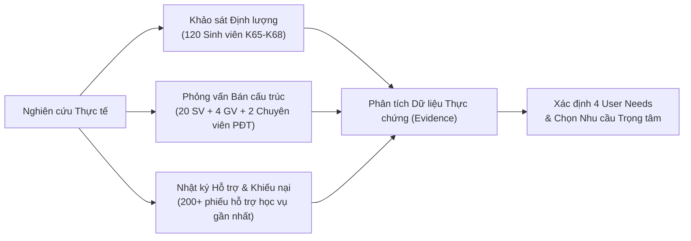
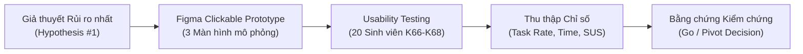
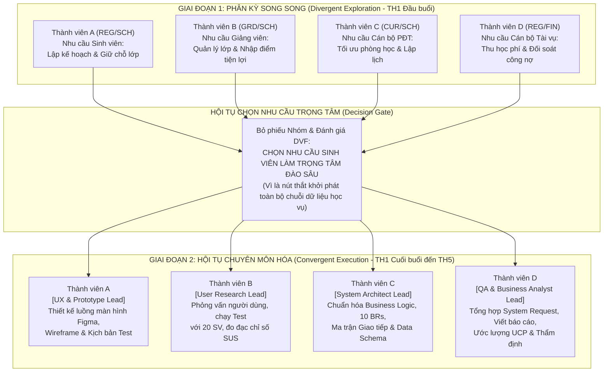

# BÁO CÁO KHÁM PHÁ VẤN ĐỀ & ĐỀ XUẤT DỰ ÁN
## (PROBLEM DISCOVERY REPORT & SYSTEM REQUEST)

> **Môn học:** Phân tích và Thiết kế Hệ thống (IT3120) – Viện CNTT&TT (SOICT), ĐHBK Hà Nội  
> **Đề tài:** Hệ thống Quản lý Đào tạo Đại học theo Học chế Tín chỉ (SIS - Student Information System)  
> **Giai đoạn:** Problem Discovery & Lean UX (Thực hành 1 – 5 / Lab B1 – B5)  
> **Mô hình làm việc nhóm:** Funnel Parallel Model (Phễu Song song 4 Thành viên)

---

## MỤC LỤC TỔNG QUAN

1. [PHẦN I: Problem Discovery Report (Báo cáo Khám phá Vấn đề - Slide 52, 55)](#phần-i-problem-discovery-report-báo-cáo-khám-phá-vấn-đề)
   - 1.1. Executive Summary (The Big Takeaway)
   - 1.2. Problem Statement (User-Centric Anchor)
   - 1.3. Background & Context (The Business "Why")
   - 1.4. Research Methodology & Inputs (Data Origins)
   - 1.5. Key Insights & User Friction Points
2. [PHẦN II: User Problem Statement Canvas & Business Problem (Slide 16-24)](#phần-ii-user-problem-statement-canvas--business-problem)
   - 2.1. User Problem Statement Canvas (6 ô chuẩn) cho Nhóm Sinh viên
   - 2.2. Business Problem & Chuỗi nhân quả liên kết (Causal Chain)
3. [PHẦN III: Lean UX Canvas & MVP Experiment Plan (Slide 26-44, 61-62)](#phần-iii-lean-ux-canvas--mvp-experiment-plan)
   - 3.1. Lean UX Canvas (8 ô chuẩn)
   - 3.2. MVP Experiment Plan chi tiết (Kiểm chứng giả thiết rủi ro nhất)
4. [PHẦN IV: System Request - Planning Phase (11 mục chuẩn Slide 47-51)](#phần-iv-system-request---planning-phase)
   - 4.1. Project Title & Project Sponsor
   - 4.2. Business Need & Problem Statement
   - 4.3. Project Vision & Goals
   - 4.4. Business Benefits (Kinh tế, Vận hành, Chiến lược)
   - 4.5. High-level Requirements (Chức năng & Phi chức năng FURPS+)
   - 4.6. Constraints & Assumptions
   - 4.7. Expected Deliverables
   - 4.8. Estimated Schedule / Timeline
   - 4.9. Feasibility Analysis & Risk Assessment
   - 4.10. Approval / Signature
5. [PHẦN V: Ma trận Phân công Thực hiện Nhóm (Parallel Work Allocation Matrix)](#phần-v-ma-trận-phân-công-thực-hiện-nhóm)
   - 5.1. Cấu trúc Phân công Song song (Funnel Parallel Model)
   - 5.2. Lộ trình Phối hợp qua 5 Buổi Thực hành (TH1 – TH5)

---

## PHẦN I: PROBLEM DISCOVERY REPORT (BÁO CÁO KHÁM PHÁ VẤN ĐỀ)

*(Tuân thủ mẫu báo cáo chuẩn theo Slide 52 & 55 của Slide bài tập môn học IT3120)*

### 1.1. Executive Summary (The Big Takeaway)
Đại học Bách khoa Hà Nội hiện đào tạo quy mô trên 35.000 sinh viên chính quy với hơn 100 chương trình đào tạo khác nhau. Việc vận hành theo **học chế tín chỉ** mang lại quyền tự chủ cao cho người học trong việc lựa chọn môn học, giảng viên và tiến độ ra trường. Tuy nhiên, tính chất cá nhân hóa cực cao này cũng đặt ra thách thức vận hành khổng lồ khi dữ liệu học vụ biến động liên tục qua từng học kỳ.

Kết quả nghiên cứu thực tế cho thấy: **Điểm nghẽn nghiêm trọng nhất của hệ thống quản lý đào tạo hiện tại không chỉ đơn thuần là sự cố quá tải hạ tầng công nghệ trong các đợt mở cổng đăng ký lớp, mà nằm ở sự phân tán dữ liệu và bất đối xứng thông tin giữa Sinh viên, Giảng viên, Phòng Đào tạo và Phòng Tài vụ.** 
- Sinh viên bị động, thiếu công cụ mô phỏng lộ trình dẫn đến việc chọn nhầm môn, trùng kíp học, vi phạm điều kiện tiên quyết và trễ hạn tốt nghiệp.
- Giảng viên bị ngắt quãng tiến độ giảng dạy do danh sách lớp thay đổi liên tục và áp lực nhập điểm thủ công.
- Nhà trường lãng phí tài nguyên phòng học và chịu áp lực giải quyết hàng nghìn đơn thư khiếu nại mỗi kỳ.

Do đó, nhóm đề xuất giải pháp tiếp cận theo tư duy **Lean Discovery**: Thay vì phân tán nguồn lực làm một hệ thống cồng kềnh ngay từ đầu, nhóm tập trung giải quyết bài toán cốt lõi có rủi ro cao nhất: **"Hỗ trợ sinh viên lập kế hoạch lộ trình, chọn lớp và giữ chỗ minh bạch, tự động kiểm tra quy chế học vụ trước khi bước vào đợt đăng ký chính thức"**, từ đó tạo nền tảng liên thông dữ liệu cho toàn bộ vòng đời đào tạo.

---

### 1.2. Problem Statement (User-Centric Anchor)

#### A. Công thức xây dựng chuẩn 5 thành tố
Dựa trên hướng dẫn của giảng viên tại Slide 13-14, công thức phát biểu vấn đề tập trung vào người dùng được chuẩn hóa như sau:
$$\text{Problem Statement} = \text{[Nhóm người dùng]} + \text{[Nhu cầu chung]} + \text{[Bối cảnh]} + \text{[Trở ngại gốc]} + \text{[Mục tiêu / Giá trị hướng tới]}$$

#### B. Phát biểu Vấn đề Tổng quát (General Problem Statement)
> *"Trong môi trường giáo dục đại học vận hành theo học chế tín chỉ (**Bối cảnh**), **sinh viên, giảng viên và cán bộ quản lý đào tạo** cần một phương thức quản lý và tra cứu thông tin học vụ xuyên suốt, thống nhất từ khâu lập kế hoạch học tập đến khi đánh giá kết quả (**Nhu cầu chung nhất**), bởi vì đặc thù cá nhân hóa lộ trình học của số lượng lớn sinh viên khiến thông tin về chương trình học, lịch biểu, điểm số và học phí dễ bị phân mảnh, gây khó khăn khi tự đối chiếu quy chế và làm quá tải công tác phối hợp thủ công (**Trở ngại**), nhằm đảm bảo kế hoạch học tập chính xác, minh bạch và nâng cao hiệu quả vận hành đào tạo (**Mục tiêu**)."*

#### C. Phát biểu Vấn đề Nhu cầu Trọng tâm (Priority Need - Góc nhìn Sinh viên)
> *"**Sinh viên đại học chính quy** cần chủ động lập kế hoạch lộ trình học tập, đăng ký lớp học phần cốt lõi và kiểm soát điều kiện tiên quyết một cách chính xác (**Nhu cầu cốt lõi**), trong các đợt mở đăng ký học tập cao điểm đầu mỗi học kỳ (**Bối cảnh**), bởi vì hệ thống hiện tại thường xuyên quá tải, không có tính năng mô phỏng kíp học hay kiểm tra tự động điều kiện môn tiên quyết theo thời gian thực khiến sinh viên bị động, dễ rơi vào tình trạng mất chỗ lớp hoặc chọn nhầm môn vi phạm quy chế (**Trở ngại**), nhằm tích lũy tín chỉ đúng tiến độ để tốt nghiệp đúng hạn (**Mục tiêu**)."*

---

### 1.3. Background & Context (The Business "Why")
Tại sao bài toán Quản lý Đào tạo Đại học theo Học chế Tín chỉ lại phức tạp và đòi hỏi phân tích thiết kế bài bản?
1. **Sự biến đổi từ Niên chế sang Tín chỉ:**
   - Trong mô hình niên chế truyền thống, sinh viên học theo lớp cố định suốt 4-5 năm với thời khóa biểu do nhà trường áp đặt sẵn. 
   - Trong mô hình tín chỉ, mỗi sinh viên là một "thực thể độc lập" tự quyết định lộ trình học, số tín chỉ đăng ký mỗi kỳ (dao động từ 8 đến 24 tín chỉ tùy theo mức cảnh báo học vụ), lựa chọn giảng viên và thời gian học phù hợp.
2. **Quy mô và áp lực vận hành thực tế tại ĐHBK Hà Nội:**
   - Quy mô: Hơn 35.000 sinh viên, gần 2.000 giảng viên, hàng nghìn lớp học phần mở mỗi kỳ với hàng chục giảng đường (D3, D5, D9, TC, B1...).
   - Đợt đăng ký lớp học phần diễn ra tập trung trong khoảng thời gian rất ngắn (3-5 ngày). Hàng chục nghìn lượt truy cập đồng thời gửi yêu cầu tranh chấp vào các lớp học phần có giới hạn sĩ số nghiêm ngặt.
3. **Cái giá phải trả nếu hệ thống hoạt động kém hiệu quả:**
   - **Đối với sinh viên:** Trễ hạn ra trường từ 1 đến 2 học kỳ chỉ vì thiếu 1 môn học tiên quyết (vốn chỉ mở vào kỳ chẵn hoặc kỳ lẻ); chi phí ăn ở, học phí phát sinh; tâm lý căng thẳng, ức chế.
   - **Đối với nhà trường:** Chi phí vận hành phòng máy chủ, trực hỗ trợ kỹ thuật tăng cao; tỷ lệ sinh viên tốt nghiệp đúng hạn giảm làm ảnh hưởng trực tiếp đến chỉ số kiểm định chất lượng đào tạo (AUN-QA, HCERES); phòng học bị bỏ trống hoặc bố trí không đồng đều dẫn đến lãng phí điện năng và cơ sở vật chất.

---

### 1.4. Research Methodology & Inputs (Data Origins)

Để đảm bảo tính khách quan và khoa học, nhóm đã áp dụng phương pháp nghiên cứu hỗn hợp (Mixed-method Research), kết hợp giữa định lượng và định tính:



1. **Khảo sát định lượng (Online Questionnaire):**
   - Thu thập 120 mẫu khảo sát hợp lệ từ sinh viên các khóa K65, K66, K67, K68 thuộc nhiều khối ngành (CNTT, Cơ khí, Điện tử, Kinh tế).
   - Nội dung khảo sát: Thói quen lập kế hoạch học tập, thời gian bỏ ra để xếp thời khóa biểu thử nghiệm trên giấy/Excel, mức độ căng thẳng trong ngày đăng ký lớp, và tỷ lệ gặp lỗi hệ thống.
2. **Phỏng vấn bán cấu trúc (Semi-structured Qualitative Interviews):**
   - **20 Sinh viên:** Gồm cả sinh viên có điểm CPA giỏi/xuất sắc (để hiểu cách họ tự quản lý) và sinh viên đang thuộc diện cảnh báo học vụ Mức 1, Mức 2 (để tìm hiểu nguyên nhân gốc rễ dẫn đến nợ môn, miss môn tiên quyết).
   - **04 Giảng viên cơ hữu:** Tìm hiểu quy trình tiếp nhận danh sách sinh viên lớp, quản lý điểm chuyên cần, điểm giữa kỳ, và những trở ngại khi nhập điểm lên phần mềm đào tạo.
   - **02 Chuyên viên Phòng Đào tạo:** Tìm hiểu áp lực điều phối lịch thi, giải quyết đơn xin mở thêm lớp, xử lý sinh viên xin rút môn và quy trình xét cảnh báo học vụ cuối kỳ.
3. **Phân tích nhật ký hỗ trợ (Support Ticket Analysis):**
   - Rà soát các chủ đề khiếu nại phổ biến nhất trên Cổng thông tin đào tạo và Diễn đàn sinh viên ĐHBK Hà Nội trong các kỳ 2024.1 và 2024.2.

---

### 1.5. Key Insights & User Friction Points

Tổng hợp từ dữ liệu nghiên cứu, nhóm rút ra 4 điểm nghẽn nghiêm trọng (Friction Points):

| Mã Điểm nghẽn | Nhóm Tác nhân | Hành vi & Nỗi đau Thực tế (Pain Points) | Dữ liệu Bằng chứng (Evidence) |
| :--- | :--- | :--- | :--- |
| **FP-01** | **Sinh viên** | **Khủng hoảng đăng ký lớp & Đứt gãy lộ trình học:** Sinh viên phải tự đối chiếu thủ công danh sách lớp và môn tiên quyết trên các tệp PDF dài hàng trăm trang. Trong ngày mở đăng ký, nhiều lớp hết chỗ chỉ sau 2 phút, dẫn tới việc chọn bừa lớp khác làm trùng lịch hoặc trễ môn tiên quyết. | **78.3%** sinh viên khảo sát từng bị trùng kíp học hoặc chọn nhầm môn không hợp lệ; **64%** phải dùng Excel tự xếp lịch trước đó cả tuần. |
| **FP-02** | **Giảng viên** | **Danh sách lớp biến động & Gánh nặng nhập điểm thủ công:** Trong 2 tuần đầu học kỳ, danh sách sinh viên thay đổi liên tục do sinh viên thêm/rút môn. Cuối kỳ, giảng viên phải nhập điểm thành phần trên phần mềm có giao diện lạc hậu, dễ nhầm dòng điểm sinh viên. | **100%** giảng viên được phỏng vấn cho biết phải duy trì sổ điểm Excel riêng và mất 3-5 giờ kiểm tra đối chiếu trước khi submit điểm chính thức. |
| **FP-03** | **Cán bộ PĐT** | **Lệch pha cung - cầu lớp học phần & Quá tải xử lý ngoại lệ:** Không dự báo trước được nhu cầu thực tế của sinh viên, dẫn tới hiện tượng lớp thì quá tải, lớp lại không đủ sĩ số tối thiểu phải hủy. Hàng nghìn sinh viên gửi đơn xin mở thêm lớp hoặc hủy môn thủ công. | Hơn **1.500 đơn thư hỗ trợ học vụ** được gửi về Phòng Đào tạo trong 10 ngày đầu học kỳ; tỷ lệ giải quyết kịp thời chỉ đạt khoảng **45%**. |
| **FP-04** | **Cán bộ Tài vụ** | **Sai lệch học phí do thay đổi đăng ký & Đối soát chậm:** Khi sinh viên điều chỉnh đăng ký, rút bớt học phần hoặc đăng ký bổ sung, việc tính toán lại học phí theo hệ số tín chỉ bị chậm trễ, dẫn đến khiếu nại công nợ học phí kéo dài. | **35%** thắc mắc gửi về Phòng Tài vụ liên quan đến việc cập nhật học phí sau khi điều chỉnh lớp và chế độ miễn giảm học phí. |

---

## PHẦN II: USER PROBLEM STATEMENT CANVAS & BUSINESS PROBLEM

*(Tuân thủ mẫu Canvas 6 ô và chuỗi nhân quả nghiệp vụ theo Slide 16-24 của bài giảng)*

### 2.1. User Problem Statement Canvas (6 ô chuẩn) cho Nhóm Sinh viên

Áp dụng mẫu Canvas tại Slide 17-19 cho đối tượng người dùng ưu tiên: **Sinh viên đại học chính quy ĐHBK Hà Nội**.

```
+----------------------------------------------------------------------------------------------------+
|                                  USER PROBLEM STATEMENT CANVAS                                      |
+--------------------------------------------------+-------------------------------------------------+
| 1. CUSTOMERS / USERS                             | 2. CONTEXT                                      |
| Sinh viên đại học chính quy (từ K65 đến K68)     | Diễn ra định kỳ trước và trong đợt mở đăng ký  |
| theo học chế tín chỉ tại ĐHBK Hà Nội.            | học phần mỗi học kỳ (kỳ chính & kỳ hè).         |
| Đặc biệt là sinh viên năm 2 - năm 4 khi lộ trình | Áp lực thời gian cao: Hệ thống mở theo khung    |
| phân hóa sâu vào các chuyên ngành hẹp.           | giờ cho từng khóa/viện, cạnh tranh suất học.   |
+--------------------------------------------------+-------------------------------------------------+
| 3. PROBLEM / ROOT CAUSE                          | 4. CURRENT ALTERNATIVES                         |
| Môn học phân tán, khó kiểm soát điều kiện tiên   | - Lập file Excel tự ghép kíp học thủ công.      |
| quyết; thiếu công cụ giả lập thời khóa biểu trực | - Tra cứu chéo giữa tệp PDF quy chế và tệp PDF  |
| quan trước giờ G; tình trạng hết chỗ tức thì     |   thời khóa biểu dự kiến dài hàng trăm trang.   |
| dẫn đến phản xạ chọn bừa, gây trùng lịch học.    | - Nhờ bạn bè đăng ký hộ hoặc "canh nhả lớp".    |
+--------------------------------------------------+-------------------------------------------------+
| 5. ALTERNATIVE SHORTCOMINGS                      | 6. IMPACT & DESIRED OUTCOME                     |
| - Tốn hàng chục giờ chuẩn bị nhưng vẫn bị vỡ kế  | - Tác động tiêu cực: Hoang mang, ức chế; nợ môn |
|   hoạch ngay khi 1 lớp mong muốn bị hết chỗ.     |   tiên quyết dẫn tới kéo dài thời gian tốt nghiệp|
| - Excel không thể tự kiểm tra ràng buộc logic hay| - Kết quả mong muốn: Giao diện trực quan, cho   |
|   sĩ số còn trống theo thời gian thực.           |   phép mô phỏng xếp lịch kéo-thả, tự động cảnh  |
| - Nguy cơ sai sót quy chế (đăng ký vượt trần TC).|   báo lỗi tiên quyết và giữ chỗ lớp minh bạch.  |
+--------------------------------------------------+-------------------------------------------------+
```

---

### 2.2. Business Problem & Chuỗi nhân quả liên kết (Causal Chain)

Như nội dung Slide 23-24 nhấn mạnh: *"User Problem là những trở ngại của người dùng, nhưng Business Problem là hậu quả trực tiếp mà tổ chức (Nhà trường) phải gánh chịu nếu không giải quyết các vấn đề đó."*

Dưới đây là sơ đồ chuỗi nhân quả kết nối từ nỗi đau của người dùng đến vấn đề kinh doanh/vận hành của Nhà trường:


---

## PHẦN III: LEAN UX CANVAS & MVP EXPERIMENT PLAN

*(Tuân thủ mẫu Lean UX Canvas 8 ô và kế hoạch thử nghiệm MVP theo Slide 37-44, 61-62 của bài giảng)*

### 3.1. Lean UX Canvas (8 ô chuẩn)

```
+----------------------------------------------------------------------------------------------------+
|                                           LEAN UX CANVAS                                           |
+--------------------------------------------------+-------------------------------------------------+
| 1. BUSINESS PROBLEM                              | 2. BUSINESS OUTCOMES                            |
| Nhà trường đang tiêu tốn nhiều nhân lực và chi   | - Giảm 70% số lượng đơn thư khiếu nại và xin   |
| phí để xử lý khủng hoảng học vụ mỗi đầu kỳ;      |   điều chỉnh lớp học phần đầu mỗi học kỳ.       |
| tỷ lệ hủy lớp do không đủ sĩ số cao; tỷ lệ sinh  | - Giảm tỷ lệ hủy lớp học phần do lệch sĩ số     |
| viên tốt nghiệp đúng hạn bị kéo giảm do vướng    |   từ 12% xuống dưới 3%.                         |
| mắc đăng ký môn tiên quyết.                      | - Tăng tỷ lệ tốt nghiệp đúng hạn thêm 5-8%.     |
+--------------------------------------------------+-------------------------------------------------+
| 3. USERS                                         | 4. USER OUTCOMES & BENEFITS                     |
| - Sinh viên đại học chính quy (User ưu tiên số 1)| - Sinh viên hoàn thành việc chọn thời khóa biểu |
| - Cán bộ quản lý Phòng Đào tạo                   |   hợp lệ chỉ trong dưới 5 phút.                 |
| - Giảng viên phụ trách giảng dạy                 | - 0% sự cố đăng ký nhầm môn vi phạm tiên quyết. |
|                                                  | - Giảm tối đa căng thẳng tâm lý mùa đăng ký.    |
+--------------------------------------------------+-------------------------------------------------+
| 5. SOLUTIONS                                     | 6. HYPOTHESES (GIẢ THUYẾT)                      |
| (1) Tính năng "Mô phỏng Lộ trình & Giữ chỗ trước | Chúng tôi tin rằng:                             |
|     (Pre-registration Simulator)" kéo-thả trực   | NẾU chúng tôi cung cấp cho Sinh viên tính năng  |
|     quan kèm kiểm tra ràng buộc tiên quyết.     | "Mô phỏng Lộ trình & Đăng ký thử nghiệm" kèm    |
| (2) Công cụ dự báo nhu cầu mở lớp dựa trên số    | thuật toán tự động rà soát điều kiện tiên quyết |
|     lượng sinh viên đã lưu thời khóa biểu dự kiến| và xung đột lịch,                               |
| (3) Bảng điều khiển cảnh báo học vụ tự động theo | THÌ tỷ lệ sinh viên chọn nhầm môn và vỡ kế      |
|     thời gian thực khi giảng viên nhập điểm.     | hoạch học tập sẽ giảm ít nhất 80%,              |
|                                                  | VÀ Nhà trường sẽ giảm được 60% đơn thư cứu xét. |
+--------------------------------------------------+-------------------------------------------------+
| 7. WHAT’S THE MOST IMPORTANT THING WE NEED TO    | 8. WHAT’S THE LEAST AMOUNT OF WORK TO LEARN IT? |
|    LEARN FIRST? (GIẢ THUYẾT RỦI RO NHẤT)         |    (MVP EXPERIMENT PLAN)                        |
| Sinh viên có thực sự chủ động lên kế hoạch và    | Xây dựng Clickable Prototype tương tác trên     |
| sử dụng công cụ mô phỏng xếp lịch trước đợt mở   | Figma gồm 3 màn hình cốt lõi. Tiến hành thử     |
| cổng hay không? Giao diện kéo-thả có thực sự     | nghiệm Usability Testing trên 20 sinh viên để   |
| giúp họ tránh được lỗi trùng kíp học không?      | đo lường Task Completion Rate và chỉ số SUS.    |
+--------------------------------------------------+-------------------------------------------------+
```

---

### 3.2. MVP Experiment Plan chi tiết (Slide 44, 61-62)

Theo nguyên tắc của Lean UX, nhóm lựa chọn **01 giả thuyết có mức độ rủi ro cao nhất (Highest-Risk Hypothesis)** ở Ô 7 để tiến hành thiết kế thử nghiệm MVP (Minimum Viable Product Experiment) với mức chi phí thấp nhất nhưng mang lại bằng chứng thực chứng rõ ràng nhất.



#### A. Mục tiêu Thử nghiệm (Experiment Goal)
Kiểm chứng xem sinh viên có thể tự xây dựng một thời khóa biểu hoàn chỉnh gồm 5-6 học phần, không bị trùng lịch và không vi phạm môn tiên quyết trên giao diện tương tác mới trong thời gian dưới 5 phút hay không.

#### B. Phạm vi & Công cụ MVP (Scope & Tooling)
- **Công cụ:** Prototype tương tác mức độ chân thực cao (High-fidelity Clickable Prototype) thiết kế bằng **Figma**, chưa cần lập trình backend hay kết nối CSDL thực tế.
- **Bộ 3 màn hình MVP:**
  1. *Screen 1 (Lộ trình & Cây tiên quyết - Prerequisite Tree View):* Trực quan hóa tiến độ các môn đã qua, môn đang học và các môn đủ điều kiện đăng ký trong kỳ tới.
  2. *Screen 2 (Không gian Kéo-thả Lịch học - Drag & Drop Timetable Simulator):* Cho phép sinh viên kéo các lớp học phần vào bảng tuần kíp học; hệ thống hiển thị màu đỏ báo hiệu ngay lập tức nếu trùng kíp: $(Start_A < End_B) \land (End_A > Start_B)$.
  3. *Screen 3 (Xem trước & Xác nhận - 1-Click Confirmation & Tuition Preview):* Tổng hợp danh sách học phần đã chọn, tự động tính tổng số tín chỉ, kiểm tra trần tín chỉ theo cảnh báo học vụ và ước tính học phí tạm tính.

#### C. Đối tượng tham gia thử nghiệm (Participants)
- Quy mô mẫu: **20 sinh viên** ĐHBK Hà Nội.
- Tiêu chí lựa chọn:
  - 10 sinh viên K68 (mới làm quen với đăng ký tín chỉ, dễ gặp bỡ ngỡ nhất).
  - 06 sinh viên K66-K67 khối kỹ thuật (lộ trình đồ án, thí nghiệm phức tạp).
  - 04 sinh viên đang ở mức Cảnh báo học vụ 1 hoặc 2 (cần kiểm tra quy chế hạn chế số tín chỉ tối đa).

#### D. Kịch bản Thử nghiệm (Test Scenario)
Người tham gia được giao một tình huống cụ thể: 
> *"Bạn là sinh viên năm 3 ngành CNTT, kỳ này cần đăng ký tối thiểu 16 tín chỉ gồm: Giải thuật nâng cao (3TC, yêu cầu đã qua Cấu trúc dữ liệu), Mạng máy tính (3TC), Cơ sở dữ liệu (3TC), Triết học Mác-Lênin (3TC), và Thực hành Cơ sở dữ liệu (1TC, yêu cầu học song hành cùng CSDL). Hãy sử dụng giao diện để hoàn thành đăng ký thời khóa biểu hợp lệ."*

#### E. Tiêu chí Đánh giá & Chỉ số Thành công (Success Metrics / KPIs)
Thử nghiệm được coi là thành công và xác nhận giả thuyết nếu đạt các ngưỡng định lượng sau:

| Chỉ số (Metric) | Định nghĩa & Cách đo | Ngưỡng Thành công (Target KPI) | Kết quả Hệ thống cũ (Baseline) |
| :--- | :--- | :--- | :--- |
| **Task Completion Rate** | Tỷ lệ người tham gia hoàn thành kịch bản mà không cần người hướng dẫn trợ giúp | $\ge \mathbf{85\%}$ (17/20 sinh viên) | $\approx 50\%$ |
| **Average Time-on-Task** | Thời gian trung bình để hoàn tất việc chọn môn và chốt lịch hợp lệ | $\le \mathbf{4.0\text{ phút}}$ | $\approx 15.0\text{ phút}$ (trên Excel/PDF) |
| **Error Rate** | Số lỗi vi phạm môn tiên quyết hoặc trùng lịch học được ghi nhận | $\le \mathbf{5\%}$ tổng số lượt thao tác | $\approx 35\%$ |
| **SUS Score** | Điểm số đánh giá mức độ khả dụng hệ thống (System Usability Scale) | $\ge \mathbf{75/100}$ (Mức Tốt - Good) | $\approx 48/100$ |

---

## PHẦN IV: SYSTEM REQUEST - PLANNING PHASE

*(Tuân thủ đầy đủ 11 mục chuẩn theo Slide 47-51 của bài giảng môn học IT3120)*

```
====================================================================================================
                                      SYSTEM REQUEST DOCUMENT
                            Giai đoạn: Lập kế hoạch dự án (Planning Phase)
====================================================================================================
```

### 4.1. Project Title & Project Sponsor (Mục 1 & 2)
* **1. Project Title (Tên dự án):** Hệ thống Quản lý Đào tạo Đại học theo Học chế Tín chỉ (HUST-SIS NextGen: Student Information System)
* **2. Project Sponsor / Requestor (Đơn vị bảo trợ & Yêu cầu):**
  - Đơn vị đề xuất: Ban Đào tạo & Phòng Công tác Sinh viên, Trường Đại học Bách khoa Hà Nội.
  - Người bảo trợ chính (Executive Sponsor): Phó Giám đốc phụ trách Đào tạo & Chuyển đổi số.
  - Trưởng dự án nghiệp vụ (Business Project Lead): Trưởng Ban Đào tạo.

---

### 4.2. Business Need / Problem Statement (Mục 3)
Hệ thống quản lý đào tạo hiện tại của Nhà trường được xây dựng trên nền tảng kiến trúc cũ, dẫn đến các bất cập nghiêm trọng:
1. **Nghẽn tải mùa cao điểm:** Thường xuyên xảy ra tình trạng chậm phản hồi hoặc gián đoạn dịch vụ khi mở cổng đăng ký tín chỉ tập trung cho hàng chục nghìn sinh viên.
2. **Dữ liệu phân mảnh:** Chưa có sự đồng bộ thời gian thực giữa Kế hoạch mở lớp (Phòng Đào tạo), Trạng thái đăng ký (Sinh viên), Tiến độ nhập điểm (Giảng viên) và Thu nộp học phí (Phòng Tài vụ).
3. **Thiếu hỗ trợ thông minh:** Sinh viên thiếu công cụ lập kế hoạch học tập trực quan; cán bộ đào tạo phải xử lý thủ công hàng nghìn đơn thư ngoại lệ (mở thêm lớp, rút môn, tính lại học phí).

Hệ thống mới **HUST-SIS NextGen** được yêu cầu xây dựng nhằm chuẩn hóa, tự động hóa và liên thông toàn diện toàn bộ vòng đời học vụ của sinh viên từ khi nhập học đến khi xét tốt nghiệp.

---

### 4.3. Project Vision / Goals (Mục 4)
* **Mục tiêu 1:** Cung cấp cổng thông tin tự phục vụ (Self-service Portal) hiện đại, trực quan, cho phép sinh viên tự mô phỏng lộ trình, đăng ký học phần nhanh chóng và không xảy ra sai sót quy chế.
* **Mục tiêu 2:** Tự động hóa 100% các quy tắc kiểm tra điều kiện học vụ (tiên quyết, trùng kíp, trần tín chỉ theo mức cảnh báo học vụ, tính học phí).
* **Mục tiêu 3:** Cung cấp công cụ quản trị tập trung cho Giảng viên và Cán bộ Đào tạo, hỗ trợ nhập điểm an toàn, quản lý phân công giảng dạy và phân bổ tài nguyên phòng học tối ưu.

---

### 4.4. Business Benefits (Mục 5)

#### A. Lợi ích Vận hành (Operational Benefits - Định lượng)
- **Giảm 75% thời gian xử lý đơn từ học vụ:** Tự động hóa quy trình xét duyệt đăng ký ngoại lệ và rút học phần, rút ngắn thời gian xử lý từ 5 ngày xuống dưới 24 giờ.
- **Rút ngắn thời gian công bố kết quả học tập:** Tự động tổng hợp điểm tổng kết học phần và tính toán GPA/CPA ngay khi giảng viên hoàn tất nhập điểm, rút ngắn thời gian từ 2 tuần xuống còn 1 ngày làm việc.
- **Độ sẵn sàng hệ thống mùa cao điểm:** Đảm bảo hệ thống vận hành ổn định với độ trễ phản hồi $\le 1.0\text{ giây}$ tại mức tải đỉnh 10.000 người dùng đồng thời.

#### B. Lợi ích Kinh tế (Financial / Tangible Benefits)
- **Tiết kiệm chi phí hành chính giấy tờ:** Giảm 90% việc in ấn biểu mẫu đăng ký, sổ tay học vụ và bảng điểm giấy, ước tính tiết kiệm khoảng 250 triệu VNĐ mỗi năm học.
- **Tối ưu hóa công suất phòng học:** Nhờ dữ liệu dự báo nhu cầu mở lớp chính xác, giảm tỷ lệ các lớp học phần dưới 15 sinh viên từ 12% xuống dưới 3%, tiết kiệm chi phí điện năng và vận hành giảng đường ước tính 400 triệu VNĐ/năm.

#### C. Lợi ích Chiến lược (Strategic / Intangible Benefits)
- Nâng cao chỉ số hài lòng của sinh viên và giảng viên đối với dịch vụ hành chính của nhà trường.
- Tăng tỷ lệ sinh viên tốt nghiệp đúng hạn thêm 5-8% trong vòng 3 năm đầu áp dụng nhờ kiểm soát tốt lộ trình học phần tiên quyết.
- Đáp ứng đầy đủ các tiêu chuẩn kiểm định giáo dục đại học quốc tế (AUN-QA, HCERES).

---

### 4.5. High-level Requirements (Mục 6)

#### A. Yêu cầu Chức năng Nghiệp vụ Cốt lõi (Core Functional Scope)
Hệ thống được thiết kế bao quát 4 phân hệ chính:
1. **Phân hệ Chương trình & Kế hoạch Đào tạo (CUR):**
   - Quản lý khung chương trình đào tạo theo ngành, chuyên ngành và khóa sinh viên.
   - Quản lý danh mục học phần và thiết lập cây ràng buộc điều kiện môn học tiên quyết.
2. **Phân hệ Lập lịch & Quản lý Lớp học phần (SCH):**
   - Lập kế hoạch mở lớp học phần theo học kỳ, phân bổ phòng học, giảng viên và kíp học.
   - Chống trùng lịch phòng học và chống trùng lịch giảng viên theo thuật toán kiểm tra giao đoạn thời gian.
3. **Phân hệ Đăng ký Học phần & Học phí (REG):**
   - Cung cấp tính năng mô phỏng và đăng ký học phần trực tuyến theo đợt.
   - Tự động kiểm tra trần tín chỉ theo mức cảnh báo học vụ và kiểm tra điều kiện tiên quyết.
   - Tự động tính toán học phí theo công thức chuẩn tín chỉ, quản lý miễn giảm và đối soát thanh toán trực tuyến.
4. **Phân hệ Quản lý Điểm & Cảnh báo Học vụ (GRD):**
   - Phân quyền cho giảng viên phụ trách nhập điểm thành phần và điểm thi.
   - Tự động tính điểm tổng kết học phần, quy đổi điểm chữ, điểm số thang 4.0, tính GPA kỳ và CPA tích lũy.
   - Tự động rà soát và gán mức Cảnh báo học vụ (Mức 0, 1, 2, 3) cuối mỗi kỳ.

#### B. Yêu cầu Phi chức năng (Non-Functional Requirements - FURPS+)
- **Performance (Hiệu năng):** Thời gian phản hồi cho các thao tác đăng ký lớp $\le 1.5\text{s}$; thời gian tra cứu thông tin $\le 500\text{ms}$.
- **Scalability (Khả năng mở rộng):** Hỗ trợ tối thiểu 10.000 concurrent sessions trong các khung giờ cao điểm đăng ký tín chỉ mà không bị sập dịch vụ.
- **Security (Bảo mật):** Phân quyền truy cập dựa trên vai trò (RBAC); mã hóa dữ liệu nhạy cảm (điểm số, mật khẩu, thông tin thanh toán); ghi log toàn bộ thao tác sửa đổi điểm số phục vụ thanh tra đào tạo.
- **Usability (Khả năng sử dụng):** Giao diện tương thích chuẩn Web Responsive (Mobile, Tablet, Desktop); điểm đánh giá khả dụng SUS $\ge 75/100$.

---

### 4.6. Constraints & Assumptions (Mục 7)

#### A. Ràng buộc Dự án (Constraints)
- **Ràng buộc Pháp lý & Quy chế:** Bắt buộc tuân thủ 100% Quy chế Đào tạo đại học hiện hành của Bộ GD&ĐT và Quy định học vụ nội bộ của Đại học Bách khoa Hà Nội.
- **Ràng buộc Thời gian:** Toàn bộ công tác phân tích, thiết kế hệ thống, mô hình hóa UML và đặc tả kỹ thuật phải hoàn thành trong 15 tuần học kỳ của học phần IT3120.
- **Ràng buộc Ngân sách Dự án:** Phạm vi bài tập lớn phục vụ đồ án môn học Phân tích và Thiết kế Hệ thống; không phát sinh chi phí mua sắm bản quyền phần mềm thương mại (sử dụng các công cụ mã nguồn mở: PostgreSQL, PlantUML, VS Code, Figma Free Tier).

#### B. Giả định Nghiệp vụ (Assumptions)
- Sinh viên và Giảng viên đều có thiết bị cá nhân (Laptop/Smartphone) kết nối Internet để thao tác trực tuyến.
- Cơ sở dữ liệu danh mục môn học, danh sách giảng viên và sơ đồ phòng học của nhà trường đã được chuẩn hóa và có thể nhập liệu ban đầu (Data Seeding).
- Nhà trường đã có hệ thống Cổng thanh toán trực tuyến (Bank Gateway/VNPay/ViettelMoney) sẵn sàng tích hợp qua API.

---

### 4.7. Expected Deliverables (Mục 8)

Các sản phẩm chuyển giao chính thức của dự án phân tích thiết kế bao gồm:
1. **Bộ Hồ sơ Yêu cầu Nghiệp vụ:** Báo cáo Khám phá Vấn đề (Problem Discovery Report), Hệ thống 10 Quy tắc nghiệp vụ (`BR-01` .. `BR-10`), Bản đặc tả Use Case chi tiết.
2. **Bộ Bản vẽ Mô hình Hóa Hệ thống (UML 2.x):**
   - Biểu đồ Hoạt động phân làn (Activity Diagram with Swimlanes) cho các quy trình nghiệp vụ phức tạp.
   - Biểu đồ Trình tự BCE (Boundary - Control - Entity Sequence Diagrams) cho các ca sử dụng trọng tâm.
   - Biểu đồ Lớp Miền (Domain Model) và Biểu đồ Lớp Thiết kế Chi tiết (Detailed Class Diagram).
3. **Bộ Bản vẽ Thiết kế Dữ liệu:**
   - Sơ đồ Thực thể Liên kết (ERD) và Từ điển Dữ liệu (Data Dictionary).
   - Mã nguồn DDL chuẩn PostgreSQL (3NF) có đầy đủ chỉ mục (Indexes) và ràng buộc toàn vẹn (Foreign Keys, Check Constraints).
4. **Bản Ước lượng Chi phí Phần mềm:** Bảng tính định lượng nỗ lực và thời gian phát triển theo phương pháp Điểm Ca sử dụng (Use Case Points - UCP).
5. **Bộ Mẫu Giao diện Tương tác (Figma Clickable Prototype):** Mô phỏng luồng thao tác của người dùng cho các ca sử dụng ưu tiên.

---

### 4.8. Estimated Schedule / Timeline (Mục 9)

Tiến độ dự án được chia thành 5 giai đoạn chính tương ứng với lộ trình bài tập lớn IT3120:

| Giai đoạn (Milestone) | Nội dung Công việc Chính | Thời lượng | Sản phẩm Đầu ra |
| :--- | :--- | :--- | :--- |
| **Giai đoạn 1 (Tuần 1 - 3)** | Khám phá Vấn đề, Xác định Nhu cầu & System Request | 3 tuần | Problem Statement, Lean UX Canvas, System Request |
| **Giai đoạn 2 (Tuần 4 - 6)** | Khảo sát Nghiệp vụ, Xác định 10 BRs & Mô hình hóa Use Case | 3 tuần | Use Case Diagram, Activity Diagrams, Use Case Specs |
| **Giai đoạn 3 (Tuần 7 - 9)** | Phân tích Động (Dynamic Analysis) theo chuẩn mẫu BCE | 3 tuần | Sequence Diagrams (BCE), State Machine Diagrams |
| **Giai đoạn 4 (Tuần 10 - 12)**| Thiết kế Tĩnh (Static Architecture) & Cơ sở Dữ liệu 3NF | 3 tuần | Class Diagram, Database Schema (PostgreSQL DDL) |
| **Giai đoạn 5 (Tuần 13 - 15)**| Ước lượng Chi phí UCP, Hoàn thiện Báo cáo & Bảo vệ | 3 tuần | Bảng tính UCP, Báo cáo Tổng kết, Slide Bảo vệ |

---

### 4.9. Feasibility Analysis & Risk Assessment (Mục 10)

Đánh giá tính khả thi theo mô hình đa diện:

```
+----------------------------------------------------------------------------------------------------+
|                                    ĐÁNH GIÁ TÍNH KHẢ THI DỰ ÁN                                     |
+--------------------------+-------------------------------------------------------------------------+
| Khía cạnh Khả thi        | Đánh giá & Căn cứ Thực tế                                               |
+--------------------------+-------------------------------------------------------------------------+
| 1. Tính Khả thi Kỹ thuật | CAO: Nhóm nắm vững phương pháp luận OOAD, UML 2.x và hệ quản trị      |
|    (Technical)           | CSDL quan hệ PostgreSQL. Kiến trúc phân lớp và mẫu BCE giúp hệ thống   |
|                          | có tính module hóa cao, dễ bảo trì và mở rộng.                          |
+--------------------------+-------------------------------------------------------------------------+
| 2. Tính Khả thi Kinh tế  | CAO: Dự án mang lại ROI vận hành rõ rệt (giảm 75% chi phí xử lý thủ     |
|    (Economic)            | công, giảm hủy lớp). Chi phí phân tích thiết kế nằm trong khuôn khổ     |
|                          | môn học, không đòi hỏi chi phí đầu tư phần cứng đắt đỏ ở pha này.      |
+--------------------------+-------------------------------------------------------------------------+
| 3. Tính Khả thi Vận hành | KHẢ THI: Mô hình học chế tín chỉ đã vận hành nhiều năm tại ĐHBK Hà Nội. |
|    (Operational)         | Sinh viên và giảng viên đều có nhu cầu cấp thiết về một công cụ số hóa  |
|                          | minh bạch, do đó mức độ sẵn sàng đón nhận và thích ứng hệ thống rất cao.|
+--------------------------+-------------------------------------------------------------------------+
```

#### Ma trận Nhận diện & Giảm thiểu Rủi ro (Risk Management Matrix)

| Mã Rủi ro | Mô tả Rủi ro Tiềm ẩn | Mức độ | Biện pháp Phòng ngừa & Giảm thiểu (Mitigation Strategy) |
| :--- | :--- | :---: | :--- |
| **RSK-01** | **Quy tắc nghiệp vụ thay đổi hoặc hiểu sai quy chế:** Sinh viên hiểu sai công thức tính điểm hoặc cách thức xét cảnh báo học vụ. | Cao | Trích xuất và bám sát trực tiếp Văn bản Quy chế Đào tạo ĐHBK Hà Nội; tham vấn trực tiếp giảng viên hướng dẫn môn học IT3120 để chốt cứng 10 BRs ngay từ đầu. |
| **RSK-02** | **Xung đột giao diện tích hợp giữa các phân hệ:** Dữ liệu giữa Module Lập lịch (SCH) và Đăng ký (REG) không đồng nhất về định dạng dữ liệu. | Trung bình | Thiết lập ma trận giao tiếp liên module ([`docs/interfaces-matrix.md`](./docs/interfaces-matrix.md)) với 6 chữ ký hàm chuẩn hóa; áp dụng nguyên tắc Thực thể duy nhất làm chủ (Single Entity Ownership). |
| **RSK-03** | **Quá tải tiến độ làm việc nhóm:** Các thành viên làm việc rời rạc, không đồng bộ được tiến độ dẫn đến chậm nộp bài tập lớn. | Trung bình | Áp dụng mô hình Phễu Song song (Funnel Parallel Model); phân công rõ trách nhiệm theo vai trò; duy trì họp kiểm điểm tiến độ và review chéo định kỳ hàng tuần. |

---

### 4.10. Approval / Signature (Mục 11)

```
====================================================================================================
                                      XÁC NHẬN VÀ PHÊ DUYỆT
====================================================================================================

ĐẠI DIỆN ĐƠN VỊ TÀI TRỢ DỰ ÁN                    TRƯỞNG NHÓM PHÂN TÍCH THIẾT KẾ
(Project Sponsor Representative)                 (Lead System Analyst)


_________________________________________        _________________________________________
Ban Đào tạo Đại học Bách khoa Hà Nội             Nhóm Sinh viên IT3120 - SOICT
Ngày phê duyệt: 22/10/2026                       Ngày trình nộp: 22/10/2026
```

---

## PHẦN V: MA TRẬN PHÂN CÔNG THỰC HIỆN NHÓM

### 5.1. Cấu trúc Phân công Song song (Funnel Parallel Model)

Để giải quyết mâu thuẫn giữa:
1. **Yêu cầu làm việc nhóm:** Cần sự tham gia song song, độc lập của cả 4 thành viên nhằm tối đa hóa năng suất và đánh giá đóng góp công bằng.
2. **Yêu cầu đề bài môn học:** Giảng viên chỉ yêu cầu chọn **01 nhu cầu ưu tiên nhất** để làm sâu Canvas, Giả thuyết và Thử nghiệm MVP (tránh làm dàn trải 4 bộ thử nghiệm rời rạc gây loãng đề tài).

Nhóm thống nhất áp dụng **Mô hình Phễu Song song (Funnel Parallel Model)**:



---

### 5.2. Lộ trình Phối hợp qua 5 Buổi Thực hành (TH1 – TH5)

| Buổi Thực hành | Trọng tâm Nghiệp vụ | Phân công Thành viên A | Phân công Thành viên B | Phân công Thành viên C | Phân công Thành viên D |
| :--- | :--- | :--- | :--- | :--- | :--- |
| **TH1: Problem Discovery** | Khám phá vấn đề, User Needs, Lean UX, System Request | Khảo sát User Need Sinh viên; Dựng Wireframe 3 màn hình MVP trên Figma | Khảo sát User Need Giảng viên; Xây dựng kịch bản Usability Test cho 20 SV | Khảo sát User Need PĐT; Khảo sát bối cảnh đào tạo tín chỉ, viết Background | Khảo sát User Need Tài vụ; Tổng hợp System Request 11 mục & Ma trận nhóm |
| **TH2: Use Case Modeling** | Khảo sát nghiệp vụ, Xác định Actor, Use Case Diagram | Đặc tả Use Case Đăng ký học phần (`UC-REG-01`) & Rút môn | Đặc tả Use Case Nhập điểm (`UC-GRD-01`) & Quản lý lớp giảng dạy | Đặc tả Use Case Lập lịch mở lớp (`UC-SCH-01`) & Quản lý môn học | Đặc tả Use Case Thu học phí (`UC-REG-02`) & Xét cảnh báo học vụ |
| **TH3: Dynamic Behavior** | Biểu đồ Trình tự BCE & Biểu đồ Hoạt động | Vẽ BCE Sequence Diagram: Luồng Đăng ký học phần (Kiểm tra kíp, trần TC) | Vẽ BCE Sequence Diagram: Luồng Nhập điểm & Phúc khảo điểm | Vẽ BCE Sequence Diagram: Luồng Mở lớp & Xếp phòng học | Vẽ BCE Sequence Diagram: Luồng Tính học phí & Xét cảnh báo tự động |
| **TH4: Static Architecture** | Biểu đồ Lớp Thiết kế & CSDL PostgreSQL 3NF | Thiết kế các Lớp thuộc Module REG; Kiểm tra ánh xạ DDL bảng đăng ký | Thiết kế các Lớp thuộc Module GRD; Kiểm tra ánh xạ DDL bảng điểm | Thiết kế các Lớp thuộc Module SCH & CUR; DDL bảng phòng, lịch học | Tổng hợp Domain Model toàn hệ thống; Tinh chỉnh chuẩn 3NF và Indexes |
| **TH5: Cost Estimation** | Ước lượng chi phí phần mềm theo phương pháp UCP | Tính toán UAW (Unadjusted Actor Weight) cho toàn bộ 8 tác nhân | Phân loại độ phức tạp và tính UUCW cho 15+ Use Cases | Đánh giá 13 Hệ số Kỹ thuật (TCF) theo đặc thù hệ thống trường học | Đánh giá 8 Hệ số Môi trường (ECF), tính UCP tổng và nỗ lực (Person-Hours) |

---

> **Quy tắc Kiểm soát Chất lượng Nhóm (Peer Review Policy):**  
> Mọi tài liệu đặc tả, bản vẽ biểu đồ PlantUML hoặc kịch bản giao diện do một thành viên phụ trách chính đều bắt buộc phải được ít nhất một thành viên khác thẩm định và xác nhận trước khi tích hợp vào báo cáo tổng thể của nhóm. Mọi xung đột logic nghiệp vụ phải được quy chiếu về 10 Quy tắc nghiệp vụ cốt lõi tại [`docs/business-rules.md`](./docs/business-rules.md).
