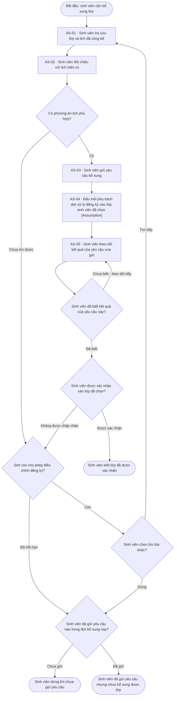
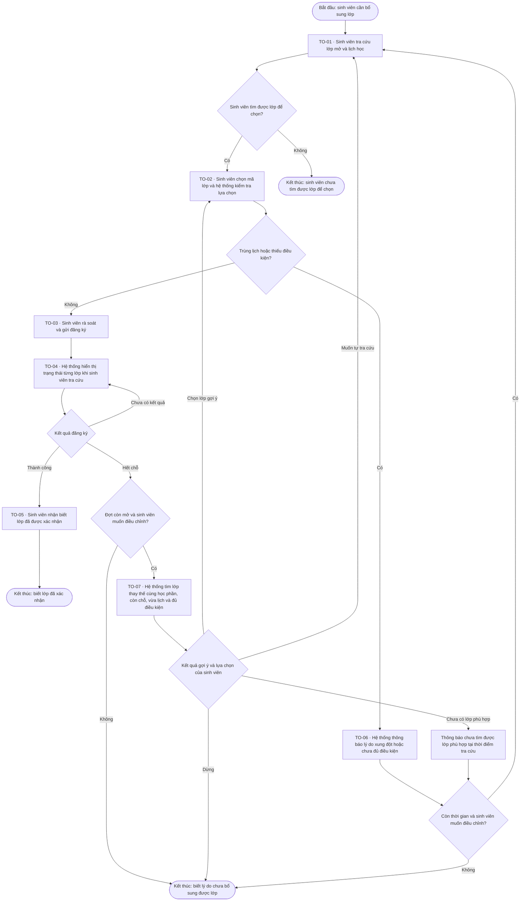

# Lab 02 — Thực hành 1: Mô hình hóa nghiệp vụ đăng ký bổ sung

**Trạng thái** Bản phân tích sơ bộ. Tham chiếu mã nguồn E01–E07 và giả định A1–A4 trong Lab 01. [Hướng dẫn Thực hành 1](../docs/Lab02_OOAD.md#nhiệm-vụ-thực-hành-1-business-modeling) · [Báo cáo Lab 01](../lab-01/OOAD_BaoCaoVanDe.md)

## 1. Phạm vi và mục tiêu nghiệp vụ

| Nội dung | Xác định cho ca nghiên cứu |
| --- | --- |
| Đối tượng chính | Sinh viên chính quy K52 đủ điều kiện đăng ký bổ sung tại HUST trong đợt điều chỉnh, giai đoạn 2007–2008. |
| Điểm bắt đầu | Sinh viên có lịch sẵn và bắt đầu tra cứu lớp để bổ sung. |
| Điểm kết thúc | Sinh viên biết lớp đã được xác nhận hoặc dừng khi chưa bổ sung được lớp. Nếu đã gửi yêu cầu, sinh viên theo dõi kết quả. Việc biết lý do cụ thể phụ thuộc vào thông tin được cung cấp. |
| Điều kiện đầu vào | Sinh viên đã có quyền tham gia đợt điều chỉnh, bao gồm tình trạng nghĩa vụ học phí theo quy định áp dụng. Điều kiện tiên quyết và giới hạn tín chỉ là quy tắc đầu vào để kiểm tra lựa chọn cụ thể ở TO-02. |
| Bên liên quan | Sinh viên là người thực hiện đăng ký. Phòng Đào tạo là đầu mối kiểm chứng nghiệp vụ. Vai trò tiếp nhận và xử lý từng bước trong đợt lịch sử cần xác minh. |
| Ngoài phạm vi | Đợt đăng ký chính, xử lý công nợ, tổ chức mở thêm lớp và bàn giao danh sách sau khi đợt kết thúc. |

**JTBD (Jobs-to-be-Done)** mô tả việc sinh viên muốn hoàn thành. Khi cần học bổ sung trong đợt điều chỉnh, tôi muốn ghép lớp vào lịch hiện có mà không trùng giờ và được xác nhận vào lớp còn chỗ để biết mình có thể theo học. Hai điều kiện tạo thành một nhu cầu **UN-03**.

**Business Problem (vấn đề nghiệp vụ)** [Assumption] Khi sinh viên biết lớp hết chỗ sau khi đã ghép lịch, họ có thể mất thời gian chọn lại và cán bộ có thể phải rà soát yêu cầu thêm lần nữa. Tần suất, phút xử lý lại và ảnh hưởng đến mốc chốt danh sách **chưa đo được**. [Business Problem và cách kiểm chứng ở Lab 01](../lab-01/OOAD_BaoCaoVanDe.md#6-business-problem)

## 2. AS-IS — Mô hình hiện trạng lịch sử sơ bộ

| Bước | Căn cứ và điểm cần xác minh |
| --- | --- |
| AS-01 | [Evidence] E01 quy định về kế hoạch giảng dạy và công bố thời khóa biểu. [Assumption] Cách sinh viên tra cứu và nguồn họ thực sự sử dụng ở từng đợt. |
| AS-02 | [Assumption] Sinh viên đối chiếu lớp dự kiến với lịch hiện có trước khi gửi yêu cầu. Công cụ và cách thực hiện cần xác minh. |
| AS-03 | [Evidence] E02 quy định quyền đăng ký bổ sung nếu điều kiện cho phép. [Assumption] Kênh gửi, trình tự tiếp nhận và khả năng gửi lại ở từng đợt. |
| AS-04 | [Evidence] Điều 12 khoản 2 giao giáo viên chủ nhiệm lớp cố vấn và duyệt kế hoạch học tập trước khi sinh viên đăng ký lớp. Khoản 4 quy định việc bổ sung hoặc bỏ bớt học phần trong đợt điều chỉnh phụ thuộc vào điều kiện tổ chức lớp và giới hạn khối lượng học tập. [Assumption] AS-04 mô tả khâu xử lý sau khi sinh viên gửi đăng ký. Chưa xác minh được cá nhân, đơn vị hoặc cơ chế xử lý của đợt, cũng như trường hợp phải duyệt lại kế hoạch khi thêm học phần hoặc đổi lớp cùng học phần. |
| AS-05 | [Evidence] E02 quy định thông báo kết quả qua Phiếu học tập. [Assumption] Cần xác minh khi nào sinh viên biết kết quả của yêu cầu và lý do nào được thông báo nếu yêu cầu không được chấp nhận. Trong sơ đồ, sinh viên tiếp tục theo dõi cùng yêu cầu khi chưa biết kết quả. |
| Vòng lặp | [Assumption] Sinh viên có thể tìm lớp khác khi đợt còn cho phép điều chỉnh và họ chọn tìm tiếp. Sau khi đã gửi, nhánh này chỉ mở khi sinh viên biết yêu cầu không được chấp nhận. Chỉ kết luận **không còn lớp phù hợp** nếu có dữ liệu về lớp thay thế trong thời gian được đổi. Ghi **không xác định** nếu thiếu căn cứ. |

E01–E02 mô tả quy định theo bản bổ sung tháng 7/2008. Cần xác minh văn bản áp dụng trước khi dùng cho một đợt trước bản bổ sung. Sơ đồ ghi lại trình tự cần kiểm chứng theo từng đợt. Nguồn từ 2012 và 2026 hỗ trợ đặt câu hỏi nghiên cứu.

## 3. Bảng Pain Points — Điểm nghẽn cần kiểm chứng

[Assumption] Các điểm nghẽn và nguyên nhân trong bảng là các tình huống cần kiểm chứng đối với K52. Các mã A1–A3 dẫn đến [giả định ở Lab 01](../lab-01/OOAD_BaoCaoVanDe.md#4-giả-định-cần-kiểm-chứng).

| Bước trong AS-IS | Pain Point giả định | Nguyên nhân giả định | Hướng cải tiến |
| --- | --- | --- | --- |
| PP-01 · AS-02 | Sinh viên mất thời gian thử nhiều phương án để ghép lịch. | Lớp dự kiến hoặc lớp thay thế trùng giờ với lớp đã có. | Hiển thị lịch theo lớp và báo xung đột khi sinh viên chọn lớp (TO-01, TO-02, TO-06). |
| PP-02 · AS-05 → AS-01 · A1 | Khi biết lớp đã đầy, sinh viên còn ít thời gian để chọn lại. | Từng có lớp thay thế phù hợp, nhưng sinh viên biết kết quả muộn trong đợt điều chỉnh. | Gợi ý lớp thay thế phù hợp sau kết quả Hết chỗ để sinh viên chọn lại khi đợt còn mở (TO-04 → TO-07). |
| PP-03 · AS-05, AS-01 · A2 | Sinh viên vẫn thiếu lớp để học dù đã biết lớp ban đầu hết chỗ. | Trong thời gian được đổi, không có lớp cùng học phần đồng thời còn chỗ, vừa lịch và đáp ứng điều kiện đăng ký. | Thông báo khi chưa tìm được lớp thay thế phù hợp tại thời điểm tra cứu (TO-07). Việc mở thêm chỗ thuộc quy trình mở lớp. |
| PP-04 · AS-03 → AS-04 · A3 | Cán bộ có thể phải rà soát lại yêu cầu khi sinh viên đổi lớp. | Một lượt đổi lớp có thể phát sinh thêm yêu cầu cần kiểm tra. | Kiểm tra lịch và điều kiện trước khi gửi lại, báo rõ lỗi để sinh viên sửa (TO-02, TO-06). |

**Cách kiểm chứng.** Các chỉ số dưới đây hiện **chưa đo được**.

- **PP-01:** Đếm số lần chọn lại và đo thời gian sinh viên ghép được lịch phù hợp.
- **PP-02:** Đối chiếu thời điểm sinh viên biết kết quả, khoảng thời gian lớp thay thế còn chỗ và hạn điều chỉnh. Ghi số lượt gửi lại và thời gian còn lại để đổi lớp.
- **PP-03:** Đối chiếu lịch, điều kiện và số chỗ của các lớp cùng học phần trong suốt thời gian được đổi. Đếm các ca thiếu phương án phù hợp. Nếu thiếu dữ liệu để phân biệt A1 với A2, ghi **không xác định**.
- **PP-04:** Cùng Phòng Đào tạo đối chiếu lượt gửi lại với lượt cán bộ thực sự rà soát và số phút phát sinh. So sánh mốc chốt danh sách dự kiến với thực tế trước khi đánh giá tác động.

## 4. TO-BE — Quy trình đề xuất theo HUST năm 2026

**Căn cứ tham chiếu [Evidence].** Hướng dẫn đăng ký học tập HUST năm 2026 mô tả việc xem danh sách lớp, chọn mã lớp, nhận thông báo khi trùng lịch hoặc thiếu điều kiện học phần, gửi đăng ký và xem kết quả theo từng lớp. Kế hoạch kỳ 2026.1 yêu cầu sinh viên kiểm tra lại trạng thái sau ít nhất một ngày. Nếu kết quả là **Hết chỗ**, sinh viên chủ động điều chỉnh trong thời gian hệ thống còn mở. Hai nguồn làm căn cứ cho TO-BE, còn AS-IS nghiên cứu giai đoạn 2007–2008. [Hướng dẫn đăng ký học tập HUST 2026, mục II–IV](https://ctt.hust.edu.vn/Upload/Nguy%E1%BB%85n%20Qu%E1%BB%91c%20%C4%90%E1%BA%A1t/files/DTDH_huongdan/HD%20DKHT-2026-V1_20251210.pdf) · [Kế hoạch đăng ký lớp kỳ 2026.1, mục III](https://ctt.hust.edu.vn/DisplayWeb/DisplayKehoach?kehoach=29240)

**Đề xuất của nhóm.** TO-07 kế thừa ý tưởng gợi ý lớp thay thế trong [Lean UX Canvas của Lab 01](../lab-01/OOAD_BaoCaoVanDe.md#7-lean-ux-canvas-phân-hệ-đăng-ký-học-phần). Gợi ý dựa trên số chỗ lúc tra cứu. Sinh viên chọn, kiểm tra và gửi đăng ký mới trước khi biết kết quả xác nhận.

| Điểm nghẽn | Bước TO-BE | Mức xử lý và trách nhiệm đề xuất |
| --- | --- | --- |
| PP-01 · Trùng lịch | TO-01, TO-02, TO-06 | Hệ thống hiển thị lịch và cảnh báo trùng giờ khi sinh viên chọn lớp, trước khi gửi đăng ký. Sinh viên có thể kiểm tra lựa chọn khác nếu còn thời gian. |
| PP-02 · Biết lớp hết chỗ muộn | TO-03, TO-04, TO-07, TO-02 | Sinh viên gửi đăng ký ở TO-03, xem trạng thái từng lớp ở TO-04 và biết đã có chỗ khi kết quả là **Thành công**. Nếu trạng thái là **Hết chỗ**, sinh viên có thể xem gợi ý trong đợt và chọn lớp để kiểm tra lại tại TO-02. Mức cải thiện về thời gian phát hiện hết chỗ **chưa đo được**. |
| PP-03 · Thiếu lớp phù hợp | TO-04, TO-07 | Trạng thái **Hết chỗ** áp dụng cho lớp đã chọn. TO-07 cho biết khi chưa có phương án thay thế phù hợp tại thời điểm tra cứu. Việc tăng sức chứa thuộc quy trình mở lớp, ngoài phạm vi ca này. |
| PP-04 · Có thể phát sinh lượt rà soát lại | TO-02, TO-06 | Hệ thống kiểm tra lựa chọn và báo lỗi trước khi gửi, qua đó có thể giảm số yêu cầu sai. Việc giảm lượt rà soát của cán bộ là [Assumption]. Mức giảm **chưa đo được**. |

**Kiểm tra trước khi chuyển sang Thực hành 2.** Chạy qua các tình huống chưa tìm được lớp để gửi, trùng lịch hoặc thiếu điều kiện trước khi gửi, và lớp trả về **Thành công** hoặc **Hết chỗ** sau khi gửi. Chỉ nhánh **Thành công** dẫn đến xác nhận lớp. Sau nhánh **Hết chỗ**, kiểm tra cả trường hợp sinh viên tìm được lớp thay thế và trường hợp dừng khi chưa tìm được lớp phù hợp. Dùng các mã PP-01 đến PP-04 và bước TO-BE tương ứng làm căn cứ viết Business Requirements (BR, kết quả nghiệp vụ cần đạt).
