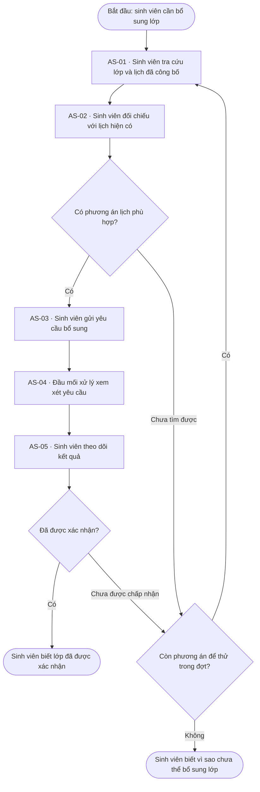
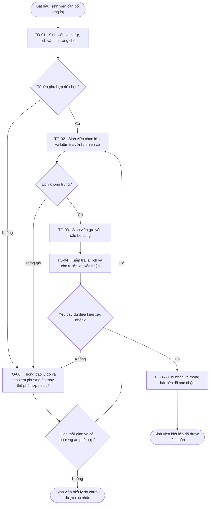

# Lab 02 — Thực hành 1: Mô hình hóa nghiệp vụ đăng ký bổ sung

**Trạng thái** Bản phân tích sơ bộ. Tham chiếu mã nguồn E01–E07 và giả định A1–A4 trong Lab 01. [Hướng dẫn Thực hành 1](../docs/Lab02_OOAD.md#nhiệm-vụ-thực-hành-1-business-modeling) · [Báo cáo Lab 01](../lab-01/OOAD_BaoCaoVanDe.md)

## 1. Phạm vi và mục tiêu nghiệp vụ

| Nội dung | Xác định cho ca nghiên cứu |
| --- | --- |
| Đối tượng chính | Sinh viên chính quy K52 đủ điều kiện đăng ký bổ sung tại HUST trong đợt điều chỉnh, giai đoạn 2007–2008. |
| Điểm bắt đầu | Sinh viên có lịch sẵn và bắt đầu tra cứu lớp để bổ sung. |
| Điểm kết thúc | Sinh viên biết lớp đã được xác nhận hoặc biết lý do yêu cầu chưa được chấp nhận. |
| Điều kiện đầu vào | Điều kiện tiên quyết, giới hạn tín chỉ, nghĩa vụ học phí và các điều kiện đăng ký áp dụng. Ca này bắt đầu khi sinh viên đã đủ điều kiện. |
| Bên liên quan | Sinh viên là người thực hiện đăng ký. Phòng Đào tạo là đầu mối kiểm chứng nghiệp vụ. Vai trò tiếp nhận và xử lý từng bước trong đợt lịch sử cần xác minh. |
| Ngoài phạm vi | Đợt đăng ký chính, xử lý công nợ, tổ chức mở thêm lớp và bàn giao danh sách sau khi đợt kết thúc. |

**JTBD (Jobs-to-be-Done)** mô tả việc sinh viên muốn hoàn thành. Khi cần học bổ sung trong đợt điều chỉnh, tôi muốn ghép lớp vào lịch hiện có mà không trùng giờ và được xác nhận vào lớp còn chỗ để biết mình có thể theo học. Hai điều kiện tạo thành một nhu cầu **UN-03**.

**Business Problem (vấn đề nghiệp vụ)** [Assumption] Khi sinh viên biết lớp hết chỗ sau khi đã ghép lịch, họ có thể mất thời gian chọn lại và cán bộ có thể phải rà soát yêu cầu thêm lần nữa. Tần suất, phút xử lý lại và ảnh hưởng đến mốc chốt danh sách **chưa đo được**. [Business Problem và cách kiểm chứng ở Lab 01](../lab-01/OOAD_BaoCaoVanDe.md#6-business-problem)

## 2. AS-IS — Mô hình hiện trạng lịch sử sơ bộ

| Bước | Căn cứ và điểm cần xác minh |
| --- | --- |
| AS-01 | [Evidence] E01 quy định về kế hoạch giảng dạy và công bố thời khóa biểu. [Assumption] Cách sinh viên tra cứu và nguồn họ thực sự sử dụng ở từng đợt. |
| AS-02 | [Assumption] Sinh viên đối chiếu lớp dự kiến với lịch hiện có trước khi gửi yêu cầu. Công cụ và cách thực hiện cần xác minh. |
| AS-03 | [Evidence] E02 quy định quyền đăng ký bổ sung nếu điều kiện cho phép. [Assumption] Kênh gửi, trình tự tiếp nhận và khả năng gửi lại ở từng đợt. |
| AS-04 | [Evidence] E01–E02 quy định giới hạn sĩ số và điều kiện bổ sung. [Assumption] Ai xử lý, kiểm tra ở thời điểm nào và có phải rà lại khi sinh viên đổi lớp hay không. |
| AS-05 | [Evidence] E02 quy định thông báo kết quả qua Phiếu học tập. [Assumption] Thời điểm sinh viên biết kết quả và cách họ biết lý do yêu cầu chưa được chấp nhận. |
| Vòng lặp | [Assumption] Sinh viên còn thời gian và có thể thử lớp khác. Chỉ kết luận **không còn lớp phù hợp** nếu có dữ liệu về lớp thay thế trong thời gian được đổi. Ghi **không xác định** nếu thiếu căn cứ. |

E01–E02 mô tả quy định theo bản bổ sung tháng 7/2008. Cần xác minh văn bản áp dụng trước khi dùng cho một đợt trước bản bổ sung. Sơ đồ ghi lại trình tự cần kiểm chứng theo từng đợt. Nguồn từ 2012 và 2026 hỗ trợ đặt câu hỏi nghiên cứu.

## 3. Bảng Pain Points — Điểm nghẽn cần kiểm chứng

| Mã và bước | Triệu chứng | Nguyên nhân cần xác minh | Tác động và cách đo |
| --- | --- | --- | --- |
| PP-01 · AS-02 | [Assumption] Sinh viên phải thử nhiều phương án lịch. | Lớp dự kiến hoặc lớp thay thế xung đột với lịch đã có. | Đo số lần chọn lại và thời gian ghép lịch. Hiện **chưa đo được**. |
| PP-02 · AS-05 quay lại AS-01 | [Assumption] A1. Sinh viên phải chọn lại sau khi biết lớp đã đầy. | Trạng thái hết chỗ đến muộn, trong khi từng có lớp cùng học phần đủ điều kiện, còn chỗ và không trùng lịch trong thời gian được đổi. | Đo thời điểm biết kết quả, số lượt phải gửi lại và thời gian còn lại để đổi. Hiện **chưa đo được**. |
| PP-03 · AS-04 đến AS-05 | [Assumption] A2. Sinh viên chưa có lớp để đăng ký dù đã biết lớp ban đầu hết chỗ. | Không có phương án đáp ứng đồng thời điều kiện, sức chứa và lịch trong thời gian được đổi. | Đếm yêu cầu chưa được xác nhận vì thiếu phương án phù hợp. Hiện **chưa đo được**. |
| PP-04 · AS-03 đến AS-04 | [Assumption] A3. Cán bộ có thể phải rà soát lại yêu cầu. | Việc đổi lớp phát sinh lượt gửi hoặc kiểm tra lại. | Đếm lượt rà lại và phút xử lý phát sinh. Đối chiếu mốc dự kiến và thực tế trước khi quy kết chậm chốt danh sách. Hiện **chưa đo được**. |

## 4. TO-BE — Quy trình đề xuất

| Thay đổi | Điểm nghẽn liên quan | Lý do nghiệp vụ và trách nhiệm đề xuất |
| --- | --- | --- |
| TO-01, TO-02 | PP-01, PP-02 | Hệ thống cung cấp lịch và tình trạng chỗ để sinh viên kiểm tra sớm. Sinh viên chọn phương án phù hợp với lịch của mình. |
| TO-03, TO-04 | PP-02, PP-04 | Sinh viên gửi lớp đã chọn. Hệ thống kiểm tra lại lịch và chỗ tại thời điểm xác nhận, vì thông tin khi chọn có thể đã thay đổi. |
| TO-05, TO-06 | PP-02, PP-03, PP-04 | Hệ thống phân biệt lớp đã xác nhận với yêu cầu chưa được chấp nhận. Nếu còn lớp hợp lệ, sinh viên có thể kiểm tra và chọn lại. Nếu hết phương án hoặc hết hạn, sinh viên biết lý do dừng. Với PP-03, cải tiến giúp làm rõ kết quả khi thiếu lớp phù hợp. Việc tăng sức chứa thuộc quy trình mở lớp. |

**Kiểm tra trước khi chuyển sang Thực hành 2.** Luồng thành công cần có lịch không trùng và xác nhận chỗ. Nếu lớp ban đầu hết chỗ nhưng có lớp thay thế phù hợp, kiểm tra lại từ bước TO-02. Nếu không có lớp phù hợp, kết thúc ở trạng thái chưa được xác nhận với lý do rõ ràng. Dùng các mã PP-01 đến PP-04 và bước TO-BE tương ứng làm căn cứ viết Business Requirements (BR, kết quả nghiệp vụ cần đạt).
