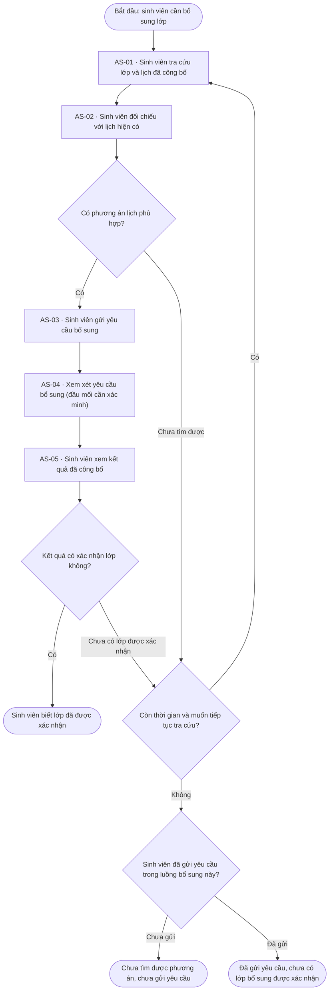
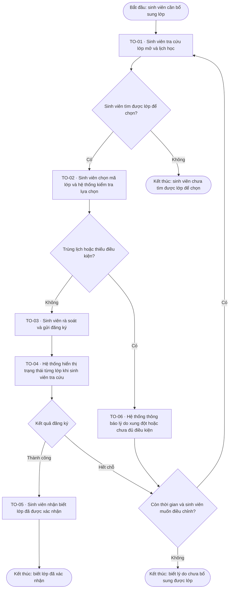

# Lab 02 — Thực hành 1: Mô hình hóa nghiệp vụ đăng ký bổ sung

**Trạng thái** Bản phân tích sơ bộ. Tham chiếu mã nguồn E01–E07 và giả định A1–A4 trong Lab 01. [Hướng dẫn Thực hành 1](../docs/Lab02_OOAD.md#nhiệm-vụ-thực-hành-1-business-modeling) · [Báo cáo Lab 01](../lab-01/OOAD_BaoCaoVanDe.md)

## 1. Phạm vi và mục tiêu nghiệp vụ

| Nội dung | Xác định cho ca nghiên cứu |
| --- | --- |
| Đối tượng chính | Sinh viên chính quy K52 đủ điều kiện đăng ký bổ sung tại HUST trong đợt điều chỉnh, giai đoạn 2007–2008. |
| Điểm bắt đầu | Sinh viên có lịch sẵn và bắt đầu tra cứu lớp để bổ sung. |
| Điểm kết thúc | Sinh viên biết lớp đã được xác nhận hoặc dừng khi chưa bổ sung được lớp. Nếu đã gửi yêu cầu, sinh viên theo dõi kết quả. Việc biết lý do cụ thể phụ thuộc vào thông tin được cung cấp. |
| Điều kiện đầu vào | Sinh viên đã có quyền tham gia đợt điều chỉnh, bao gồm tình trạng nghĩa vụ học phí theo quy định áp dụng. Điều kiện tiên quyết và giới hạn tín chỉ là quy tắc đầu vào để kiểm tra lựa chọn cụ thể ở TO-02. |
| Bên liên quan | Sinh viên là người thực hiện đăng ký. Phòng Đào tạo là đầu mối kiểm chứng nghiệp vụ. Vai trò tiếp nhận và xử lý từng bước trong đợt lịch sử cần xác minh. |
| Ngoài phạm vi | Đợt đăng ký chính, xử lý công nợ, tổ chức mở thêm lớp và bàn giao danh sách sau khi đợt kết thúc. |

**JTBD (Jobs-to-be-Done)** mô tả việc sinh viên muốn hoàn thành. Khi cần học bổ sung trong đợt điều chỉnh, tôi muốn ghép lớp vào lịch hiện có mà không trùng giờ và được xác nhận vào lớp còn chỗ để biết mình có thể theo học. Hai điều kiện tạo thành một nhu cầu **UN-03**.

**Business Problem (vấn đề nghiệp vụ)** [Assumption] Khi sinh viên biết lớp hết chỗ sau khi đã ghép lịch, họ có thể mất thời gian chọn lại và cán bộ có thể phải rà soát yêu cầu thêm lần nữa. Tần suất, phút xử lý lại và ảnh hưởng đến mốc chốt danh sách **chưa đo được**. [Business Problem và cách kiểm chứng ở Lab 01](../lab-01/OOAD_BaoCaoVanDe.md#6-business-problem)

## 2. AS-IS — Mô hình hiện trạng lịch sử sơ bộ

| Bước | Căn cứ và điểm cần xác minh |
| --- | --- |
| AS-01 | [Evidence] E01 quy định về kế hoạch giảng dạy và công bố thời khóa biểu. [Assumption] Cách sinh viên tra cứu và nguồn họ thực sự sử dụng ở từng đợt. |
| AS-02 | [Assumption] Sinh viên đối chiếu lớp dự kiến với lịch hiện có trước khi gửi yêu cầu. Công cụ và cách thực hiện cần xác minh. |
| AS-03 | [Evidence] E02 quy định quyền đăng ký bổ sung nếu điều kiện cho phép. [Assumption] Kênh gửi, trình tự tiếp nhận và khả năng gửi lại ở từng đợt. |
| AS-04 | [Evidence] E01–E02 quy định giới hạn sĩ số và điều kiện bổ sung. [Assumption] Ai xử lý, kiểm tra ở thời điểm nào và có phải rà lại khi sinh viên đổi lớp hay không. |
| AS-05 | [Evidence] E02 quy định thông báo kết quả qua Phiếu học tập. [Assumption] Thời điểm sinh viên biết kết quả và việc họ có được thông báo lý do cụ thể khi chưa có lớp được xác nhận. |
| Vòng lặp | [Assumption] Sinh viên còn thời gian và có thể thử lớp khác. Chỉ kết luận **không còn lớp phù hợp** nếu có dữ liệu về lớp thay thế trong thời gian được đổi. Ghi **không xác định** nếu thiếu căn cứ. |

E01–E02 mô tả quy định theo bản bổ sung tháng 7/2008. Cần xác minh văn bản áp dụng trước khi dùng cho một đợt trước bản bổ sung. Sơ đồ ghi lại trình tự cần kiểm chứng theo từng đợt. Nguồn từ 2012 và 2026 hỗ trợ đặt câu hỏi nghiên cứu.

## 3. Bảng Pain Points — Điểm nghẽn cần kiểm chứng

| Mã và bước | Triệu chứng | Nguyên nhân cần xác minh | Tác động và cách đo |
| --- | --- | --- | --- |
| PP-01 · AS-02 | [Assumption] Sinh viên phải thử nhiều phương án lịch. | Lớp dự kiến hoặc lớp thay thế xung đột với lịch đã có. | Đo số lần chọn lại và thời gian ghép lịch. Hiện **chưa đo được**. |
| PP-02 · AS-05 quay lại AS-01 | [Assumption] A1. Sinh viên phải chọn lại sau khi biết lớp đã đầy. | Trạng thái hết chỗ đến muộn, trong khi từng có lớp cùng học phần đủ điều kiện, còn chỗ và không trùng lịch trong thời gian được đổi. | Đo thời điểm biết kết quả, số lượt phải gửi lại và thời gian còn lại để đổi. Hiện **chưa đo được**. |
| PP-03 · AS-04 đến AS-05 | [Assumption] A2. Sinh viên chưa có lớp để đăng ký dù đã biết lớp ban đầu hết chỗ. | Không có phương án đáp ứng đồng thời điều kiện, sức chứa và lịch trong thời gian được đổi. | Đếm yêu cầu chưa được xác nhận vì thiếu phương án phù hợp. Hiện **chưa đo được**. |
| PP-04 · AS-03 đến AS-04 | [Assumption] A3. Cán bộ có thể phải rà soát lại yêu cầu. | Việc đổi lớp phát sinh lượt gửi hoặc kiểm tra lại. | Đếm lượt rà lại và phút xử lý phát sinh. Đối chiếu mốc dự kiến và thực tế trước khi quy kết chậm chốt danh sách. Hiện **chưa đo được**. |

## 4. TO-BE — Quy trình đề xuất theo HUST năm 2026

**Căn cứ tham chiếu [Evidence].** Hướng dẫn đăng ký học tập HUST năm 2026 mô tả việc xem danh sách lớp, chọn mã lớp, nhận thông báo khi trùng lịch hoặc thiếu điều kiện học phần, gửi đăng ký và xem kết quả theo từng lớp. Kế hoạch kỳ 2026.1 yêu cầu sinh viên kiểm tra lại trạng thái sau ít nhất một ngày. Nếu kết quả là **Hết chỗ**, sinh viên chủ động điều chỉnh trong thời gian hệ thống còn mở. Hai nguồn làm căn cứ cho TO-BE, còn AS-IS nghiên cứu giai đoạn 2007–2008. [Hướng dẫn đăng ký học tập HUST 2026, mục II–IV](https://ctt.hust.edu.vn/Upload/Nguy%E1%BB%85n%20Qu%E1%BB%91c%20%C4%90%E1%BA%A1t/files/DTDH_huongdan/HD%20DKHT-2026-V1_20251210.pdf) · [Kế hoạch đăng ký lớp kỳ 2026.1, mục III](https://ctt.hust.edu.vn/DisplayWeb/DisplayKehoach?kehoach=29240)

| Điểm nghẽn | Bước TO-BE | Mức xử lý và trách nhiệm đề xuất |
| --- | --- | --- |
| PP-01 · Trùng lịch | TO-01, TO-02, TO-06 | Hệ thống hiển thị lịch và cảnh báo trùng giờ khi sinh viên chọn lớp, trước khi gửi đăng ký. Sinh viên có thể kiểm tra lựa chọn khác nếu còn thời gian. |
| PP-02 · Biết lớp hết chỗ muộn | TO-03, TO-04, TO-05 và vòng về TO-01 | Sinh viên gửi đăng ký ở TO-03, xem trạng thái từng lớp ở TO-04 và biết đã có chỗ khi kết quả là **Thành công**. Nếu trạng thái là **Hết chỗ**, sinh viên quay lại tra cứu nếu còn thời gian và muốn điều chỉnh. Mức cải thiện về thời gian phát hiện hết chỗ **chưa đo được**. |
| PP-03 · Thiếu lớp phù hợp | TO-04 và vòng về TO-01 | Trạng thái **Hết chỗ** áp dụng cho lớp đã chọn. Sinh viên cần tra cứu các lớp khác để biết mình có tìm được phương án phù hợp hay không. Việc tăng sức chứa thuộc quy trình mở lớp, ngoài phạm vi ca này. |
| PP-04 · Có thể phát sinh lượt rà soát lại | TO-02, TO-06 | Hệ thống kiểm tra lựa chọn và báo lỗi trước khi gửi, qua đó có thể giảm số yêu cầu sai. Việc giảm lượt rà soát của cán bộ là [Assumption]. Mức giảm **chưa đo được**. |

**Kiểm tra trước khi chuyển sang Thực hành 2.** Chạy qua các tình huống chưa tìm được lớp để gửi, trùng lịch hoặc thiếu điều kiện trước khi gửi, và lớp trả về **Thành công** hoặc **Hết chỗ** sau khi gửi. Chỉ nhánh **Thành công** dẫn đến xác nhận lớp. Sau nhánh **Hết chỗ**, kiểm tra cả trường hợp sinh viên tìm được lớp thay thế và trường hợp dừng khi chưa tìm được lớp phù hợp. Dùng các mã PP-01 đến PP-04 và bước TO-BE tương ứng làm căn cứ viết Business Requirements (BR, kết quả nghiệp vụ cần đạt).
